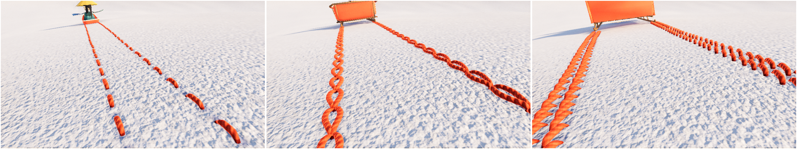
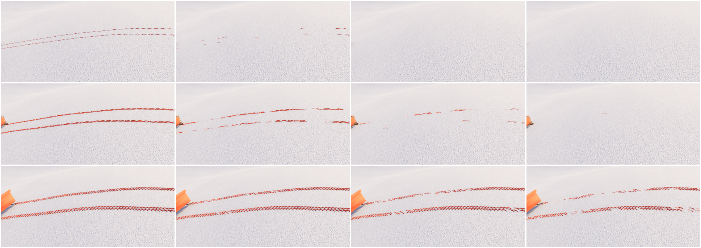
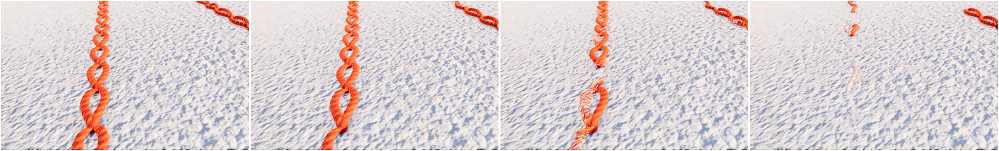
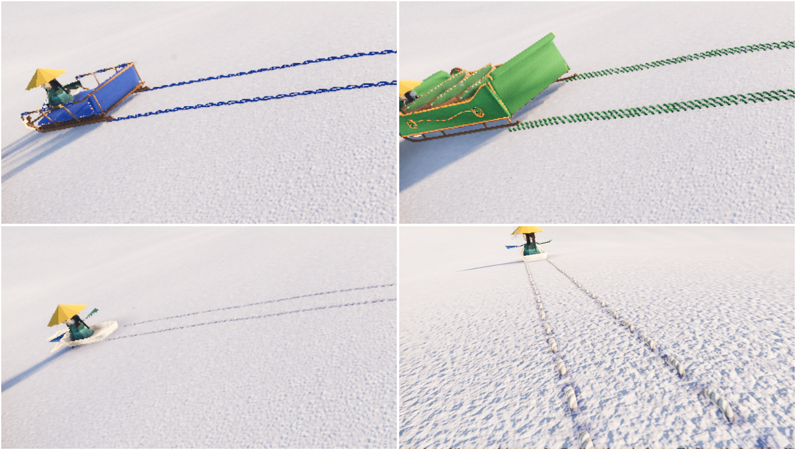

# Lodge アートコンセプト

2026-10-22 の相談で決め、10-26 の原型で確かめた内容。絵柄・色・光・動き・音の決まりをここに集める。実装の部品は `game/look.gd`。

## 一言で

**手芸の世界。** 雪は毛糸、木や上着はフェルト、人は紙でできている。流行りのトゥーン調（PEAK など）からはずらす。

## 世界の素材

| もの | 素材 | 見え方 |
|---|---|---|
| 雪・丘 | 毛糸（メリヤス編み） | 編み目の V が並ぶ。繊維の凹凸で光がざらつく。輪郭が毛羽立って光る |
| 木 | フェルトの円錐 | 2 段重ね。てっぺんに雪の帽子。幹は木 |
| 雲 | 羊毛 | 低い所ほど大きく、縁はふわっと。ゆっくり流れる |
| 太陽 | フェルトを丸く切った円 | 縁が少し毛羽立ち、まわりに淡い光がにじむ |
| 遠景の山なみ | フェルトの楕円 | 地平線に、空より少し濃い青白で並ぶ |
| ソリ | フェルトの台に木の滑り木 | メインカラー（既定は赤）。背もたれは後ろ |
| 人の体 | 紙 | 生成り。面を平らにして、折り紙のような角 |
| 人の上着・帽子・手袋 | フェルト | 紙の体を雪から守る。濡れるとまずい、という設定 |
| 紐 | 麻ひも | ソリの前に垂れる |

- 紙の人は、雪に濡れると困る。だからフェルトの上着を着て、ロッジのストーブで乾かす。この設定はそのまま遊びになる（上着を脱ぐと紙の体が少し見える、など）
- 外の素材（モデル・画像・音）は使わない。質感はコードで作る（`look.gd`）
- **裁縫の素材で世界を統一する。** これから足すもの（ロッジ、店、機械、食べ物）も、布・糸・綿・型紙・ミシンなど裁縫の道具と材料から形を借りる
  - アイデア（2026-10-26）：ソリと服は大きなミシンの形の機械で作る。調理機器はアイロン台・スチーマー・乾燥機など、布を熱で扱う道具の形。詳しくは [ゲームの構想](game-concept.md) のロッジの節

## 質感の作り方（2026-10-27 の調査から）

手芸素材の質感を Godot でどう出すかの調査（工作素材を前提にしたもの）から、裁縫の世界に合う所だけを取った。

- **毛羽はシェルテクスチャリングで立てる。** メッシュを法線の向きに薄く何層も重ね、毛の長さと間隔で毛羽にする。コードだけで作れる。使うなら vamack の「Fur/Grass with Shell Texturing」（CC0、godotshaders.com）。広い面は MultiMesh 版。雪の輪郭、近くのフェルト、人の上着に
- **縁の光は `rim`。** Godot 4 の StandardMaterial3D にあり、`look.gd` のフェルトですでに使っている
- **画面全体に紙の粒子を薄く乗せる。** 一枚のポストプロセスで、素材ごとに作るより統一感が出る
- **雪の硬さで見た目と音を変える。** 素材は裁縫のものに置き換える
  - 踏み固めた雪：目の詰んだメリヤス編み（いまのもの）
  - 柔らかい積雪：ふっくらした綿。輪郭がにじむ
  - パウダー：ちぎった綿か、小さな毛玉。滑ると散り、上着に糸くずや毛玉が付いて残る
- **ガラスは透明フィルムに白糸の枠。** 枠を縫い目で表す。ロッジ 1 階の食堂のガラスに
- **煙突の煙は綿。** 雲の羊毛と並ぶ
- **使わないもの**
  - 工作の素材（発泡スチロール、セロファン、プラ板、鉄道模型のスポンジの木、松ぼっくり、色画用紙の切り絵）。裁縫の素材で統一するため
  - AGPL のシェーダー（godot-hand-drawn）。ゲームに組み込むと、ゲームのコードまで公開を求められる
  - ライセンスの書かれていない道具（Felt Maker Lite、Weavr、GN Fuzz）
- **まだ決めていない**：画像のテクスチャ（ambientCG などの CC0）や、Blender で作った質感の焼き込みを使うか。使うなら上の「外の素材は使わない」を緩め、音と同じく出どころを台帳に残す

## ロッジ

2026-10-27 に代表の図面から組んだ。作り方と寸法は [lodge/](../lodge/README.md) と [lodge/design.md](../lodge/design.md)。

- **大きさ**: 実寸では丘とソリの中で小さく見えたので、間取りを 2 倍（43.6 × 25.5 m）、高さを 1.5 倍にした。戸・階段・椅子は人の大きさのまま
- **形**: 丸太組みの 2 階建て。藍のフェルトの片流れ屋根は丘の側が高く、雪は北の裏へ落ちる。1 階の南はガラスの食堂で、2 階は南へ 2 間さげてテラスにする。西の端に外階段と、屋根だけの貸出
- **素材**: 丸太は巻いたフェルトのロールで、木口に渦が見える。屋根の雪は毛糸の編み地、基壇と煙突はフェルトの小石、床は木の板、2 階は畳とパッチワークのこたつ布団、灯りは紙
- **光**: 外は雪の影の青。中は電球色より少し赤みの灯りと炉の火。夕方はガラスの食堂が橙に光り、丘から見て「あそこへ帰る」目印になる
- **機械**: 料理や、服・スキー・ソリを作る機械はまだ置かない。床を空け、glb に置き場の目印（`slot_*`）だけ入れた

## 色

- **雪の影は青、窓の明かりは橙。** 寒さと温かさの対比が、そのまま「登る → ロッジ」の流れになる（新版画の色の考え方。川瀬巴水・吉田博の雪景色）
- 差し色は人の上着と帽子。赤（あなた）、藍、山吹（仲間）
- 空は青白〜薄い藍、地平線は白。太陽は温かい黄
- ロッジの中は、外と色を変える。少し褪せた温かい色（木の内装、蛍光灯、色あせた案内板）。扉を開けた瞬間に絵柄ごと切り替わる

## 光と陰影

- 太陽は少し低めの午後の光。影の縁はやわらかい（angular distance 2°）
- 環境光は落とし気味（0.75）にして、丘の形が陰影で読めるようにする。くぼみに SSAO
- ロッジに近づくと、画面の端の冷えた色がゆっくり温かくなる

## 動き（ストップモーションの世界観）

- **コマ落とし（12 コマ／秒）は人の姿勢だけ。** 画面全体・カメラ・降る雪はなめらか。全部がガクガクすると見栄えが悪い
- 人を「居場所」と「姿勢」に分ける（2026-10-27）
  - **居場所**（体全体の位置と向き）：毎フレームなめらか。ソリで滑るときの移動はまっすぐ流れ、歩くときも体は止まらず進む
  - **姿勢**（手足の振り、体の揺れ、手袋の形）：12 コマ／秒で更新し、コマの間は止める。歩く・押す・乗るの動きがストップモーションに見える
- 人の形はわずかにふるえる（クレイアニメの揺れ）。コマが変わるたびに少しだけ形を崩す
- 全員が同じ時計でコマを刻む。映画のように、画面の中の人がそろって 1 コマずつ動く
- 見た目だけの処理。通信では送らず、それぞれの画面で作る
- ソリをつかんでいる手は、ソリに対しての姿勢をコマで更新する。ソリがなめらかに動いても、手がソリから離れて見えない
- 体はなめらかに進むので、コマの間に足と地面が少しずれる。歩幅を進む速さに合わせて目立たなくする。少しのずれは手作りらしさとして許す
- 実装（2026-10-27）: `game/doll.gd`。人形の骨の向きを 12 コマで決め、コマの間は止める。ソリや紐をつかむ手は、つかんだ物に対しての所をコマで決め、毎フレーム腕を伸ばし直す。一人称の手袋も 12 コマで置き直し、つかんでいる間はソリに対しての位置で保つ。白い息は口から、コマに合わせて吐く（押していると間隔が短い）
- **白い息（2026-10-30 に作り直し）**: 綿のかたまりがぽこぽこ別々に浮くのではなく、口もとから一続きに流れて広がる煙。小さく柔らかい粒を等間隔で次々に出して重ね、出口では細く濃く、離れるほど太く薄くほどける。体が動くと出た所に煙が残るので、ゆるく曲がる帯になる。粒の縁は毛羽立ち、ほつれた糸のような細い筋が出る（手芸の綿）。色はほぼ真っ白で、少し透けて後ろの景色がうっすら見える。光を受けない塗りなので、日なた・日かげ・夕方・ロッジの中で灰色や青に沈まない（画面の明るさの圧縮のあとでも白く出るよう、1 より明るく塗る）。出口は 3 つ: ふだんの息（0.6 秒ほど細く）、声の息（大きく勢いよく）、B の長い息とおーい（吐いているあいだ出し続ける）。確かめは `game/tools/breath_shots.gd`
- **気温と白い息（2026-10-30）**: 場所ごとの気温は `game/temperature.gd`（自動で読み込む。`Temperature.at(位置)` で °C）。外は寒く、高い所ほど寒い（丘の頂上で 4.5 °C 下がる。本物より強め）。夜は昼より寒い（14 時がいちばん暖かく −2 °C、明け方 4 時がいちばん寒く −11 °C、ふもとで）。ロッジの中は 18 °C、暖炉のそばはさらに 8 °C まで暖かい、風除室はそのあいだ。中か外かは音の屋内の判定と同じ。天気の寒さを足す口（`weather_chill`）を用意した（吹雪・標高の高い山はこれから）
  - 白い息は気温で変わる: 8 °C より暖かいと出ない。そこから寒いほど、煙が大きく、濃く、一回に長く吐く（−4 °C でふつう、とても寒いと 1.6 倍）。人形ごとに口もとの気温を 0.25 秒おきに引き、2 秒ほどの時定数でなじむので、ロッジを出入りしても急に切り替わらない（出て 4 秒でほぼ外の寒さに、入って 6 秒ほどで消える）。ふだんの息・声の息・B の長い息・おーいのすべてに効く
  - 暖かい息なので、口から出た煙は前へ少し伸びてから、ゆっくり上へ昇りながら広がって消える。体が動くと、出た所に残って帯になる
  - 確かめ: `game/tools/temperature_check.gd`（場所と時刻ごとの気温の表）、`game/tools/breath_shots.gd --place=foot|summit|inside|fire`・`--move=out|in`（出入り）

## 滑りあと（ステッチ、2026-10-29）

ソリが滑ると、雪にソリの縫い目が残る（PR #6 で作った）。跡は時間がたつと消えていく。

代表の言葉:「ステッチは雪に残る跡なわけだから、雪がその上に積もって消えることの表現のために、古いものからきれいに消えていくのでなく、まばらに消えていってほしい。重たいものの跡であればあるほど消えづらくなってほしい。あとソリのメインカラーを設定（いずれカスタマイズできるように）して、そのメインカラーと同じステッチになるようにしてほしい」。そのあと「滑りあとはステッチの糸がほつれるように消して行くってできますかね」「ソリの重さに依ってステッチの種類を変えてほしい」

- **縫い目の種類はソリの重さで決まる。** 重いソリほど太く丈夫な縫い目（2026-10-27 に代表が選んだ組み合わせ。[props/stitches.md](../props/stitches.md)）
  - 米袋・小: **なみ縫い**（中心線に沿った軽い破線）
  - 中: **くさり縫い**（しずく形の輪が、前の輪の中から次の輪が出るようにつながる）
  - 大: **サドルステッチ**（太い糸の斜めの目が 2 列。いちばん丈夫）
  - はじめの滑りあとの**ジグザグ**も残してある。凝った柄（千鳥がけ・花の蔓など）は、報酬や買い物で手に入れる差し替えとして、ここに足していく（`game/sled.gd` の `STITCHES`）
- **まばらに消える。** 古い順に一列で消すのでなく、目ごとにばらばらの時刻で消える。数 m のまとまりで早く消える所と長く残る所ができ、その中でも目ひとつずつずれる。古い所ほど平均では早く消える
- **一目ずつ、糸がほつれて消える**（既定）。ぱっと消さない。撚り合わせた 2 本がゆるんで離れ、糸は張りをなくして少し波打つ。目のまんなかから繊維が切れはじめ、切れ口の繊維は色が抜けて毛羽立ち、両端の針穴へ向かって細い繊維になってなくなる。糸の下の影と針穴のくぼみも、糸と一緒に消える
  - もう一つの消え方として **雪に埋もれる** も選べる（`TRAIL_FADE = "bury"`）。針穴が先に雪で埋まり、糸は上を向いた面から雪の粉をかぶって白くなり、細りながら沈む
- **重いソリの跡ほど長く残る。** 重さは「ソリ ＋ 乗っている人」。米袋に一人なら 30 秒ほど、大きなソリに 8 人なら 2 分半ほど（値と表は [操作と物理の決まり](controls-and-physics.md) の「滑りあとが消える」）
- **糸の色はソリのメインカラー。** ソリの主なフェルトと同じ色の糸で縫う（下）
- 実装: `game/sled.gd`（縫い目の組み方と、いつ消え始めるか）、`game/look.gd` の `THREAD_SHADER`・`STITCH_HOLE_SHADER`（糸の形と消える見た目）

左から小（なみ縫い）・中（くさり縫い）・大（サドルステッチ）。

上から小（二人）・中（三人）・大（八人）、左から止めて 0・60・90・120 秒。

中の跡を近くから。左から止めて 0・50・65 秒（ほつれる）、右端は消え方を「雪に埋もれる」にしたときの 65 秒。

### ソリのメインカラー

- ソリはそれぞれ「メインの色」を一つ持つ。既定は `game/sled.gd` の `KINDS` の `color`（いまの主なフェルトの赤。米袋は袋に刷った赤）。のちのカスタマイズはこの色を変える
- 変わるのは、**ソリの主なフェルト**（座布団・胴・握り。暗い握りは暗いメインカラーに）と、**滑りあとの糸**。金の飾り・緑の座布団・生成りの縁・クラフト紙・木はそのまま
- glb の色は焼いてあるので、焼いた色の画像の「主な色に近い色相で鮮やかな所」だけを、明暗を保ったまま差し替える（`game/props.gd` の `recolor`）。凝った柄や、二色目を変えるカスタマイズは、glb の素材を分けてから
- **雪に近い色（白・ごく淡い色）**の糸は、撚りの谷と横から見える縁を暗くし、糸の下の影を濃く広くして縁取る。雪からの色の離れぐあいで自動で強まる（`look.gd` の `stitch_edge`）
- 色を変えると、もう雪に残っている跡の糸も同じ色に変わる（色は跡全体で一つ）

左上から中・藍（`2F4E9A`）、大・緑（`3F7A4A`）、小・白（`F6F4EE`）、白の糸を近くから。

## 人（2026-10-27）

代表の参考（折り紙・千代紙の人形・新聞紙と麻布の人形、Pinterest のボード）から 3 体を作り、**3 体とも採用**した。軸は同じ「肌は紙、身につけるのは布や紙。手でさわる手芸の素材」。作り方は `person/`（Blender の台本）、ゲームでは `game/doll.gd`。

| 人形 | 体 | 身につけるもの | 顔 |
|---|---|---|---|
| ① 笠と千代紙（kasa） | 3 頭身。平らな面の紙の顔 | 黄色い紙の笠（放射に山と谷を折る）、黒い紙の長い髪、千代紙の着物（青海波・亀甲・桜を重ねて折る）、赤い七宝の帯 | 閉じた目の弧と頬 |
| ② 多面体の折り紙（origami） | 4 頭身。大きな平らな面と稜線で組んだ紙の体 | 白い頭巾（おでこまで深く）、茶色の紙の髪、白い服とひだの裾、青いエプロン | 鼻すじの山折りと、アーモンド形の目 |
| ③ 新聞紙と麻布（news） | 2.5 頭身でいちばん小さい（目の高さが ② のお尻あたり）。北欧の新聞紙を貼った張り子 | 毛羽立った緑の麻布のとんがり頭巾と上着、革のたすき | 大きな丸い黒いボタンの目 |

- **作り方の決まり**: 部品ごとに要の点を決めて包む凸の多面体にする（大きな平面と鋭い稜線）。紙の板は表が柄で裏と縁が白。面ごとに明るさを少し変える。柄・新聞の地はコードで描く（`person/newsprint.py` は北欧の言葉に見える作り語で、意味のある文を書かない）。色と凹凸は画像に焼いて glb に入れる
- **見え方は光と質感が込み**: 灰色の粘土の表示では可愛く見えない。確かめるときは光と質感を入れて見る（Blender なら「Rendered」）
- **ゲームでの大きさ**: ① 1.15 倍、② 1.1 倍、③ 1.05 倍（③ の目が ② のお尻の高さ）
- **付属品は少なく**: 最初から多くを持たせると、服や帽子を集める楽しみが薄れる。① の笠は、つばの向きで目線が読めるので残す。笠のような身につけるものは、集めて着替える側に回す
- **共在感覚のために入れるもの**（調べの要約）: 目線（頭の向きと笠のつば）、手を振る・腕で指す（手を自由に動かせる型）、言葉にならない声（白い息を大きく）、白い息。口は描かない。名前は出さない
- **指さしと顔の向き**（2026-10-27。相互行為でいちばん大事な手がかりの一つ。2026-10-31 に、視点についていく形に変えた）: 右クリック（か身ぶりの輪・2 キー）で指さしを入れると、選んだ手の腕をまっすぐ伸ばして指す（指は分けず腕で）。入れているあいだ、腕はいま見ている先（画面のまんなかが当たる所）を追い、見回すと指す先も一緒に動く（代表「指差し時に向きを固定していますが、視点に追従するほうがわかりやすいので、向き固定はやめましょう」）。追い方はなめらかで（向きを回し、長さを近づける。腕の形は人形の 12 コマで刻む）、手前の物と遠くの雪のあいだで当たる所が跳んでも腕は飛ばない。前の作り（指した所に残す・ソリや人に吸い付いて相手が動いても指し続ける）はやめた。もう一度押すと腕を下ろす。ソリをつかんでいても、その手を離して指せる。一人称でも手袋が画面のまんなかへ伸びる。指しているあいだは、顔もそこを見る。顔は首と頭で大きく回り（左右 75°、上 43°・下 52°）、届かない分は胸も少し回す。仲間は、あなたがいま指している所を一緒に見る（共同注意。指す先が動けば、目も追う）。指していないときは、近くのあなたの顔を見る
  - **床に平行に指す**（2026-10-31 代表「指差しは床に平行な方が見やすいのかもしれません」）: 腕は見ている向きの左右だけを追い、見上げる・見下ろすは腕に移さない（指す先は頭の高さ、4 m より遠く）。ほかの人・三人称・右下の小窓から見ると、いつも水平に伸びた腕で、どちらを指しているかが読みやすい。一人称の手袋だけは、画面の上下のまんなかに置く（体の腕に合わせると、見下ろすと袖が画面をふさぎ、見上げると手が画面の外へ出るため）。起動引数 `--point-tilt` で前の傾く作りに戻して見比べられる。絵: 真横から、見下ろす・前・見上げる（上が傾く作り、下が床に平行）[point-level-side.jpg](hud/point-level-side.jpg)、一人称 [point-level-fp.jpg](hud/point-level-fp.jpg)
  - **通信**: 指す先は動き続けるので、毎コマは送らない。配り役（`emotes.gd`）へ「指している向き（頭から）と長さ」の出来事 `point` を、向きが 4° 以上変わったときだけ、多くても 1 秒に 6 回送る。下ろすときは向きなしで送る。ほかの人（いまは仲間）は、配られた向きから指す先を出す（`point_of`）。ずれは 4° まで
- **使い込み（案）**: たくさん遊ぶと、水のシミ・転ぶ・ソリに轢かれるで紙の体に折りじわが増える。乾かすとシミは薄くなるが、折りじわは残る、など。まだ入れていない
- **まだ決めていない**: 遊ぶ人がどの人形を選ぶか（いまは あなた = ①、仲間 = ② と ③）、色違い、③ の麻布の毛羽をゲームで描くか（シェルテクスチャリング）。輪（Tab）は挨拶のボタンではなく手と声の材料を選ぶもの、と代表が決めた（2026-10-28〜29、下の「手と身ぶり」）。手を振る（Q）は、高い片手のひらと役が重なるので外した

## 手と身ぶり（エモート、2026-10-28〜29）

代表が挙げたもの（ハイタッチ、深呼吸、雪玉づくり・投げる・当たる、滑りながらの万歳、声）から始め、代表の声で「挨拶のボタン」ではなく「手と声の材料」を選ぶ作りにした（2026-10-29 の仕様）。実装は `game/emotes.gd`（配り役）、`game/doll.gd`（姿勢）、`game/palm.gd`（手形のアップリケと紙吹雪）、`game/snowball.gd`、`game/emote_ring.gd`（輪）。絵は `design/emotes/`。

- **身ぶりの輪（Tab）**: 押しているあいだ画面のまんなかに輪が出る。マウスを動かした向きで選び、離すと出す。7 つ: 上 = 高い手のひら、右回りに おーーーい（遠くへ呼ぶ）・ウン・ンーン・低い手のひら・首をかしげてウン？・指さし。文字はなく、紙の丸に紙の手形のアップリケと墨の線の絵。まんなかに、いま使う手（右・左・両手）を小さな手袋で描く。同じものを 1〜7 キーでもすぐ出せる（1 高い手のひら、2 低い手のひら、3 指さし、4 ウン、5 ンーン、6 ウン？、7 おーーーい）
- **手を選ぶ**: Q で片手 ⇄ 両手、X で片手の右 ⇄ 左。手のひらと指さしは、いま選んでいる手で出す。手のひらは同じものをもう一度選ぶと下ろす。ソリをつかむ・紐を持つと下ろす
- **挨拶のボタンは作らない**（柱 1 の「やらないこと」のまま）。手は材料だけで、腕は見ている向きへ上がる。意味は遊ぶ人が作る
  - **高い手のひら**: 片手なら、遠くの人に場所を示す・呼ぶ。両手なら、万歳・楽しい。ソリで滑りながら高い両手のひらにすると、ひとりでに「ワ〜」と声が出る
  - **低い手のひら**: 手のひらを下へ向けて、腰の前。おさえて、ストップ、待って
  - **指さし**: 選んだ手（両手なら両腕で「あっち！」）を伸ばし、手の先に指さしの手形（親指が上）。右クリックでも出せる
- **手と手が出会ったとき**（届く所 1.3 m で向き合う）
  - 高い手のひら同士: ハイタッチ。片手でも両手でも合う。片手と両手なら、片手の側の手と、その向かいの相手の手が合う。両手どうしなら両手で。3 コマ引いて叩きつけ、手が合ったコマに千代紙の紙吹雪（少なめ。両手どうしでも一度）と紙の星と綿の粉が散る
  - 低い手のひら同士: 握手（もう少し近づいて 1.0 m）。片手どうしはふつうの握手、両手どうしは二人の手が互い違いに重なる両手の握手、片手と両手なら、片手を両手で包む握手。手のひらはみな平行で、垂直から少し斜めに傾け（面が見えるように）、親指が上。手を差し出し、重ねる所でぴったり合わせ、二人一緒に 3 回上下に振って離す。重ねる所と傾きはホストが決めて二人に配る
  - 高い手のひらで、片方だけが向かって寄ると、向かった人が空振りして首をかしげる
  - 合ったら二人とも手を下ろす（掲げ直せば、またできる）
- **声**: ウン（うなずく）、ンーン（首を横に振り、顔の前で手を振る）、ウン？（後半が上がる。首をかしげ、肩をすくめて手を少し外へ。一人称では視点も少し傾く）。おーーーい（遠くの人を呼ぶ。「お」を長く伸ばし、最後の「い」で上がって届く。小さく息を吸ってから胸を張って顔を上げ、空いた手を口の横に当ててメガホンに。高い片手のひらで場所を示しながら呼べる。大きな白い息が長く出て、声は遠く 120 m まで届く）。「ワ〜」は滑りながら高い両手のひらにしたときだけ。どれも大きな白い息が出る。雪玉が当たると、息をのんで「わっ」とびっくりした声。声の大きさは人形ごとに決まっている（あなたはふつう、背の高い折り紙は低く、小さな新聞紙は高く）
- **雪玉の当たり**: 人への当たりは、人形ごとに測った体の形（高さを 12 段に切った太さ。笠のつば・着物の裾・頭巾の形が入る）で見る。しゃがむ・座ると、頭の下がった分だけ縮める。物理のカプセル（どの人形も同じ大きさ）には当たらない
- **雪玉**: 左 Ctrl を押しているあいだしゃがむ。しゃがんで雪面を見て F（インタラクト）で、両手でぽんぽん丸めて右手に持つ。左クリックを押しているあいだためて（振りかぶり）、離して投げる。長くためるほど遠くへ。投げた雪玉は物として飛び、人（仲間も）・ソリ・地面・ロッジに当たると崩れて綿の粉が散り、当たった所に綿の雪が少し残って 8 秒で消える（ソリに当たればソリと一緒に滑っていく）。軽いのでソリはほとんど動かない。人に当たると、痛みも押し戻しもなく、のけぞって両手がぱっと上がり、首をぶるぶる振って雪を払う
  - **持てる数（2026-10-30）**: 5 つまで。しゃがんで F で丸めるたびに 1 つ増え、投げると 1 つ減る。数え方:
    - 右手に 1 つ持ち、残りは帯の前の「雪玉入れ」に入る。藍のフェルトの小さな袋が 5 つ並び、1 つの袋に雪玉 1 つが上からのぞく。文字なしで数が分かり、空の袋で、あといくつ持てるかも分かる。ほかの人からも、右下の自分の小窓からも見える。雪玉がなければ袋ごと隠す
    - 一人称では帯が見えないので、袋の雪玉と同じ数の小さな粒を、右手のそばに一列に並べる
    - 投げると、4 コマ（3 分の 1 秒）たってから次の雪玉が袋から右手に出る
    - 持ち物（畳んだソリなど）を手に持っていると、雪玉はぜんぶ袋に入る。左クリックで持ち物をしまって雪玉を出し、振りかぶる。雪玉は持ち物の列には入れない
    - 丸めている途中に雪玉が当たると、その玉は崩れてできない
    - 数は配り役（`emotes.gd` の balls）が数える（あとで雪玉をお金のように使うので、通信ではホストが決める）
    - 将来の案（雪玉で払う・雪合戦）は [ゲームデザイン](game-design.md)
- **吐く息（B）**: 押した瞬間に短く吸って胸をそらし、押しているあいだ真っ白な長い息を吐き続ける（いつもの綿の倍ほど。最長 5 秒）。離すと止まる
- **拍手**: 高い両手のひらを掲げて左クリック。フェルトの手袋で、ぽふぽふ
- **手形と腕**: 先に手形の置き所と向きを決め、腕の先（手首の関節）を手形の手首の真ん中へ伸ばす。腕の角度は手形の場所に合わせる（一人称でも、袖の先が手形の手首に来る）。指さしと握手の手形は親指が上
- **動きの決まり**: どれも 12 コマのコマ撮りで、「ため → 解放」。手形はぽんと出て（少し行きすぎて戻る）、腕は見ている向きへコマで追う。一人称では、自分の手袋・手形・雪玉・白い息が画面に出て、うなずき・首振り・しゃがむ・のけぞりは視点が小さく動く（設定の「視点の揺れ」を切ると控えめ。しゃがむ高さはそのまま）
- **仲間の返し（確かめ用）**: 近くで手のひらを掲げると、ソリを離して前まで来て、同じ高さで掲げる（片手か両手かもまねる）。高ければハイタッチ、低ければ握手。一緒に乗っているときの高い両手のひらには、高い両手のひらと「ワ〜」で返す。声には同じ声、「ウン？」には「ウン」、「おーーーい」には遠くからでもこちらを見て「おーい」か手を振る、拍手には拍手。雪玉が当たると、のけぞって「わっ」、そのあと「ワ〜」と笑う
- **通信に乗せる形**: 身ぶりは「誰が・何を・いつ（姿勢の時計のコマ）」の短い出来事（辞書。中身は数・文字・Vector3 だけ）。掲げた手も「誰が・どの手を・いつ」の出来事で、下ろすまで続く状態としてホストが持つ。いまは配り役がすぐ配る。通信ではホストがコマを付けて配り、ハイタッチ・握手（どの手とどの手が合うか）・空振り・雪玉の当たりはホストだけが決める

## 一人称と、自分の見え方

- 一人称。見えるのは**フェルトの手袋をした両手だけ**
- 外では手袋、ロッジの中では素手。手袋を外す切り替えで「中に入った」感じを出す
- 右上に、頭の上に載せた **360° カメラ**のライブ映像（Insta360 風）。スマホ向けの縦長で、超広角の魚眼で切り出す（下や端へ行くほどぎゅっと縮む）。後ろ向き。この映像の中だけ自分の体が見える
- C で三人称にも切り替えられる

## 音

- **ゲレンデのスピーカーの音楽。** 斜面に立つ何本もの柱のスピーカーから、少しずつずれて同じ曲が届く。雪が高い音を吸い、壁がないので残響がなく、ラッパ型のスピーカーで中の音域だけが残る、あの細い音。近づくと大きく、風で遠くなったり近くなったり
- 日本のゲレンデの個性として売りにする。海外の人には珍しい
- ロッジの扉を閉めると、外の音楽がこもって遠くなり、薪のはぜる音や食器の音に変わる
- **曲はチルい R&B のスロウ**（2026-10-28、代表の声）。参考は SZA「Snooze」で、雰囲気だけを借り、旋律や進行は写さない。澄んだエレキギターやローズの甘い和音、伸びる低いベース、力の抜けたドラム、言葉のない声の重なり。テンポは 70 台。2 曲（D: ギターと 808、E: ローズと声）を、ゲレンデの放送のように交互に流す。柱は麓のずっと外なので、曲はかすかに届く。速くて明るいゲレンデの曲（前の原型）や、雪のパッドとベル・ボサ・エレピとブラシの案は代表が選ばなかった

## 画面の文字と表示

- 言葉の表示は最小限。伝える手段は体の動きと、顔文字のスタンプ数個（🙂 ❓ 👋 ✨ など。文字のチャットはなし）
- ゲームの中の案内も、なるべく言葉を使わない。アイコンや矢印で伝える
- 「手を振る」「挨拶する」といった専用のボタンは用意しない。動きの材料だけを渡し、意味は遊ぶ人が作る

## 見本

- 2026-10-22 に three.js で A（新版画）・B（平成の記憶色）・C（手芸・クレイ）の見本を作り、C に確定。B は却下。A の色の考え方は C に混ぜる
- 見本の HTML は一時フォルダにあって消えた。作り直すなら `prototypes/` に置く
