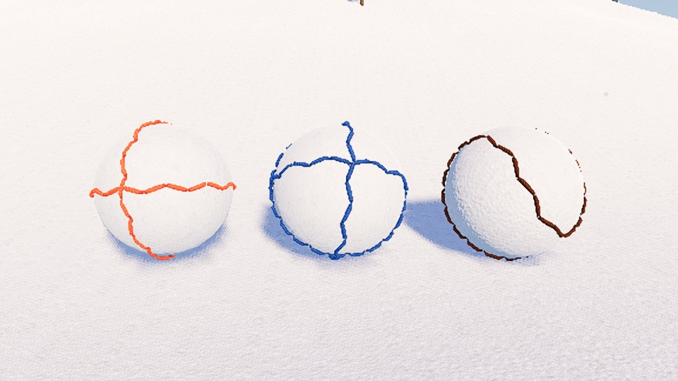
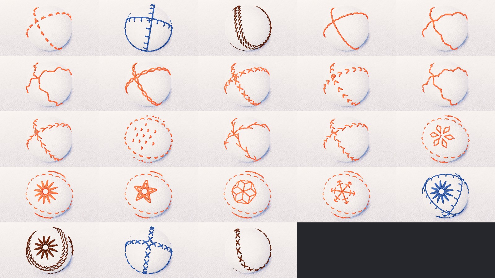
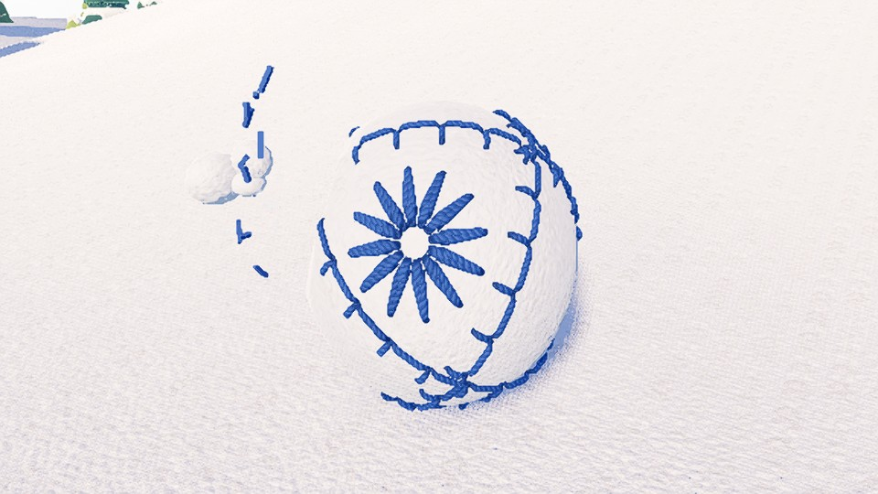
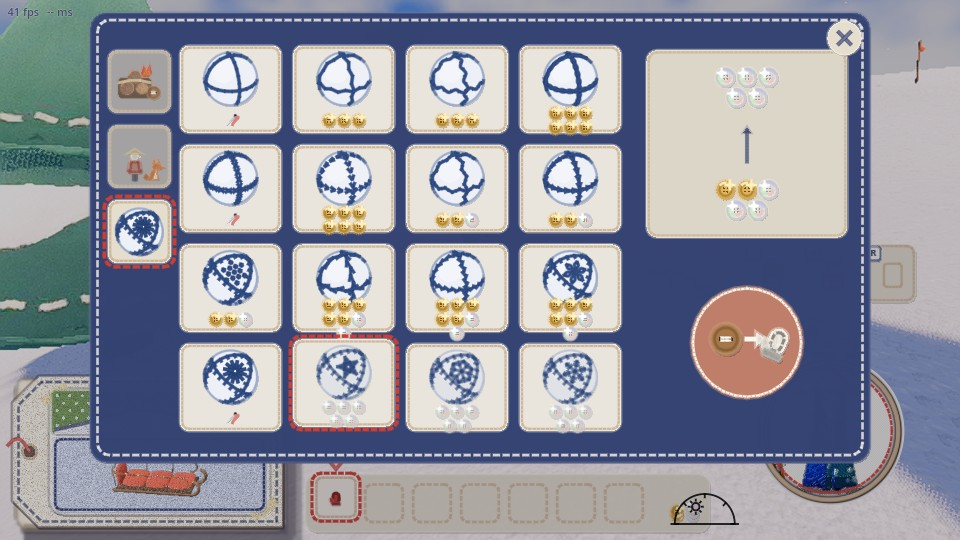
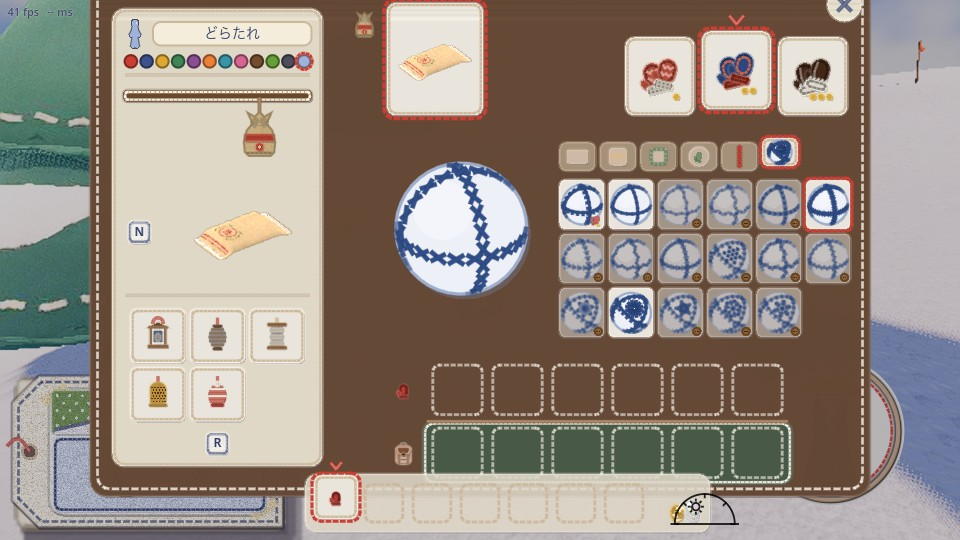

# 大玉の縫い目の柄（2026-11-09）

代表「作られた手袋のグレードによって雪玉のステッチの模様変えてほしい。雪玉のステッチも売って欲しい」。

縫い目があるのは、転がして育てる大玉（`game/big_ball.gd`）だけ。手で丸めて投げる雪玉（`game/snowball.gd`）と袖の玉は半径 7.5 cm の綿の玉で、縫い目はない。手袋で固めるのも大玉だけ（`big_ball.gd` の `pack`）なので、大玉の話として作った。

## 決まり

- **手袋の段で決まるもの**: 縫い合わせの形と糸の色。どの柄にしても、この 2 つは変わらない。一目でどの手袋で固めた玉か分かる
  - 毛糸: 赤道と斜めの 2 本の輪（前からの玉と同じ）。錆びた赤の太い毛糸
  - フェルト: 直角に交わる 3 本の輪（手まりの地割りの 8 等分。8 枚のフェルトの三角を縫い合わせた玉）。藍の糸
  - 革: 野球の玉のように、2 枚の革を合わせたうねる 1 本の縫い合わせ。こげ茶の糸
- **柄（縫い方）**: 標準は段で決まる（毛糸 なみ縫い＝太く丈夫な素朴な縫い目、フェルト ブランケット＝フェルトの縁かがり、革 サドルステッチ＝革細工の縫い方）。山師の棚で買った柄を持ち物の画面で選ぶと替わる
  - 縫い合わせに沿って縫う柄は、滑りあとの縫い方（`game/stitches.gd` の `sew`）を玉の上でそのまま縫う
  - 手まりの柄は、縫い合わせのあいだの面のまんなか（4 か所）に刺す。縫い合わせは段の標準の縫い方のまま
- **玉の段が上がったとき**: よい手袋の人が押して段が上がると（`pack`）、縫い合わせと糸の色も替わる
- **だれの柄か**: 玉を置いた人（`maker`）が選んでいる柄。選び直すと、もう置いてある自分の玉も縫い直す。へこんではじけた目は、はじけたまま
- **買う**: 山師の売り場の左の札の 3 枚目（菊かがりの玉の絵）。手袋を売っている所なので、ここにした。持ち物の場所は使わない。人ごとに一度買えばよい。同じ柄は二度買えない
- **選ぶ**: 持ち物の画面（I）の名札の段の 6 枚目の札（菊かがりの玉の絵）。右の棚のはじめが手袋の柄（はめている手袋の段の標準。小さな手袋の印）、続けて売る柄。買っていない柄は薄く、木のボタンの印
- **字**: 画面に字は足していない。柄の名前は表（`ja`）にだけ持つ
- **保存**: 買った柄と選んだ柄は `my_tag.cfg` の `[ball]` に残す
- **通信**: 段はホストが決め、大玉の姿の知らせ（`net.gd` の `"bigball"`）に段の番号を足して配る。買う・選ぶは `craft.gd` の出来事（`ball_stitch_buy`・`ball_stitch_set`）で全員に配り、あとから入った人にも持ち物と一緒に届く
- **軽さ**: 糸は滑りあとと同じ 2 本撚りの糸（`look.gd` の `stitch_mesh`。針穴の影の面は付けない）。目は玉ごとに 1 つの MultiMesh に並べ、糸の形と柄の目の並びは柄と段ごとに 1 つを使い回す。玉 1 つの目は多くて 336（革の菊かがり）
  - 測った（`game/tools/ball_stitch_fps.gd`。置ける上限の 8 個、半径 1.2 m の玉を目の前に並べ、縦同期を切って交互に 6 回ずつ、中央値）: 縫い目なし 7.05 ms・前の作り（箱 28 個）6.99 ms・今回（8 個とも革の菊かがり）6.99 ms。描く回数は 1122・1151・1131。差は測れないほど小さい

## 柄と値段（ボタン）

| 段 | 柄 |
|---|---|
| 標準（手袋で決まる） | なみ縫い（毛糸）・ブランケット（フェルト）・サドルステッチ（革） |
| 30 | 返し縫い・ジグザグ・波縫い |
| 60 | くさり縫い・クロス・山形 |
| 120 | 千鳥がけ・フライ・フレンチノット |
| 250 | フェザー・フィッシュボーン・レゼーデージー・菊かがり |
| 500 | 星かがり・麻の葉・雪の結晶 |

凝った柄ほど高い。縫い合わせに沿う柄は滑りあとの見本帳と同じ段の考え方、玉にしかない手まりの柄（面に刺す）は高い段に置いた。

## 見たものと汲み取ったもの

| 見たもの | 汲み取ったもの |
|---|---|
| `design/trail-stitches/README.md`（滑りあとの見本帳。刺繍の系統、刺し子、和柄の出典） | 縫い合わせに沿う柄は、その見本帳の縫い方をそのまま使う（返し・ジグザグ・波・くさり・クロス・山形・千鳥がけ・フライ・フェザー・フィッシュボーン） |
| 手まり: [Temari (toy)（Wikipedia）](https://en.wikipedia.org/wiki/Temari_(toy))、[Temari glossary（Japanese Temari）](https://japanesetemari.com/wp-content/uploads/2024/10/TemariGlossarySuess2024.pdf)、[Chrysanthemum flower temari（Temari Barb）](https://temaribarb.blogspot.com/2011/02/chrysanthemum-flower-temari-challenge.html)、[Mitsubishi Stars](https://www.japanesetemari.com/freepatterns/mitsubishistarstemari/mitsubishistarsp1.html) | 糸で玉に模様を刺す手仕事。玉を地割り（極と子午線）で分け、分けた面に菊かがり（千鳥にかがった花びらが中心から放射）や星かがり（五芒星を重ねる）を刺す。フェルトの玉の 3 本の輪は、地割りの 8 等分。面のまんなかに刺す柄として、菊かがり・星かがりを入れた |
| 野球の玉: [Baseball (ball)（Wikipedia）](https://en.wikipedia.org/wiki/Baseball_(ball))、[99baseballs: baseball stitches](https://99baseballs.com/equipment/baseball-stitches) | 2 枚の 8 の字形の革を、赤い糸の 108 の二重の目で縫い合わせる。革の玉は、このうねる 1 本の縫い合わせにして、斜めの目が 2 列に並ぶサドルステッチで縫う |
| 刺繍の結び目と輪（[Embroidery stitch（Wikipedia）](https://en.wikipedia.org/wiki/Embroidery_stitch)） | 滑りあとでは入れられなかったフレンチノット（粒）を、玉では短い弧を重ねた粒で描く。レゼーデージー（輪にした糸を先で留める花びら）を面の花に |
| 和柄（滑りあとの見本帳と同じ出典） | 麻の葉（六角形を三角に割り、三角ごとにまんなかから角へ）・雪の結晶を面に刺す |

案を足しすぎないよう、新しく形を作ったのは、玉にしかない手まりの柄（菊かがり・星かがり）と、滑りあとでは描けなかった結び目（フレンチノット・レゼーデージー）だけ。ほかは見本帳の縫い方と和柄の形をそのまま使った。

## 絵

左から毛糸・フェルト・革の手袋で固めた玉（標準の柄）。少し離れると縫い方の違いは細かいが、糸の色と縫い合わせの形で見分けられる。

どれも同じ位置・同じカメラ。縫い合わせに沿う柄は縫い合わせの 1 点を、手まりの柄は刺した面をカメラへ向けた。上の段の左から 3 つが手袋の柄（毛糸・フェルト・革）。続けて売る柄を毛糸の玉に（返し縫い・ジグザグ・波縫い・くさり縫い・クロス・山形・千鳥がけ・フライ・フレンチノット・フェザー・フィッシュボーン・レゼーデージー・菊かがり・星かがり・麻の葉・雪の結晶）。最後の 4 つは菊かがりとクロスを、フェルトと革の玉に。

フェルトの菊かがりの玉の左をへこませたところ。へこんだ所の目だけがはじけ、糸の色のきれはしが飛ぶ。

左の 3 枚目の札が雪玉の柄の棚。フェルトの手袋をはめているので、糸は藍で縫い合わせは 3 本の輪。買った柄（返し縫い・クロス・菊かがり）は針の印、選んでいるのは星かがり。

名札の段の 6 枚目の札。左に大きく、選んでいるクロスの玉。右の棚のはじめが手袋の柄、買っていない柄は薄く木のボタンの印。

## 確かめの道具

- `game/tools/ball_stitch_check.gd`: 柄と段ごとの目の数、段で替わる、買う、選ぶ、縫い直す、へこむ、保存（1 台）。2 台で、ほかの人の玉の柄と段がそろうか
- `game/tools/ball_stitch_shots.gd`: 上の絵
- `game/tools/ball_stitch_fps.gd`: 重さ
