# 焚き火（2026-11-01）

代表の言葉: 「焚き火セットを売って欲しい。焚き火をして体を乾かせるようにしてほしい」

## 決めたこと

- 売り場: 山の道具を売る山男の棚（PR #110 の `mountain_goods.gd`）。値段はボタン 15（布 10・米袋の型紙 20 の間）。名前・値段・絵は `campfire.gd` の `ITEM`・`NAME`・`PRICE`・`icon` の 1 か所
- 持ち物 `{kind: "campfire"}`。買うと手に持つ。手の形は、麻ひもで縛った巻いたフェルトの薪 3 本の束と、くしゃっとした薄葉紙の焚きつけ
- 組む: 手に持って、外の雪の上（雪の地面。ソリや家の上ではなく、急すぎない所）で F。体の 1.3 m 前に組む。案内は F と、薪の櫓と炎の絵。ロッジの中・風除室では組めない。ほかの焚き火から 1.6 m は離す
- 1 つのセットで 1 回。3 分燃えて、最後の 30 秒で弱り、燃え尽きる。組んだ人は、そばで焚き火を向いて F を押すと雪をかけて消せる（案内は F と、炎に雪がかかる絵）。消えて 8 秒たつと片づく
- 一人ひとつ: 新しく組むと、前に組んだ自分の焚き火は消える
- 乾く: 火がついているあいだ `"fires"` の仲間分けに入り、暖炉と同じ決まりで乾き、0 より下（パリッと）へ行く（暖かさ 0.15 から、2 m で −40）。速さは暖炉の 2.5 倍。焚き火から 1.4 m で、水 100 から −40 まで 15 秒（暖炉の 1.4 m なら 36 秒ほど、乾燥機は 4 秒）
- 暖かさ: 外の気温を、すぐそばで +16 °C 上げる（`temperature.gd`）。白い息とふるえが弱まる
- 灯り: 暖色の点の灯り（届く 7.5 m、影なし）。コマごとに揺らぐ
- 音: 暖炉と同じ CC0 の録音（燃える床のループと、ぱちぱち 8 つ）を、外の音として焚き火の所で鳴らす。新しい素材は足していない（`sound/SOURCES.md`）

## 薪・炎・煙を手芸の材料に描き直した（2026-11-02）

代表「焚き火の木と煙のアートワークがアートコンセプトに合わないと思う」。案を本番の素材（フェルト・毛糸・紙・綿の毛羽）で 4 つずつ描き（`props/build_campfire.py`。画面が眠っているときは `--cpu`）、代表が絵の中の位置で選んだ。

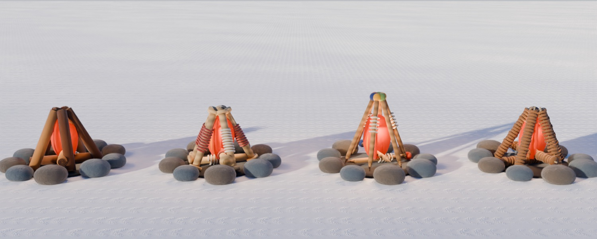
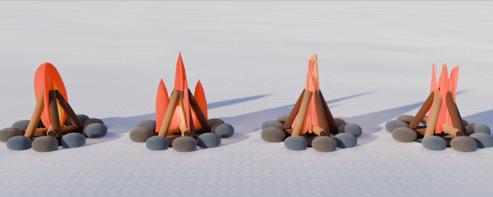
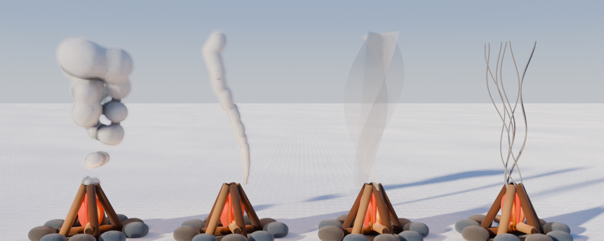

- 薪: 左から 1 つ目の、巻いたフェルトのロール（暖炉の薪と同じ）。木口に渦の糸（`campfire.gd` の `felt_log`）。燃えるうちに焦げ、消えると炭の色
- 炎: 左から 4 つ目の、薄葉紙をくしゃっと重ねた炎（`flame.gd`）。花びらのような紙を、外から赤 7 枚・橙 5 枚・黄 4 枚、輪に立てて重ねる。くしゃっとさせ方の違う 4 つの形を 2 コマごとに差し替える。紙は光を受けない塗り（炎の中の灯りで白く飛ばない）で、面の向きでしわの陰だけ付ける。紙すべてを 1 つの形に焼くので、炎 1 つで描く回数は 1 回
  - 火の手本なので、ロッジの松明・ガス灯の中の火・キャンドル（`lodge_lights.gd`）も同じ薄葉紙の炎になった
- 煙: 左から 3 つ目の、灰色のチュール（網目の薄い布）の帯を 3 本ねじって重ねる（`tulle_smoke.gd`）。根元で細く上で広がり、端で薄く消える。網目が透ける。光は受ける（夜は根元だけ火に照らされて橙）。うねりの違う 8 つの形を 2 コマごとに順に差し替える。消えた直後の 2 秒は大きく上る
- 持ち物の絵（山男の棚・持ち物の列）と手に持った形も、巻いたフェルトの薪と薄葉紙の焚きつけに。束ねるひもは麻ひも（赤い輪だと、赤い薪の束がダイナマイトに見えた）

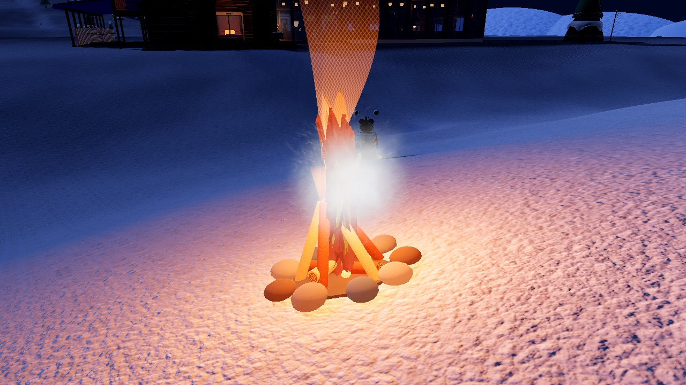
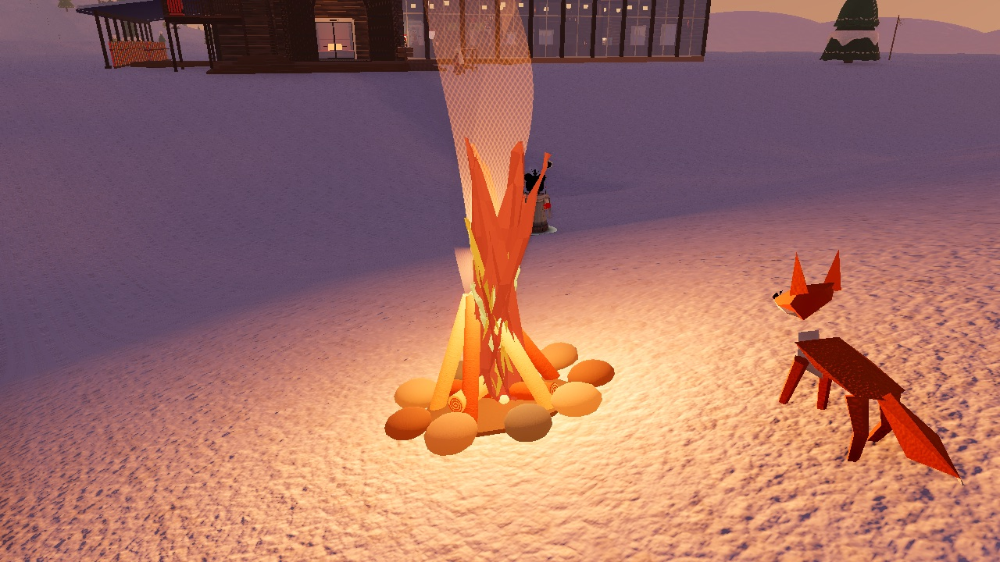
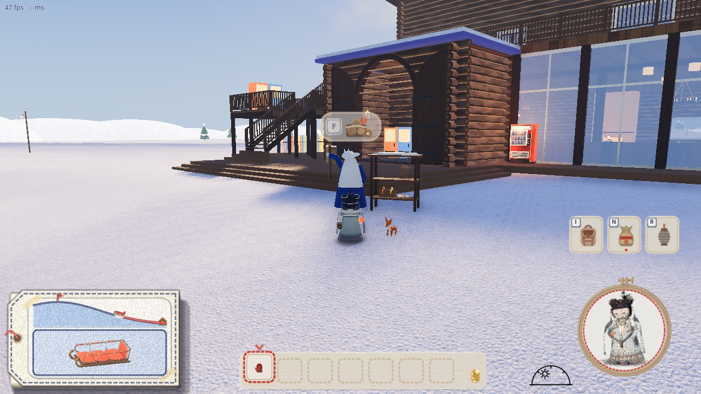
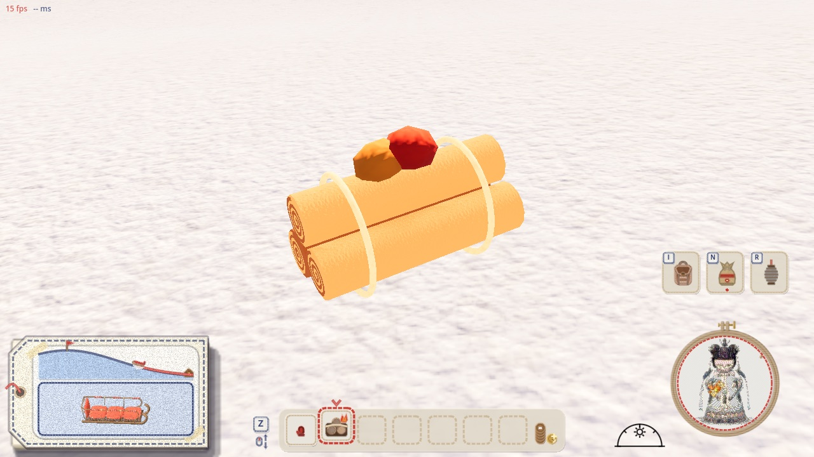
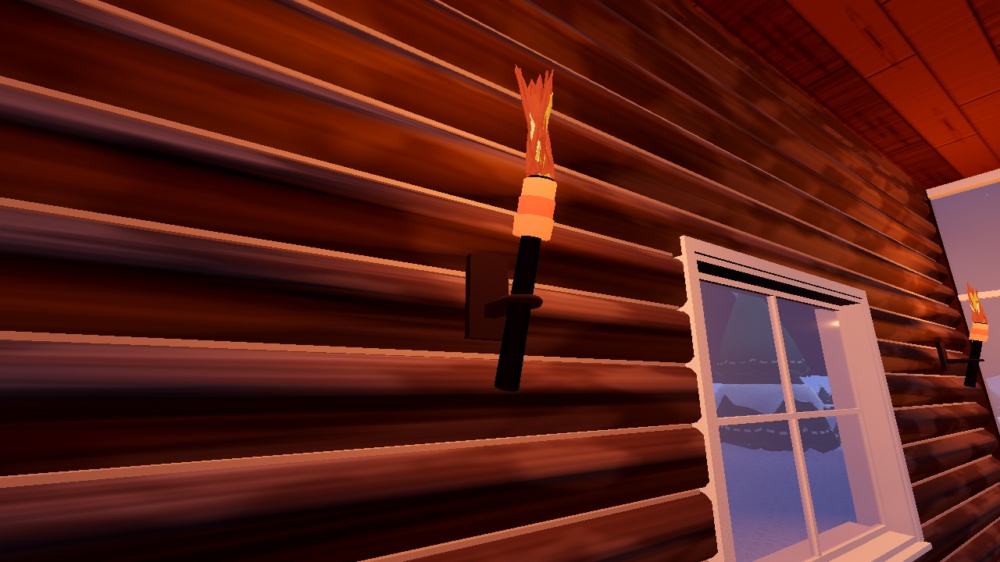
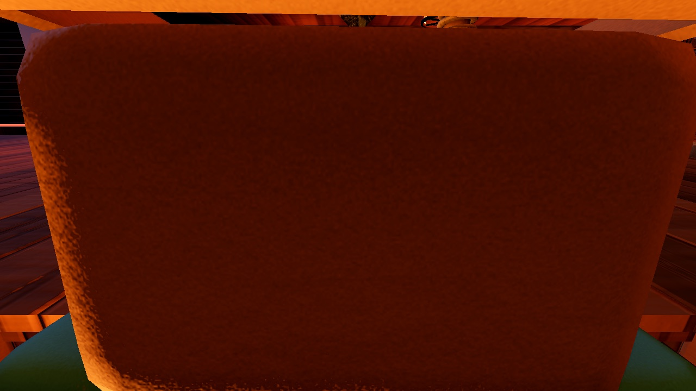
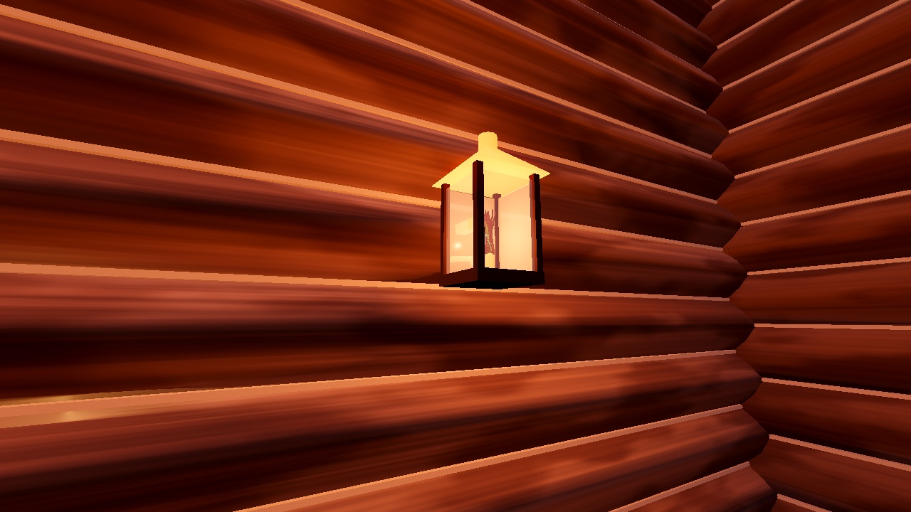

## 形と動き（`game/campfire.gd`。2026-11-01 の最初の形。薪・炎・煙は上で描き直した）

- フェルトの石の輪（灰・茶・青みの羊毛玉をつぶした形 9 つ）、灰色のフェルトの敷物
- 毛糸の帯を 2 か所に巻いた木の薪: 下に横たえた 2 本と、櫓に組んだ 5 本。燃えるうちに焦げ、消えると炭の色
- 炎: 赤・橙のフェルトと黄のクラフト紙を、はさみで切ったような形にして重ね、2 枚を十字に差し込んだもの。4 つの切り方を 2 コマごとに差し替える（置き換えのコマ撮り）。熾火は小さな羊毛玉
- 12 コマ／秒: 組む（石が 1 コマに 1 つ、薪は上から落ちてくる。14 コマ）→ 火がつく（8 コマ）→ 燃える → 弱る → 消える（雪のしぶき）→ 片づく（6 コマで縮む）
- 試してやめたもの: 綿の玉の煙（火に照らされて浮いた石に見え、夜は黒い穴に見えた）

## 通信

- 組む・消すは `craft.gd` の出来事 `fire_lay`・`fire_out`。ホストが持ち物と持ち主を確かめて全員に配り、どの画面にも同じ所・同じ番号の焚き火が出る
- 乾くのは、それぞれの画面が自分の人の水を決める今の仕組みのまま（どの画面にも焚き火があるので、そばにいる人はみな乾く）
- あとから来た人には、ホストが燃えている焚き火と燃えた秒を渡す（`snapshot` の `fires`）
- 燃え尽きるまでの時間は画面ごとに数える（少しずれても、消えるのが数フレーム違うだけ）

## 確かめ

- `game/tools/campfire_shots.gd`: 山男の棚で買う（ボタン 30 → 15）・ロッジの中では組めない・外で組む・火がつく・そばで乾く（1 秒ごとの水 100, 90, 80, 70, 61, 51, 41, 31, 21, 12, 2, −7, −17, −26, −36, −40）・気温（そば 6.2 °C、10 m 先 −5.0 °C）・F で消す・片づく・燃え尽きる
- `game/tools/campfire_net_check.gd`: つなぐ側が買って組んだ焚き火が、ホストの画面の同じ所に出る。ホストもつなぐ側も、そばで乾く。つなぐ側が消すと、ホストでも消えて片づく。`--late` で、あとから来た人の画面に燃えた秒（30.2 秒）の合った焚き火が出る

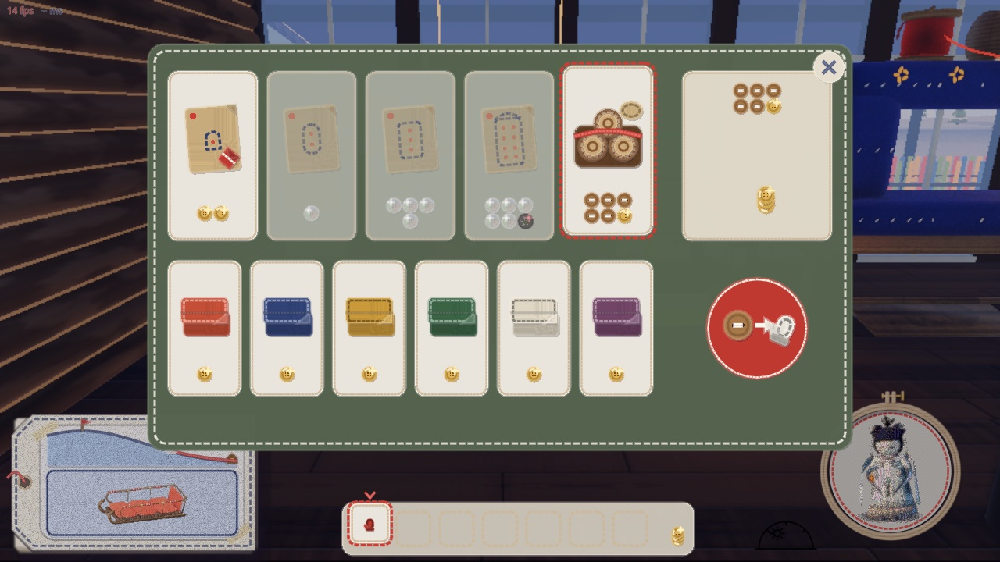
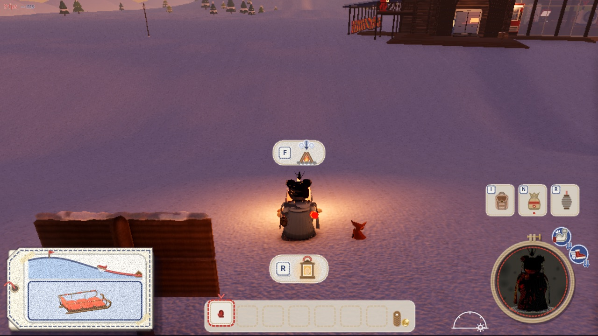
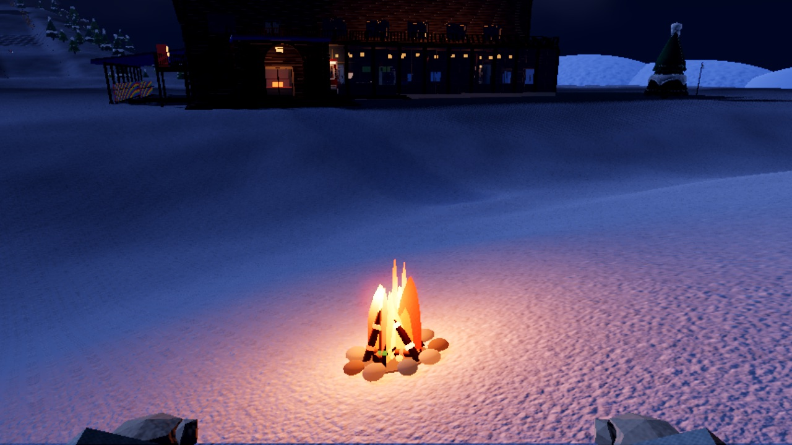
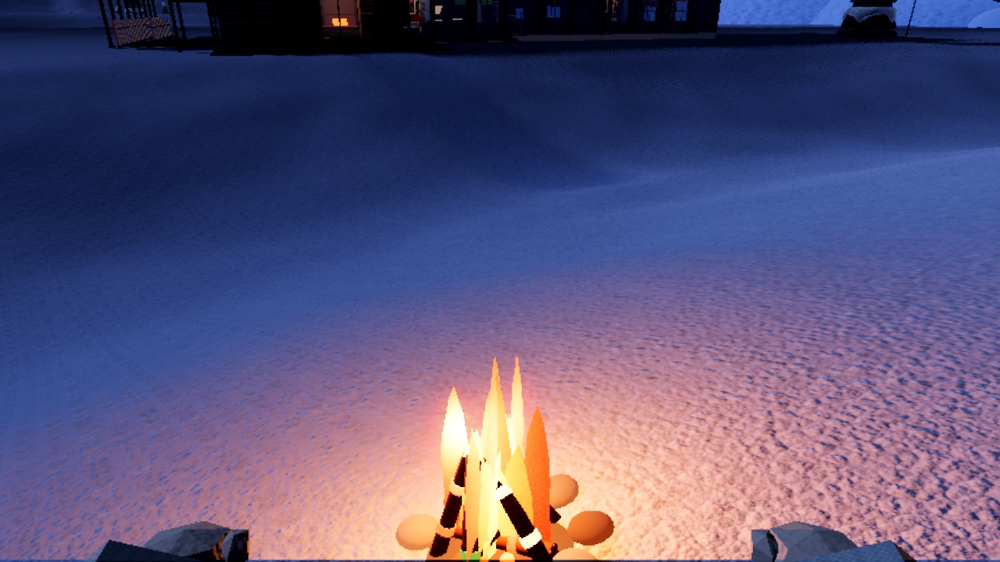
