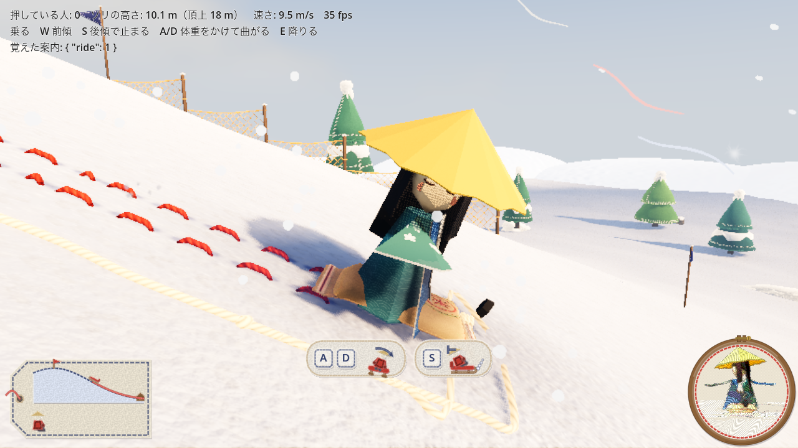
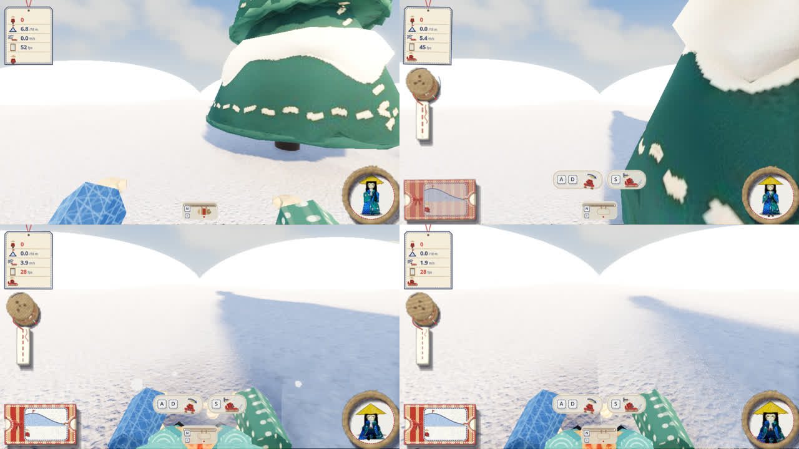
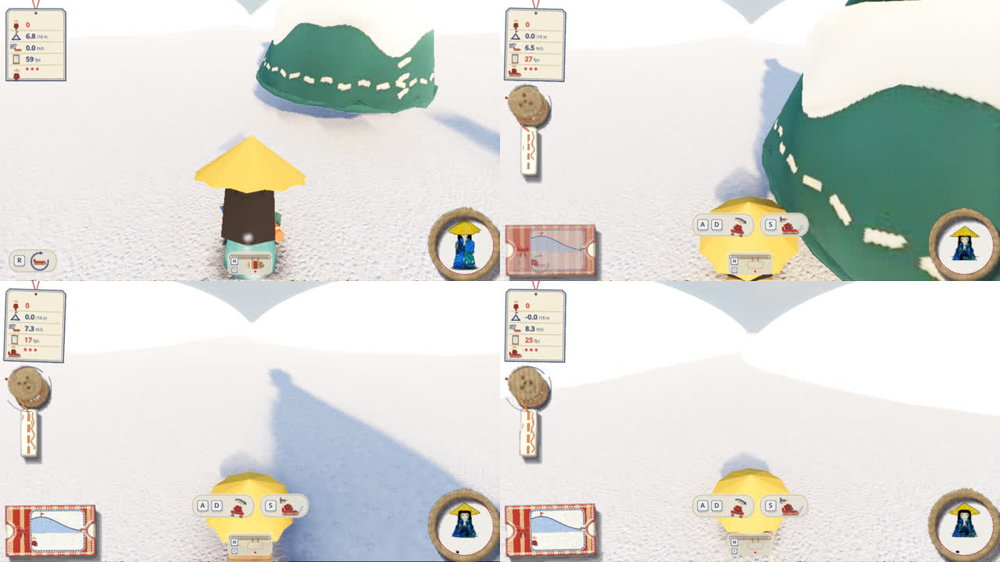
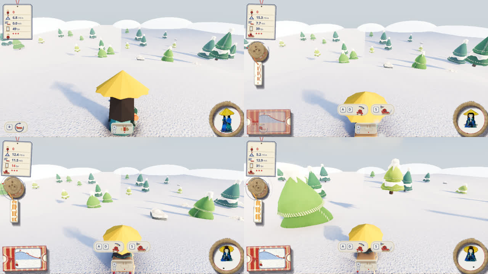
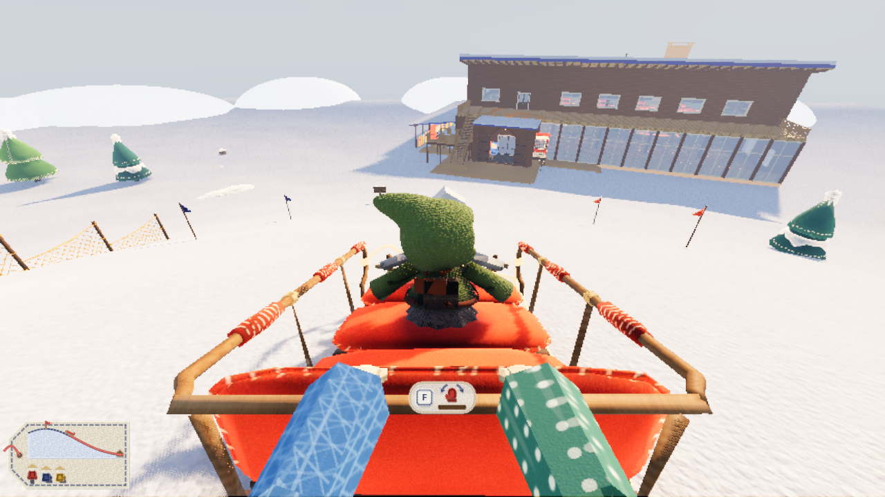
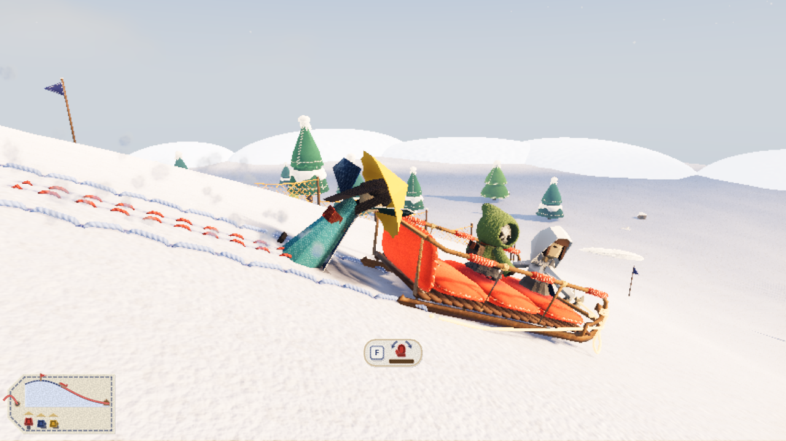
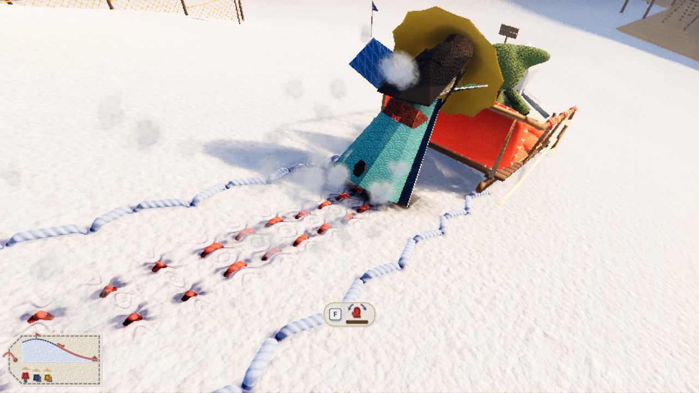

# Lodge 操作と物理の決まり

2026-10-26 に原型を遊びながら決めた内容。考え方は「**操作は力の向きだけ、あとは物理**」。

## 考え方

- 持つ場所ごとに操作の意味を決めない。入力は「視点基準で、どの向きに力をかけるか」だけ
- どう動くかは、ソリの滑り木と重力が決める。専用の旋回や回り込みの動きは作らない
- これで、押す人数や持つ場所の違いが、そのまま手ざわりになる

## 操作

| 入力 | 歩いているとき | ソリをつかんでいるとき | 乗っているとき | 紐を持っているとき |
|---|---|---|---|---|
| WASD | 歩く | 見ている向きを基準に、つかんだ所へ力をかける（W 前へ押す、S 手前へ引く、A/D 左右） | W 前傾、S 後傾で止まる、A/D 体重をかけて曲がる | 歩く。紐が張ると引く |
| Shift | 走る（4 → 7 m/s） | — | — | 走る |
| F | ソリの縁をつかむ。ソリの前なら紐を持つ | 離す | — | 離す |
| E | 乗る | 乗る | 降りる | 乗る |
| Space | ジャンプ | — | — | ジャンプ |
| マウス | 見回す | 見回す（体の向きも変わる） | 見回す | 見回す |
| ホイール／二本指スクロール | 持ち物の持ち替え（持ち物がなければ何もしない） | | | |
| ピンチ | 三人称: カメラの距離（指を閉じると引く）。一人称で閉じ続けると三人称へ、三人称でいちばん近くまで寄ってさらに開くと一人称へ | | | |
| C | 一人称／三人称 | | | |
| V | 右上の 360° 映像の見せ方（縦長の魚眼 → 全天球 → リトルプラネット） | | | |
| R | ソリをふもとへ戻す | | | |

- 近づいての自動吸着は**やらない**（やめた）。つかむのは F だけ
- つかんだまま S を押しても離れない（手前に引く）。離すのは F だけ。ほかに手が離れるのは、雪玉が当たったときと、引きずられて止められなかったとき（下の「ずり落ちと引きずり」）。紐はソリが 5 m/s より速く滑ると手が離れる
- ソリのまわりのどこからでもつかめる。立った所からいちばん近い縁に手が吸い付く
- ソリの前に 3 m の紐。前に回って F で持ち、歩いて張ると引ける。張っている間は歩みが重くなる

## ソリの物理（`game/sled.gd`）

- 質量 60 kg（中。大きさごとの重さは下の「大きさ」）。1 人が押す力 300 N（1 人でも一番急な所をじりじり登れる）。押されているソリが 3〜4 m/s を超えると押す力が消えていく（人は走るより速く押せない。軽いソリが飛ぶように登らないため。2026-10-29）
- **力は手が触れている縁にそのままかける**（中心に寄せない）。縁に偏った力は、横にずれるのでなく向きを変える
- **滑り木**：前後にはよく滑り、横には滑らない。前後 2 点で横滑りを止める（SLIP_RESIST 18）。止まっているときは抵抗を弱め（0.3 倍）、人が押して向きを変えられる
- **静止摩擦**：遅いソリ（0.8 m/s 未満）は、押されているか、誰かがつかんでいれば、地面の法線から求めた静止摩擦で坂に留まる。強さは重さの 0.45 倍まで、ただし押されていなければ「つかんでいる人の止める力」まで（下の「ずり落ちと引きずり」）。1 人が押せば動き出す。誰も触れていない空のソリはずり落ちる（2026-10-29 から）
- **乗っているときの体重移動**：トルクを直接かけない。傾けた側の滑り木が雪に食い込んで抵抗が増え、曲がる（2026-10-28 に 14 から 17.5 に上げた）。前傾で抵抗が減り、後傾で両側が食い込んで止まる。頂上では前傾で手で雪をかいて動き出す。2026-10-29 から、乗っている一人ひとりの力が足し合わさり、乗る人の重さも滑るソリの重さに入る（下の「乗って滑るときの手ざわり」。中＋一人の曲がり方と速さは前と同じに合わせた）
- **乗っても登りは速くならない**（2026-10-28）：守る手ざわりは「人が加わるほど速く登れる」で、乗るのは登る力にならない
  - 前傾で雪をかく力は、坂を登る向きの成分を消す。平らな所と下りではそのまま進む（頂上で滑り出す、ふもとで止まったら動き出す、のための力なので）。横向きの成分は残す
  - 押されて坂を登っている間は、乗っている人がいても登りの雪の抵抗（CLIMB_DAMP 3.5）。乗ると抵抗が 0.12 に下がり、乗る＋二人が押すが二人で押すより 4 倍近く速かったため
  - 押されている間は、乗っていても静止摩擦が効く。乗る＋一人が押すは、一人で押すのと同じ速さで登る（これがないと、一人では乗った人を押し上げられない）
  - 押されて登っているあいだは、乗っている人の重さはソリに足さない。乗る人は登りを速くも遅くもしない（下って滑るときだけ足す。2026-10-29）
- 大きく傾いたら起き上がる

## 大きさ（2026-10-29、`game/sled.gd` の `KINDS`）

起動の引数 `--sled=sack|small|mid|large` で選ぶ（既定は mid）。メインカラーは `--sled-color=2F4E9A`（16 進か `white` などの色の名前。見た目の決まりは [アートコンセプト](art-concept.md) の「ソリのメインカラー」）。当たりの箱・滑り木・席はこの表が正で、絵（`props/build_sled.py` の glb）はこれに合わせて作る。glb がまだない大きさは仮の箱で出る。

| 名前 | 何 | 重さ | 席 | 台（幅 × 長さ） |
|---|---|---|---|---|
| sack | 米袋（1 人用） | 1 kg | 1 | 0.6 × 1.1 m |
| small | ホームセンターのプラスチックのソリ（1〜2 人） | 15 kg | 2（縦に並ぶ） | 0.75 × 1.6 m |
| mid | いまのフェルトのソリ | 60 kg | 3 | 1.5 × 2.8 m |
| large | サンタが乗るような大きなそり（8 人） | 220 kg | 8（横 2 × 縦 4） | 2.2 × 4.8 m |

- 米袋の重さ 1 kg（代表が決めた、2026-10-29）は、止める計算（下）の重さに入れる値。物理の体は揺れないよう 15 kg（`BODY_MIN_MASS`）として動かし、止める力は「本当の重さ（袋 1 kg ＋ 乗る人）」との比で弱めてかける
- 小の席は、成形ソリの座る面に合わせて低い（雪から 6 cm。glb に合わせた）
- 滑り木の抵抗・体重移動で曲がる効き・雪をかく力は、重さに比べて中と同じ効きにしている（大きなソリも小さなソリも、曲がり方は同じ）

## 乗って滑るときの手ざわり（2026-10-29）

代表の言葉:「ソリは小さければ小さいほど操舵性と加速がよく、最高速度が遅い。重ければ重いほど操舵性と加速が悪く、最高速度が速い。しかし、乗っている人が同じ操作をするとき、操舵力は強くなる、というパラメーターを持たせられますか？」→ 作ると決めた

- **乗る人の重さも一緒に滑る**：乗って下っているあいだ、乗っている人（一人 `RIDER_MASS` 45 kg）もソリと一緒に動く重さに入る。重力の加速は同じで、雪の抵抗・沈み・体重移動・雪かきの力は「ソリ＋乗る人」の重さで分け合う。押されて登っているあいだは前のまま（乗る人は登りを速くも遅くもしない）
- **最高速度**：雪の抵抗は重さによらない。重いソリほど抵抗に負けにくく、最後は速い。抵抗は、遅いときから効く `drag`（こする）と、速くなるほど急に増える `push`（雪を押しのける・風）の 2 つ。乗る人が多いほど重くなるので、同じソリでも速くなる
- **加速（出足）**：坂の上では重力がどれも同じだけ加速させるので、はじめは同じように速くなる。違いは、①自分の最高速度にすぐ届くか（軽いソリはすぐ頭打ちになる＝きびきび、重いソリは長く伸び続ける＝もっさり）、②滑り木のソリは遅いうち雪に沈む（`sink`。`plane` まで速くなると浮く。大は出足がはっきり重い）、③手で雪をかく力（一人 `SCOOP_FORCE`）は重さで分け合うので、軽いソリほど漕ぎ出しが速い
- **曲がりやすさ**：体重移動の力は同じでも、長く重いソリほど回りにくい（回りにくさは当たりの箱の大きさと重さから物理で出る）。米袋は中の 5 倍、大は中の 4 分の 1 ほど
- **乗っている人の協力**：一人ひとりの体重移動（A/D）は別々の力で、上限なしに足し合わさる。全員が同じ向きなら重なって大きく曲がり、逆向きの人がいると打ち消し合う。前傾（雪かき・抵抗が減る）と後傾（制動）も人数ぶん重なる。大は一人だとほとんど曲がらないが、8 人そろえると 3.5 倍曲がる
- **止まっているときの動かしやすさ**（2026-10-29 代表「ソリの静止状態での移動自由度も、小さければ小さいほど高くしてほしい」）：止まったソリを押す・引く・つかんで向きを変えるとき、小さいほどその場で回しやすく、横にずらしやすい。米袋はほぼ自由に向きを変えて引きずれる。大は滑り木が雪に食い込んで、一人では回しにくい。止まっているときの横すべりの抵抗を大きさごとにした（`stand_slip`・`stand_speed`）。押して登る向き（前後）には効かないので、登りの手ざわりは変わらない
- **仲間**：一緒に乗っているとき、あなたの体重移動（A/D・前傾・後傾）に 0.3 秒（`bot.gd` の `LEAN_DELAY`）遅れて合わせる。`--bot-lean=off` で合わせない。合わせないと、仲間はただの重さになり、あなた一人の体重移動は効きにくくなる

### 調整する値（`game/sled.gd` の `KINDS` と、その下の「乗って滑るときの、乗っている一人ひとりの力」）

| 名前 | 米袋 | 小 | 中 | 大 | 意味 | 大きくすると |
|---|---|---|---|---|---|---|
| `drag` | 1.0 | 1.5 | 8.0 | 12.0 | 底や滑り木が雪をこする抵抗 (N per m/s)。遅いときから効く | 出足から重くなり、最高速度も下がる |
| `push` | 3.3 | 3.6 | 2.5 | 3.5 | 雪を押しのける・風を受ける抵抗 (N per (m/s)²)。速いほど急に増える | 最高速度が下がる（出足はあまり変わらない） |
| `sink` | 0 | 0 | 0.02 | 0.06 | 滑り出しで雪に沈む抵抗（重さに対する割合）。滑り木のソリだけ | 出足が重くなる。大きすぎると頂上の緩い所から漕いでも出ない（大で 0.08 を超えると一人では出にくい） |
| `plane` | — | — | 3 m/s | 5 m/s | この速さで浮いて、沈む抵抗が消える | 重い出足が長く続く |
| `turn` | 1.0 | 1.0 | 1.0 | 1.0 | 一人の体重移動の効きの倍率。いまはどれも 1（違いは物理だけで出している） | そのソリだけ曲がりやすくなる |
| `stand_slip` | 0.03 | 0.1 | 0.3 | 0.6 | 止まっているときの横すべりのしにくさ（`SLIP_RESIST` 18 に掛ける割合）。中の 0.3 は前の値 | その場で回しにくく、横にずらしにくい（滑り木が雪に食い込む） |
| `stand_speed` | 3 m/s | 1.5 m/s | 0.6 m/s | 0.5 m/s | この速さまでは「止まっている」として `stand_slip` を使う。中の 0.6 は前の値 | ゆっくり動いているあいだも、横へずらしやすい（米袋は底が平らなので、ゆっくりなら横へも引きずれる） |

| 名前 | いまの値 | 意味 | 大きくすると |
|---|---|---|---|
| `LEAN_DIG` | 30 N per m/s | 一人が体重をかけた側の滑り木が食い込む抵抗。人数ぶん足し合わさる | どのソリもよく曲がる（中＋一人が前より曲がるようになる） |
| `SCOOP_FORCE` | 210 N | 一人が前傾して手で雪をかく力（1.5 m/s まで。坂を登る向きには効かない） | 頂上からの漕ぎ出しが速い。軽いソリほど効く |
| `BRAKE_DRAG` | 24 N per m/s | 一人が後傾したときの制動 | よく止まる |
| `FWD_LEAN_EASE` | 0.6 | 前傾した人の割合 × これだけ雪の抵抗が減る（全員前傾で 0.4 倍） | 前傾で速くなる |
| `RIDER_MASS` | 45 kg | 乗っている人一人の重さ | 乗る人が増えたときの速さの伸びと、曲がりにくさが大きくなる。止めにくくなる |
| `LEAN_DELAY`（`bot.gd`） | 0.3 秒 | 仲間があなたの体重移動に合わせるまでの遅れ | 息が合うまで時間がかかる |

### 計測（2026-10-29、`game/tools/handling_check.gd`）

頂上（2 m）から、乗る人が全員前傾で 1.5 m/s まで雪をかき、あとは何もしない（頂上のまわりは緩いので、はじめの数秒は漕ぎ出しで決まる）:

| ソリ | 乗る人 | 3 m/s まで | 5 m/s まで | 自分の最高速度の 9 割まで | 最高速度 |
|---|---|---|---|---|---|
| 米袋 | 1 | 3.8 秒 | 6.0 秒 | 6.7 秒 | 6.1 m/s |
| 小 | 1 | 3.7 秒 | 5.7 秒 | 6.7 秒 | 6.5 m/s |
| 小 | 2 | 3.4 秒 | 5.0 秒 | 6.7 秒 | 8.0 m/s |
| 中 | 1 | 4.1 秒 | 5.7 秒 | 7.5 秒 | 8.1 m/s |
| 中 | 2 | 3.8 秒 | 5.3 秒 | 7.3 秒 | 9.1 m/s |
| 中 | 3 | 3.6 秒 | 5.0 秒 | 7.2 秒 | 9.7 m/s |
| 大 | 1 | 6.1 秒 | 7.4 秒 | 9.5 秒 | 9.5 m/s |
| 大 | 2 | 5.3 秒 | 6.5 秒 | 8.7 秒 | 9.9 m/s |
| 大 | 3 | 5.2 秒 | 6.5 秒 | 8.7 秒 | 10.2 m/s |
| 大 | 8 | 4.8 秒 | 6.0 秒 | 8.4 秒 | 11.1 m/s |

坂の途中（頂上から 15 m）で止まった所から放す（重力の加速がはっきり効く所）:

| ソリ | 乗る人 | 3 m/s まで | 5 m/s まで | 自分の最高速度の 9 割まで | 最高速度 |
|---|---|---|---|---|---|
| 米袋 | 1 | 0.9 秒 | 2.2 秒 | 2.6 秒 | 6.0 m/s |
| 小 | 1 | 0.9 秒 | 2.1 秒 | 2.8 秒 | 6.4 m/s |
| 小 | 2 | 0.9 秒 | 1.7 秒 | 3.0 秒 | 7.7 m/s |
| 中 | 1 | 1.0 秒 | 2.0 秒 | 3.3 秒 | 7.9 m/s |
| 中 | 2 | 1.0 秒 | 1.8 秒 | 3.4 秒 | 8.7 m/s |
| 中 | 3 | 0.9 秒 | 1.7 秒 | 3.5 秒 | 9.3 m/s |
| 大 | 1 | 1.3 秒 | 2.1 秒 | 3.8 秒 | 9.1 m/s |
| 大 | 8 | 1.1 秒 | 1.9 秒 | 3.9 秒 | 10.5 m/s |

5 m/s までの時間は、どれもあまり変わらない（坂の上では重力がどれも同じだけ加速させる。物理のまま）。違いが出るのは、自分の最高速度にすぐ届くか（米袋 2.6 秒 → 大 3.8 秒）と、最高速度（6.0 → 10.5 m/s）、頂上からの漕ぎ出し（3 m/s まで 米袋 3.8 秒 → 大＋一人 6.1 秒）。

曲がる（丘から離れた平らな所で、速さを 5 m/s に保ち、体重移動を 1 秒。角速度と半径）:

| ソリ | 乗る人 | 全員 D | 一人だけ D | そろわない（D と A が交互） |
|---|---|---|---|---|
| 米袋 | 1 | 9.8 °/s（29 m） | — | — |
| 小 | 1 | 4.9 °/s（59 m） | — | — |
| 小 | 2 | 5.5 °/s（52 m） | 2.8 °/s（103 m） | 曲がらない |
| 中 | 1 | 1.8 °/s（160 m） | — | — |
| 中 | 2 | 2.5 °/s（115 m） | 1.3 °/s（229 m） | 曲がらない |
| 中 | 3 | 2.9 °/s（100 m） | 1.0 °/s（297 m） | 1.0 °/s（D・A・D） |
| 大 | 1 | 0.4 °/s（748 m） | — | — |
| 大 | 2 | 0.7 °/s（438 m） | 0.3 °/s（875 m） | 曲がらない |
| 大 | 3 | 0.9 °/s（335 m） | 0.3 °/s（1002 m） | 0.3 °/s（D・A・D） |
| 大 | 8 | 1.4 °/s（205 m） | 0.2 °/s（1637 m） | 曲がらない |

止まったソリを一人で押す（丘から離れた平らな所。`--case=budge`）:

| ソリ | 90° 向きを変える（後ろの角を横へ押す） | 横に 1 m ずらす（長い辺のまんなかを押す） |
|---|---|---|
| 米袋 | 0.3 秒（前 0.6 秒） | 0.8 秒（前 1.9 秒） |
| 小 | 0.6 秒（前 0.8 秒） | 1.6 秒（前 2.0 秒） |
| 中 | 2.9 秒（前と同じ） | 2.1 秒（前と同じ） |
| 大 | 33.9 秒（前 21.5 秒） | 14.9 秒（前 9.4 秒） |

前は、止まっているときの横すべりの抵抗がどの大きさも同じ割合で、0.6 m/s を超えると戻っていたので、横にずらす速さはどれも 0.6 m/s ほどで頭打ちになっていた。大は一人だと回すのに 30 秒以上かかる（三人なら 3 分の 1）。

仲間が合わせる（あなた＋仲間 2 人が乗り、5 m/s で あなただけ D を 1 秒。仲間は 0.3 秒遅れて合わせる）: 大 0.3 → 0.6 °/s、中 0.9 → 2.2 °/s（合わせない → 合わせる）。

前と同じか: 仲間二人で押して登る 15.7 秒、一人 35.0 秒、乗って W ＋ 一人 34.1 秒、乗るだけ ＋ 一人 35.0 秒、乗るだけ ＋ 二人 15.7 秒（すべて前と同じ）。中＋一人の旋回は、速いとき D 1 秒で 2.4°、止まった所から W＋D 3 秒で 1.3°（前と同じ）。中＋一人の最高速度は 8.5 → 8.1 m/s。

### 決めていないこと

- 坂の上での「5 m/s までの時間」は、物理のままではどの大きさもほぼ同じ。小さいソリをはっきり速くするなら、物理から外れた押し（軽いソリだけ重力を強く感じる、など）が要る。いまは入れていない
- 漕ぎ出しが効くのは 1.5 m/s まで（前のまま）。3 m/s くらいまで漕げるようにすると、軽いソリの出足の差がはっきり出るが、止まった所からの旋回（前と同じ 1.3°）が変わる
- 乗る人が多いほど速くなる（大＋8 人で 11.1 m/s）。速すぎるなら `RIDER_MASS` か `push` を上げる

## 米袋で足で漕ぐ・追いついて止める（2026-10-29）

代表の言葉:「米袋は常に所持している状態で、インベントリを圧迫しない装備扱いに…みんなで大きいソリを押している最中にソリが滑っていってしまったときなんかは絶望的ですが、即座に米袋で滑っていって大きいソリに追いついて食い止められたら良いなと思っています。性能は高くないけど、足で漕いで加速しまくれるといいですね。スペース連打で滑走中のみ加速できる、みたいな」「米袋は最高速度速めが良いかも。友達と連打勝負できるように」

装備にすること・N で呼び出す・しまうのは、ソリを作る店のセッション（`player.gd` の `toggle_sack`・`summon_sack`、`craft.gd`）。ここは物理。

- **足で漕ぐ**：米袋に乗って滑っているあいだ（0.5 m/s 以上）、Space を押すたびに足で雪を蹴って前へ速くなる（乗っているあいだの Space はジャンプしない）。速いほど一回の蹴りが効かなくなり、`KICK_TOP` に近づくと 0 になる。漕がずに滑るだけなら大きいソリより遅いが、速く連打するほど伸び、大きいソリより速くなれる。連打の速さが、そのまま速さの差になる（友達と並んで滑って、連打の勝負ができる）
  - 下り坂で全部効き、平らな所では `KICK_FLAT` だけ、登りでは効かない（登りを楽にしない）
  - 蹴る足（人形の 12 コマで 3 コマ。左右交互に、横から下へ伸ばして後ろへ蹴り、引き戻す）、足もとに綿の雪の粉、踏ん張りの音を高めに短く
- **追いついて止める**：米袋に乗ったまま、ほかのソリのつかみ所から `CATCH_REACH` の中で F を押すと、米袋から降りてそのソリにしがみつく。速く下っていれば、そのまま「引きずられて止める」に入る。米袋は自動で帯に戻る（装備なので、空の米袋を坂に残さない。店のセッションと決めた）
  - もう一つの案「米袋に乗ったまま足を踏ん張って、止める力を足す」は作っていない。しがみつくほうが、いまの引きずられる姿勢・跡・音につながり、「追いついて飛びつく」の一瞬がはっきりするので、こちらを選んだ。踏ん張る案は、米袋ごと引っぱられて二人で連なる絵になるが、止める力の作りが二重になる
- **逃げていくソリ**：誰も触れていない空のソリのずり落ちの抵抗を、重さによらない値（`SLIDE_DRAG`）にした。重いソリほど速くずり落ちる。中は前と同じくらい（最高 2 m/s ほど）、大は 4 m/s ほどで、走って（3.4 m/s）では追いつけない
- 長いソリを坂に水平に置くと、下の端が雪に埋まって地面を突き抜けることがあった（大で、スタートや R で戻したとき）。置くときに長さに合わせて少し浮かせる（`place_lift`）

### 調整する値（`game/sled.gd` の「足で漕ぐ」、`KINDS` の `kick`、`player.gd` の `CATCH_REACH`）

| 名前 | いまの値 | 意味 | 大きくすると |
|---|---|---|---|
| `KICK_DV` | 1.5 m/s | 一回蹴って速くなる量（止まりかけのとき） | 連打が少なくても速くなる。連打の速さの差は縮む |
| `KICK_TOP` | 16 m/s | 蹴って届く速さの上限。ここに近づくほど蹴りが効かない | 速い連打ほど伸びる（差が広がる） |
| `KICK_FLAT` | 0.6（2026-10-29 に 0.3 から） | 平らな所での蹴りの効き（下り坂で 1、登りで 0） | 平らな所で漕いで進める |
| `KICK_FULL_SLOPE` | 0.15 | この下り（傾きの sin）より急なら蹴りが全部効く | ゆるい下りでは効きにくい |
| `KICK_MIN_SPEED` | 0.5 m/s | これより遅いと蹴れない（滑り出しは W で雪をかく） | 止まりかけでは漕げない |
| `kick`（`KINDS`） | 米袋 1、ほか 0 | そのソリで漕げるか、その効き | ほかのソリでも漕げる |
| `CATCH_REACH`（`player.gd`） | 2.4 m | 米袋に乗ったまま F でつかめる、ほかのソリのつかみ所までの距離 | 遠くから飛びつける |
| `SLIDE_DRAG` | 72 N per m/s | 空のソリのずり落ちの抵抗。重さによらない | どのソリもゆっくりずり落ちる（大が逃げにくい） |

### 計測（2026-10-29、`game/tools/sack_check.gd`）

連打（米袋に一人。頂上から漕ぎ出し、1.5 m/s からは蹴るだけ。ふもと = 頂上から 55 m）:

| ソリ | 1 秒に蹴る回数 | 最高速度 | ふもとまで |
|---|---|---|---|
| 米袋 | 蹴らない | 4.7 m/s | 18.8 秒 |
| 米袋 | 4 回 | 8.6 m/s | 8.7 秒 |
| 米袋 | 6 回 | 9.5 m/s | 7.6 秒 |
| 米袋 | 8 回 | 10.2 m/s | 6.9 秒 |
| 米袋 | 10 回 | 10.8 m/s | 6.5 秒 |
| 中＋一人（くらべ） | — | 8.1 m/s | 11.6 秒 |
| 大＋一人（くらべ） | — | 9.5 m/s | 12.9 秒 |

逃げていくソリを追う（空のソリが頂上から 15 m で手を離れる。4 秒遅れて、手を離した所の 4 m 上から追いかける。つかめる所まで来たら F。あなた一人で止める）:

| 逃げるソリ | 追い方 | 追いつくまで | 追いつくまでにソリが滑った距離 | そのあと |
|---|---|---|---|---|
| 中（最高 2.0 m/s） | 走る | 5.9 秒 | 6.2 m | すぐ止まる |
| 中 | 米袋・蹴らない | 7.3 秒 | 8.1 m | すぐ止まる |
| 中 | 米袋・1 秒に 6 回 | 5.3 秒 | 5.4 m | すぐ止まる |
| 中 | 米袋・1 秒に 10 回 | 5.1 秒 | 5.1 m | すぐ止まる |
| 大（最高 3.8 m/s） | 走る | 13.6 秒 | 33.6 m（ふもと近く） | すぐ止まる（緩い所まで来ていた） |
| 大 | 米袋・蹴らない | 13.0 秒 | 32.8 m | すぐ止まる |
| 大 | 米袋・1 秒に 6 回 | 6.4 秒 | 14.6 m | 引きずられて 10.4 m・9.2 秒で止まる |
| 大 | 米袋・1 秒に 10 回 | 5.8 秒 | 12.5 m | 引きずられて 12.4 m・11.1 秒で止まる |

中は空だとゆっくりずり落ちるので、走っても追いつける。大は走るとふもと近くまで逃げられるが、米袋で連打すると半分以下の所で追いつける（一人では急な所で止めきれず、緩い所まで引きずられてから止まる。二人なら坂の途中で止まる）。



## 走りながら米袋を出す・Space で漕ぐ（2026-10-29）

代表の言葉:「走りながら米袋つかうと慣性で速くそこそこの距離滑れるようにしてほしい、スペースキーで加速もできるようにしてほしい。」

- **勢いを受けつぐ**：N を押した瞬間に歩いて・走っていれば、その速さが米袋の初めの速さになる（`player.gd` の `summon_sack` → `craft.gd` の `sack_out` の `v`）。前へ進んでいた分は、前へ飛び乗る勢いで `SACK_CARRY` 倍（横・後ろはそのまま）。上限 `SACK_CARRY_MAX`。止まって出せば前と同じ（坂ならずり落ち始め、平らな所では W で雪をかいて動き出す）
- **Space で漕ぐ**：たたくたびに一回蹴る。押しっぱなしでは蹴らない（PR #50 で押しっぱなしでも蹴れるようにしたが、2026-10-30 代表「スペース連打じゃないとだめ。ダサくて必死にこぐのがいい」で外した。下の表の「押しっぱなし」の行は、外す前に測ったもの）。平らな所での効き `KICK_FLAT` を 0.3 → 0.6 にして、走って乗った勢いを平らな所でも漕いで保てるようにした（蹴れるのは前と同じく 0.5 m/s 以上で滑っているあいだだけ）
- **上限**：蹴りの効きは前と同じく `KICK_TOP`（16 m/s）に近づくほど 0 になる。坂で W（前傾）を押したまま 1 秒に 8 回たたくと 13 m/s ほど。この速さでも、S（後傾）なら 0.2 秒で 3 m/s を切り、A/D で 1 秒体重をかけると 3 m/s ほどに落ちる（曲がるより減速が大きい）ので、新しい上限は足していない

| 名前 | いまの値 | 意味 | 大きくすると |
|---|---|---|---|
| `SACK_CARRY`（`player.gd`） | 1.8 | 走りながら出すと、前へ進んでいた速さのこれだけ倍で滑り出す | 走って乗ったときに速く、遠くまで滑る |
| `SACK_CARRY_MAX`（`player.gd`） | 6.5 m/s | 受けつぐ速さの上限 | |

### 計測（2026-10-29、`game/tools/sack_carry_check.gd`）

平らな所（丘から 85 m 離れた所）と坂（頂上から 12 m 下、傾き 0.31 から下る）で、1.2 秒走る（3.4 m/s）・歩く（2.0 m/s）・止まったまま から N。Space は乗ってから 4 秒。
「勢い」は 1.5 m/s（W で雪をかく速さ）に落ちるまでに滑った道のり。

| 場所 | 乗りかた | Space | 乗った瞬間 | 最高速度 | 勢い（W を離す） | 勢い（W を押したまま） |
|---|---|---|---|---|---|---|
| 平ら | 止まって | 押さない | 0 m/s | — | 0 m | 0 m |
| 平ら | 歩いて | 押さない | 3.6 m/s | 3.6 m/s | 2.6 m（3.8 m で止まる） | 4.6 m |
| 平ら | 走って | 押さない | 6.1 m/s | 6.1 m/s | 5.7 m（6.9 m・3.4 秒で止まる） | 10.5 m |
| 平ら | 走って | 押しっぱなし | 6.1 m/s | 6.6 m/s | 17.1 m | 29.3 m |
| 平ら | 走って | 1 秒に 8 回 | 6.1 m/s | 6.6〜8.6 m/s | 28.5 m | 46.4 m |
| 坂 | 止まって | 押さない | 0 m/s | 4.7 m/s | — | —（W で 7.8 m/s） |
| 坂 | 走って | 押さない | 5.8 m/s | 5.8 m/s | — | 8.2 m/s |
| 坂 | 走って | 押しっぱなし | 5.8 m/s | 8.1 m/s | — | 11.3 m/s |
| 坂 | 走って | 1 秒に 8 回 | 5.8 m/s | 10.2 m/s | — | 13.1 m/s |

前の作りでは、走って出しても米袋は止まった所から始まり（平らな所では 0 m）、平らな所では蹴れる速さに届かないので Space も効かなかった。





撮るのは `game/tools/sack_carry_shots.gd`（一人称と三人称、平ら・坂、押さない・押しっぱなし・連打）。

### 決めていないこと

- 一人で大に追いついても、急な所では止めきれない（引きずられて緩い所で止まる）。米袋の人だけ止める力を強くするか
- 乗っている人の重さを入れたので、乗っている大きいソリが逃げると、いまの値では誰にも追いつけないほど速い（大＋一人で 9.5 m/s）。連打 8 回以上なら追いつける

## ずり落ちと引きずり（2026-10-29）

代表の言葉:「ソリは手を離すとずり落ちていく物理演算にしてほしい。人が乗っているときよりはゆっくりに。雪玉を当てられたときは手を離してしまうようにして、もう一度インタラクトしないと止まらないようにしたい。ソリがある程度の速さで下っているときにインタラクトしても、引きずられていってしまうようにしてほしい。引きずられているときには、ある程度止める力を働かせて、ある程度引きずられたらソリを止められるようにしたい。それは、ソリと乗っている人より、止めようとしている人のほうが強いときにできること。調整していきたい」

- **手を離すとずり落ちる**：誰もつかんでいない・乗っていない空のソリは、坂の傾きが `SLIDE_GRIP` より急な所でひとりでに下へ滑る。乗っていないと雪に食い込むので、乗ったときよりずっと遅い（`SLIDE_DRAG`。2026-10-29 から重さによらない抵抗にしたので、重いソリほど速くずり落ちる）。ふもとの緩い所（頂上から約 50 m）で止まる。頂上のまわり（約 5 m まで）は緩いので留まる
  - 最初と R で戻したときのソリは「止めてある」（`parked`）。誰かが触れるまでずり落ちない（始まってすぐソリが逃げないように）
- **雪玉で手を離す**：縁をつかんでいる・押している・紐を持っている人に雪玉が当たると、びっくりして手を離す。止めるには、もう一度 F でつかむ。仲間は 1.5 秒（`bot.gd` の `REGRAB_WAIT`）たつとつかみ直しに行く。乗っている人は降ろさない
- **引きずられる**：`DRAG_SPEED` より速く下っているソリをつかむと、引きずられる。その間は押せず（W は効かない）、ひとりでに踏ん張って止める力（一人 `STOP_FORCE`）がかかる。HUD は「F 手を離す」のワッペンだけ
  - 体勢が崩れる（2026-10-29 代表「もっと体勢崩してほしい」）: 体ごとソリへ前のめりに引かれ、片足を前へ突っ張ってかかとですべり、もう片足は後ろに残って膝が折れる。左右によろけ、左手はソリを離して宙をかき、右手だけでしがみつく。1 秒ちょっとごとに膝ががくっと抜けて沈む（人形の 12 コマで刻む）
  - 一人称: 目が低く前へ出て、左右によろけて傾き、膝が抜けるたびに沈む。左の袖は画面の左上で宙をかく。設定の「視点の揺れ」を切ると弱くなる
  - 足もとから綿の雪の粉が舞い、かかとが雪をすべる「ざざざ」が鳴る
  - **引きずられ跡のステッチ**: かかと 2 本の線に、赤茶の毛糸の「ぐし縫いのギャザー」を残す。短いなみ縫いの目のまわりに、雪の編み地が縫い縮められて寄ったひだができる。速く引きずられるほどひだが濃い。ソリの滑りあと（青いジグザグ）と見分けられる（`look.gd` の `gather_stitch_mesh`、`sled.gd` の `_update_heel_stitches`。見本帳は `props/stitches.md`）
- **止まるか**：止める人の力の合計が「ソリと乗っている人の重さ × 坂」に勝てば、だんだん遅くなり、`DRAG_STOP_SPEED` まで落ちたら踏みとどまって静止摩擦で留まる。負ければ引きずられ続け、`DRAG_MAX_DIST` 引きずられると手が離れる。`DRAG_SLIP_SPEED` より速いソリは、つかんでもすぐ手が離れる
  - 乗っている人の重さ（一人 `RIDER_MASS`）は、止めるときだけ数える。登りは前と同じく、乗る人で速くも遅くもならない（「人が加わるほど速く登れる」を守るため）
  - 止める力はソリがまとめて計算する（通信ではホストがソリと一緒に計算して配る）。人の側は「引きずられているか」を読んで、姿勢と音を変えるだけ

### 調整する値（`game/sled.gd` の上のほう「ずり落ちと引きずり」）

| 名前 | いまの値 | 意味 | 大きくすると | 小さくすると |
|---|---|---|---|---|
| `SLIDE_GRIP` | 0.15 | 空のソリの雪の摩擦（重さに対する割合）。坂の傾き（tan）がこれより緩い所で止まる。0.15 ≈ 8.5° | ずり落ちる所が丘の急な所だけになり、ふもとの手前で止まる。0.44 を超えるとどこでもずり落ちない | 緩い所でもずり落ち、遠くまで行く。0.12 未満にすると頂上でも少しずつ落ちる |
| `SLIDE_DRAG` | 72 N per m/s | 空のソリがずり落ちるときの雪の抵抗。重さによらないので、重いソリほど速くずり落ちる（2026-10-29 まで重さに比べた 1.2） | ずり落ちがゆっくりになる（いま最高 中 2 m/s・大 4 m/s ほど） | 速くなる。乗ったとき（中＋一人 8 m/s）に近づく |
| `RIDER_MASS` | 45 kg | 乗っている人一人の重さ。止めるときだけ効く | 乗っている人が多いソリを止めにくくなる | 乗っていても止めやすくなる |
| `STOP_FORCE` | 300 N | つかんでいる人一人が止める力（押す力と同じ） | 少ない人数で止まる。大きなソリも止まる | 止めるのに人数が要る |
| `DRAG_SPEED` | 2.5 m/s | これより速く下っているソリをつかむと引きずられる | 引きずられにくくなる（空のソリは最高 1.6 m/s なので、いまは乗っているソリだけが引きずる） | 空のソリでも引きずられるようになる（2 m/s 以下にすると） |
| `DRAG_STOP_SPEED` | 0.8 m/s | 引きずられて、ここまで遅くなったら踏みとどまる | 早めに止まった扱いになる | 最後まで引きずられる |
| `DRAG_MAX_DIST` | 15 m | 止められないまま、この距離を引きずられると手が離れる | 粘れる。止まるまでの長い引きずりも成り立つ | すぐ手が離れる |
| `DRAG_SLIP_SPEED` | 8 m/s | これより速いソリは、つかんでもすぐ手が離れる | 全速の乗ったソリ（約 9 m/s）もつかめる | 遅めのソリしかつかめない |
| `REGRAB_WAIT`（`bot.gd`） | 1.5 秒 | 雪玉が当たった仲間が、つかみ直すまで | ソリが遠くへずり落ちる | すぐ止まる |

### 計測（2026-10-29、`game/tools/drag_check.gd`）

ずり落ち（中、坂の途中で放す。乗る人は何もしない）:

| 放す所（頂上から） | 乗る人 | 最高の速さ | 最初の 10 秒の平均 | 止まった所（頂上から） |
|---|---|---|---|---|
| 8 m | 0 | 1.6 m/s | 0.4 m/s | 60 秒で 49 m まで（まだじりじり） |
| 8 m | 1 | 8.1 m/s | 5.5 m/s | 62 m（10 秒） |
| 35 m（スタート） | 0 | 1.6 m/s | 0.9 m/s | 50 m（38 秒） |
| 35 m | 1 | 5.6 m/s | 3.7 m/s | 62 m（7 秒） |

雪玉（あなたと仲間一人が、頂上から 20 m の坂でつかむ）: あなたに当たると 0.38 秒で手が離れ、空のソリは 3 秒で 3.2 m ずり落ちた（1.5 m/s）。F でつかみ直すと 2 秒で止まった。仲間に当たると 0.38 秒で手が離れ、1.5 秒後につかみ直した

引きずって止める: 乗っているソリは頂上（2 m）から前傾で滑り出し、空のソリは 8 m から放す。頂上から 15 m の所で、止める人が後ろの両角と後ろのまんなかをつかむ（乗っているソリはそこで 5.4〜5.6 m/s、空のソリは 1.0 m/s）。距離と時間はつかんでから止まるまで、止まらなければ手が離れるまで。2026-10-29 に乗る人の重さが滑るソリに入ったので測り直した（乗っている人の勢いも止めるので、少し止めにくくなった。かっこ内は前の値）。

| ソリ | 乗る人 | 止める人 1 | 止める人 2 | 止める人 3 |
|---|---|---|---|---|
| 米袋 | 0 | すぐ止まる | すぐ止まる | すぐ止まる |
| 米袋 | 1 | 3.0 m・1.3 秒 | 1.3 m・0.7 秒 | 0.8 m・0.5 秒 |
| 小 | 0 | すぐ止まる | すぐ止まる | すぐ止まる |
| 小 | 1 | 4.9 m・2.0 秒（4.6 m） | 1.8 m・0.9 秒 | 1.1 m・0.6 秒 |
| 小 | 2 | 止まらない（15 m・3.6 秒で離れる） | 4.3 m・1.7 秒（3.7 m） | 2.3 m・1.0 秒 |
| 中 | 0 | すぐ止まる | すぐ止まる | すぐ止まる |
| 中 | 1 | 止まらない（15 m・3.6 秒） | 4.3 m・1.7 秒（3.6 m） | 2.4 m・1.0 秒（2.0 m） |
| 中 | 2 | 止まらない（15 m・2.7 秒） | 10.4 m・4.1 秒（7.4 m） | 4.1 m・1.6 秒（3.3 m） |
| 中 | 3 | 止まらない（15 m・2.4 秒） | 止まらない（15 m・3.4 秒） | 7.4 m・2.8 秒（5.3 m） |
| 大 | 0 | じりじり引きずられる（30 秒で 12 m） | すぐ止まる | すぐ止まる |
| 大 | 1〜3 | 止まらない | 止まらない | 止まらない（15 m・2.9〜4.3 秒。前は 1 人乗りなら 17.7 m で止まった） |

米袋は 2 人以上、小は 3 人は乗れない（席がない）。中に乗る人 1〜3 を、頂上から 22 m（7.2 m/s）でつかむと: 1 人乗りは止める人 2 で 7.1 m、3 で 4.0 m。2 人乗りは 2 で 13.1 m、3 で 6.6 m。3 人乗りは 3 で 10.1 m（2 では止まらない）。30 m（8.9 m/s）では速すぎて、何人でもすぐ手が離れる。

米袋は 1 kg にしてから測り直した（0 kg のときは 2.9 m・1.2 m・0.8 m）。

一人称で引きずられている場面（頂上から 15 m でつかんだ 0.8 秒後、4.8 m/s）と、横から見た姿勢、後ろ上から見たかかとの引きずられ跡（つかんで 2 秒）:





### 決めていないこと

- 乗っている人に雪玉が当たったとき、降ろすか（いまは降ろさない）。案: 降ろさず、体重移動が一瞬ぶれる（左右どちらかへ少し曲がる）。降ろすと「邪魔できるのに、しない」の邪魔が強すぎる
- 大きいソリは、押して登るときは重さに比べた静止摩擦で留まる（前のまま）ので、一人でも押し上げられる。一方、つかんで留めるだけなら一人では急な所で少しずつずり落ちる。押して登るのも人数が要るようにするかは、登りの手ざわりと合わせて決める
- 引きずられている人が S（手前に引く）で力を足せるようにするか。いまは自動で踏ん張るだけ
- 紐を持っている人の引きずりはまだ作っていない（紐はばねで引くので、張れば止める力になる。速いと前のまま 5 m/s で手が離れる）

## 滑りあとが消える（2026-10-29）

滑りあとは、ソリの重さで決まる縫い目（米袋・小はなみ縫い、中はくさり縫い、大はサドルステッチ）で縫われ、目ごとにばらばらの時刻で、糸がほつれて消える（`TRAIL_FADE` で「雪に埋もれる」にもできる）。重いソリ（ソリの重さ ＋ 乗っている人 45 kg ずつ）の跡ほど長く残る。見た目の決まりは [アートコンセプト](art-concept.md) の「滑りあと」。

起動の引数: `--stitch=running|zigzag|chain|saddle`（縫い目の差し替え）、`--trail-fade=fray|bury`（消え方）。

1 目が消えるまでの時間は、目を縫ったときに決める:

- まんなか = `TRAIL_LIFE` ×（重さ ÷ `TRAIL_LIFE_MASS`）^ `TRAIL_LIFE_POW`、`TRAIL_LIFE_RANGE` の間におさめる
- それを、吹きだまり（`TRAIL_PATCH_SIZE` ほどのまとまりの雑音）で ±`TRAIL_PATCH`、目ひとつずつで ±`TRAIL_SCATTER` ずらす（下限はまんなかの 0.15 倍）
- 最後の `TRAIL_BURY` の割合（`TRAIL_BURY_MIN` 秒より短くしない）で、ほつれていく（埋もれていく）

### 調整する値（`game/sled.gd` の「滑りあとが消える」と、その上の縫い目の値）

| 名前 | いま | 意味 | 大きくすると | 小さくすると |
|---|---|---|---|---|
| `TRAIL_LIFE` | 50 秒 | 重さ `TRAIL_LIFE_MASS` の跡が消えるまでの時間のまんなか | どの跡も長く残る | 早く消える |
| `TRAIL_LIFE_MASS` | 100 kg | その基準の重さ | （`TRAIL_LIFE` と組で、どの重さを基準にするか） | |
| `TRAIL_LIFE_POW` | 0.6 | 重さの効き。重さ 2 倍で 2^0.6 ≈ 1.5 倍長く残る | 重さの差が大きく出る（1 で重さに比例） | 重さで差がつかない（0 でどれも同じ） |
| `TRAIL_LIFE_RANGE` | 12〜300 秒 | まんなかの下限と上限 | | |
| `TRAIL_PATCH` | 0.45 | 吹きだまりのまとまりで、残る時間がずれる割合（±） | 跡が数 m ずつ、まとまって抜ける | まとまりが目立たない |
| `TRAIL_PATCH_SIZE` | 3 m | 吹きだまりのまとまりの大きさ | 抜ける所が長くなる | 細かくまだらになる |
| `TRAIL_SCATTER` | 0.4 | 目ひとつずつで、残る時間がずれる割合（±） | 一目ずつ、ぽつぽつ抜ける | 古い順に近づく（0 と `TRAIL_PATCH` 0 で古い順） |
| `TRAIL_BURY` | 0.3 | 消えるまでの時間のうち、ほつれていく（埋もれていく）時間の割合 | ゆっくりほつれる（ほつれかけの目が多い） | すっと消える |
| `TRAIL_BURY_MIN` | 4 秒 | ほつれていく時間の下限 | | |
| `TRAIL_FADE` | `"fray"` | 消え方。`"fray"` ほつれる、`"bury"` 雪に埋もれる | | |
| `TRAIL_N` | 1600 | 同時に残せる歩みの数（滑り木 2 本 × 800 歩 = 約 240 m。丘を 4 回ほど滑った長さ）。あふれたら、いちばん早く消える目から使い回す | 長い跡が残せる。描く目が増える | 長く滑ると、まだ残るはずの目が消える |
| `TRAIL_STEP` | 0.3 m | 縫い目の 1 歩の長さ。1 歩ごとに縫い目の形を 1 つ置く | 目が粗くなる | 目が詰む（目の数が増える） |
| `STITCHES` | | 縫い目の種類ごとの、1 歩に置く糸の目の数（`per`：なみ縫い・ジグザグ 1、くさり縫い 2、サドルステッチ 4）と糸の太さ（`radius`：0.020・0.026・0.021・0.025 m）。重さの表 `KINDS` の `stitch` がどれを使うか決める | | |
| `RUNNING_DASH` | 0.62 | なみ縫いの 1 歩のうち、糸が表に出ている割合 | 隙間が狭い | 点線に近づく |
| `CHAIN_WIDTH` | 0.052 m | くさり縫いの輪の、ふくらんだ所の半分の幅 | 輪が丸い | 輪が細く、ねじった縄に近づく |
| `SADDLE_ROW` / `SADDLE_SLANT` | 0.08 m / (0.055, 0.095) m | サドルステッチの 2 列の中心からの距離と、1 目の横・前後の半分の長さ | | |
| `TRAIL_CHUNK` | 100 | 歩みをこの数ずつの塊に分けて描く（塊の目の数は × `per`）。画面の外の塊と、目がすべて消えた塊は描かない | 描く回数が減る | 画面の外を細かく省ける |
| `TRAIL_SEE` | 45 m | これより遠い塊は描かない | | |

重さごとの「消えるまでの時間のまんなか」（`trail_fade_shot.gd --table`）:

| | 0 人 | 1 人 | 2 人 | 3 人 | 8 人 |
|---|---|---|---|---|---|
| 米袋（1 kg） | 12 秒 | 31 秒 | | | |
| 小（15 kg） | 16 秒 | 37 秒 | 51 秒 | | |
| 中（60 kg） | 37 秒 | 51 秒 | 64 秒 | 75 秒 | |
| 大（220 kg） | 80 秒 | 90 秒 | 99 秒 | 107 秒 | 144 秒 |

### 計測（2026-10-29、`game/tools/trail_fade_shot.gd`）

頂上の近くから 5 秒滑って止め、滑りあとの時計を進めて、まだ見えている目（消えきっていない目）の割合を数えた（目の数は小 約 80・中 約 190・大 約 380）:

| 止めてから | 小・二人（105 kg、なみ縫い） | 中・三人（195 kg、くさり縫い） | 大・八人（580 kg、サドルステッチ） |
|---|---|---|---|
| 30 秒 | 84% | 95% | 99% |
| 60 秒 | 28% | 71% | 96% |
| 90 秒 | 0% | 27% | 86% |
| 120 秒 | 0% | 4% | 71% |
| 150 秒 | 0% | 0% | 48% |

重さ: 残せる目をすべて見えている目で埋め、跡の横から全部を見たまま、跡を隠したコマと 0.5 秒ごとに入れかえて 20 秒くらべた（M2、1280 × 720、右上の 360° 映像あり。別の Godot が同時に動いていたので、fps は低めに、ぶれて出ている）:

- 糸の管に粗い形（LOD）を 2 段つけた。画面での大きさで選ばれるので、遠くの目と 360° 映像の小窓（6 面）では粗い形になる。ジグザグ 2400 目で、描く三角は つける前 +245 万 → つけた後 +3 万（跡なし 323 万）
- 中（くさり縫い、4800 目）: コマの時間 24.6 → 27.7 ms（+3 ms）。大（サドルステッチ、`TRAIL_N` 1600 で 6400 目）: 28.3 → 33.7 ms（+5 ms）、三角 +6 万
- これは跡が丘 4 回ぶん（240 m）残って、全部が画面に入っているときのいちばん重い場合。ふつうに 5 秒滑ったあと（目 100〜400）は、同じ条件で 30〜45 fps
- 大のソリの跡がいちばん重い（1 歩に 4 目）。重すぎるときは、`TRAIL_N` を減らすか、サドルステッチの目を 1 列 1 目に（`per` 2）する

### 決めていないこと

- 跡の糸の色は、跡全体で一つ（色を変えると、もう残っている跡も変わる）。目ごとに色を持たせるなら、色を目のデータに足す
- 雪が降っている・晴れているで、埋もれる速さを変えるか（いまは同じ）
- 通信では、目を縫った時刻と重さを送れば、どの画面でも同じ所が同じ順に消える（吹きだまりの雑音の種をそろえる）

## 仲間（通信を入れるまでの代わり。`game/bot.gd`）

- あなたと同じ「つかむ」の仕組みで、ソリの**後ろの角**をつかむ。いま自分がいる側を選び、他の仲間が持っていれば反対側。反対側へは、自分側の後ろの角 → 後ろの通路 → 持ち場、と回ってソリに突き当たらない
- **ソリの軸に沿って押し**、縁を横に押して向きを頂上へ向け直す。60° 以上ずれていれば進めずにその場で向きを直す。回りすぎないよう、回転の速さで弱める
- 学び: 後ろの角から「頂上の方向」へ押すと、横向きのソリは逆に回る（てこの腕は前後方向の距離で決まる）。軸に沿って押すのが正解
- 頂上であなたが乗ったら一緒に乗る。下で止まったら降りて、また押す

## 計測（原型、仲間だけに押させた値）

- 1 人: 約 45 秒で頂上。2 人: 約 11 秒
- 逆向き（160°）のソリ: 仲間 2 人が約 10 秒で向きを直し、20 秒で頂上
- 滑り降りると最高 8 m/s ほど

## 計測（2026-10-28、`game/tools/ride_check.gd`。高さ 8 → 16 m を登る時間）

| 場面 | 直す前 | 直した後 |
|---|---|---|
| 仲間二人が押す | 15.7 秒 | 15.7 秒 |
| 仲間一人が押す | 34.9 秒 | 34.9 秒 |
| あなたが乗って W ＋ 仲間一人が押す | 17.6 秒 | 34.1 秒 |
| あなたが乗るだけ ＋ 仲間一人が押す | 登れない（6.2 m で止まる） | 34.9 秒 |
| あなたが乗るだけ ＋ 仲間二人が押す | 4.2 秒 | 15.7 秒 |

旋回（D の効き）: 速いとき（約 6 m/s）1 秒で 1.9° → 2.4°（1.26 倍）、止まった所から W＋D 3 秒で 1.1° → 1.4°（1.27 倍）。滑り降りの最高速は 8.5 m/s で変わらない

## 確かめ方（ヘッドレス）

```bash
G=/Applications/Godot.app/Contents/MacOS/Godot
$G --headless --path game -- --no-player --bots=2 --log --quit-at=40     # 仲間だけ
$G --headless --path game -- --bots=1 --sim --log --quit-at=12           # あなたが後ろから W（F でつかむ）
$G --headless --path game -- --bots=0 --sim=rope --log --quit-at=10      # 紐で引く
$G --headless --path game -- --bots=0 --sim=left --log --quit-at=8       # 左側面から A
$G --headless --path game -- --no-player --bots=2 --sled-yaw=160 --log   # 逆向きから
$G --path game -- --bots=1 --sim --shot=/tmp/a.png --shot-at=5           # 画面を保存（--third で三人称）
$G --headless --path game -s res://tools/ride_check.gd -- --case=climb --bots=1 --ride --keys=W   # 乗って W ＋ 仲間一人（登る時間）
$G --headless --path game -s res://tools/ride_check.gd -- --case=turn-fast --bots=0              # 速いときの旋回
$G --headless --fixed-fps 60 --path game -s res://tools/drag_check.gd -- --case=slide --sled=mid --no-player --bots=0 --no-sound --no-lodge   # ずり落ちの速さ
$G --headless --fixed-fps 60 --path game -s res://tools/drag_check.gd -- --case=drag --sled=mid --no-player --bots=0 --no-sound --no-lodge    # 引きずって止める表（--at=頂上からの距離）
$G --headless --fixed-fps 60 --path game -s res://tools/drag_check.gd -- --case=snowball --bots=1 --no-sound --no-lodge --no-pip --no-snow    # 雪玉で手が離れる
$G --headless --fixed-fps 60 --path game -s res://tools/handling_check.gd -- --case=run --sled=mid --no-player --bots=0 --no-sound --no-lodge    # 出足と最高速度（--from=15 で坂の途中から）
$G --headless --fixed-fps 60 --path game -s res://tools/handling_check.gd -- --case=turn --sled=mid --no-player --bots=0 --no-sound --no-lodge   # 曲がる角速度（全員 D・一人だけ D・そろわない）
$G --headless --fixed-fps 60 --path game -s res://tools/handling_check.gd -- --case=budge --sled=mid --no-player --bots=0 --no-sound --no-lodge  # 止まったソリを一人で押して、回す・横にずらす
$G --headless --fixed-fps 60 --path game -s res://tools/handling_check.gd -- --case=follow --sled=large --bots=2 --bot-lean=follow --no-sound --no-lodge --no-pip   # 仲間が合わせる
$G --headless --fixed-fps 60 --path game -s res://tools/sack_check.gd -- --case=mash --sled=sack --no-player --bots=0 --no-sound --no-lodge   # 連打の速さごとの最高速度と、ふもとまでの時間
$G --headless --fixed-fps 60 --path game -s res://tools/sack_check.gd -- --case=chase --sled=large --by=sack --rate=10 --delay=4 --bots=0 --no-sound --no-lodge --no-pip   # 逃げるソリを米袋で追う（--by=foot で走って）
$G --path game --resolution 1280x720 --fixed-fps 30 -s res://tools/drag_check.gd -- --case=shot --bots=2 --no-sound --no-pip --out=/tmp/drag.png   # 一人称の絵（--side で横から）
$G --headless --path game -s res://tools/trail_fade_shot.gd -- --table                                    # 滑りあとが消えるまでの時間の表
$G --path game --resolution 1280x720 -s res://tools/trail_fade_shot.gd -- --bots=0 --no-sound --sled=large --riders=8 --at=0,60,120 --out=/tmp/fade   # 滑りあとが埋もれていく絵と、見えている目の割合
$G --path game --resolution 1280x720 -s res://tools/trail_fade_shot.gd -- --bots=0 --no-sound --sled=mid --sled-color=2F4E9A --out=/tmp/navy   # メインカラーを変えた絵
$G --path game --resolution 1280x720 -s res://tools/trail_fade_shot.gd -- --bots=0 --no-sound --sled=large --riders=8 --fill=20 --out=/tmp/fill   # 残せる目をすべて描いたときの重さ
$G --path game --resolution 1280x720 -s res://tools/trail_fade_shot.gd -- --bots=0 --no-sound --sled=mid --trail-fade=bury --stitch=zigzag --at=0,60 --out=/tmp/bury   # 消え方・縫い目を差し替えて見る
```

## 右上の 360° 映像（`game/main.gd`）

- 頭のてっぺんに載せた 360° カメラ。6 方向を同時に撮り、シェーダで合成する
- 既定は、スマホ向けの縦長（9:16）に縦の画角 170° の魚眼で切り出した**後ろ向き**の映像。中央はふつうに、下や端へ行くほど縮む。足元に自分の帽子が映る
- この映像の中だけ自分の体が見える（体は描画の層 2、一人称の手は層 3 で映し分け）

## 三人称のカメラ（2026-10-29、`game/player.gd`）

代表の声「三人称視点のときの視野角ではなく、カメラ距離とカメラ高さを設定できるようにしてほしい」から。

- 三人称（C）では、ホイール・ピンチ・二本指で変わるのは視野角ではなく、**カメラの距離**（1.4〜9 m、既定 3.4 m）。**カメラの高さ**（頭から −0.3〜3 m、既定 0.6 m。肩ごし〜見下ろす）は Alt＋Shift＋ホイールか、二本指の横。一人称はこれまでどおり視野角
- 持ち物があるときは、ホイールと二本指は持ち替え（PR #21）。Alt を押しているあいだは、一人称は視野角・三人称は距離と高さ。ピンチは持ち物に関わらず視野角・距離
- 設定（Esc）に「三人称: カメラの距離」「三人称: カメラの高さ」のスライダー。ホイールなどで変えた値も、手を止めて 0.6 秒後に設定へ保存する（一人称の視野角も同じ）
- カメラが埋まらないように、頭からカメラの向きへ半径 0.22 m の玉を滑らせ、壁・天井・地面・ソリ・人に当たる手前で止める。当たって縮むときはすぐ、離れて戻るときはゆっくり。地面の高さの地図より 0.4 m 下へは行かない
- Esc の操作の札は、三人称のときだけ距離と高さの段を出す
- 近い・ふつう・遠い × 低い・高い で押している所を撮った絵は `design/hud/cam-dist-height.jpg`、乗って滑る・ロッジの中・Esc は `design/hud/cam-ride-lodge-menu.jpg`

### 人形の画面の高さと、顔の向きの直し（2026-10-30）

代表の声「カメラ距離 6 m あたりでキャラの顔の向きがおかしくなる。カメラの高さは、キャラを中心とした角度ではなく、キャラの水平ラインの画面での高さの調整がしたいです」から。

- **顔の向きの不具合の原因**: 人形の顔は「カメラの見ている向きの 6 m 先」を見る（`doll.gaze`）。その 6 m をカメラの位置から測っていたので、三人称でカメラが頭の後ろ 6 m にあると、見る先がちょうど頭そのもの（頭から 0.1 m、向きは前から 78° ずれる）になり、首の向きが定まらずねじれた。9 m では見る先が頭の 3 m 後ろ（前から 178°）になり、後ろを振り返っていた。3 m のときだけ前の 3 m 先で、たまたま自然だった
- **直し**: 三人称では、見る先を頭から測る（頭からカメラの前の向きへ 6 m）。距離 3・6・9 m のどれでも、頭から 6 m、カメラの前の向きとの角度 0〜1° になった。一人称はこれまでどおりカメラ（目）から
- **カメラの高さ → 人形の画面の高さ**: これまでの「カメラの高さ」（頭の上の何 m から見下ろすか。見下ろす角度が変わる）をやめた。かわりに、人形の目の高さの線が画面のどの高さに来るかを決める（設定「三人称: 人形の画面の高さ」、−75%〜+50%、既定 −20%。まんなかが 0、負で人形が画面の下のほうに来て上が広く見える）。カメラは頭のまわりをマウスの上下で回って見下ろす角度を決め、そのあと自分の上下の向きに平行にずらす（Camera3D の v_offset と同じ。見下ろす角度は変えない）。カメラは頭より 0.4 m 上を回る。地面や壁に当たって動かしたときは、そこから頭へ向け直す
- **保存した値**: 前の「cam_height」は意味が違うので読まない（新しい鍵「cam_frame」で既定から）
- **操作**: Alt＋Shift＋ホイール（Mac の横ホイール）、二本指の横で動かす。Esc の操作の札の絵は、画面の枠の中の後ろ姿の人形と、目の高さの赤い線と、上下の矢印
- **絵**: 直す前（3 m と 6 m）[cam-gaze-before.jpg](hud/cam-gaze-before.jpg)。直した後、距離 3・6・9 m（上から）× 前・横・後ろを見る（左から）[cam-gaze.jpg](hud/cam-gaze.jpg)、その右下の小窓の顔 [cam-gaze-faces.jpg](hud/cam-gaze-faces.jpg)。距離 3・6・9 m × 画面の高さ −60%・0・+40% [cam-frame.jpg](hud/cam-frame.jpg)

### 操作の割り当て（2026-10-30）

代表の声「ピンチイン・アウトはカメラ距離の調整、二本指スクロールはインベントリ選択にしたい。視野角とカメラ高さは設定からのみ変更」から。

- **ピンチ**: 三人称のカメラの距離。指を閉じると引き、開くと寄る。**一人称でピンチしたら**、指を閉じ続けると（たまった量が ln で 0.35、約 3 割すぼめる）三人称に切り替わり、いちばん近い距離から始まる。三人称でいちばん近くまで寄って、さらに開き続けると一人称へ戻る。同じ動きで一人称と三人称を行き来できる
- **ホイール・二本指スクロール**: 持ち物の持ち替えだけ。持ち物がなければ何もしない（前は視野角・カメラの距離・高さになっていた）。Alt＋ホイール、Alt＋Shift＋ホイール、二本指の横は外した
- **視野角・人形の画面の高さ**: Esc の設定のスライダーからだけ変える
- **Esc の操作の札**: 「ピンチ → 一人称と三人称」（一人称のとき）か「ピンチ → カメラの距離」（三人称のとき）、「ホイール・二本指 → 持ち替え」
