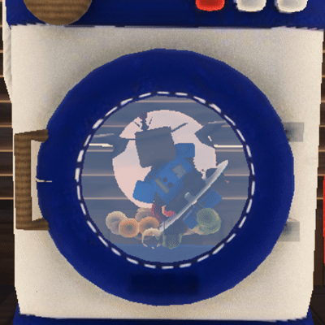
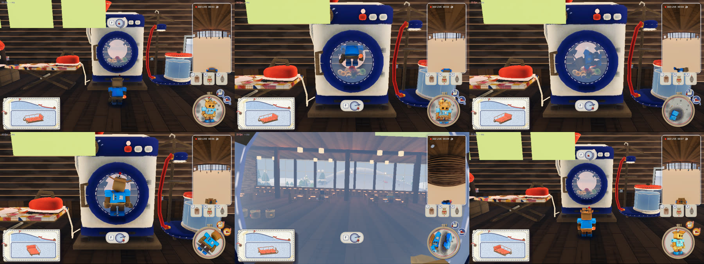

# 紙の人形の水（濡れとパリッと）

2026-11-01。代表の言葉は「キャラクターのよれゲージ（ないし水分量ゲージ）のパラメータ設定と実装お願いします。よれが大きくなるとビジュアルも濡れた見た目になり、動きも緩慢になり、押す力も減るようにしてほしい。そしてその下降バッジをつくってわかるようにしてほしい。逆に暖炉にあたったときにパリッとゲージが上がって…動きの俊敏さや押す力の上昇するようにしてほしい。上昇バッジもほしい」。

そのあと形を変えた（同じ日）:

- 「水だけでいいや。暖炉か焚き火で水分ゲージを減らして 0 にして、さらに火にあたっていくとパリッとしてバフになるって感じで。食べ物でのバフはやめよう。完全に雰囲気づくりの道具にしよう」（いちど水と熱の 2 本に分けたのを、水だけに戻した）
- 「リニアなゲージUIって、常にチラ見して管理しなきゃいけないからこのゲームには窮屈であってないかも」→ 帯のゲージはやめ、刺繍枠の地の布をまばらに濡らす（「刺繍の地の布をまばらに濡らす感じにしよう。で、乾くときもまばらに乾いてく」）

紙の人は雪に濡れると困る（[アートコンセプト](art-concept.md)）。外で濡れて弱り、ロッジの暖炉で乾かしてパリッと強くなって、また山へ出る。「ロッジでくつろぐ」柱に、休む理由と手ざわりを足すものです。

実装は `game/damp.gd`（値と効き目）、`game/person/paper_damp.gdshader` と `game/doll.gd`（人形の見た目と動き）、`game/self_cam.gd` の `MASK_SHADER`（刺繍枠の地の布のしみ）、`game/damp_hud.gd` と `game/badges.gd`（バッジ）です。

## 値

人ごとに 1 つの値を持つ。

- **100（びしょびしょ）〜 0（乾いている）〜 −40（パリパリ）**。始めは 0
- 0 より上が水。0 より下は、火で乾かしすぎてパリッとした紙。火のそばだけで 0 より下へ行く

## 段と効き目（`damp.gd` の `STAGES`）

| 段 | 値 | 歩く速さ | 押す力（1 人） | 姿勢のコマ | バッジ |
|---|---|---|---|---|---|
| よれよれ | 75 より上 | ×0.80 | ×0.70（210 N） | 8 fps（1.5 コマに 1 回） | 下降（藍・↓↓） |
| しんなり | 35 〜 75 | ×0.90 | ×0.85（255 N） | 10 fps（1.2 コマに 1 回） | 下降（藍・↓） |
| ふつう | −10 〜 35 | ×1 | ×1（300 N） | 12 fps | なし |
| パリッと | −10 以下 | ×1.15 | ×1.25（375 N） | 12 fps | 上昇（山吹・↑） |

- 効き目は段ごとに切り替える（バッジの段と同じ）。見た目は段でなく値のまま、なめらかに変わる
- 歩く速さはあなたと仲間（`player.gd`・`bot.gd`）の歩みに、押す力は `sled.push` と `sled.pull_rope` に掛ける（`strength`）
- 姿勢のコマ: 弱ると人形の姿勢を決める間隔が空き、動きがもたもたする（12 fps のコマ撮りのまま、コマを飛ばす）。身ぶりの長さは変わらない（全員の画面で同じコマに終わる）

## 何で濡れるか（`damp.gd`）

| 何 | 量 | 中身 |
|---|---|---|
| 外にいるだけ | 0.07 / 秒（35 まで） | 舞う雪と湿った空気。0 から 35 まで 8 分ほど。外にいるだけなら、ふつうの上の端で止まる |
| 雪の上を歩く | 0.08 / 秒 | 雪を蹴る |
| ソリを押す・紐を引く | 0.17 / 秒 | 雪に膝をつき、体を雪に寄せる |
| ソリに引きずられる | 2.0 / 秒 | 雪の上を滑らされる |
| 乗って滑る | 速さ × 0.033 / 秒 | 雪煙をかぶる。米袋は雪にじかに座るので 2 倍 |
| 雪玉が当たる | 8（1 回） | `emotes.gd` の hit。パリッとしていても、0 から濡れる |
| 雪玉を丸める | 3（1 回） | 素手で雪をつかむ |
| 転ぶ | 7（1 回） | 高い所から落ちて、下向き 6 m/s より速く雪に着く（ふつうのジャンプは 4.5 m/s） |

## 何で乾くか・パリッとするか

| どこ | 速さ | どこまで |
|---|---|---|
| ロッジの中（火から離れた所） | 0.55 / 秒 | 0 まで。100 から 3 分 |
| 火のそば（暖炉・焚き火から 5 m の内） | 0.55 ＋ 4.7 × 暖かさ / 秒 | 暖かさ 0.15 から 0 より下へ行きはじめ、0.6（火から 2 m）で −40 まで。すぐそばなら 100 から −40 まで 27 秒ほど |
| 厨房の乾燥機の中（F で入る。下の「乾燥機に入る」） | 35 / 秒 | 4 秒ほどで −40 まで（2026-11-01 代表「乾燥機入れるようにするか。そしたら一瞬で MAX までいくみたいな。いいじゃん」。そのあと「キャラの乾燥時間を倍にしてほしい」で 2 秒から 4 秒に）。前に立つだけでは乾かない |
| 火から離れる（中でも外でも） | 0.22 / 秒 | パリッとが抜けて 0 に戻る（−40 から 3 分） |
| 風除室 | 変わらない | |

- 暖かさは火からの近さ（0 〜 1）。暖炉はロッジの中からだけ効く（壁の外では効かない）
- 焚き火はまだゲームにない。置くときは、その Node3D を `add_to_group("fires")` すれば、暖炉と同じように乾き、パリッとする（外でも）
- 中・風除室・外は、音の屋内の判定（`audio.gd` の `zone_at`）で分ける
- ほかの仕組みからは `damp.add_water(人の番号, 量)` で足せる（正で濡れる、負で乾く）

## 乾燥機に入る（`cook_station.gd`）

2026-11-01 代表「乾燥機入れない。手にペレット持ってない状態のとき F で入ってキャラ乾燥させれるようにしてほしい」。





- 手にペレット（調理の途中の物）を持たずに、乾燥機の前（食堂の側）で乾燥機を向いて F。案内は F と、丸い戸に丸まった人形と回る矢印の絵。ペレットを持っていれば、いつもどおり調理
- 丸い戸へ弧を描いてとび込み（6 コマ）、胴の中でぐにゃんぐにゃんに回される（`dryer_flop.gd`。2026-11-01 代表「キャラの顔が窓から見えるようにして、体はぐにゃんぐにゃんの物理演算にしてほしい」）。羽根に引っかかって胴（16 コマで 1 回り）といっしょに持ち上げられ、てっぺんの手前で離れて、くるっと回りながら落ちる。落ちると「ぽすっ」。手足と頭は見かけの重力に引かれてぶらぶら振れ、顔はいつも丸い戸の窓へ向く。体は足もとから頭までの太さのある棒として、両端を胴の壁に当てる（笠のつばが壁にめりこまない）。胴（半径 0.65 m）に収まらない大きな人形は、とび込むあいだに収まるまで縮み、出るとき戻る（笠 0.59・ゴーレム 0.49・折り紙 0.77・新聞 0.89 倍。ロボット・武者・人形はそのまま）。計算は入ってからのコマだけで進めるので、どの画面でも同じ動き。姿は人形と同じ 12 コマ／秒で刻む。乾燥機は調理のときと同じにがたがた揺れ、漏斗から湯気、回る音とオルゴール
- 回っているあいだ、水が 1 秒に 35 抜ける。100 から −40 まで 4 秒（2026-11-01 代表「キャラの乾燥時間を倍にしてほしい」。前は 70 で 2 秒）
- 乾ききって（−40）1.5 秒以上回ったら、ひとりでに戸からとび出し（5 コマ）、乾燥機の前に立つ。中でもう一度 F でも出る（案内は F と、戸から出る矢印の絵）。12 秒より長くは回らない
- 一人称は、胴の真ん中から丸い戸の窓ごしに外（食堂）を見る。人形といっしょには回らず、少し揺れる。三人称は、戸の前から窓の中の人形を見る
- 中では歩く・投げる・米袋を出す・ソリに乗るはしない
- ほかの画面: 入る・出るは「誰が」の短い出来事（`craft.gd` の `dry_in`・`dry_out`）。ホストが空きを確かめて全員に配るので、どの画面でも同じ人が同じコマに入って回る（人形の姿は届いた位置でなく、その画面の乾燥機のコマで動かす）
- ぶつからないように: 中に人がいるあいだは、誰も入れず、調理もできない。誰かが乾燥機で調理しているあいだ（ほかの画面の人も。`cook` の出来事で知る）は入れない。同時に F を押したら、ホストに先に届いた人が入る
- 乾燥機の glb は、本体の箱の前の面が丸い戸のフィルムのすぐ裏に残っていて、中の胴・羽根・粒が見えなかった。ゲームを始めたときに、本体のフェルトの前の面のうち窓の内側を抜いている（`cook_station.gd` の `_open_window`。ぎざぎざの縁は紺の縁の下に隠れる）。台本（`props/build_kitchen.py` の `dryer_body`）で穴を開けて書き出し直せば要らない

## ご飯

効かない。雰囲気づくりの道具（2026-11-01 代表「食べ物でのバフはやめよう。完全に雰囲気づくりの道具にしよう」）。前の「ぬくもり」（`warmth.gd`。湯たんぽの絵・ふるえを抑える・押す力 2 割増し）と、ご飯で湿り気が戻る仕組みは外した。外のふるえは気温だけで決まる（`temperature.gd`）。

## 押す力の釣り合い（`tools/push_check.gd`）

ふもと（頂上から 36 m）から頂上の 4 m 手前まで、ソリの後ろから頂上へ押し続けた時間。押す人は形だけで、人の歩く速さは入れていない。

| ソリ | 押す人 | よれよれ ×0.70 | しんなり ×0.85 | ふつう ×1 | パリッと ×1.25 |
|---|---|---|---|---|---|
| 小（15 kg） | 1 人 | 14.6 秒 | 11.9 秒 | 10.8 秒 | 10.2 秒 |
| 小（15 kg） | 2 人 | 9.9 秒 | 9.6 秒 | 9.4 秒 | 9.2 秒 |
| 小（15 kg） | 4 人 | 9.1 秒 | 8.9 秒 | 8.8 秒 | 8.7 秒 |
| 中（60 kg） | 1 人 | 49.2 秒 | 44.1 秒 | 45.5 秒 | 42.9 秒 |
| 中（60 kg） | 2 人 | 40.9 秒 | 34.4 秒 | 26.3 秒 | 19.1 秒 |
| 中（60 kg） | 4 人 | 15.0 秒 | 12.9 秒 | 11.3 秒 | 10.4 秒 |
| 大（220 kg） | 1 人 | 150 秒で 18.8 m | 150 秒で 24.9 m | 147.7 秒 | 109.0 秒 |
| 大（220 kg） | 2 人 | 93.9 秒 | 73.2 秒 | 60.1 秒 | 46.6 秒 |
| 大（220 kg） | 4 人 | 44.2 秒 | 43.5 秒 | 42.4 秒 | 39.4 秒 |

- **よれよれでも、止まって登れなくなる所はない**（いちばん急な所は 23.6°）。「1 人でも最も急な所をじりじり登れる」は守る
- 中のソリを 1 人で押すときは、差が小さい。遅い所では静止摩擦が重力を打ち消し、速くなると消える今の作り（`sled.gd` の `DRAG_STOP_SPEED`）のため、登る速さは押す力よりこの境で決まる
- 差がはっきり出るのは、中のソリを 2 人で押すときと、大きいソリを押すとき。4 人で中を押すと、押す力が消えていく速さ（3〜4 m/s）に届くので差は小さい

## 見た目（`paper_damp.gdshader`・`doll.gd`）

人形の材質（焼いた色の絵と法線の絵）を、湿り気の見える紙の材質に替えた。7 体（kasa・origami・news・robo・musha・ningyo・golem）とも同じ材質で効く。人形の見た目は `damp.look_of(値)`（-1 びしょびしょ 〜 0 ふつう 〜 1 パリパリ）で、0 より上は水のまま湿りが濃くなり、0 より下で張りが出る（−40 でいっぱい）。

- **湿る**: 紙が水を吸って色が濃く沈む。水のシミが広がり、シミの縁に濃い輪（潮じみ）が出る。濡れた所は艶が出て、後ろからの光が透ける。紙が波打ち、しわの陰が深くなる。笠のつば・肩・袖など、体の芯から離れた所ほど重さで垂れ、全体が少し縮む
- **うなだれる**: 胸が前へうなだれ、首が下がり、腕が垂れる。クレイアニメの揺れが小さくなる（重い）
- **パリッと**: 濃淡が少し締まる。明るさと色はそのまま（明るくすると白く飛ぶ。2026-11-01 代表「明度上げ過ぎ、キャラが白飛びしてる」）。艶のない張った面になり、しわが浅く、縁にうすく明るさが立つ。胸が起きる
- 見た目は値を 1.5 / 秒でなめらかに追う（暖炉でじわっと乾き、雪玉でさっと濡れる）

絵: [11-dolls.jpg](damp/11-dolls.jpg)（7 体。上から 100・0・−40）。前の [1-dolls.jpg](damp/1-dolls.jpg)・[2-stages-kasa.jpg](damp/2-stages-kasa.jpg) は、パリッとを明るくしていたころのもの。確かめは `tools/damp_shots.gd`。

## 見せ方: 刺繍枠の地の布のしみとバッジ（`self_cam.gd`・`damp_hud.gd`・`badges.gd`）

数字や帯のゲージは出さない。右下の刺繍枠（自分の小窓）の地の麻布が濡れる。

- **しみ**: 布のあちこちに、まばらにしみが出る。しみは大きさ（小さなしずく 〜 大きなしみ）も濃さもばらばらで、出る順もしみごと。濡れるほど増えて広がり、乾くときは一つずつ縮んで消えていく（まばらに乾く）。びしょびしょに近いと、しみのあいだも全体に湿る
- しみは真ん中がいちばん濃く、外へ行くほど連続して淡くなる。縁の濃い輪じみ（乾いたあとの汚れの跡）は、濡れているあいだは描かない（2026-11-01 代表「連続的に外側に行くにつれて淡くなるもんだと思ってた」）。重なった所は濃い方に合わせ、境はなめらかにつなぐ（代表「濡れの重なりのとこは濃度を濃い方にあわせて、境界の輪郭も馴染むように」）
- 濡れた所は黒っぽく沈み、そこに縫った糸も少し沈む（代表「濡れてる時ももうちょい黒めで」）
- 縁は布の目でにじみ、形は少し楕円にゆがむ（まんまるにしない）
- **パリッと**: 麻布の織り目が少しくっきりする（明るさと色はそのまま）
- 見せる値は本当の値を 1.5 / 秒でなめらかに追う（`hud.gd` の `_damp_w`。人形の見た目と同じくらいの速さでしみる・乾く）
- 試したがやめたもの: 帯のゲージ（窮屈）、地を和紙にする（テーマが崩れて混乱する。代表「刺繍の地なんだから、テーマが崩れて混乱するからだめだ」）

バッジは、何が変わったかの絵をフェルトのまるいワッペンに刺繍し、矢印を重ねる。段が変わったときに跳ねて出るので、見張らなくても分かる。

- 押す力: 腕を曲げて力こぶを見せる（2026-11-01 代表「押す力は力こぶのワッペンにしてほしい」）。生成りのフェルトの腕を縁を縫ったアップリケにし、肩に赤い半袖、握りこぶし、力こぶの上に白い糸の力の線
- 速さ: 赤いフェルトの靴と、かかとの後ろの速さの線・雪けむり
- 下がっているときは藍のワッペンで、右下に藍の矢印（よれよれは 2 本）。上がっているときは山吹のワッペンで、右上に赤い矢印。上がる矢印は根もとを留めたまま、12 コマでゆっくり（2.2 秒に 1 回）控えめに伸び縮みする
- 刺繍枠の右上に、枠に沿って並べる（2026-11-01 代表「バフデバフは刺繍の右上に置きましょう」）。出たとき・段が変わったときに跳ねる
- 仲間のバッジは出さない（仲間の調子は人形の見た目で分かる。2026-11-01 代表「仲間のは見えなくて良い」）
- 大きさ・矢印・動きは代表と何度か見比べて決めた（ワッペン 52 px、矢印は小さく短く、動きは控えめ）

まわりの並べ替え: 刺繍枠を画面の端から離した（右 92 px・下 56 px。`self_cam.gd` の `MARGIN`）。I・N・R の札と雪玉のリボンは、刺繍枠の上の縁から 72 px 上へ（`craft_ui.gd` の `ABOVE_HOOP`）。

絵: [9-hoop-stains.gif](damp/9-hoop-stains.gif)（100 から 0 へ乾いていく）、[10-hoop-stains.jpg](damp/10-hoop-stains.jpg)（左から 100・70・40・25・12・0）、[12-push-badge.png](damp/12-push-badge.png)（押す力の力こぶ。左からよれよれ・しんなり・パリッと）。3〜8 は帯のゲージのころの絵。確かめは `tools/damp_hud_shots.gd`。

`badges.gd` は湿り気だけのものではない。`main.badges.put(人の番号, 名前, 向き, 矢印の数, 絵)` で、ほかの効き目も同じ並びに入れられる。絵は `badges.gd` の `draw_icon` に足す。

## 通信

- 人の値は、その人の画面が決める（自分の場所・動きを知っているのはその画面なので）。値は姿といっしょに 1 秒に 20 回送る（`net.gd` の `_my_state` の `"dw"`、整数）
- ほかの画面では、その人の体（`remote_person.gd`）が `damp.apply_net` で値を入れる。その人の体は `damp_from_net` を持ち、`damp.gd` はその値を動かさない
- ホストは自分と仲間の値も配る（`damp.sent` → `net.down`。`{kind: "damp", who, w}`）。入ってきた人には、みんなの値をまとめて渡す（`damp.snapshot`）
- 人形の見た目（`doll.damp`・`doll.pose_step`）は、どの画面でも届いた値から出る
- ソリはホストの物理が動かすので、ホストの画面のその人の体が、届いた値の押す力（`damp_k`）で押す・紐で引く

## 確かめ

```
G=/Applications/Godot.app/Contents/MacOS/Godot
$G --headless --fixed-fps 60 --path game -s res://tools/damp_check.gd -- --no-sound            # 場所と出来事での値の動き
$G --headless --fixed-fps 60 --path game -s res://tools/push_check.gd -- --sled=mid --no-player --bots=0 --no-sound --no-lodge   # 押して登る時間
$G --path game --resolution 1800x560 -s res://tools/damp_shots.gd -- --dir=/tmp/damp --no-pip --no-selfcam --values=100,0,-40   # 7 体を値ごとに
$G --path game --resolution 1600x900 -s res://tools/damp_hud_shots.gd -- --dir=/tmp/damp --hud-idle=0 --values=100,70,40,0,-30   # 画面（一人称・三人称）
$G --headless --fixed-fps 60 --path game -s res://tools/damp_net_check.gd -- --host --port=24711 --no-sound            # 通信（ホスト）
$G --headless --fixed-fps 60 --path game -s res://tools/damp_net_check.gd -- --join=127.0.0.1 --port=24711 --no-sound  # 通信（つなぐ側）
```

`tools/damp_net_check.gd`（同じ Mac で 2 つ）: つなぐ側の値を 90 → 50 → 0 → −30 と入れると、ホストの画面のその人の押す力の倍率も ×0.70 → ×0.85 → ×1.00 → ×1.25 と追い、人形の見た目も −0.90 → −0.50 → 0 → 0.75 になった。

`tools/dryer_net_check.gd`（同じ Mac で 2 つ、2026-11-01）: つなぐ側が乾燥機に入ると、ホストの画面でもその人の体が胴の真ん中から 0.32 m（腰の所）で回り、出るとモードが戻った。中にいるあいだに入ろうとすると、ホストもつなぐ側も断られた。ホストが乾燥機でラーメンを調理しているあいだ、つなぐ側は入れず、仕上がったあとは入れた。

`tools/damp_check.gd` の結果（2026-11-01）:

| 場面 | 値 | 段 | 歩く速さ | 押す力 | バッジ |
|---|---|---|---|---|---|
| 始め | 0 | ふつう | ×1.00 | ×1.00 | なし |
| 外に 60 秒立つ | 4 | ふつう | ×1.00 | ×1.00 | なし |
| 雪玉が 3 回当たる | 28 | ふつう | ×1.00 | ×1.00 | なし |
| （水 60 にする） | 60 | しんなり | ×0.90 | ×0.85 | 押す↓ 速さ↓ |
| 暖炉のそば 5 秒 | 41 | しんなり | ×0.90 | ×0.85 | 押す↓ 速さ↓ |
| 暖炉のそば 10 秒 | 23 | ふつう | ×1.00 | ×1.00 | なし |
| 暖炉のそば 20 秒 | -15 | パリッと | ×1.15 | ×1.25 | 押す↑ 速さ↑ |
| 暖炉のそば 30 秒 | -40 | パリッと | ×1.15 | ×1.25 | 押す↑ 速さ↑ |
| 外に 60 秒（パリッとが抜けていく） | -27 | パリッと | ×1.15 | ×1.25 | 押す↑ 速さ↑ |
| 外にさらに 120 秒 | 0 | ふつう | ×1.00 | ×1.00 | なし |
| 水 60 から乾燥機の前に立って 3 秒（乾かない） | 58 | しんなり | ×0.90 | ×0.85 | 押す↓ 速さ↓ |
| 乾燥機に入って 1 秒（とび込み 0.5 秒） | 43 | しんなり | ×0.90 | ×0.85 | 押す↓ 速さ↓ |
| 乾燥機に入って 2 秒 | 8 | ふつう | ×1.00 | ×1.00 | なし |
| 乾燥機に入って 4 秒 | -40 | パリッと | ×1.15 | ×1.25 | 押す↑ 速さ↑ |
| 乾燥機からひとりでに出た（入って 4.0 秒） | -40 | パリッと | ×1.15 | ×1.25 | 押す↑ 速さ↑ |
| 水 90 からロッジの中（暖炉から遠く）に 60 秒 | 57 | しんなり | ×0.90 | ×0.85 | 押す↓ 速さ↓ |
| ロッジの中に 150 秒 | 7 | ふつう | ×1.00 | ×1.00 | なし |
| 風除室に 30 秒 | 7 | ふつう | ×1.00 | ×1.00 | なし |

一人プレイの仲間（CPU、`bot.gd`）は濡れない（`stays_dry`。ロッジへ乾かしに行かないので。2026-11-01 代表「一人プレイの時の CPU は濡れないようにしましょう」）。0 のまま、押す力も歩く速さも変わらない。

## まだのこと

- 乾燥機の glb の前の面の穴は、ゲームの中で抜いている（台本で開けて書き出し直していない）。卓上の乾燥機（`table_dryer`）も同じく中が見えない
- 乾燥機に入っている途中で通信が切れた人は、12 秒たつと空きに戻る（それまでは誰も入れない）
- あとから来た人には、いま乾燥機に入っている人を渡していない（入る・出るの出来事が届いてからは合う）

- 焚き火はまだない（置いたら `fires` の仲間分けに入れるだけで効く）
- 一人称の手（`fp_hands.gd`）は濡れても変わらない。自分の調子は、刺繍枠の地と人形で分かる
- 乾いたあとの輪じみ（汚れの跡）は残さない
- [アートコンセプト](art-concept.md) の「使い込み（案）」の、乾かしても残る折りじわは入れていない
- ソリが大きく傾いて投げ出されるのは「転ぶ」に入れていない（高い所から落ちたときだけ）
- 止める力（引きずられているときに踏ん張る力）は濡れで変えていない
