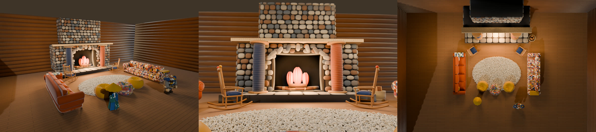
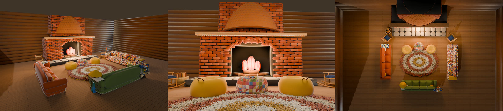
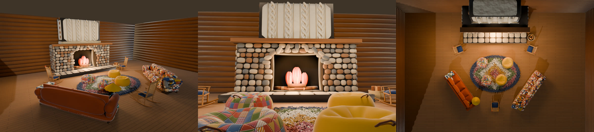

# 暖炉と、そのまわりの居場所（2026-11-02）

代表の言葉:「暖炉がちゃっちい。暖炉前のベンチもなんか味気ない。まんなかに毛足の長いラグ、その周りに揺り椅子がいくつか、ビーズクッションがいくつか、大きなソファがいくつかって感じが良い」

## 案（代表は案 3 を選んだ）

どの絵も左から「入口の側から」「暖炉の前に座った目線」「真上から（北が上）」。形は裁縫の道具と材料から借り、`props/build_nook.py` の本番の素材で描いた。左の絵の人形（笠と千代紙・継ぎはぎの巨人）は大きさの目安。炎は描く画像だけの仮の形（ゲームは `game/flame.gd` の薄葉紙の炎）。

| 案 | 暖炉 | 並べ方 |
|---|---|---|
|  1 向かい合わせ | フェルトの小石を天井まで積み、炉の両脇に大きな木の糸巻き、飾り棚は木の物差し | 生成りのラグの左右にソファ 2 脚を向かい合わせ、揺り椅子 2 脚は暖炉の両脇、ビーズクッション 3 つは入口の側 |
|  2 コの字 | フェルトのレンガに、銅の指ぬきの形のフード（くぼみの点）、棚の縁にかぎ針のレース | 同心の輪のラグをソファ 3 脚がコの字に囲み、揺り椅子 2 脚は炉床の両端、ビーズクッション 3 つは暖炉のすぐ前 |
|  **3 半円（採用）** | 炉のまわりはフェルトの小石、上の煙突はなわ編みのセーター（裾はゴム編み、脇に木のボタン） | 菱形のリヤのラグをソファ 2 脚が斜めに囲み、揺り椅子 3 脚（1 脚は入口の側）、ビーズクッション 4 つはラグの上 |

描き直し: `sh design/hearth-nook/sheet.sh`（案ごとの 3 枚は `props/build_nook.py --plan N --cpu --views room,plan,sit`）

## ゲーム

- ロッジ（`lodge/build_lodge.py`）は煙突の塊だけ。炉の口・炉床・飾り棚・火と前の長椅子はやめ、目印 `slot_hearth`（暖炉の前の面のまんなか）を置いた。1 階の煙突の箱は壁の内の面まで
- `game/hearth_nook.gd` が目印に暖炉と家具を置き、外形の箱の当たりを付ける。ラグの毛足はここで作る（同じ楕円を 16 層重ねて毛糸の房を立てる。描くのは 1 回）
- 席（`game/seats.gd`、F で座る）: ソファは 4 人ずつ並ぶ、揺り椅子は座りきると前後に揺れる（弓の円の中心まわりに椅子と人形をいっしょに回す。±0.085 rad、2.2 秒で 1 往復。全員の画面で同じコマの時計から）、ビーズクッションは袋がつぶれて沈み、うしろへもたれる
- 人形の傾きは `doll.gd` の `rock_axis`・`rock`・`rock_at`。つないだ人には `net.gd` の `ra`・`rk`・`rp` で送る
- 暖炉の火は `game/hearth_fire.gd`（炎 5 つと熾火）。部屋の灯り `light_fire` は範囲 11 m・明るさ 2.0
- 暖かさと乾く範囲: 暖炉は 9 m（`temperature.gd`・`damp.gd` の `HEARTH_R`。焚き火は 5 m のまま）
- ロッジでくつろぐ仲間（`--lodge-bots`）は 7 割で暖炉のまわりの席を選び、入り口（`hearth_nook.gd` の `ENTRIES`）を通って内側の席へ回り込む。ペットはラグの暖炉の側で寝る

## 絵

| 絵 | 中身 |
|---|---|
| `compare-*-day.jpg` `compare-*-night.jpg` | 左が前、右が後。entrance 入口から・plan 真上から・seated 暖炉の前に座った目線・side 南東から・close 火の寄り |
| `sit-side-7dolls.jpg` | 7 体（上から kasa・origami・news・robo・musha・ningyo・golem）を、左からソファ・揺り椅子・ビーズクッションに座らせた真横（揺り椅子はいちばんうしろへ揺れた所） |

## 確かめ

- `game/tools/hearth_shots.gd`（見渡し 5 つ、`--sit=all` で 7 体を座らせる、`--fps` で家具のありなし）
- `game/tools/sit_side_shots.gd --seats=sofa,rocker,beanbag`（座面の下へ入った脚・背もたれへ出た体・浮き）
- `game/tools/nook_sit_check.gd`（あなたが F と同じ流れで 3 種類に座る）、`game/tools/nook_bot_check.gd`（仲間が座る席の種類）
