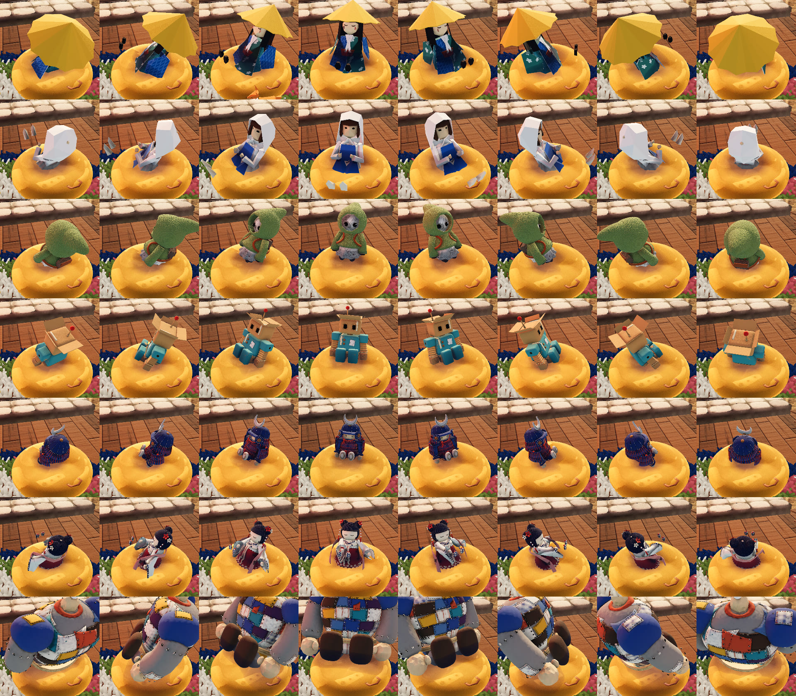
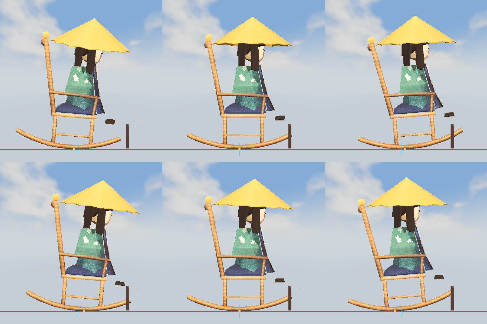

# 暖炉と、そのまわりの居場所（2026-11-02）

代表の言葉:「暖炉がちゃっちい。暖炉前のベンチもなんか味気ない。まんなかに毛足の長いラグ、その周りに揺り椅子がいくつか、ビーズクッションがいくつか、大きなソファがいくつかって感じが良い」

## 案（代表は案 3 を選んだ）

どの絵も左から「入口の側から」「暖炉の前に座った目線」「真上から（北が上）」。形は裁縫の道具と材料から借り、`props/build_nook.py` の本番の素材で描いた。左の絵の人形（笠と千代紙・継ぎはぎの巨人）は大きさの目安。炎は描く画像だけの仮の形（ゲームは `game/flame.gd` の薄葉紙の炎）。

| 案 | 暖炉 | 並べ方 |
|---|---|---|
|  1 向かい合わせ | フェルトの小石を天井まで積み、炉の両脇に大きな木の糸巻き、飾り棚は木の物差し | 生成りのラグの左右にソファ 2 脚を向かい合わせ、揺り椅子 2 脚は暖炉の両脇、ビーズクッション 3 つは入口の側 |
|  2 コの字 | フェルトのレンガに、銅の指ぬきの形のフード（くぼみの点）、棚の縁にかぎ針のレース | 同心の輪のラグをソファ 3 脚がコの字に囲み、揺り椅子 2 脚は炉床の両端、ビーズクッション 3 つは暖炉のすぐ前 |
|  **3 半円（採用）** | 炉のまわりはフェルトの小石、上の煙突はなわ編みのセーター（裾はゴム編み、脇に木のボタン） | 菱形のリヤのラグをソファ 2 脚が斜めに囲み、揺り椅子 3 脚（1 脚は入口の側）、ビーズクッション 4 つはラグの上 |

描き直し: `sh design/hearth-nook/sheet.sh`（案ごとの 3 枚は `props/build_nook.py --plan N --cpu --views room,plan,sit`）

## ゲーム

- ロッジ（`lodge/build_lodge.py`）は煙突の塊だけ。炉の口・炉床・飾り棚・火と前の長椅子はやめ、目印 `slot_hearth`（暖炉の前の面のまんなか）を置いた。1 階の煙突の箱は壁の内の面まで
- `game/hearth_nook.gd` が目印に暖炉と家具を置き、外形の箱の当たりを付ける。ラグの毛足はここで作る（同じ楕円を 16 層重ねて毛糸の房を立てる。描くのは 1 回）
- 席（`game/seats.gd`、F で座る）: ソファは 4 人ずつ並ぶ、揺り椅子は座りきると前後に揺れる（弓が床の上を転がる。下の「揺り椅子の支点を床に」。±0.085 rad、2.2 秒で 1 往復。全員の画面で同じコマの時計から）、ビーズクッションは袋がつぶれて沈み、うしろへもたれる
- 人形の傾きは `doll.gd` の `rock_axis`・`rock`・`rock_at`。つないだ人には `net.gd` の `ra`・`rk`・`rp` で送る
- 暖炉の火は `game/hearth_fire.gd`（炎 5 つと熾火）。炎は切ったフェルト（代表が焚き火の炎の案 `design/campfire/proposal-flames.jpg` の左から 2 つ目を選んだ。`flame.gd` の既定の形を `"felt"` に。焚き火・松明・ガス灯・キャンドルもそろえた）。部屋の灯り `light_fire` は範囲 11 m・明るさ 2.0
- 暖かさと乾く範囲: 暖炉は 9 m（`temperature.gd`・`damp.gd` の `HEARTH_R`。焚き火は 5 m のまま）
- ロッジでくつろぐ仲間（`--lodge-bots`）は 7 割で暖炉のまわりの席を選び、入り口（`hearth_nook.gd` の `ENTRIES`）を通って内側の席へ回り込む。ペットはラグの暖炉の側で寝る

## 絵

| 絵 | 中身 |
|---|---|
| `compare-*-day.jpg` `compare-*-night.jpg` | 左が前、右が後。entrance 入口から・plan 真上から・seated 暖炉の前に座った目線・side 南東から・close 火の寄り |
| `flames-all-felt.jpg` | 切ったフェルトにそろえた炎（上: 焚き火の寄り・焚き火・松明、下: ガス灯・卓のキャンドル・暖炉。夜） |
| `sit-side-7dolls.jpg` | 7 体（上から kasa・origami・news・robo・musha・ningyo・golem）を、左からソファ・揺り椅子・ビーズクッションに座らせた真横（揺り椅子はいちばんうしろへ揺れた所） |

## 確かめ

- `game/tools/hearth_shots.gd`（見渡し 5 つ、`--sit=all` で 7 体を座らせる、`--fps` で家具のありなし）
- `game/tools/sit_side_shots.gd --seats=sofa,rocker,beanbag`（座面の下へ入った脚・背もたれへ出た体・浮き）
- `game/tools/nook_sit_check.gd`（あなたが F と同じ流れで 3 種類に座る）、`game/tools/nook_bot_check.gd`（仲間が座る席の種類）

## ビーズクッションで見ている向きへ体が回る（2026-11-03）

代表「ビーズクッションは全方位に向かって座れるから、視点の向きに体の向きが追従してほしい」

- 座りきったら、人形の体の向きが、見ている向き（左右）についてくる。人形と同じ 12 コマ／秒で、1 コマに 0.45 rad（約 26°）まで回る（沈んだまま、もぞもぞ向きを変える）。`doll.gd` の `rock_turns`・`TURN_STEP`。一人称でも三人称でも同じ
- もたれ（`rock_of` の `rock_lean`）の軸も体の向きから決めるので、どちらを向いても、向いた方のうしろへもたれる。もたれたときは裾だけ水平に戻す（広がった裾のうしろが床を抜けない）
- 袋は座るとつぶれて横へ広がる（`hearth_nook.gd` の `BEAN_SINK` 0.12 → 0.38、背 1.7 m の巨人は `BEAN_BIG` でさらに 0.2）。もたれは 0.2 → 0.5 rad。前は袋の縁が腰より 0.2 m 高く、どの向きでも脚が縁に入った
- つないだ人の画面へは、向き（`f`）と、向きについてくるか（`net.gd` の `rt`）を送る。人形が同じコマの時計で回るので、どの画面でも同じ向きになる
- ソファと揺り椅子は席の向きのまま。仲間（`bot.gd`）も席の向き（暖炉の方）のまま

上から kasa・origami・news・robo・musha・ningyo・golem、左から席の向き（暖炉の方）から 45° ずつ回した向き。どれも同じ所から見下ろした絵。

確かめ: `game/tools/beanbag_turn_check.gd`（7 体 × 袋 4 つ × 8 方向で、袋へ入った脚・床の下・ほかの家具の当たりに入った頂点。結果は `beanbag-turn-log.txt`）、
`game/tools/nook_sit_check.gd`（あなたが座って見回す・立つ）、`game/tools/beanbag_net_check.gd`（ホストとつなぐ側の 2 つを起動して、体の向きともたれの軸を比べる）

## 揺り椅子の支点を床に（2026-11-03）

代表「揺り椅子が頭のほうが視点になって揺れてるけど視点床のほうでは？」「支点」

- 前は、弓の円の中心（床から 1.4 m、座った頭より上）のまわりに回すだけだった。ぶらんこのように、座面が前後に振れて頭がほとんど動かず、頭のほうが支点に見えた
- いまは、弓が床の上を滑らずに転がる。弓の円の中心まわりに角 a 回しながら、中心を a × 半径（1.428 m）だけ床に沿ってうしろへ動かす（`hearth_nook.gd` の `roll_xf`）。支点は弓が床に触れている所で、揺れるにつれて前後に ±0.12 m ずれる。弓の円の中心の高さはいつも同じなので、弓は床から浮かず、めり込まない
- 弓の下の面は glb で床より 7 mm 上にあったので、置くときに `ROCK_FLOAT` だけ下げた（座る高さは床から測る）
- 人形も同じ形で動く（`doll.gd` の `rock_roll`。席の `rock_roll` は `seats.gd`、つないだ人へは `net.gd` の `rr`）。椅子は人形の角が変わったフレームで動かす（前は 12 コマの区切りまで待ち、1 コマ遅れることがあった）
- 一人称の視点は、傾いて動いた人形の目の所から（前は腰のまわりに回していた）。視点は傾けない（地平線は水平のまま）。kasa で前後 0.18 m・上下 0.04 m を 2.2 秒で 1 往復

上の段が前（弓の円の中心まわりに回すだけ）、下の段が後（弓が床を転がる）。左から、いちばん前・まんなか・いちばんうしろ。赤い線が床の高さ（真横から水平に見ているので、床の面は線になる）、黄色の点が弓の床に触れている所、水色の縦の線が揺れていないときの触れる所。

確かめ: `game/tools/rocker_roll_check.gd`（真横の絵と、41 の角で弓と床の差・椅子に対しての人形のずれ・目の動き）、`game/tools/nook_sit_check.gd`（一人称の視点の動き）、`game/tools/rocker_net_check.gd`（ホストとつなぐ側で、同じ傾きの人形と椅子の所をくらべる）。結果は `rocker-roll-log.txt`
