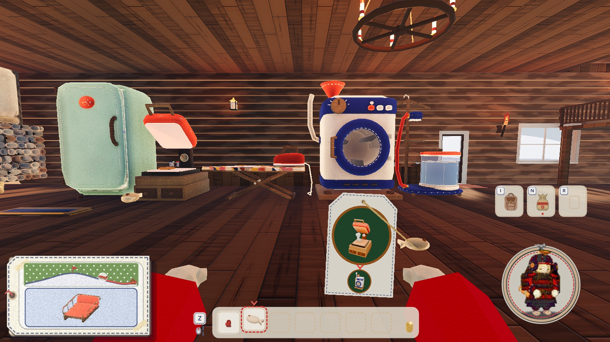
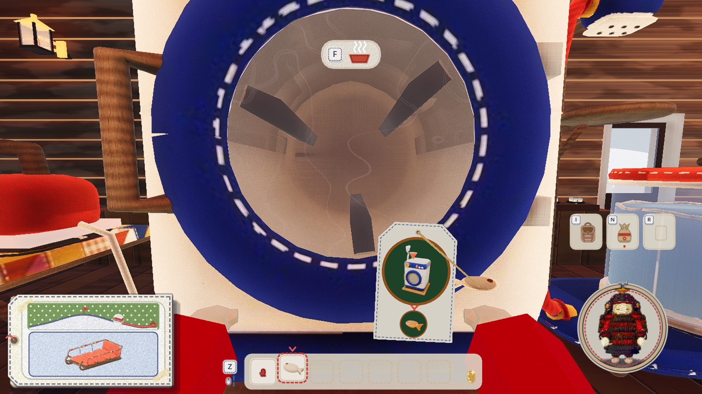

# 手の材料に吊る紙の札（2026-11-06）

代表「食べ物と調理施設の対応を施設の上のボードでなくもとを手に持ったときに表示」。

案は 3 つ（[00-proposals.jpg](00-proposals.jpg)。上段: 手元の札、中段: 世界の待ち針と床の糸、下段: 手の札）。代表は下段を選んだ。


## 決まり

- **いつ出す**: 手の材料（`Food.next_station` が空でない食べ物）を持っているあいだ。できあがった料理、ほかの物、空の手では出さない。手形を出して手が隠れているとき、机の席で料理が机にあるときも出さない
- **絵**: 次の装置を大きく、その下に、その次の装置（なければできあがる料理）を小さく。文字なし。1 工程済むと絵が替わり、ぽんとふくらむ。絵は `game/props/kitchen/icons/`（Blender で装置だけ写した絵。売り場の画面と同じ）と `props/food/icons/`
- **大きさ**: 画面の高さに対する割合で決める（`SIZE`。1080p で札 216 × 324 px、次の装置の丸は 180 px ほど）。視野角を変えても大きさと位置は同じ。下の端は持ち物の列のすぐ上
- **揺れ**: 札はカメラに留め、手とは一緒に動かさない。手が動くと麻ひもだけが伸び縮みする。見回す・踏み出すと、はとめを支点に少しだけ振れる（上限 6°。速い見回しで 5.5°、札の下の端で 31 px）
- **三人称**: 手の物は三人称の画面に出ていないが、板をなくしたので、札は同じ所に出す。結ぶ先がないので麻ひもはなし
- **本人の画面だけ**: カメラの子で、層 5（`ride_wind.gd` と同じ）。小窓・鏡には映らない。通信には載せない

作りは `game/hold_tag.gd`、呼ぶのは `game/player.gd` の `_update_hold_tag`。

## 品書きの板をなくした

`game/menu_board.gd` と、確かめの台本 `game/tools/menu_board_shots.gd` を消した。ロッジの glb に前からある無地の板 3 枚は、glb を書き出し直さず、`game/lodge/lodge.gd` の `_hide_plain_boards` で隠す。

## 見え方





## 確かめ

```bash
/Applications/Godot.app/Contents/MacOS/Godot --path game --resolution 1920x1080 -s res://tools/hold_tag_shots.gd -- --bots=0 --lodge-bots=0 --no-pip --no-sound --no-snow --dir=/tmp/hold_tag
```

## 残っていること

- はとめが材料より上にあるので、麻ひもは下から上へ張る形になる（札を読める大きさにすると、材料の下に吊る場所が足りない）
- 札は画面の右寄りのまんなかより下を隠す。材料を持っている間は雪の上でも出る
