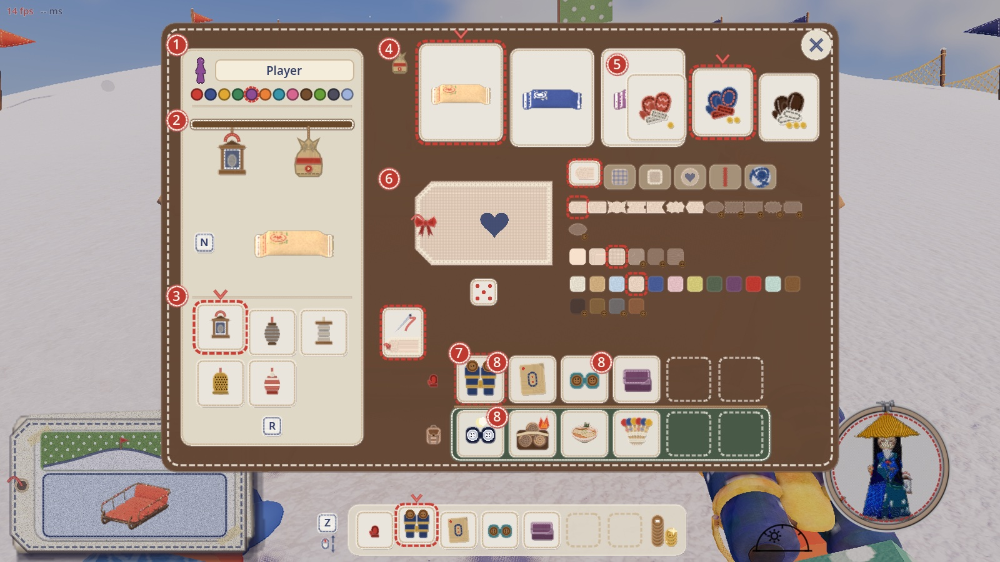
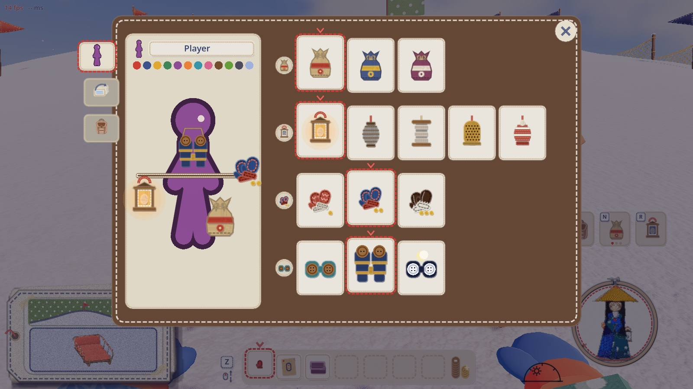
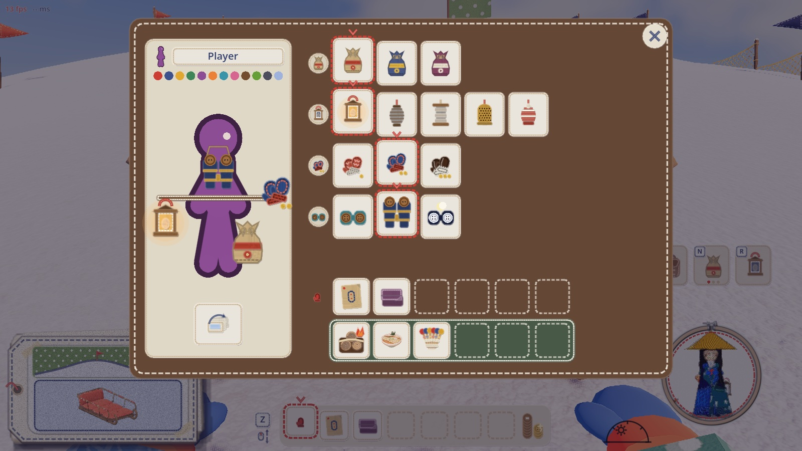
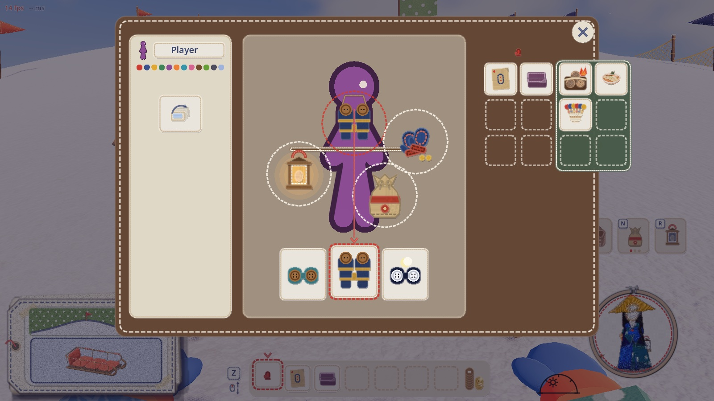
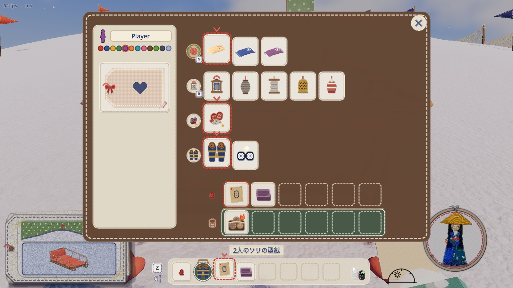
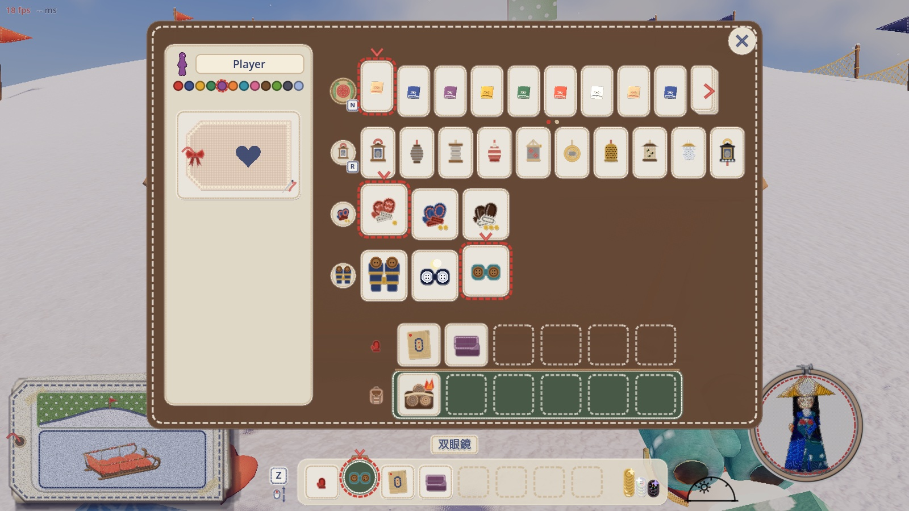
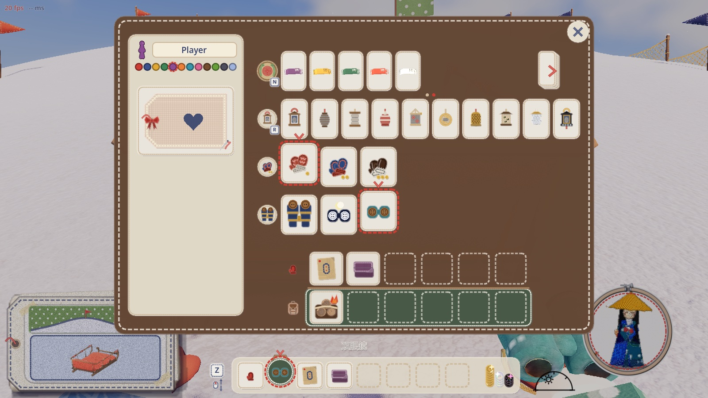
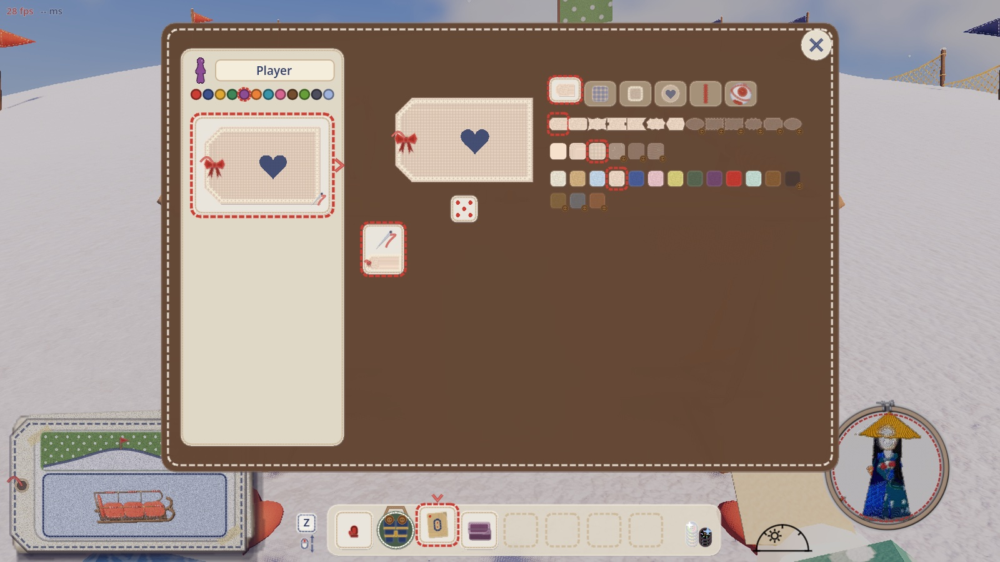
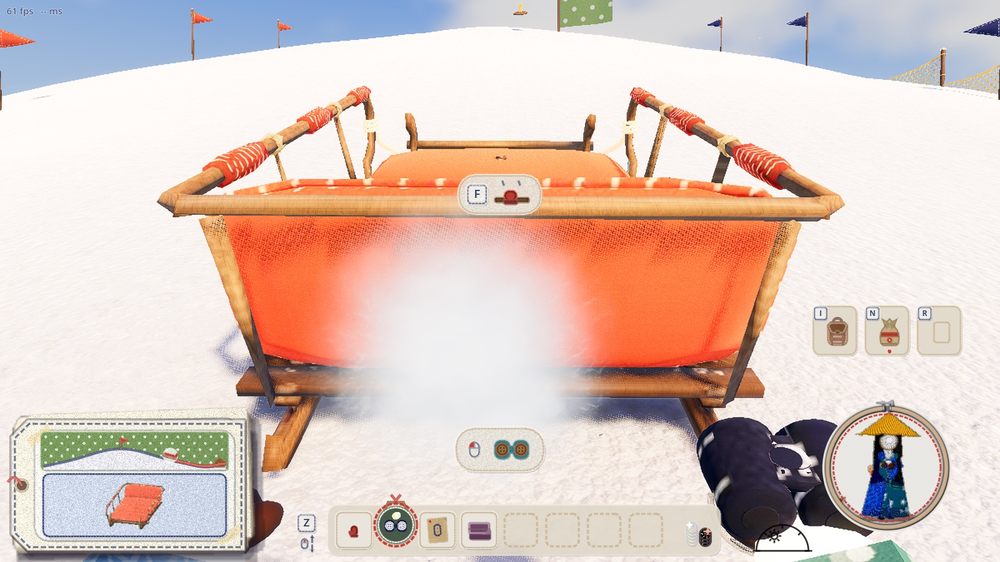
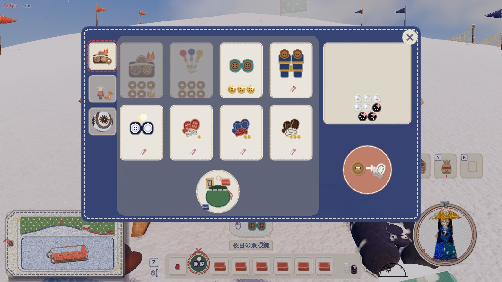

# 持ち物の画面（I）の整理と、手袋・双眼鏡の解放（2026-11-10）

代表「手袋も双眼鏡もUNLOCK形式にしましょう。インベントリ圧迫するのだるいし」「消耗品でもないしね」「インベントリのなかもUI整理したいね」。

## 調べたこと（直す前）

- 手袋（毛糸・フェルト・革）は、もう解放の形だった。買うと持ち物の場所を使わず装備に入り、I の画面の右上の札で替える。保存もしていた（my_tag.cfg の [gloves]）
- 双眼鏡（ふつう・遠見・夜目）は持ち物の品物で、1 本ごとに手持ちかかばんの場所を 1 つ使っていた。手持ちの列で手に持ち、左クリックでのぞく
- 持ち物（手持ち・かばん）は保存していない。だから、今の保存に場所に入った双眼鏡はなく、起動し直すと買った双眼鏡はなくなっていた
- I の画面は、米袋が 3 枚になると、3 枚目が手袋の札の下に隠れていた（`proposal_now.jpg` の 5 の所）

## 案と代表の決め

| 絵 | 案 |
|---|---|
|  | 今の中身（1 名前と色、2 帯、3 ランタン、4 米袋、5 手袋、6 名札と柄、7 手持ちとかばん、8 場所に入った双眼鏡） |
|  | A: しおり 3 枚で分ける |
|  | B: 1 枚のまま区切り直す（左に自分、右上に装備の 4 段、右下に持ち物） |
|  | C: 着せ替え |

代表「Bがいいレイアウトは」「米袋のアイコン微妙。実物についてる米マークワッペンにしてほしい」
「装備画面の体に乗っけてるのがだいぶ意味わかんない。装備物の大きさってそれで大丈夫？増えると収まんなくなりそうだけど」。

描き直した B（`proposal_B2_few.jpg`・`proposal_B2_many.jpg`）と、米マークのワッペン（`proposal_kome_patch.jpg`。実物の米袋の布 `props/sled_sack` の刷りの、赤い輪の米の字形と緑の稲穂）。
双眼鏡ののぞき方は、ア（`proposal_peek_a_neck_slot.jpg`。手持ちの列の素手の右に、首から下げた双眼鏡の丸い枠）とイ（キーでのぞく）から、代表が **ア** を選んだ。

## 作ったもの

- **双眼鏡の解放**（`craft.gd` の scopes・scope_sel・NECK）: 山師の棚で買うと、持ち物の場所を使わずに持っている双眼鏡に入り、首から下げて手に持つ。同じ段は 1 つだけ。
  持ち物がいっぱいでも買える。山師の棚では、持っている段は「もう持っている」の見え方（値段の代わりに針の印）
- **手持ちの列**: 首から下げた双眼鏡は、素手の右に緑のフェルトの丸い枠（木の色の紐を掛けた形）で出る。ホイール・Z で持ち替えて手に持ち、左クリックでのぞく（今と同じ操作）
- **I の画面（B）**: 左は自分（名前と色、自分の名札の札）。名札の札を押すと、右が名札と柄の画面になる（もう一度押すか Esc で戻る）。
  右は装備の 4 段（米袋・ランタン・手袋・双眼鏡）。米袋の段の印は米マークのワッペン（`craft_icons.gd` の kome_patch）。
  札はふつう 78 × 86。段に入らなければ 54 まで小さくし（ランタン 10 は 1 段に入る）、それでも入らなければ、右の端に「めくる」札と、段の下にページの点が出る（米袋は縫うたびに増える）
- **保存**: my_tag.cfg に [binoculars] owned（持っている段）・wear（首から下げている段）を足した。起動したら scope_own と、段で下げる equip で戻す
- **前の版から移す**: 持ち物の場所に入った双眼鏡は `lift_scopes` で持っている双眼鏡へ移し、場所は空ける（あとから来た人が受け取る持ち物にも使う）。
  持ち物は保存していないので、保存から移す双眼鏡はなかった。手袋は前から保存されていて、そのまま読める

| 絵 | 写っているもの |
|---|---|
|  | I の画面。米袋 3・ランタン 5・手袋 1・双眼鏡 2。下の手持ちの列に首の双眼鏡の丸い枠 |
|  | 米袋 14・ランタン 10・手袋 3・双眼鏡 3。米袋の段にめくる札とページの点、ランタン 10 は小さくして 1 段 |
|  | めくる札を押した 2 ページ目 |
|  | 名札の札を押した、名札と柄の画面 |
|  | 遊んでいるときの手持ちの列。素手の右に首の双眼鏡（手に持っている） |
|  | 山師の棚。持っている双眼鏡と手袋は針の印。持ち物がいっぱいでも、双眼鏡は買える |

## 確かめの道具

- `game/tools/inventory_unlock_check.gd`: 数字（買う・場所を使わない・2 度買えない・いっぱいでも買える・首の枠・のぞく・外す・保存から戻す・前の版から移す・山師の札・I の画面の段とめくる札と名札の画面）と、上の絵
- `game/tools/inventory_unlock_net.gd`: 2 台の通信。つなぐ側が双眼鏡を買ってのぞくと、ホストの画面でも同じ段を持ち、相手の人形がその段の双眼鏡を目に当てる。手袋も同じ段になる
- `game/tools/inventory_ui_mock.gd`・`game/tools/binoculars_unlock_mock.gd`: 案の絵を描いた道具（今の画面の上に、案の部品を重ねる）
