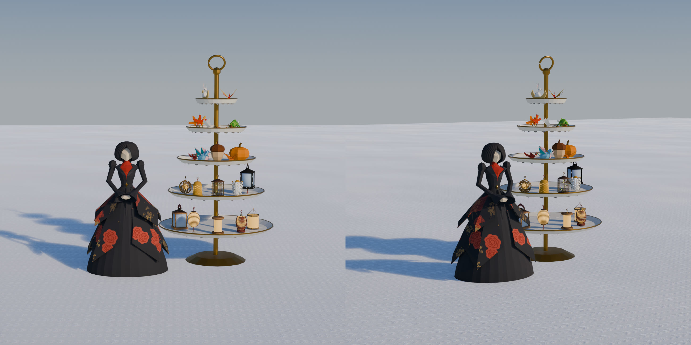

# 紙細工屋さん（2026-11-02）

代表の依頼「新キャラの紙細工屋さん作りたい。提灯とアクセサリ（鳥とかどんぐりとか）売ってくれる人。5案出して。」から。
売る物は、腰に提げる提灯と、頭・肩に載せる小物。ミニオンは山師（山男）が育てて売る（別の作業）。

## 決まったこと

- 姿: 5 案（[person/ideas/kamizaiku](../../person/ideas/kamizaiku/README.md)）から、代表が「右から 2 つ目の黒い貴婦人」を選んだ。
  参考はボードの、着物とドレスを混ぜた黒い紙の婦人。写真の寸法を測って組み直し、代表の声でおかっぱを直し（あごで広がり首へ締まる）、
  胸の覆いを取って朱の着物を V にのぞかせ、頭を小さく・胴と腕を短くした
- 売り場: 代表の案「アフタヌーンティーみたいに何段にもなってるディスプレイ。バカでかくして」。婦人は立ったまま、横に背丈より大きい 5 段のスタンド
- 段の分け方: 下の 2 段が提灯（10 種）、上の 3 段が頭・肩の小物（11 点）。同じ品は一つずつ（代表「ランタンの段とアクセサリの段で分けて」「同じアイテムを置かなくていいならなるべく置いてほしくない」）
- 売る物: 番台の横のランタン掛けの 10 種と、2 階の売り台の頭・肩の小物 11 点を、婦人へまとめた（代表が選んだ）。ランタン掛けはなくした
- 置き場: 2 階の衣装掛けの横（前の売り台の所）。婦人の左にスタンド。2026-11-04 から、エレガントなテントの中で営業する（[作り](../paper-lady-tent/README.md)）。下の絵はテントの前のもの

## ゲームの中の絵

| 絵 | 何か |
|---|---|
| [01-wide.jpg](01-wide.jpg) | 2 階の衣装掛けの横。婦人とスタンド（昼） |
| [02-stand.jpg](02-stand.jpg) | スタンドの寄り。下 2 段に提灯、上 3 段に小物 |
| [03-lady-look.jpg](03-lady-look.jpg) | 婦人の寄り（左）と、近くの人へ顔を向けたところ（右） |
| [04-evening.jpg](04-evening.jpg) | 夕方。提灯がほんのり灯る |
| [05-ui.jpg](05-ui.jpg) | 前で F の画面。左から提灯・頭・肩の段 |
| [06-bought.jpg](06-bought.jpg) | 糸巻きの提灯・千代紙の小鳥・青い小鳥を身につけたところ（三人称） |
| [07-online.jpg](07-online.jpg) | 通信。左はホストの画面（つなぐ側の人が買った糸巻きの提灯とどんぐり）、右はつなぐ側の画面 |

## 作り

- 形: `person/ideas/kamizaiku/roughs.py`（Blender）。`--export game/props/paper_lady --what lady|stand` で glb を書き出す（`props/kit.py` の焼き付けで色と凹凸を画像に）
  - `paper_lady.glb`: 節 `upper_body`（腰から上）・`head_pivot`（頭）。素材は焼いた紙 `paper_doll` と真鍮 `brass`
  - `tea_stand.glb`: 皿の高さと半径は台本の `TIERS`（ゲームでは 1.3 倍。`game/paper_lady.gd` の `TIERS` と同じ）
- ゲーム: `game/paper_lady.gd`（婦人とスタンド。品物を皿に並べる、12 コマで動く、買うとうなずく）、`game/paper_shop_ui.gd`（売る画面）
  - 置き場は `game/main.gd` の `PAPER_LADY_AT`（衣装掛けの座標）。スタンドは `paper_lady.gd` の `STAND_AT`
  - F: `player.gd` の `paper_shop_near`。案内は `hud.gd`（帯のランタンの絵）。買ったときの音は `audio.gd` の店 `pal`（提灯も同じ店の音に）
- 出来事: 前と同じ `craft.gd` の `lantern_buy`・`equip`（提灯）と `pal_buy`・`pal_wear`（小物）。通信ではほかの人の画面でも、その人の物が替わる
- 確かめ: `game/tools/paper_shop_shots.gd --part=look|ui|net`（`--spawn=paper_shop`）

## 動き（2026-11-03）

代表「紙細工屋さんは近づいたらおじぎしてほしい。雪だるまやパッチワークのようにお店アニメーションもほしい」。
案の絵（[07-motion.jpg](../../person/ideas/kamizaiku/renders/07-motion.jpg)）を代表が見て決めた。人形と同じ 12 コマ／秒（コマの間は止める）。

| 絵 | 動き |
|---|---|
| [08-motion-craft.gif](08-motion-craft.gif) | だれも近くにいないとき: 千代紙を三角に折って鶴にする（紙の音 `wrap_paper`）、次ははさみで紙を切る（`sew_snip`）。交互にくり返す |
| [09-motion-bow.gif](09-motion-bow.gif) | 人が近づくと、顔を向けて腰から深くおじぎ。5 m より離れてからまた 3.2 m の内へ来ると、またおじぎ |
| [10-motion-sale.gif](10-motion-sale.gif) | だれかが買うと: スタンドの方へ体を向けて左手で品物を取る → 買った人から飛んできたお代のボタンを受ける → 薄紙に包んで朱の紐 → 両手で差し出し、包みは買った人の手もとへ飛ぶ → 会釈 |

- 婦人の glb は節を足した: `shoulder_r/l` → `elbow_r/l` → `hand_r/l`（手の目印）。姿勢は `game/props/paper_lady/lady_poses.json`（台本の `POSES` を書き出したもの）
- 動きの並びと、手に持つ物を出すコマは `game/paper_lady.gd` の `SEQ`・`PROPS_IN`
- 通信: おじぎは、それぞれの画面で、自分と通信の相手の体の位置から決める。売る動きは買い物の出来事（`pal_buy`・`lantern_buy`）で始めるので、だれの画面でも同じ順で動く
- 確かめ: `game/tools/paper_shop_shots.gd --part=motion`（`--close` で胸から上の寄り）。動きの名前とコマを log.txt に書く

## まだのこと

- `game/pal_stall.gd`・`game/pals_ui.gd` は、どこからも開かなくなった。山師の作業（ミニオンを山師へ移す）で使うかを見てから片付ける
