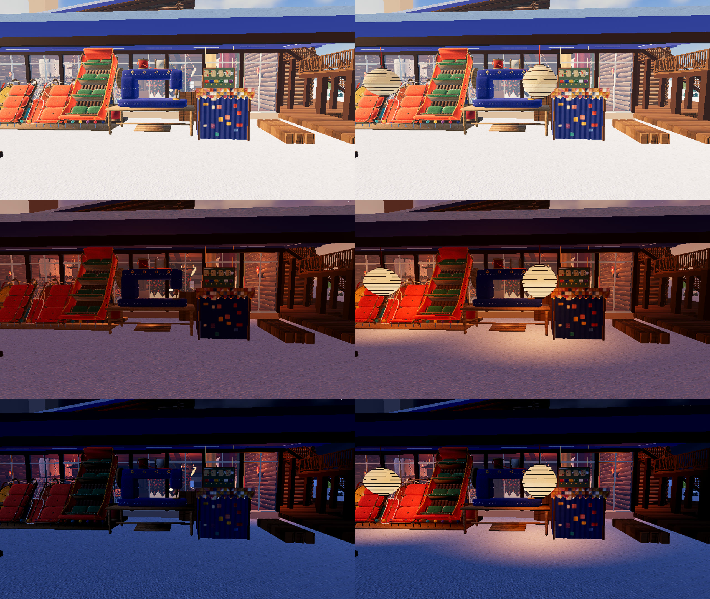
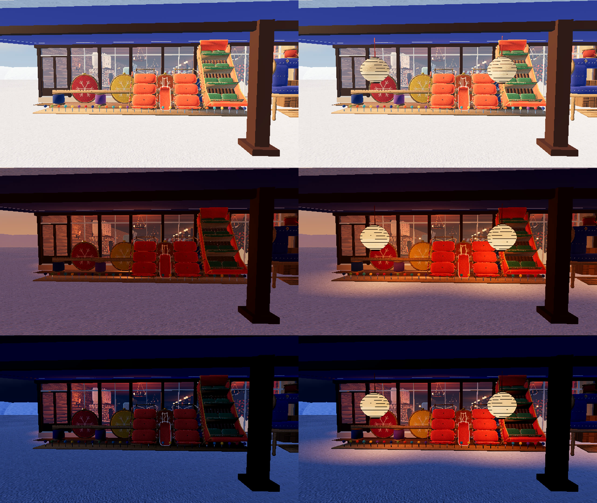
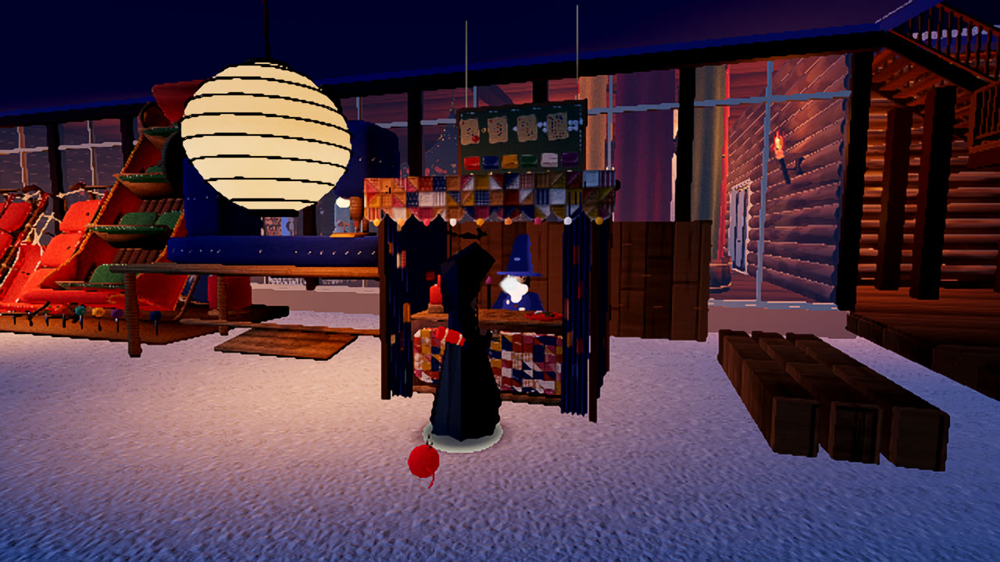

# 下屋の灯り（ソリ屋と立てかけ台）

2026-11-04。代表の言葉：「ソリ屋とソリ置き場暗いね！照明付けてあげよ！」

## 決まり

- **形:** 紙と木の提灯（`props/furniture/pendant_lantern.glb`）。[3 つの案](00-kinds.jpg)（提灯・プリーツの筒・円錐の傘）から代表が選んだ。大きなミシンに合わせて 1.5 倍。骨の線が途切れて見えたので、骨を紙の面から少し出した
- **数:** ソリ屋に 1 つ、立てかけ台に 2 つ（`game/lean_lights.gd` の PLACES）
- **色:** ロッジの灯りと同じ、電球色より少し赤み
- **灯りの向き:** 影を落とさない灯りは屋根を通り抜けるので、四方へ広がる灯りでは屋根の上の雪まで照らしてしまう。下向きのスポットを物の側（東）へ傾けた
- **時刻:** `DayCycle` の `daylight()` を見て、昼は消え、午後 4 時ごろから点き、夕方には満ちる。昼の下屋は外の光で十分に見えるので点けない。消えているあいだは灯りごと止める

## 前と後（左が前、右が後。上から昼 12 時・夕方 17:48・夜 21:30）

ソリ屋:

立てかけ台:

夜、人が近づいて番台の幕が開いた所:

## 重さ

夜の立てかけ台の前で、8 秒ずつ 3 回（1280×720、この Mac）。60 fps の上限つきの数字なので、余裕の分は見えない。

| | 1 回目 | 2 回目 | 3 回目 |
|---|---|---|---|
| 灯りあり | 58.6 | 59.8 | 58.6 |
| 灯りなし | 59.8 | 60.0 | 59.6 |

## 確かめの道具

`game/tools/lean_light_shots.gd`（`--hours=` `--no-lean-lights` `--lean-light=` `--fps` `--keeper`）

## 見ていないこと

スマホの重さ。2 階のテラスから見下ろしたときの、屋根の上の雪の色。
