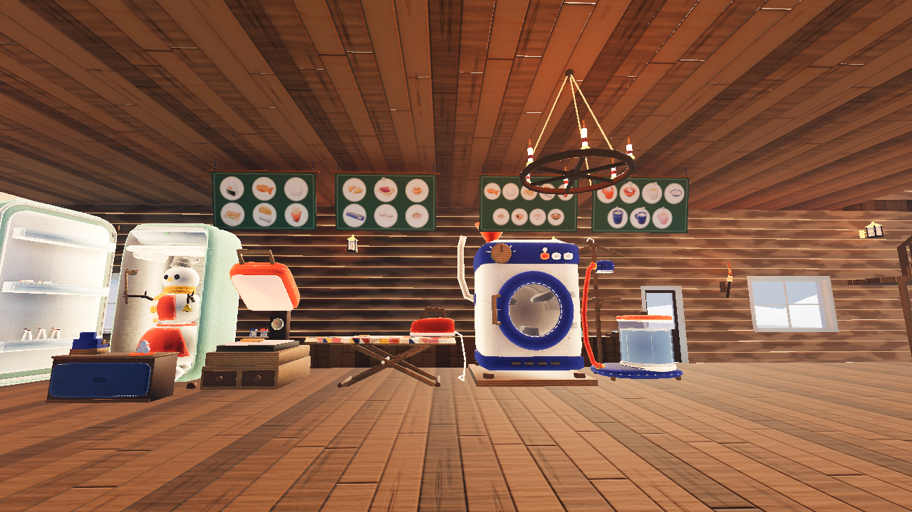
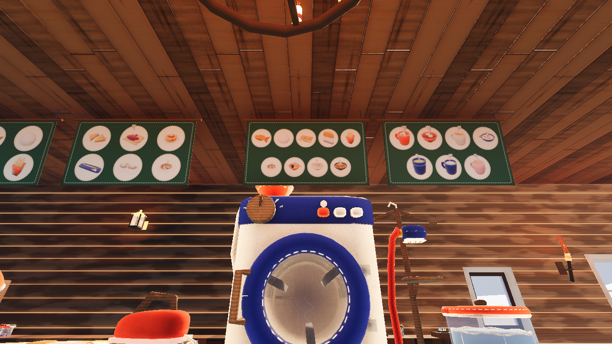

# 厨房の品書きの板（2026-11-02）

代表の言葉: 「ごはんの上にあるメニュー書く用のぼーどみたいなのにメニュー書いてほしい」「あと作り方も」
→ 案を 3 つ（作り方ごとの段・名前の刺繍・料理ごとの紙の札）見せたあと、「けっこう遠くていまの3案じゃどれも見えない」
「施設それぞれの上にその施設が調理工程にある食べ物一覧にするだけで大丈夫。値段もいりません」で決まった。

- 厨房の装置（プレス機・アイロン台・乾燥機・衣類スチーマー）それぞれの真上に、幅 2.4 m・高さ 1.35 m の板を吊る
- 板には、その装置を調理の道（`game/food.gd` の `route()`）に通る料理の絵を 2 段に並べる。名前と値段は書かない（2026-11-02 代表「値段もいりません」「名前いらないよ」）
  - 2 つの装置を通る料理（たい焼き・肉まん・コロッケ・ハッシュドポテト・フライドポテト・焼きそば）は、両方の板に載る
- 形は、天井から藍の糸で吊った木の棒に深緑のフェルトを掛けたもの。食堂から見上げて読めるよう前へ 12° 傾ける
- 絵は売り場の画面と同じ描き方（フェルトの継ぎ当て・なみ縫い）で、起動のときに 1 度だけ描いて画像にする
- ロッジに前からあった無地の板 3 枚（`lodge/build_lodge.py` の `menu_board`）は、ゲームの中で隠す（glb は書き出し直していない）
- 作りは `game/menu_board.gd`、確かめは `game/tools/menu_board_shots.gd`（`--flat` で板の絵も書き出す）

