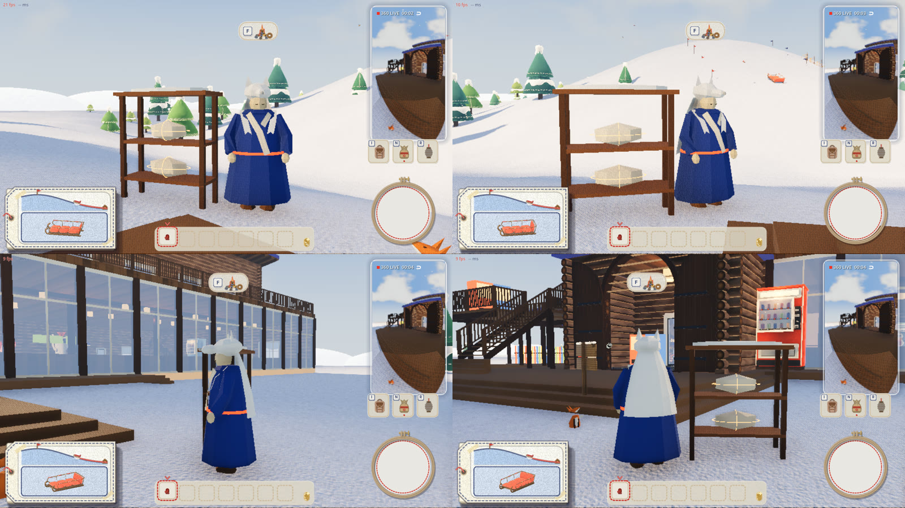

# 山の道具を売る山男（2026-11-01）

代表の言葉「そういう道具類を売ってくれる山男？山師？みたいなキャラが欲しい」から。「そういう道具類」は、斜面にソリを留める**ペグ**（消耗品）と、**焚き火セット**（焚き火のそばで体が乾く）。どちらも別の作業で作っている最中なので、売る仕組みを先に作り、2 つの品目を差しこむ口を用意した。

## 決まったこと

- 姿は、案の絵 [01-roughs.jpg](01-roughs.jpg) の右の **C 狼の毛皮の山男**（代表が 3 案から選んだ）
- 売るのは山の道具の棚。ペグと焚き火セットはこの山男の売り場に集める（前は、今ある店から選ぶ話だった）

## 案の絵（[01-roughs.jpg](01-roughs.jpg)）

代表の Pinterest のボード「&wind：Lodge キャラ」（いまは折り紙が中心）から取り、`props/common.py` と人形のラフの紙の素材で描いた。上から斜め前・正面・斜めうしろ。台本は `person/ideas/yamaotoko/roughs.py`。

| 案 | ボードの参考 | 取ったもの |
|---|---|---|
| A 蓑の山師（左） | 紙の葉を重ねた剣士 | ちぎった紙の葉（緑・黄土・クラフト）を 11 段重ねた蓑、折った紙のとんがり頭巾、木の杖 |
| B 熊の山男（まんなか） | クラフト紙の熊・兎 | 面の少ないクラフト紙の大きな体、熊の頭を折った頭巾の口元から顔、胸に白い紙 |
| **C 狼の毛皮の山男（右）** | 白い和紙の狼、折り紙の着物の人 | 藍の和紙を折った長い上着、クリームの衿、白い和紙の狼の頭を頭巾にかぶり毛皮を背中へ |

顔はどれも折り紙の多面体に、黒い糸の閉じた目（光る目・頬・口は描かない）。

## ゲームの中



上の左から 正面・斜め前、下の左から 横・うしろ。棚はまだ売っていない品目を紙に包んで麻ひもで縛ってある（いまの main の姿）。

- **姿**（`game/mountain_man.gd`）: ラフの C を、おじいさん（`shopkeeper.gd`）と同じくゲームの中で形の部品から組んだ。どれも面の少ない多面体を平らな面のまま描き、素材は `look.gd` の紙（和紙の藍・白・クリーム、顔の紙、クラフト紙の長靴）と、赤い毛糸の帯。背はおじいさんと同じくらい（1.7 m ほど）
- **動き**（人形と同じ 12 コマ／秒）: 息でふくらむ、ときどき見回し、狼の耳がぴくりと動く。人が近づくと顔を向けて左手を振る。売り場が開くと右手で棚を示す。だれかが買うと（オンラインのほかの人の買い物でも）その人を向いてうなずき、狼の耳が立つ。見る相手は、あなたとオンラインのほかの人のうち、いちばん近い人
- **置き場所**（`main.gd` の `MOUNTAIN_MAN_AT`）: ロッジの玄関（風除室）を出て、広場の板張りを降りた雪の上の、山への道の右脇（丘への案内板の先）。登る前に焚き火セットやペグを買い、そのまま山へ出られる。正面は玄関の方を向く。[03-place.jpg](03-place.jpg) は玄関を出た所から見た絵
- **棚**: 左手の側に木の棚（柱 4 本と板 2 段、屋根に白い和紙の毛皮）。売っている品目は道具の見本（毛糸を巻いた薪の束とフェルトの石、毛糸の輪の付いた木の杭の束）を並べ、まだの品目は紙の包み

## 売り場（`game/mountain_ui.gd`）

おじいさんの売り台・雪だるまの店と同じ作りで、文字は使わない。フェルトの板は山男の上着の藍。

- 左: 棚の品物のカード（絵と、値段のボタン）。まだ売っていない品目は、薄い絵を麻ひもで十字に縛ったカード（選べない。値段も出さない）: [04-menu-wrapped.jpg](04-menu-wrapped.jpg)
- 右の上: 財布のボタン。品物を選ぶと、その値段を上に（足りなければ赤い糸で）
- 右の下: 買うボタン（ボタン → 矢印 → 手袋）。買えないときは震える
- 閉じるのは ×・F・Esc。F の案内は、焚き火とボタンの絵

品物を並べて買った絵（確かめ用の `--shelf-all` で、まだの品目も売った）: [05-shelf-all.jpg](05-shelf-all.jpg)、[06-buy.jpg](06-buy.jpg)（左: 焚き火セットを選んだ、右: 買って持ち物の列に入った。財布 30 → 15）

## 品目の差しこみ口（`game/mountain_goods.gd`）

```gdscript
const SHELF := [
	{"item": {"kind": "campfire"}, "price": 15, "on": false},
	{"item": {"kind": "peg"}, "price": 5, "on": false},
]
```

- `item` は持ち物に入る形（`craft.gd` の bags にそのまま入る）、`price` は木のボタンの何個分、`on` は売るかどうか
- 買うのは `craft.gd` の `buy`（おじいさんの店と同じ出来事）。値段は `craft.gd` の `price` がここを読む。`on` でない品目は、ホストが断る
- 持ち物の列の絵と名前は `craft_icons.gd` の `item`・`item_name` がここの `draw`・`item_name` を呼ぶ
- **焚き火セット**（feature/campfire）が main に入ったら: `on` を true にする。あちらの `craft.gd` の `CAMPFIRE_PRICE`（15）と値段が二重になるので、どちらかにそろえる（ここの `price` を使うなら、あちらの `price` の分かれ道は消す）
- **ペグ**（feature/sled-peg）が main に入ったら: `on` を true にする。束で売るなら item に数を足す（例 `{kind: "peg", n: 5}`）。値段（いまは仮に 5）は、あちらの釣り合いで決め直す
- 品目を足すときは、ここに 1 行と、`draw` に絵を足す

## オンライン

- 山男は main.gd がどの画面にも同じ所に置く。動きは画面ごとに 12 コマで回り、見る相手もその画面にいる人（あなたとほかの人の体）から選ぶ
- 買うのは `craft.send` の `buy`。つなぐ側はホストへ送り、ホストが値段・財布・持ち物の空き・`on` を確かめて全員に配る（いままでの店と同じ）。配られた `buy` を見て、どの画面の山男も買った人を向いてうなずく

## 確かめたこと

- 一人（`tools/mountain_shots.gd`）: 山男の前で F の案内が出て、話しかけられる。売っていない品目を買うと断られる。`--shelf-all` で焚き火セットを買うと、財布が 30 → 15、持ち物に `{kind: "campfire"}`、持ち物の列に絵と「焚き火セット」の名前
- 通信（`tools/mountain_net_check.gd`、ホストとつなぐ側を同じ Mac で）: 山男の位置が両方で同じ。つなぐ側が焚き火セットを買うと、ホストの画面で相手の持ち物と財布が同じになり、山男が相手の体を向く。ホストがペグを買うと、つなぐ側の画面で同じ。売っていない品目をつなぐ側が買おうとすると、ホストが断り、持ち物は増えない

```bash
/Applications/Godot.app/Contents/MacOS/Godot --path game --resolution 1280x720 -s res://tools/mountain_shots.gd -- --spawn=mountain --dir=/tmp/mountain_shots --bots=0 --lodge-bots=0 --shelf-all
```

## まだのこと

- 焚き火セットとペグの中身（使う動き・効き目）は、それぞれの作業。こちらは売るまで
- 手に持った形: 焚き火セットはあちらの `player.gd` の `held_shape` が作る。ペグの手に持った形はまだない（いまの `held_shape` は、知らない品目に 1 m の白い箱を出す。`--shelf-all` でペグを買うと見える）
- 売れたときの音は付けていない
- 山男の骨と焼いた絵の glb はない（おじいさんと同じく、形の部品をゲームの中で組んでいる）
- 衿の帯は、斜めの細い線に見えて、衿らしさが弱い
