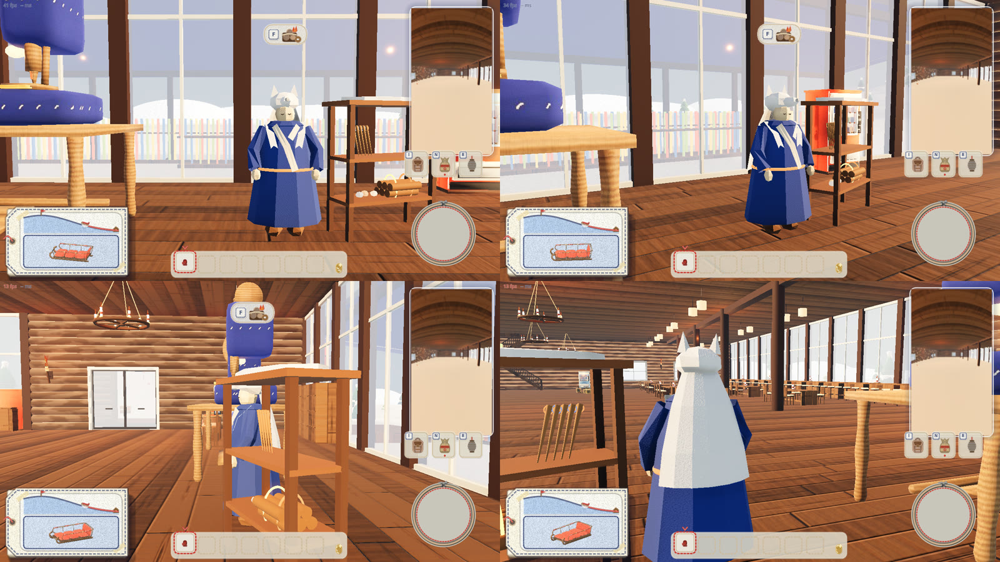
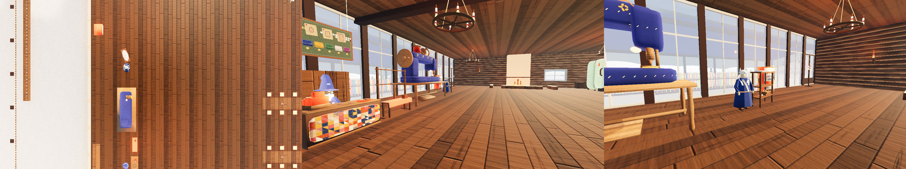

# 山の道具を売る山男（2026-11-01）

代表の言葉「そういう道具類を売ってくれる山男？山師？みたいなキャラが欲しい」から。「そういう道具類」は、斜面にソリを留める**ペグ**（消耗品）と、**焚き火セット**（焚き火のそばで体が乾く）。どちらも別の作業で作っている最中なので、売る仕組みを先に作り、2 つの品目を差しこむ口を用意した。

## 決まったこと

- 姿は、案の絵 [01-roughs.jpg](01-roughs.jpg) の右の **C 狼の毛皮の山男**（代表が 3 案から選んだ）
- 売るのは山の道具の棚。ペグと焚き火セットはこの山男の売り場に集める（前は、今ある店から選ぶ話だった）

## 案の絵（[01-roughs.jpg](01-roughs.jpg)）

代表の Pinterest のボード「&wind：Lodge キャラ」（いまは折り紙が中心）から取り、`props/common.py` と人形のラフの紙の素材で描いた。上から斜め前・正面・斜めうしろ。台本は `person/ideas/yamaotoko/roughs.py`。

| 案 | ボードの参考 | 取ったもの |
|---|---|---|
| A 蓑の山師（左） | 紙の葉を重ねた剣士 | ちぎった紙の葉（緑・黄土・クラフト）を 11 段重ねた蓑、折った紙のとんがり頭巾、木の杖 |
| B 熊の山男（まんなか） | クラフト紙の熊・兎 | 面の少ないクラフト紙の大きな体、熊の頭を折った頭巾の口元から顔、胸に白い紙 |
| **C 狼の毛皮の山男（右）** | 白い和紙の狼、折り紙の着物の人 | 藍の和紙を折った長い上着、クリームの衿、白い和紙の狼の頭を頭巾にかぶり毛皮を背中へ |

顔はどれも折り紙の多面体に、黒い糸の閉じた目（光る目・頬・口は描かない）。

## ゲームの中


上の左から 正面・斜め前、下の左から 横・うしろ。棚はまだ売っていない品目を紙に包んで麻ひもで縛ってある（いまの main の姿）。

- **姿**（`game/mountain_man.gd`）: ラフの C を、おじいさん（`shopkeeper.gd`）と同じくゲームの中で形の部品から組んだ。どれも面の少ない多面体を平らな面のまま描き、素材は `look.gd` の紙（和紙の藍・白・クリーム、顔の紙、クラフト紙の長靴）と、赤い毛糸の帯。背はおじいさんと同じくらい（1.7 m ほど）
- **動き**（人形と同じ 12 コマ／秒）: 息でふくらむ、ときどき見回し、狼の耳がぴくりと動く。人が近づくと顔を向けて左手を振る。売り場が開くと右手で棚を示す。だれかが買うと（オンラインのほかの人の買い物でも）その人を向いてうなずき、狼の耳が立つ。見る相手は、あなたとオンラインのほかの人のうち、いちばん近い人
- **置き場所**（`main.gd` の `MOUNTAIN_MAN`）: ロッジの 1 階の、大きなミシンの奥（下の「ロッジの中へ」）。はじめ（PR #110）はロッジの玄関の外の雪の上に置いていた（[02-man.jpg](02-man.jpg)・[03-place.jpg](03-place.jpg) はそのときの絵）
- **棚**: 左手の側に木の棚（柱 4 本と板 2 段、屋根に白い和紙の毛皮）。売っている品目は道具の見本（毛糸を巻いた薪の束とフェルトの石、毛糸の輪の付いた木の杭の束）を並べ、まだの品目は紙の包み

## ロッジの中へ（2026-11-02）

代表「山師ロッジの中に入れてあげよう。ミシンの奥空いてるし。」から、外の雪の上をやめて、ロッジの 1 階へ移した。

- 案の絵 [09-inside-candidates.jpg](09-inside-candidates.jpg)（上の段 A＝赤、下の段 B＝青。左から真上・玄関を入った目線・ミシンの前から奥）を送り、代表が「ミシンと同じ並び、同じ向きが良いです。向きは赤で」と決めた
- 立つ所はロッジの座標 (-18.3, 0.6)（`lodge/dims.py` の座標。y が北）。ミシン（`slot_craft_rental` の (-18.3, -3.4)、正面は東）と同じ列、同じ東向き。ミシンの北の端（y -1.4 ほど）から 2 m あけた。棚は左手（北）。客は東の通り道の側から話しかける
- ミシンを使う人・おじいさん（ミシンの南の番台）に話しかける人と、山男に話しかける人の立つ所は 4 m ほど離れている。山男の前ではミシンとおじいさんの F は出ない（`mountain_shots.gd` で確かめた）
- 西の壁ぎわの自販機（`slot_vending_1`、y 4.2）とは棚が重ならないので、そのまま残した
- **ミシン前の柱を抜いた**（同日 代表「ミシン前の柱撤去してほしい。邪魔。」）: 2 階の南の壁を受ける丸柱 5 本（`lodge/dims.py` の `COLS`）の西の端 `gx(2)`（ロッジの座標 x -14.5）。玄関を入った目線のまんなかで、ミシンと奥をさえぎっていた。梁は西の壁から通っているので、梁はそのまま。`lodge/build_lodge.py` で `lodge.glb`・`lodge_collision.glb` を書き出し直した（もとの寸法で書き出すと main の glb と同じになることを確かめたので、違いはこの柱だけ）
- 外にあった置き場所（玄関前の雪の上）は消した。外に山男の灯りや目印は置いていなかった



上の左から 正面・斜め前、下の左から 北の横・うしろ。暖炉と天井の灯り（#112）の暖かい光の中。



左から 真上（上が北。青い長い形がミシン、その北の白と青の点が山男と棚）・玄関を入った目線（柱がなくなり、ミシンの右の奥に山男）・ミシンの前から奥。

## 人形と同じ作りに（2026-11-02）

代表「山師がアートコンセプトに沿ってない気がする。キャラの要素は良いんだけど」から。

- **ずれていた所**（[10-look-before.jpg](10-look-before.jpg)。左が山師、右が今の人形）: 山師はゲームの中で、一色に塗った三角の面を組んでいた。人形は `design/art-concept.md` の「人」のとおり、紙・布の柄と縫い目・くぼみの陰を絵に焼いた glb で、面ごとに明るさが変わる。山師だけ、つるつるの CG に寄っていた
- **直したこと**: 人形と同じ作り方にした。`person/ideas/yamaotoko/roughs.py --export game/person` で、ラフの C と同じ要素を紙と糸の素材で組み、`person/rig_export.py`（人形の骨と焼き方）で骨を入れ、色と凹凸とくぼみの陰を焼いた `game/person/yamaotoko.glb` を書き出す。ゲームの `mountain_man.gd` は、この glb を骨（頭・両腕）で 12 コマに動かす。足もとには人形と同じ青いやわらかい影
- **足した細部**（要素は変えない）: 上着は青海波を刷った藍の和紙（裏と縁は白）、裾と衿に生成りの糸のなみ縫い、袖口にクリームの紙の折り返し、赤い毛糸の帯は 2 巻きして前の左で結んで垂らす、長靴に麻ひもを巻く、狼の耳の内側に生成りの紙、頭巾の縁になみ縫い。Blender で描いた絵: [12-look-blender.jpg](12-look-blender.jpg)
- **やめたこと**: 狼の耳がぴくりと動く・売れたら立つ動き（耳は頭に焼き込んだ）。売れたときは、うなずいて手を差し出す
- 直したあと（[11-look-after.jpg](11-look-after.jpg)）: 上の段は人形と並べた絵、下の段は左から 近づいたとき手を振る・売り場を開いたとき棚を示す・売れたときうなずいて差し出す

## ミニオンは山師が育てている子を買う（2026-11-02）

代表「ミニオンは山師が育てているのを買う感じにしてほしい」から。

- 見せ方の案 [13-minion-candidates.jpg](13-minion-candidates.jpg)（左 A 足もとで遊ぶ・まんなか B 寝床の台・右 C 柵の囲い）から、代表が **C 柵の囲い** を選んだ。買う画面は「山師の画面に札」を選んだ
- **柵**（`mountain_man.gd` の `_make_pen`）: 道具の棚の先（棚と同じ側。いまは北）に、毛糸を巻いた木の柵で囲った寝床。編んだ敷物、薪かごの巣（子狐が寝ている）、紙コップの餌の器。前（客の側）は入口をあける。中でウサギ・カエル・毛糸玉が座っていて、12 コマでときどき首を振る（2 階の売り台と同じ動き）。ミニオンの形は、あなたが 30 m まで近づいてから置く。柵には当たりがある: [14-minion-pen.jpg](14-minion-pen.jpg)
- **買う画面**: 山師に F で開く売り場の左に「道具」「連れ」の段の札。「連れ」を押すと、ミニオンの画面（`pals_ui.gd` を連れの段だけで開く。板は山師の上着の藍、段の札の上に山の道具へ戻る札）。札を押すと、買ってすぐ連れる（持っていれば付け替える）。いままでの 2 階の画面と同じ作り: [15-minion-buy.jpg](15-minion-buy.jpg)（左上 道具、右上 連れ、左下 カエルを買った、右下 2 階の売り台は頭・肩だけ）
- **2 階の売り台**: 頭・肩の段だけにし、台の上の子狐とカエルの見本を外した（`pal_stall.gd` の `SHOW_PET`）。台と画面のそれ以外は変えていない。頭・肩の小物をどこで売るかは、紙細工屋さんの案で代表が決める（そのセッションに知らせた）
- **変えていないこと**: 買う・付け替える出来事（`craft.gd` の `pal_buy`・`pal_wear`・`pal_own`）、連れて歩く動き（`companions.gd`）、保存（`player.gd` の `save_tag`）、オンラインでの見え方
- 買ったときの音は、山師の所で鳴る（`audio.gd` の店 `mountain`。音は型紙の店と同じ）。山の道具を買ったときも、前はおじいさんの番台で鳴っていたので、山師の所にした
- 山師は、だれかが柵のミニオンを買っても（オンラインのほかの人でも）その人を向いてうなずく

## ヤク・ソリの屋台・広い柵と遊び場、ミシンをおじいさんへ寄せる（2026-11-02）

代表の言葉: 「山師の後ろにこういう白いヤク置いてほしい、なんかヤクが座って休んでるみたいな」（写真つき）、「棚スカスカすぎだし素っ気なさすぎ。山師が商売してんだからただの棚じゃ味気ないでしょ」、「動物たちの柵と遊び場みたいなのも狭すぎ小さすぎ」、「ミシンはパッチワークのおじさんに近づけよう」

- 案の絵 [16-corner-candidates.jpg](16-corner-candidates.jpg)（上 出店の案 1「背負子と茣蓙」、下 案 2「ソリの屋台」。どちらも後ろにヤク、奥に広げた柵）から、代表が **ソリの屋台** を選び、ヤクと柵は「このまま入れる」
- 作り方: `person/ideas/yamaotoko/corner.py` で、山師の座標のまま組み、人形と同じく色と凹凸とくぼみの陰を焼いた glb を 3 つ書き出す（`game/person/yama_yak.glb`・`yama_stall.glb`・`yama_pen.glb`。`person/rig_export.py` に骨のない置き物の `export_static` を足した）。ゲームの `mountain_man.gd` は、それを山師の節に置くだけ（1.15 倍。柵が西の壁に届かない大きさ）
  - **ヤク**: 後ろで伏せて休む。体は白いフェルト、毛は生成りの太い毛糸の房（体の縁から床へ 2 列、背中とこぶにも寝かせる）、角はフェルトの筒（横へ張って上へ曲がる）、赤いフェルトの鞍掛けに金の糸のなみ縫い、麻の腹帯、床に寝た鐙、閉じた糸の目
  - **ソリの屋台**: 木のソリの台に赤いフェルト、赤と生成りの縞の日よけ（前は三角の縁）。台に焚き火セット 4 つとフェルトの石、段に桶に立てたペグ・縄の輪・薪の束、横木から提灯 2 つと縄の輪、脇にかんじき
  - **柵と遊び場**: 4 × 3.2 m（ゲームでは 4.6 × 3.7 m）。毛糸を巻いた柱の木の柵、入口は客の側で、中にも入れる（当たりは柵だけ）。編んだ敷物 2 枚、フェルトのトンネル、切り株 3 つと木の坂、毛糸玉、薪かごの寝床 2 つ、水桶と餌の器。ミニオン 7 匹（子狐と千代紙の狐はかごで寝て、カエルは切り株の上、ウサギ・毛糸玉・孔雀は歩く姿、ポニーは座る）。12 コマでときどき首を振る
- 道具の棚（コードで組んだ木の棚）と、前の小さな柵はやめた。売っていない品目を紙に包む見せ方も、棚と一緒になくなった（いまは焚き火セットもペグも売っている。売り場の画面の、売っていない品目のカードはそのまま）
- **ミシンをおじいさんへ寄せた**: ミシンの置き場（`lodge/dims.py` の `slot_craft_rental`）を南へ 2 m（y -3.4 → -5.4）。ロッジの glb を書き出し直した（目印だけが動く）。おじいさんの立つ所は目印からの位置で決まるので、番台の後ろのまま変わらないよう `SHOP_AT` を合わせた。ミシンと番台のあいだにあったランタン掛けは、番台の南（玄関の側）へ移した（`LANTERN_RACK_AT`）
- 山師はミシンと同じ列のまま 1.5 m 南へ（ロッジの座標 (-18.3, -0.9)）。北に出店と柵の場所をとった。西の壁ぎわの自販機（`slot_vending_1`）は柵の所になるのでやめた（代表「自販機は撤去でもいいですよ」）
- ゲームの中: [17-corner-game.jpg](17-corner-game.jpg)（上 左から山師の正面・斜め・柵、下 左から玄関の側から見たおじいさんとミシン・ミシンの前から・真上のミシンと番台とランタン掛け）、並び: [18-corner-place.jpg](18-corner-place.jpg)（左から真上・玄関を入った目線・奥の目線）

## 柵のミニオンが、その子らしく過ごす（2026-11-02）

代表「山師のミニオンが全然動かない。」から。

- **動かなかった理由**: 柵のミニオンは、#124・#126 で見本として置いただけで、首をときどき振るほかに動きを付けていなかった（#125 と合わせたせいではない）
- **直したこと**（`game/pen_pets.gd`）: 1 匹ずつ、柵の中で次のことを、その子らしさの重み（`NATURE`）で選んで続ける
  - 歩き回る（柵の内側の、まっすぐ行ける所へ）・座ってまわりを見る（近くの人、いなければ毛糸玉）
  - 薪かごの寝床で丸まって寝る（子狐・千代紙の狐が好き）・餌の器や水桶の前で食べる（ポニー・孔雀・ウサギ）
  - 毛糸玉のそばで遊ぶ（毛糸玉のミニオンが好き。ときどき向こうへ跳ねていく）・切り株の上に乗る（カエル）
- 歩き方・跳ね方・転がり方と、座る・寝る姿の刻み方は、連れて歩くミニオンと同じ（`companions.gd` の刻み方を `pose_parts` に切り出して、両方から使う。連れの動きは変えていない）。居場所はなめらかに、姿勢は 12 コマ／秒
- めり込まない: 行き先は柵の内側（柱から 0.3 m）の、トンネル・切り株と坂・水桶の円の外から選び、まっすぐ行けるときだけ行く。90 秒回して、柵の外や物の中に入ったコマはなかった（カエルが切り株から降りるときだけ、切り株の円の縁を通る）
- 動き: [19-pen-move.gif](19-pen-move.gif)（12 コマ／秒で 12 秒）、[20-pen-move-frames.jpg](20-pen-move-frames.jpg)（1 秒おきのコマ）。確かめは `tools/pen_pets_shots.gd`（`--near` で近くから、`--check=秒` でふるまいの割合とはみ出しを数える）

## 売り場（`game/mountain_ui.gd`）

おじいさんの売り台・雪だるまの店と同じ作りで、文字は使わない。フェルトの板は山男の上着の藍。

- 左: 棚の品物のカード（絵と、値段のボタン）。まだ売っていない品目は、薄い絵を麻ひもで十字に縛ったカード（選べない。値段も出さない）: [04-menu-wrapped.jpg](04-menu-wrapped.jpg)
- 右の上: 財布のボタン。品物を選ぶと、その値段を上に（足りなければ赤い糸で）
- 右の下: 買うボタン（ボタン → 矢印 → 手袋）。買えないときは震える
- 閉じるのは ×・F・Esc。F の案内は、焚き火とボタンの絵

品物を並べて買った絵（確かめ用の `--shelf-all` で、まだの品目も売った）: [05-shelf-all.jpg](05-shelf-all.jpg)、[06-buy.jpg](06-buy.jpg)（左: 焚き火セットを選んだ、右: 買って持ち物の列に入った。財布 30 → 15）

## 品目の差しこみ口（`game/mountain_goods.gd`）

```gdscript
const SHELF := [
	{"item": {"kind": "campfire"}, "price": 15, "on": false},
	{"item": {"kind": "peg"}, "price": 5, "on": false},
]
```

- `item` は持ち物に入る形（`craft.gd` の bags にそのまま入る）、`price` は木のボタンの何個分、`on` は売るかどうか
- 買うのは `craft.gd` の `buy`（おじいさんの店と同じ出来事）。値段は `craft.gd` の `price` がここを読む。`on` でない品目は、ホストが断る
- 持ち物の列の絵と名前は `craft_icons.gd` の `item`・`item_name` がここの `draw`・`item_name` を呼ぶ
- **焚き火セット**（feature/campfire）が main に入ったら: `on` を true にする。あちらの `craft.gd` の `CAMPFIRE_PRICE`（15）と値段が二重になるので、どちらかにそろえる（ここの `price` を使うなら、あちらの `price` の分かれ道は消す）
- **ペグ**（feature/sled-peg）が main に入ったら: `on` を true にする。束で売るなら item に数を足す（例 `{kind: "peg", n: 5}`）。値段（いまは仮に 5）は、あちらの釣り合いで決め直す
- 品目を足すときは、ここに 1 行と、`draw` に絵を足す

## オンライン

- 山男は main.gd がどの画面にも同じ所に置く。動きは画面ごとに 12 コマで回り、見る相手もその画面にいる人（あなたとほかの人の体）から選ぶ
- 買うのは `craft.send` の `buy`。つなぐ側はホストへ送り、ホストが値段・財布・持ち物の空き・`on` を確かめて全員に配る（いままでの店と同じ）。配られた `buy` を見て、どの画面の山男も買った人を向いてうなずく

## 確かめたこと

- 一人（`tools/mountain_shots.gd`）: 山男の前で F の案内が出て、話しかけられる。売っていない品目を買うと断られる。`--shelf-all` で焚き火セットを買うと、財布が 30 → 15、持ち物に `{kind: "campfire"}`、持ち物の列に絵と「焚き火セット」の名前
- 通信（`tools/mountain_net_check.gd`、ホストとつなぐ側を同じ Mac で）: 山男の位置が両方で同じ。つなぐ側が焚き火セットを買うと、ホストの画面で相手の持ち物と財布が同じになり、山男が相手の体を向く。ホストがペグを買うと、つなぐ側の画面で同じ。財布が足りないときにつなぐ側が買おうとすると、ホストが断り、持ち物は増えない（ロッジの中へ移したあとにも確かめた）

```bash
/Applications/Godot.app/Contents/MacOS/Godot --path game --resolution 1280x720 -s res://tools/mountain_shots.gd -- --spawn=mountain --dir=/tmp/mountain_shots --bots=0 --lodge-bots=0 --shelf-all
```

## まだのこと

- 焚き火セットとペグの中身（使う動き・効き目）は、それぞれの作業。こちらは売るまで
- 手に持った形: 焚き火セットはあちらの `player.gd` の `held_shape` が作る。ペグの手に持った形はまだない（いまの `held_shape` は、知らない品目に 1 m の白い箱を出す。`--shelf-all` でペグを買うと見える）
- 売れたときの音は付けていない
- 山男の骨と焼いた絵の glb はない（おじいさんと同じく、形の部品をゲームの中で組んでいる）
- 衿の帯は、斜めの細い線に見えて、衿らしさが弱い
