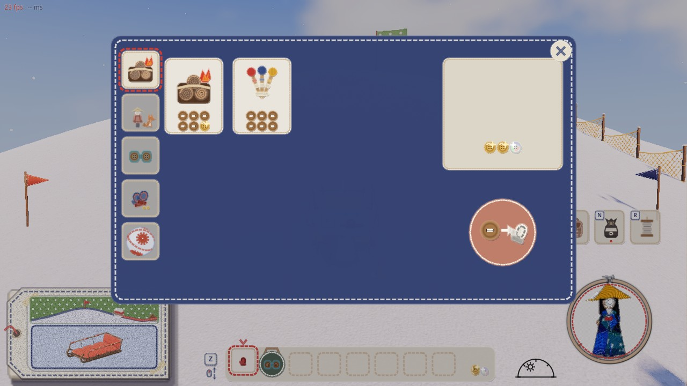
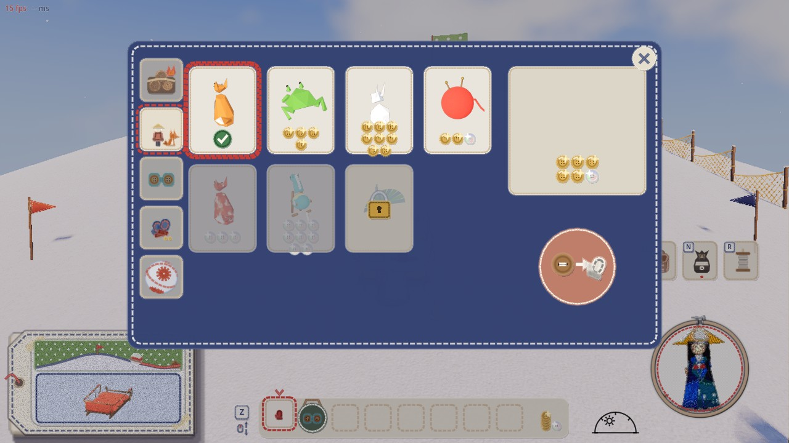
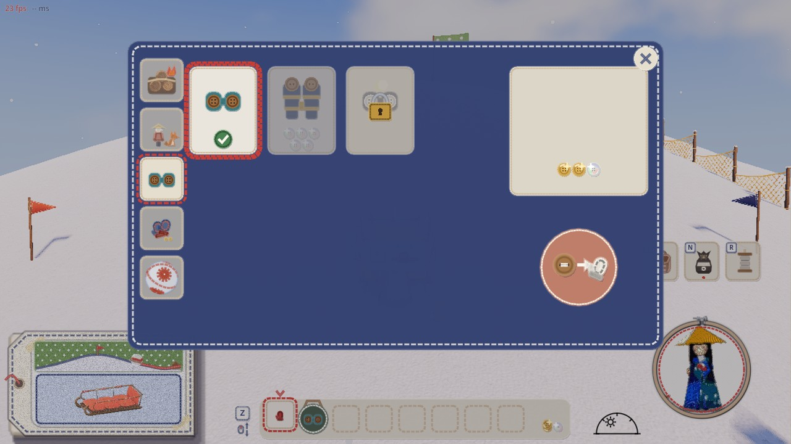
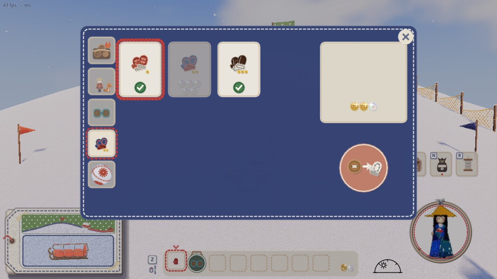
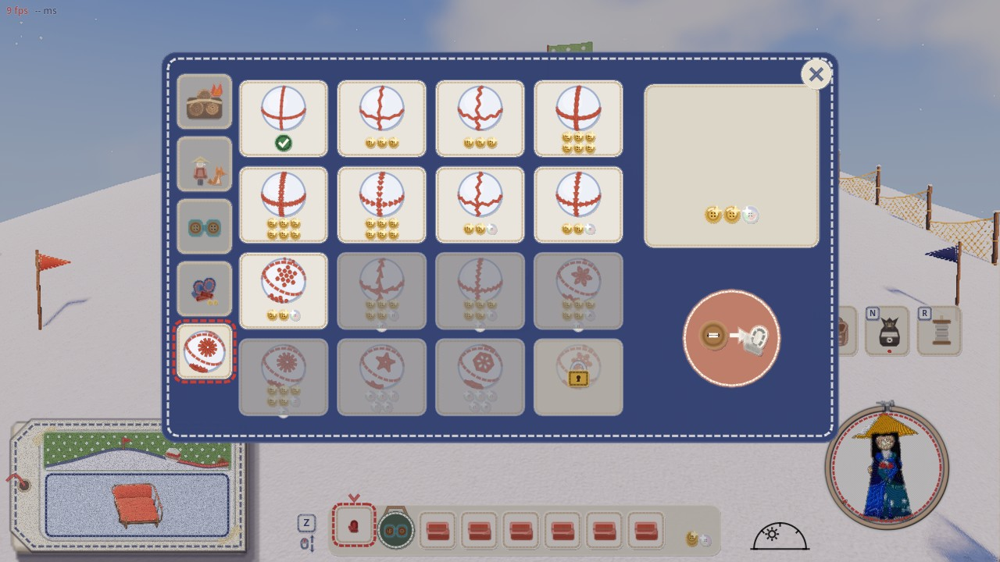
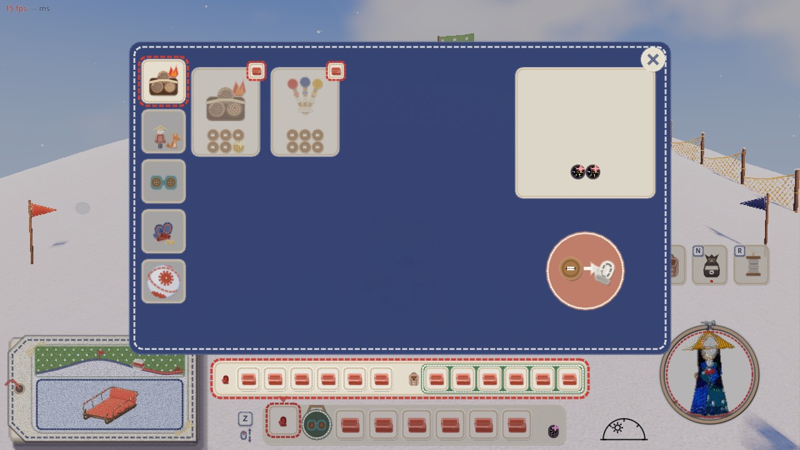

# 山師の店の段の札の並びと、ミニオンの棚の形（2026-11-10）

代表「山師のミニオン購入だけUIの形変わるの嫌過ぎる。あと上から、消耗品、ミニオン、双眼鏡、手袋、雪玉ステッチにしてほしいタブは」

## 変えたこと

- 左の段の札の並び（印は品物の絵）:
  1. 消耗品（焚き火セット）
  2. ミニオン（子狐）
  3. 双眼鏡
  4. 手袋
  5. 雪玉の柄（菊かがりの玉）
- ミニオンの棚を、山師の画面の中に入れた。前は別の画面（pals_ui.gd）が開き、札の大きさ・並び・財布の場所が違っていた。
  - 今は、ほかの棚と同じ形。札は 1 段 4 枚で、品物の絵の下に値段かチェック。右に財布の枠と買うボタン。
  - 札の中では、座ったミニオンがくるくる回る（絵は pals_ui.gd の連れの段のものを使う）。
  - 持っていないミニオンは、選んで買うボタンで買うと、すぐ連れる。
  - 持っているミニオンの札を押すと連れ替える。連れているミニオンを押すと外す。
- 双眼鏡と手袋は、前の PR（#237）から別の棚になっている。

| 絵 | 写っているもの |
|---|---|
|  | 消耗品の棚 |
|  | ミニオンの棚（ほかの棚と同じ形。連れている子狐は赤い糸の縁とチェック、足りないものはグレー、ロックは南京錠） |
|  | 双眼鏡の棚 |
|  | 手袋の棚 |
|  | 雪玉の柄の棚 |
|  | 持ち物がいっぱいの消耗品の棚 |

確かめ:
- `shop_state_shots.gd`: OK 21・だめ 0。ミニオンは山師の画面の札で並ぶ、ロックは選べない、段の札の並びを見る。
- `inventory_unlock_check.gd`: OK 28・だめ 0。
- 遊ぶ人の保存ファイルは、確かめの前後で同じだった。
