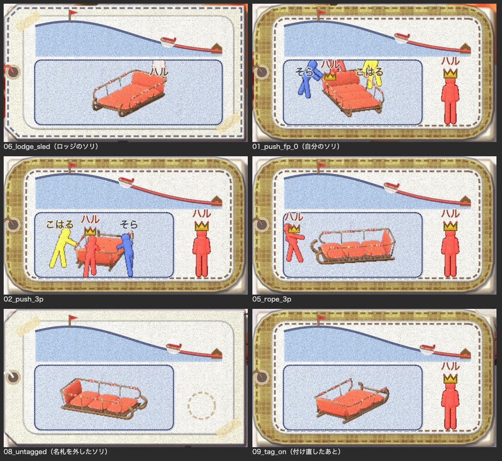

# 持ち主の欄からロッジを外す

2026-11-01。代表の言葉：「オーナーのロッジ表示やめてほしい。どこにいるかじゃなくてだれかがだいじだから」

HUD の左下の札の右下（持ち主の欄）に、ロッジのソリでは王冠を載せた家を出していた。これをやめる。

## 見本の絵で決めたこと

[見本](mock.jpg)で、いまの家と、かわりの 4 つの案を並べた。

- A：空の輪（名札を外したソリと同じ点線の輪）
- B：点線の人型（王冠なし）
- C：売り子のおじさんを持ち主にした紺の人型に王冠
- D：欄を空け、回る図の窓を右へ広げる

代表は **D** を選んだ。

## 決まり

- **ロッジのソリ**（持ち主がいなくて、ロッジの名札が付いている）は、持ち主の欄を出さない。回る図の窓を札の右いっぱいまで広げる（`hud.gd` の `_draw_tag_info`）。
  - 回る図の大きさは変えず、広い窓のまん中に描く。
- **持ち主のいるソリ**は今までどおり。右に王冠を載せた人型と名前。
- **名札を外したソリ**も今までどおり。点線の空の輪。
- 丘の断面のふもとにあるロッジの印は、場所の目印なので残す。

## 撮った絵

左下の札を切り抜いたもの（左上がロッジのソリ）：



画面全体：[ロッジのソリ](06_lodge_sled.jpg)・[自分のソリを押す](01_push_fp_0.jpg)・[三人称](02_push_3p.jpg)・[紐で引く](05_rope_3p.jpg)・[名札を外したソリ](08_untagged.jpg)・[付け直したあと](09_tag_on.jpg)

```bash
Godot --path game --resolution 1600x900 --fixed-fps 30 -s res://tools/sled_tag_shots.gd -- --bots=2 --no-sound --no-pip --dir=/path/shots
```
