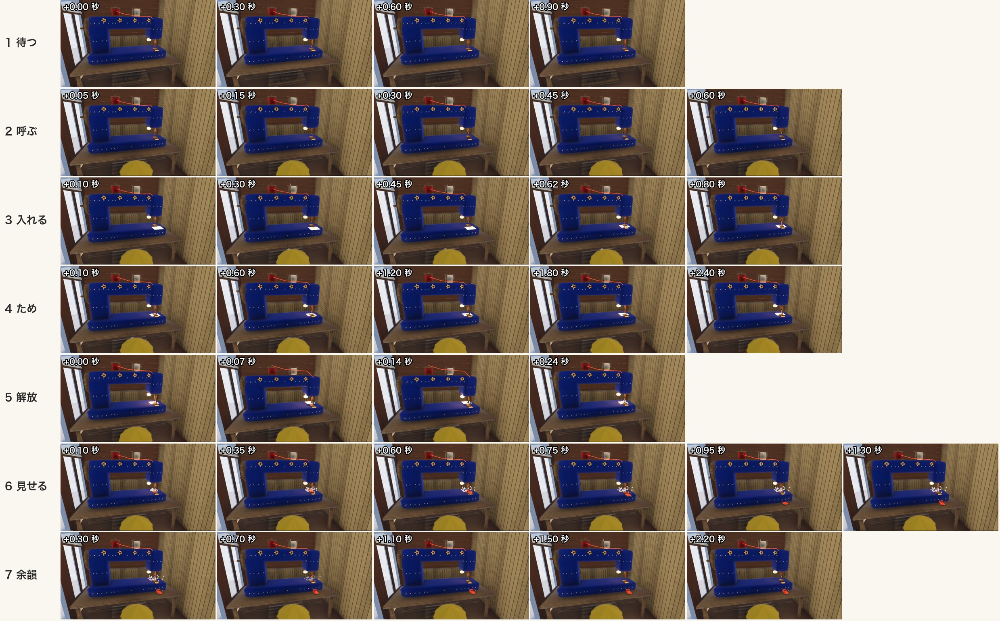
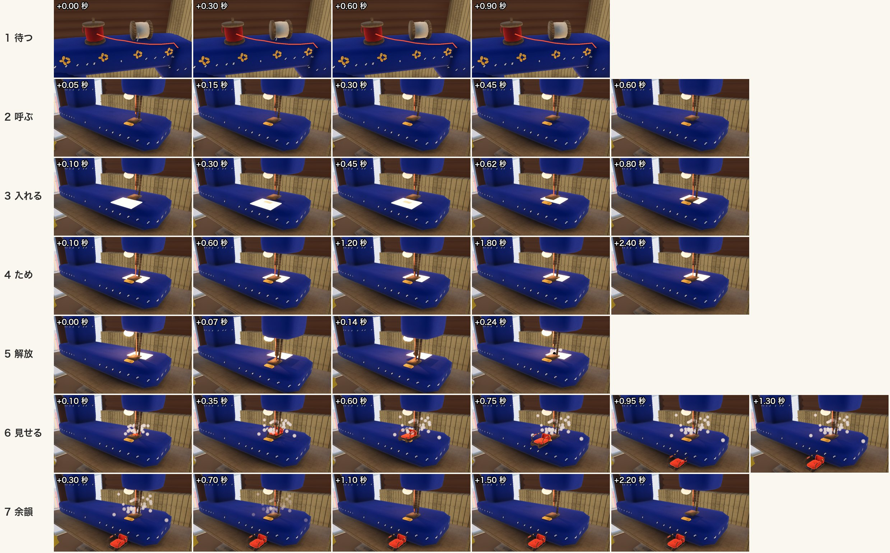
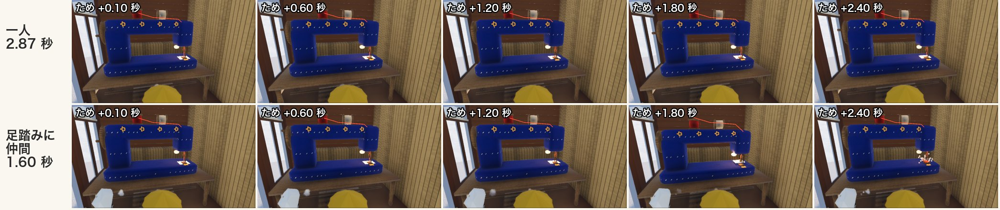
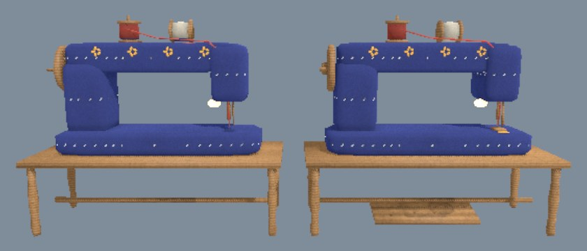

# 大きなミシンの動き（試作）

2026-10-28。[施設の研究](../facilities.md) の「施設の動き」の 7 つの場面を、ロッジの中の大きなミシンで動かした。動きは `game/sewing_machine.gd`、確かめ用の撮影は `game/tools/sew_shots.gd`、仮の音は `sound/gen/sew.py`。

## 手で試す

```bash
/Applications/Godot.app/Contents/MacOS/Godot --path game -- --spawn=sew --bots=0
```

- `--spawn=sew` でミシンの前に立って始まる。前へ 1 歩出ると、針と押さえが持ち上がる（呼ぶ）
- **T** 縫う（立つ所のそばだけ）。**Y** なめらか／コマ撮り（12 fps）を切り替える。**H** 仲間（ボット）を足踏みに呼ぶ／帰す
- 起動のときから: `--sew-stepped`（コマ撮り）、`--sew-helper`（仲間を足踏みに）
- 原型の文字の案内（画面の左上）に、ミシンの前だけ操作の行が出る

## 7 つの場面

| 場面 | 動き | 長さ |
|---|---|---|
| 1 待つ | 糸巻きがときどき半回転して小さく跳ねる（糸の端が回るのでわかる）。紙の灯りがゆらぐ | 3.5〜6.5 秒ごと |
| 2 呼ぶ | 立つ所から 2.4 m 以内に人が来ると、針と押さえが少し行き過ぎて持ち上がり、布送りの歯がカタッと 1 往復 | 0.5 秒 |
| 3 入れる | クリームの布が前にふわっと現れ、だんだん速く針の下へ吸い込まれる。押さえが下り、糸がぴんと張って小さく震える | 0.85 秒 |
| 4 ため | 針の上下が 1.2 回／秒から上がっていく。11 目縫うと解放。はずみ車・糸巻きが回り、布が奥へ送られて赤い縫い目が並ぶ。灯りも少し明るく速くゆらぐ | 一人 2.9 秒 |
| 5 解放 | 糸切りのパチン。ミシンだけ 0.12 秒止まり、そのあいだ全体がむぎゅっと縮む。明けるとばねのように戻り、綿くずがふわっと舞う | 0.4 秒 |
| 6 見せる | 布が小さなソリ（`sled_small.glb` を 36 cm に縮めたもの）になって前へ滑り、台の縁から天板へぽんと下りて、少しつぶれて止まる | 1.35 秒 |
| 7 余韻 | 針がだんだん遅くなり、ちょうどいちばん上で止まる。そのあと元の高さへ下りる（人がいれば持ち上がったまま） | 約 2 秒 |





## 協力: 足踏みに人がいると速い

もう一人が足踏みの位置（目印 `pedal`、立つ所の右）に立つと、針の速さの上限が 5 → 9 回／秒、上がるまでの時間が半分になり、足踏みが揺れる。そばにいるだけの人は 1 人ごとに上限 +1.2 回／秒。

| | ためにかかった時間 |
|---|---|
| 一人 | 2.87 秒 |
| 足踏みに仲間 | 1.60 秒 |



動画: [solo-vs-helper.mp4](solo-vs-helper.mp4)（左が一人、右が足踏みに仲間。呼ぶから余韻まで）

## なめらか版とコマ撮り版

動き（時間の流れ）は同じで、形に当てるのを 12 コマ／秒に刻む（人形の `doll.gd` と同じやり方）。綿くずの粒も 12 fps で動く。動画: [smooth-vs-stepped.mp4](smooth-vs-stepped.mp4)（左がなめらか、右がコマ撮り。30 fps で録って並べた）。30 fps で録った 80 コマのうち、針のまわりが変わったコマはなめらか版 77、コマ撮り版 38（3 コマ・2 コマずつ止まる）。

感想（絵とコマの数から。音を入れて手で触っての判断はまだ）:

- **待つ・呼ぶ・入れる・見せる・余韻**のように、ゆっくりした動きや、止まって形が決まる動きは、コマ撮りでも読みやすく、人形と並んだときに世界がそろう。「ぽん」と下りて止まる所は、コマ撮りのほうが手でつまんで置いた感じが出る
- **ため**はコマ撮りと相性が悪い。12 fps では 6 回／秒より速い上下は正しく見えない。一人（上限 5 回／秒）でも針がぱらぱら飛んで見え、仲間がいるとき（9 回／秒）は理屈の上で 3 回／秒に見えてしまい、**速くなったのに遅く見える**おそれがある。協力の手ごたえを針の速さで見せるなら、ためだけはなめらかにするか、コマ撮りのまま速さを音・揺れ・ぶれの絵（スミア）で見せる工夫が要る
- 案: 機械は「ゆっくりな所はコマ撮り、ための回転だけなめらか」にする。または針の上下を 4 回／秒までに抑え、速さは音の高さとはずみ車のぶれで出す

## 模型の変えたところ（`props/build_machines.py`）

- 動く部品を、別の根元の空（`mv_*`）に分けて書き出すようにした。根元が回す・動かす中心: `mv_needle`（針）、`mv_presser`（押さえ）、`mv_balance`（はずみ車。名前の末尾を `wheel` にすると Godot が車輪の節点にしてしまう）、`mv_spool_red`・`mv_spool_cream`（糸巻き）、`mv_pedal`（足踏み）、`mv_feed`（布送りの歯）、`mv_thread`（糸の道。ゲームでは隠し、張り具合を描いた糸に替える）
- **足したもの**: 布送りの歯（押さえの前にのぞく小さな金の歯。動きを見せるため）。目印 `thread_0..4`（糸の通る所）、`eye`（針の糸の通る所）、`lamp`、`out`（できた物の止まる所）、`pedal`（足踏みに立つ所）
- **直したもの**: 作業台（天板・脚・貫）も `mv_table` として分けて焼く。前の書き出しでは、フェルトの胴と同じ組で三角を減らしたため、木の取り分が少なすぎて**足踏みの板が消えていた**（動く部品だけを分けたときは、こんどは天板が消えた）。いまは天板も足踏みも残る


- 形（寸法・位置）は変えていない。糸巻きの「糸の端」はゲームの側で足した短い糸

書き出し直すときは、Godot が古い画像を使い続けないよう `game/props/craft_machine_prop_*.jpg` を消してから読み込み直す。
