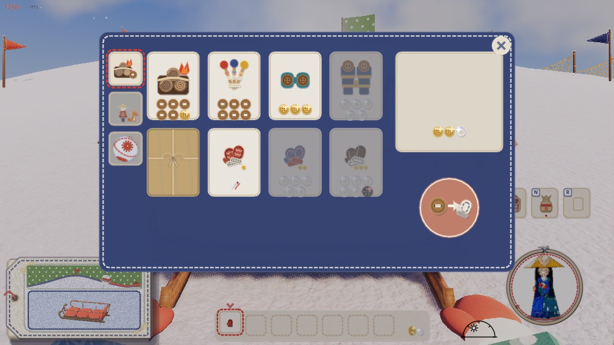
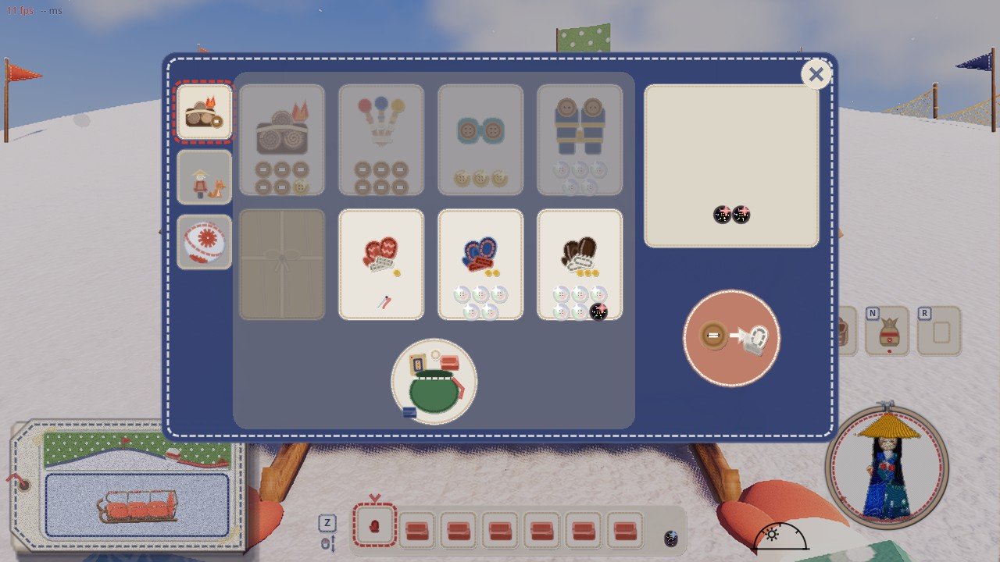
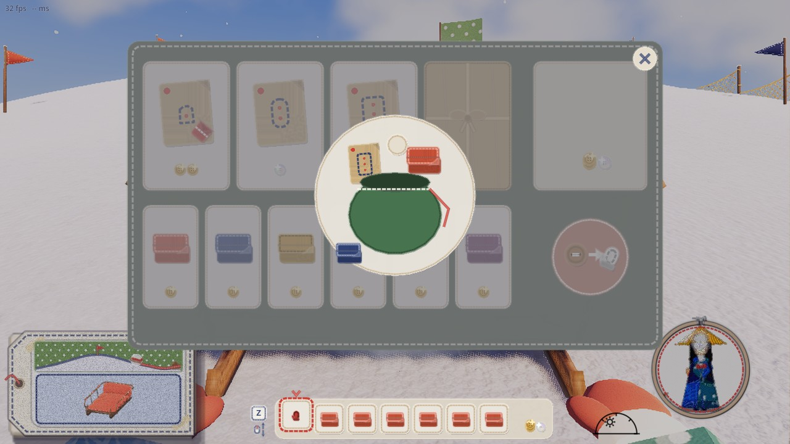
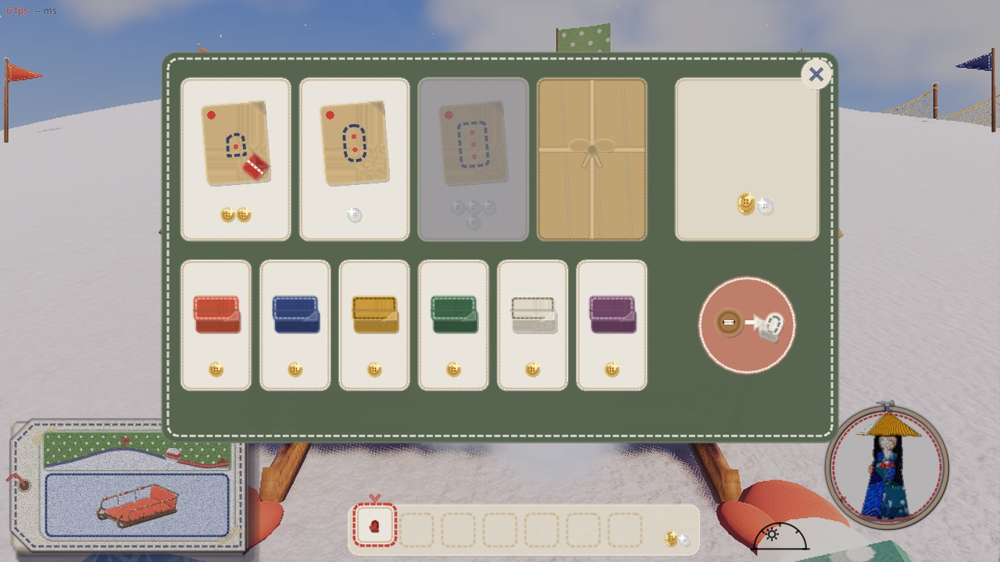
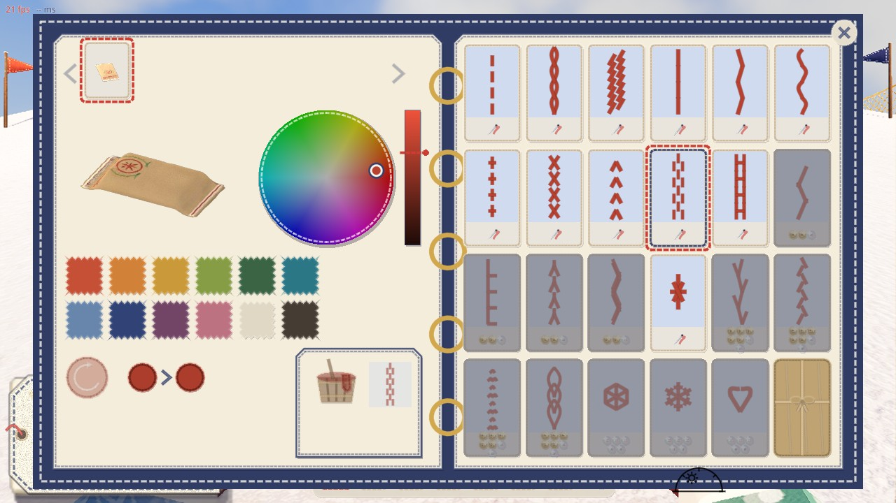
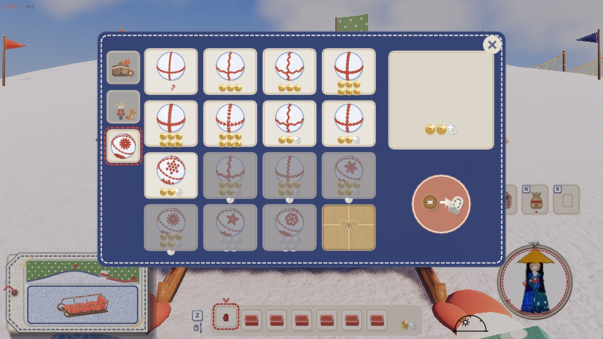
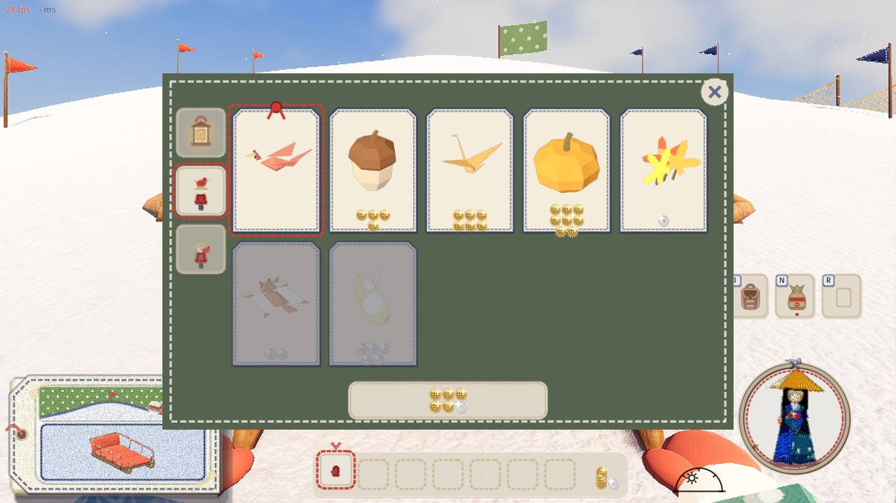
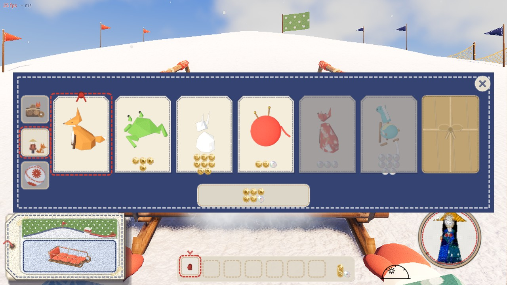
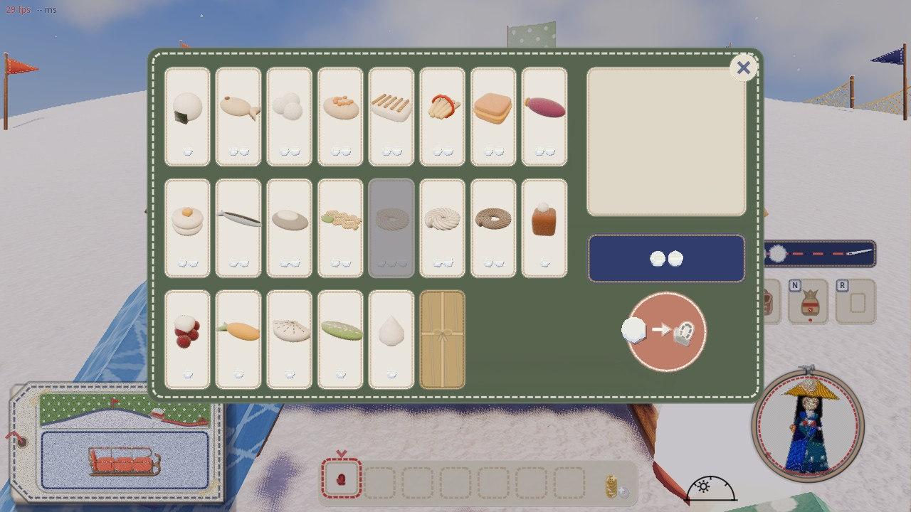
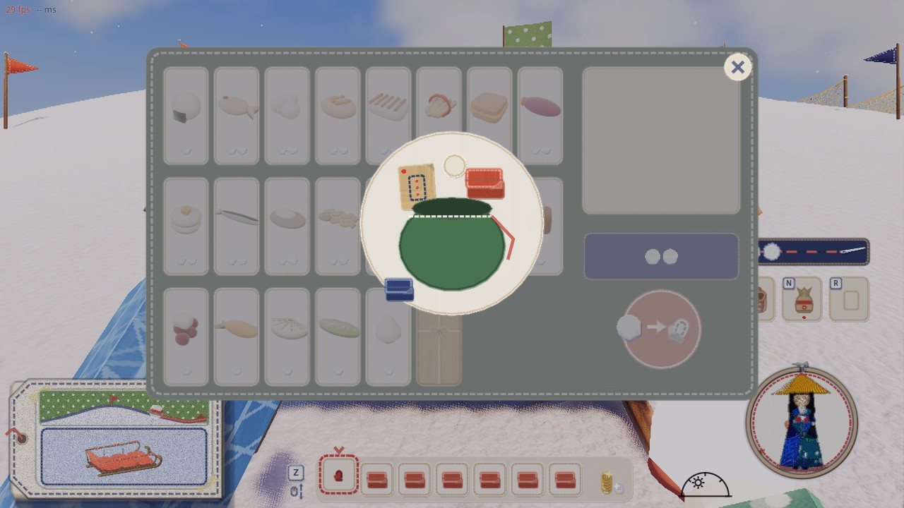

# 店の札の「買える・買えない」の見え方（2026-11-10）

代表「ショップで買えるものと買えないものの見え方はっきり変えてほしい」。3 案の絵（`proposals-01.png`。上から今・薄紙・値札の ×・裏返る）を見せたところ、
代表「全部意味不明だ 1段目が一番わかるけど…単純にグレーにして選択不可にするだけでいいんだけど」
「まだ売っていないを作るのもいいですね。一部LOCKしておくのもいい。じゃあLOCKしてるのを麻紐のつつみにして、でも荷物がパンパンなときはなにも変えないんだから画面全体をグレーにして荷物がパンパンですよって巾着からモノ溢れてるアイコンにするのが良いと思う。からの財布はイラストが悪くてわかんないからやめよう」。

## 決まり

どの店も同じ（山師の道具・連れ・雪玉の柄、ソリ屋、見本帳の柄、紙細工屋さん、雪だるまの店）。描くのは `game/craft_icons.gd` の関数で、各店の画面はそれを呼ぶだけ。

| 札のようす | 見え方 | 押すと |
|---|---|---|
| 買える | 今のまま | 選べる |
| お金（雪玉）が足りない | 札の上にグレーをかぶせる（`shade_card`）。印は付けない | 何も起きない（選べない） |
| もう持っている | 今のまま（値段の代わりに針の印。紙細工屋さん・連れは値段を出さない） | 選べる（身につける・外す） |
| まだ売っていない（ロック） | クラフト紙で包んで麻ひもで縛った包み（`wrap_card`）。中は見えない | 何も起きない。ホストも断る |
| 持ち物がいっぱい | 札ごとではなく、売り場の全体をグレーにして、まんなかに巾着から物があふれる印（`bag_full`）。閉じる × は上に残る | 何も起きない |

- 持ち物がいっぱいでも買える品は、グレーの上に出たまま買える: 山師の手袋（装備）、持っている束に足せるペグ。見本帳・紙細工屋さん・連れ・雪玉の柄は持ち物の場所を使わないので、いっぱいでもグレーにならない
- 札のようすの決め方は `craft_icons.gd` の `card_state`（ロック → 持っている → いっぱい → 払える の順に見る）

## ロックの作り

`game/shop_locks.gd` の `LOCKED` に品の名前（"店:品"）を書くと、その品はどの店でも包みの札になり、買えない（`craft.gd` でホストも断る）。
**いまは空**（どの品もロックしていない）。山師の棚の `on` が false の品目（`mountain_goods.gd`）も同じロックとして扱う（いまはどれも on）。
確かめのときは起動の引数 `--lock=名前,名前` で付けられる。

### 代表に決めてほしいこと: どの品をロックするか、何で解けるか（案。まだどれも入れていない）

解ける決まりは、まだ作りがない。決まったら、解けたかを人ごとに持つ所（`craft.gd`）と、保存を足す。

| 店 | ロックする品の案 | 解ける決まりの案 |
|---|---|---|
| 山師 | 革の手袋（1500） | フェルトの手袋を持ったら（段の順に） |
| 山師 | 夜の双眼鏡（1000） | はじめて夜を迎えたら |
| ソリ屋 | 大の型紙 | 中のソリを縫ったら |
| 見本帳 | 500 ボタンの柄（麻の葉・雪の結晶・ハート・花の蔓） | 滑った道のりの合計で 1 つずつ |
| 山師（雪玉の柄） | 500 ボタンの柄（星かがり・麻の葉・雪の結晶） | 大玉をいちばん大きく（半径 2.4 m）育てたら |
| 紙細工屋さん | 螺鈿の提灯 | ほかの提灯をみんな持ったら |
| 雪だるまの店 | 季節の料理 | 日（daycycle）や天気で |

## 絵

`game/tools/shop_state_shots.gd` で撮った（ロックは確かめのあいだだけ、各店の 1 品ずつに付けた）。

| 絵 | 写っているもの |
|---|---|
|  | 山師の道具。左上から焚き火（買える）、…、夜の双眼鏡（包み）、毛糸の手袋（針）、フェルト・革の手袋（グレー） |
|  | 山師の道具で持ち物がいっぱい。棚がグレーで（夜の双眼鏡の包みもグレーの下）、手袋の 3 枚だけがグレーの上。巾着からあふれる印は、札の下の空いた所 |
|  | ソリ屋で持ち物がいっぱい。売り台の全体がグレー |
|  | ソリ屋。大の型紙が包み、足りない型紙がグレー |
|  | 見本帳の柄。花の蔓が包み、足りない柄がグレー |
|  | 山師の雪玉の柄。雪の結晶が包み、返し縫いが針 |
|  | 紙細工屋さん |
|  | 山師の連れ。いちばん右のミニオンが包み |
|  /  | 雪だるまの店。最後の料理が包み、雪玉が足りない料理がグレー／いっぱい |
