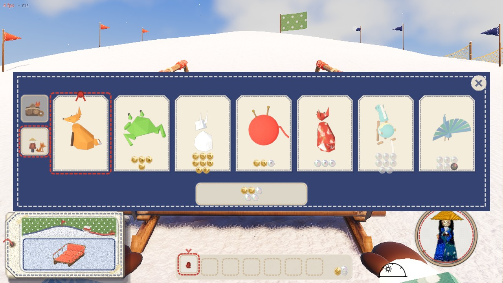
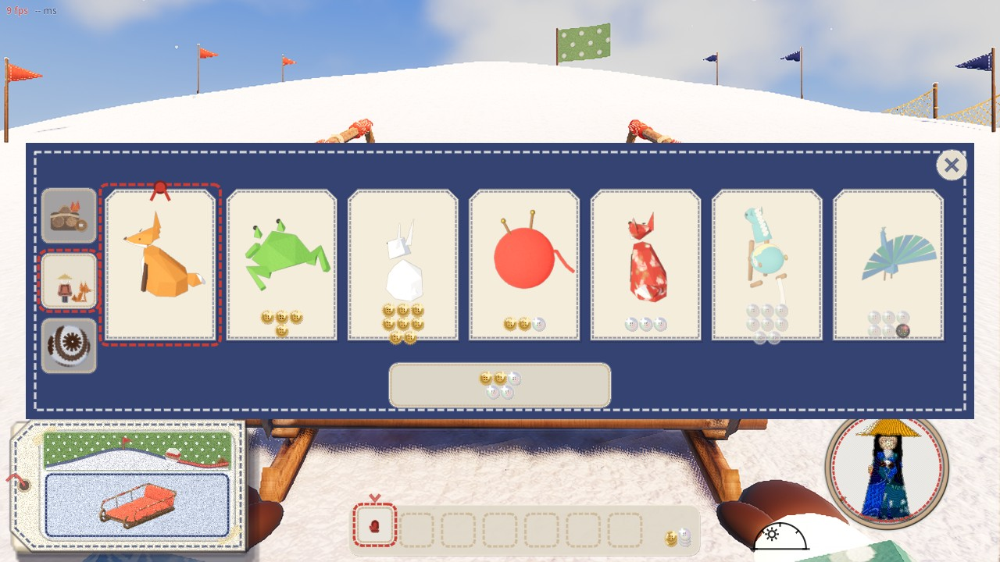
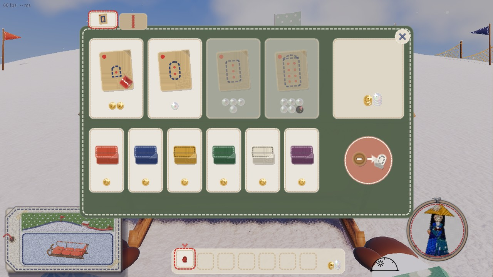
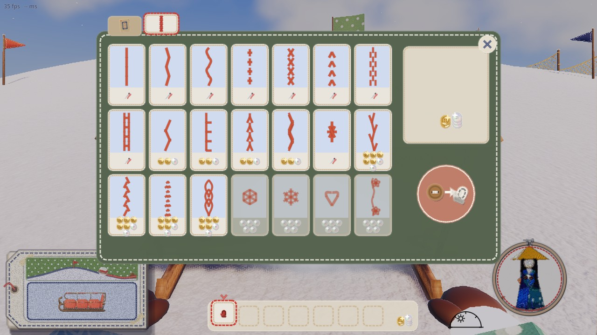
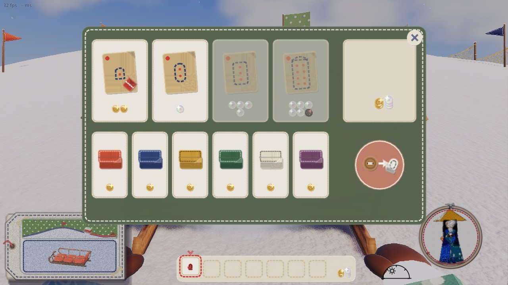
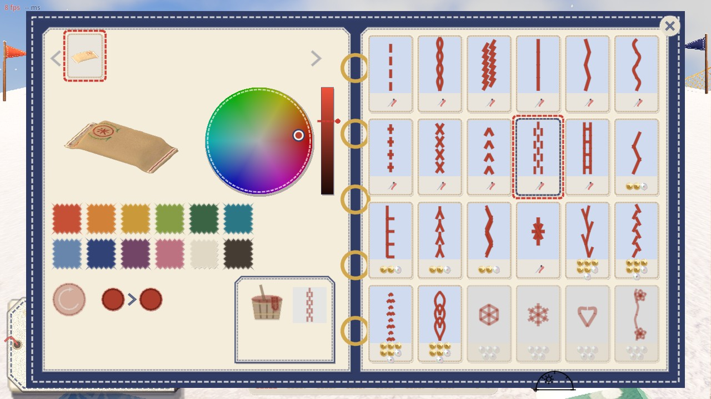
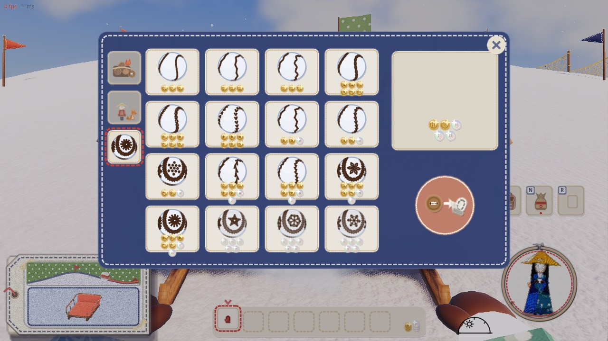
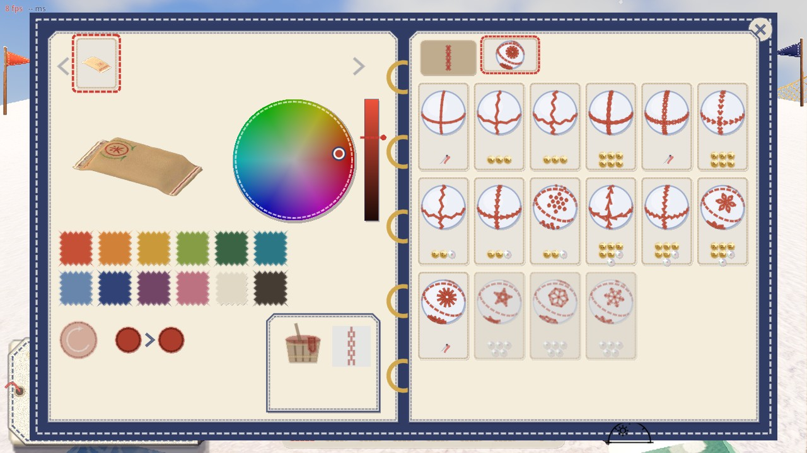

# 店の売り場の一覧（2026-11-10）

代表「ショップのなかゴチャついてたりする？山師でミニオン欄開いたら雪玉ステッチタブが消えちゃう。あとソリ屋でステッチ買えるけど見本帖でもステッチ買える。混ざってない？見本帳だけでいいかも。」

## どこで何を売っているか（直したあと）

払いはどれも木のボタン（雪だるまの店と双眼鏡台は雪玉でも払う）。「持ち物」は手持ちとかばんの場所を使う品物、「装備」「柄」は場所を使わない。

| 店（画面） | 置き場 | 売っている物 | 種類 |
|---|---|---|---|
| **ソリ屋**（おじいさんの売り台。`craft_ui.gd` の売り台） | 外の下屋、ミシンの横 | 型紙 4（米袋・小・中・大）、布 6 色 | 持ち物（ミシンで縫ってソリにする） |
| **見本帳**（布の見本帳。`sled_book_ui.gd`） | 外の下屋、立てかけ台の北の端 | 自分のソリを染める（布 12 色と自由な色、染め代）、**滑りあとの柄** 21 種（ほかに標準 3 種） | 染めるのは手間賃、柄は人ごとに一度買えばよい |
| **山師**（`mountain_ui.gd` 道具・雪玉の柄、`pals_ui.gd` 連れ） | ロッジ 1 階 | 道具: 焚き火セット・ペグ・双眼鏡 3 段・雪玉ころがしの手袋 3 段 / 連れ: ミニオン 7 / **雪玉の柄** 16 種 | 道具は持ち物（手袋は装備）、連れと柄は場所を使わない |
| 紙細工屋さん（`paper_shop_ui.gd`） | ロッジ 1 階の南西、テント | 提灯 10・頭の小物 7・肩の小物 4 | 装備・身につける物 |
| 雪だるまの食べ物屋（`food_ui.gd`） | ロッジの番台 | ペレット 22（雪玉で払う。厨房で料理になる） | 持ち物 |
| 染め桶（`dye_ui.gd`） | ロッジ 1 階の人台 | 服を染める（部位の数で染め代） | 手間賃 |
| 衣装掛け（`wardrobe_ui.gd`） | ロッジ 1 階の人台 | 人形を選び直す | ただ |
| 双眼鏡台 | テラス | のぞく時間（ボタンか雪玉） | 手間賃 |

## 混ざっていた所

| 何が | どこで | どうした |
|---|---|---|
| **滑りあとの柄**が 2 つの店で売られていた | ソリ屋の売り台の 2 枚目の棚（21 種）と、見本帳の右の面（同じ 21 種＋標準 3 種）。同じ出来事 `stitch_buy` | **ソリ屋の棚をやめ、見本帳だけにした**（代表「見本帳だけでいいかも」）。ソリ屋の売り台は型紙と布だけ（棚の札もなくした） |
| 山師の「連れ」を開くと、**雪玉の柄の札が消えた** | 連れの欄は別の画面（`pals_ui.gd`）で、「道具に戻る」札と自分の段の札しか描いていなかった（雪玉の柄の札は #220 で `mountain_ui.gd` にだけ足した） | 連れの画面にも、自分の段の札の下に雪玉の柄の札を足した。どの欄でも 道具・連れ・雪玉の柄 の 3 枚が並ぶ |
| 縫い目の柄の売り場が分かれている | 滑りあとの柄は見本帳、雪玉の柄は山師 | **代表に聞く**（下の「決めてほしいこと」）。勝手には移していない |
| 布 | ソリ屋は縫う材料の布 6 色（品物）、見本帳は染める色の布 12 色（手間賃） | 同じ「布」の絵だが、買う物（材料）と染める色（手間）で別。今回は変えていない |
| 買い物の音 | 滑りあとの柄を買うと、ソリ屋と見本帳の近いほうで音が鳴っていた。雪玉の柄は音がなかった | 滑りあとの柄は見本帳、雪玉の柄は山師の所で鳴らす（`audio.gd`）。見本帳で柄を買っても、ソリ屋のおじいさんはうなずかない |

## 直す前と後

| | 直す前 | 直したあと |
|---|---|---|
| 山師の連れ |  札が 2 枚（道具・連れ） |  札が 3 枚（道具・連れ・雪玉の柄） |
| ソリ屋 |   上に棚の札 2 枚（型紙と布・滑りあとの柄） |  棚の札なし、型紙と布だけ |
| 見本帳 |  変えていない（右の面が滑りあとの柄 24 種） | |

## 決めてほしいこと: 雪玉の柄をどこで売るか

**案 A（今のまま）**: 山師の売り場の左の列の 3 枚目の札（菊かがりの玉の絵、赤い糸で囲んだもの）。手袋を売っている所と同じ。この絵は革の手袋をはめているので、糸がこげ茶。

**案 B（見本帳へ移す。まだ作っていない絵）**: 見本帳の右の面のいちばん上に札を 2 枚並べ、左上の札（クロスの縫い目の絵）が今の滑りあとの柄、その右の札（菊かがりの玉の絵、赤い糸で囲んだもの）で雪玉の柄の 16 枚に替わる。柄はどちらも見本帳でそろう。左の面（ソリの色）は雪玉の柄のときは使わないので、作るときは左の面の替え方も決める。

## 確かめの道具

- `game/tools/shop_tidy_shots.gd`: 各店の画面を撮る（直す前と後で同じ道具）
- `game/tools/shop_move_mock.gd`: 案 B の絵（見本帳の画面の上に、ゲームの中と同じ部品で描く）
