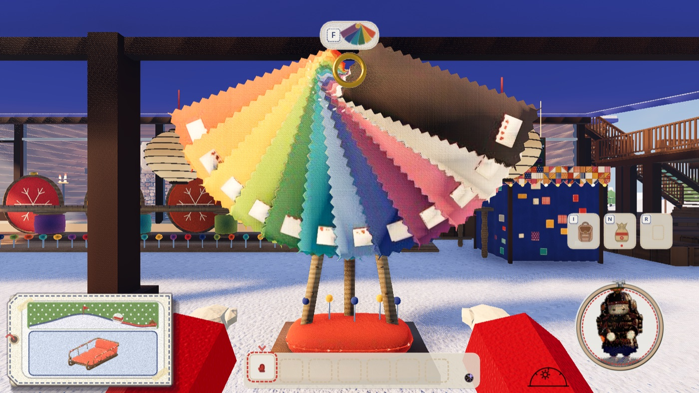
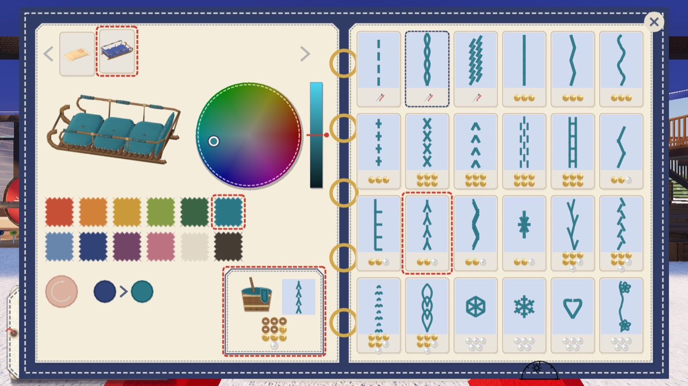
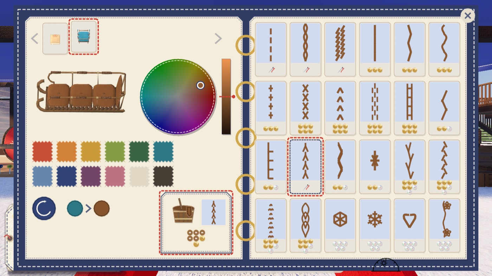
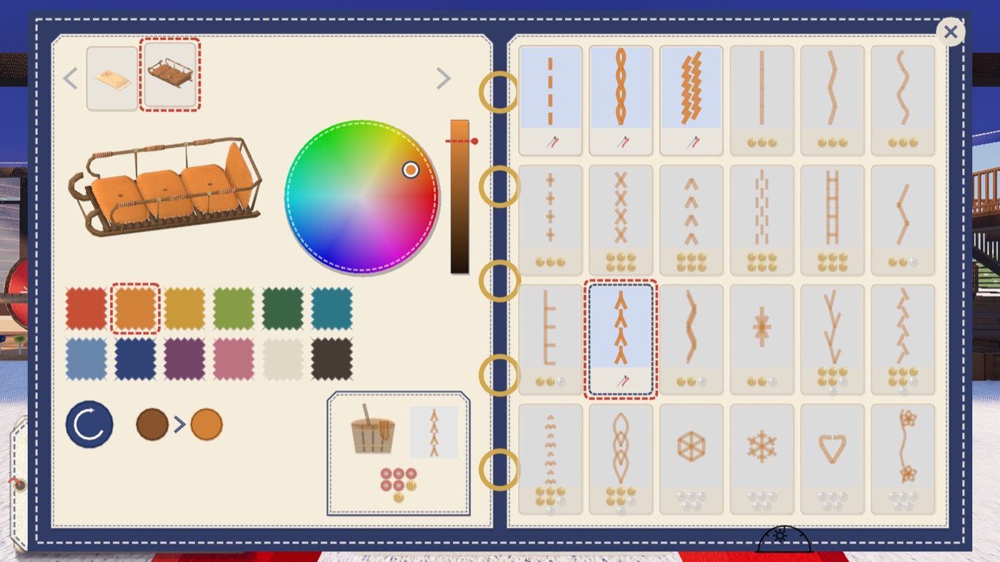
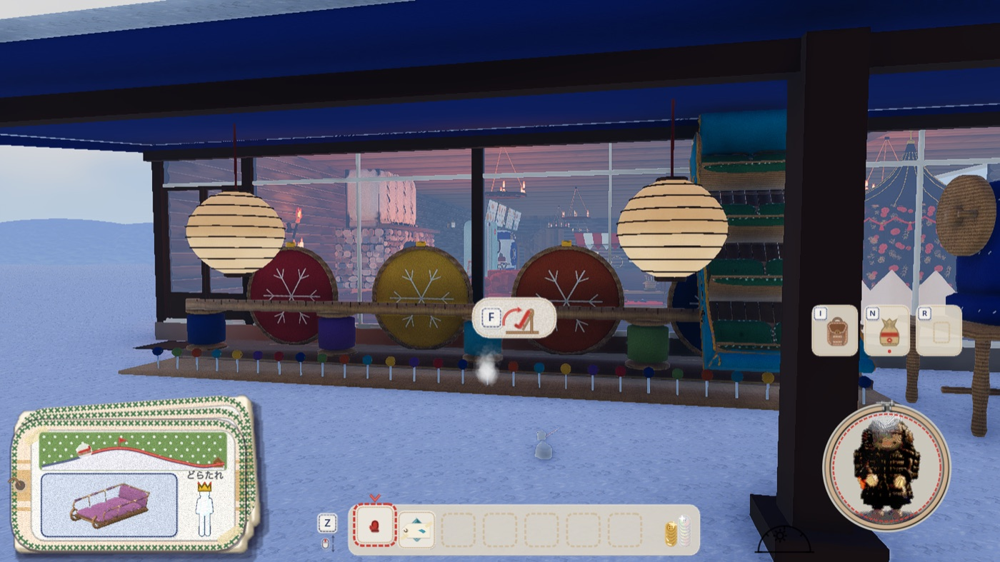
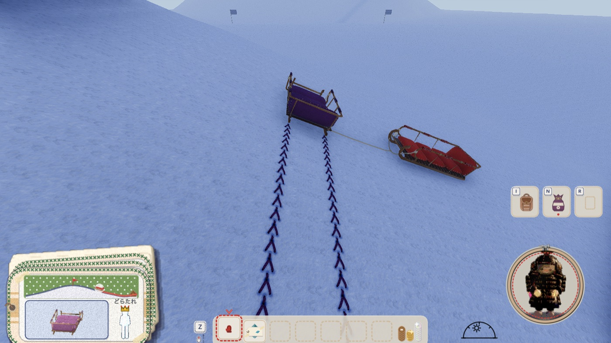

# ソリの見本帳（2026-11-06）

代表「見本帖＋自由な色にしてほしい」。案は [00-proposals.jpg](00-proposals.jpg)（上から、人台のとなりの桶・見本帳・立てかけ台の前。いちばん下が縫い目の棚）。代表は 2 段目の見本帳に、1 段目の色の輪を足す形を選んだ。案の絵は `game/tools/sled_custom_ideas.gd`。

## 決まり

- **場所**: ミシンと番台の前、下屋の外の雪の上（ロッジの座標 (-30.3, -3.3)、`game/main.gd` の `SLED_BOOK_AT`）。正面は西。前で F。形は `build_book.py`（ぎざぎざのフェルト 12 枚を真鍮の輪で綴じて扇に開く。物差しの脚、足もとは針山）、書き出しは `game/props/sled_book/`
- **役目**: 今あるソリの色と滑りあとの縫い目を替える。新しいソリを縫うのは、これまでどおりミシン。売り子の布 6 色と縫う流れは変えていない
- **字は使わない**。左の面に替えるソリ・回る見本・色の輪と明るさの帯（`game/color_wheel.gd`。服を染める画面と共通）・布 12 色・元の色に戻す丸い布・今の色 > 選んだ色・染める札。右の面に縫い目 24 柄
- **縫い目の見分け**: 持っている柄は針の印、買える柄はボタンの値段、買えない柄は薄い（選べない）。藍の破線はそのソリの今の柄、赤の破線は選んでいる柄。糸は選んでいる色で描く
- **替える相手**: 自分がオーナーのソリ。雪の上・立てかけ台・畳んだ包み・米袋。ロッジのソリと名札を外したソリは替えられない
- **使っているソリは替えない**（安全なほうに倒した）: 人が乗っている・つかまれている・紐を持たれている・0.5 m/s より速く動いている間は、列で薄くなり選べず、ホストも断る。立てかけ台のソリと、ペグで留めてあるだけのソリは替えられる
- **払う分**: 染め代は `DYE_PRICES` を布の多さで引く（米袋・小 15、中 25、大 40）。自由な色も布の色も同じ。元の色に戻すのはただ。買っていない柄を選んでいれば、その値段も足す。足りなければ札が薄くなり、押せない
- **すぐ色が付く**: `sled.gd` の `dye_to` → `set_main_color`。ソリと滑りあとの糸（もう残っている跡も）が同じ色になる
- **閉じる**: 右上の × か F か Esc。Tab でソリ、←→ で色合い、↑↓ で明るさ、Q・E で縫い目、Backspace で元の色、Enter で決める

## 色の持ち方と通信

- 自由な色は `fabric` に `"#RRGGBB"` の名前で入れる（`fabrics.gd` の `color` が読む）。売っている布の名前と同じ道を通るので、置き直し（`_place`）・畳んだ包み・立てかけ台・あとから入った人へ送る状態・札の絵・折り紙の動きがそのまま効く
- 元の布は、ソリの `base_fabric`、包みと米袋の `base` に残す（元の色に戻す用）。`_place` の引数と `snapshot` に通した
- 出来事は `craft.gd` の `sled_dye`（`{who, color, id か slot か sack}`。`color` が `""` なら元の色）。持ち主だけ、ホストが判定して配る
- `sled_dye_own` は、保存した標準の米袋の色を起動のときに戻す（ただ。米袋だけ）。保存は `my_tag.cfg` の `stitch/sack_color`。縫ったソリは今でも次の起動に持ち越さない

## 絵













## 確かめ

`game/tools/sled_book_check.gd`。一人で（絵つき）と、2 つ起動の通信（ホストを先に）。

```bash
/Applications/Godot.app/Contents/MacOS/Godot --path game --resolution 1920x1080 -s res://tools/sled_book_check.gd -- --bots=0 --lodge-bots=0 --no-sound --no-pip --no-buttons --dir=/tmp/book
```

```bash
/Applications/Godot.app/Contents/MacOS/Godot --headless --path game -s res://tools/sled_book_check.gd -- --host --port=24791 --bots=0 --lodge-bots=0 --no-sound --no-pip --no-buttons
```

```bash
/Applications/Godot.app/Contents/MacOS/Godot --headless --path game -s res://tools/sled_book_check.gd -- --join=127.0.0.1 --port=24791 --bots=0 --lodge-bots=0 --no-sound --no-pip --no-buttons
```
