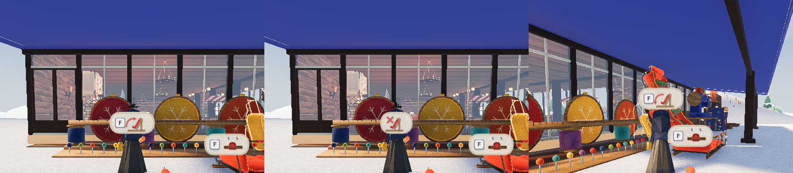
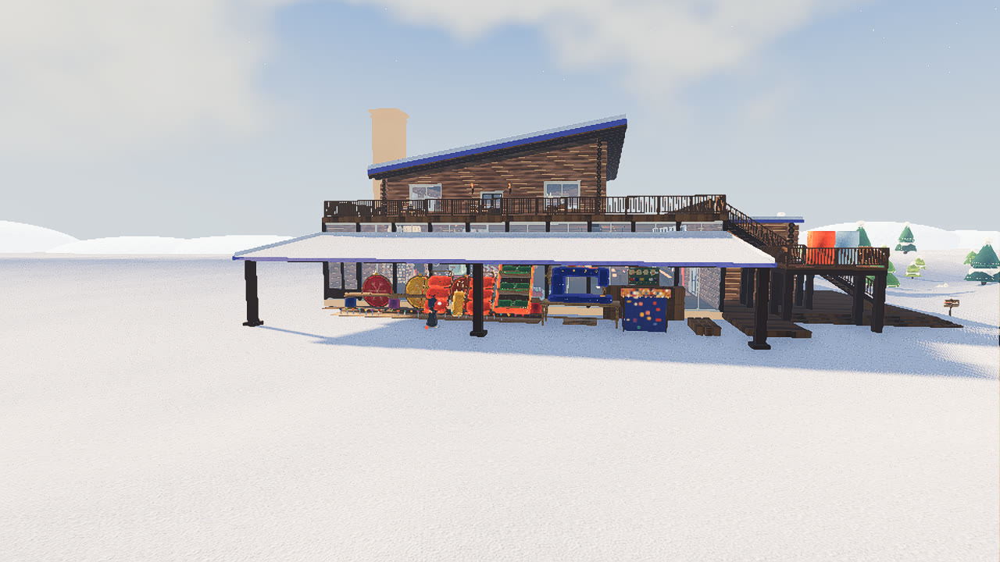

# ソリ屋を外の下屋へ、ソリの立てかけ台

2026-11-04。代表の言葉：「ソリ屋を外の屋根あるとこに持ってくのもありだなって思ってる」「ソリ屋の隣に今困ってるソリ放置問題を解決するために、ソリ立てかけスペースにインタラクトして、だれも触ってない状態の自分がオーナーのソリを立てかけ台に戻したり、持ってきてしまったりできるようにしたい」「既設のスキー立てかけ台は邪魔だから全撤去で」

## 形

[3 案](00-proposals.jpg)（待ち針の針山・糸立て・刺繍枠の衝立）から、代表が組み合わせを決めた（[できあがり](02-mix.jpg)）。

- 後ろに雪の結晶の刺繍枠が 4 枚（下の案がベース）
- 枠と枠のあいだに糸巻き（「糸巻きは刺繍枠と刺繍枠の間に置くのが良い」）。その上に物差しの横木を渡し、ソリをもたせかける
- 床の板を手前へ伸ばして待ち針をたくさん刺し、丸い玉でソリのお尻を止める（「滑り落ちてくるの止めるストッパーに」）

描き方と glb の書き出しは [ideas.py](ideas.py)。ゲームの節は `game/sled_rack.gd`。

## 遊び方の決まり

[意味を聞いた絵](01-meaning.jpg)で代表が決めた。

- 山に置いたソリは、台の前で F を押すとまず**台へ戻る**。その場で折り紙に畳まれて消え、包みが飛んできて台に現れる
- 台の自分のソリの方を見て F で、前の雪の上へ**持ち出す**
- **ペグで留めたソリは呼べない**（留めるのは「ここに置く」という意思）
- **名札のないソリ（持ち主なし）とロッジのソリは対象外**。米袋も対象外（30 m 離れて 4 秒で帯に戻るので困らない）
- 乗っている人・つかんでいる人・紐を持っている人がいれば、ホストが断る。そのとき持ち出せる物もなければ、F の代わりに赤い × の絵
- 戻す物が何台もあれば、遠いソリから 1 押しで 1 台
- 手の届くソリがそばにあれば、F はつかむほう（持ち出したソリをつかもうとして台へ戻さないように）
- 台の長さは 12 m。大きさごとの幅（大 2.4・中 1.7・小 0.95 m）で端から詰める。大なら 5 台で、いっぱいなら断る

案内の絵（左から: 戻す、呼べない、持ち出す）:

## 置き場（外の下屋）

寸法は `lodge/dims.py`。座標はロッジの x（東）, y（北）。

| もの | 所 | 決めた理由 |
|---|---|---|
| ミシン | (-25.3, -4.77) 正面は西 | 背 3.73 m。ここの屋根は 4.25 m（すき間 0.53 m）。外の端の桁（3.5 m）の下へは寄せない |
| 番台・おじいさん・貸出の棚 | ミシンの南。ガラスの壁の外 | 中にいた時の並びを東西に裏返した |
| 立てかけ台 | ミシンの北どなり。足もとの線は x -24.6、y -2.1〜9.9 | 大を立てかけた鼻は高さ 4.46 m、屋根 4.62 m。北の端は西のガラスの戸の前をあける |
| 下屋の柱 | 9 本 → 3 本（南の端・まんなか・北の端） | 代表「柱が多すぎますね。1/3にできませんか？」 |

スキーの立て（下屋の貸出のスキー立てとスキー置場）は当たりごとなくした。腰掛けは残した。

## 外になって変わること

- 足音: 下屋の下は雪の上なので、雪の音のまま。戸のマットだけ今までどおり
- 寒さ: `audio.gd` の zone_at で外（0）。ソリ屋で買い物をしている間も外と同じ扱い
- 舞う雪: 下屋の屋根の下に落ちないよう、見えない箱を足した（`main.gd` の SHELTER_LEAN）
- 大（OUT_FRONT）: 今までどおりロッジの前へ包みが落ちてくる

## 確かめ

- `game/tools/sled_rack_check.gd`: 屋根とのすき間、買う・縫う、ソリが柱のあいだを抜ける、通り道、戻す・持ち出す・断る
- `game/tools/sled_rack_net_check.gd`: 2 つのプロセスで、つなぐ側が本物の F キーで戻す・持ち出す。ホストがつかんでいる間は断られる
- `game/tools/sled_rack_shots.gd`: 絵。案内を写すときは `--hud-idle=0`（HUD が引っこむため）

## まだ見ていない

- 夜の下屋の明るさ（下屋に灯りは足していない）
- 代表の手元の画面で、実際に歩いて遊んだ手ざわり
