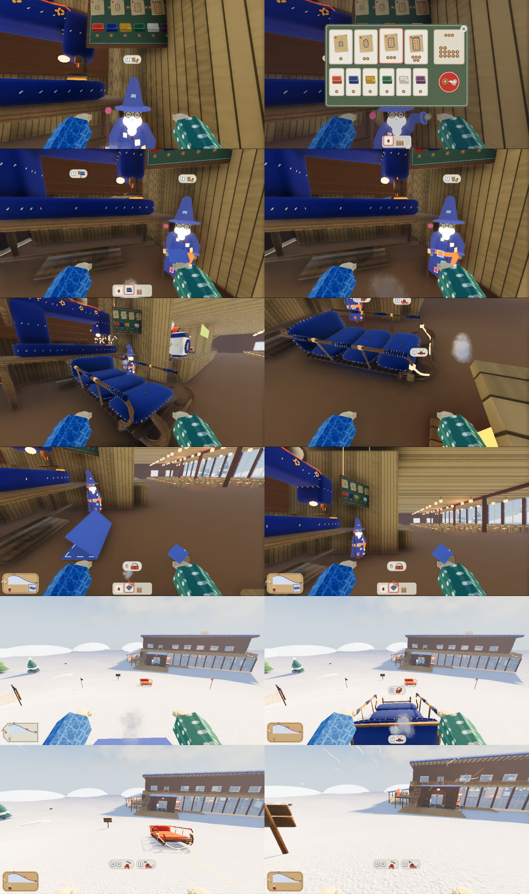
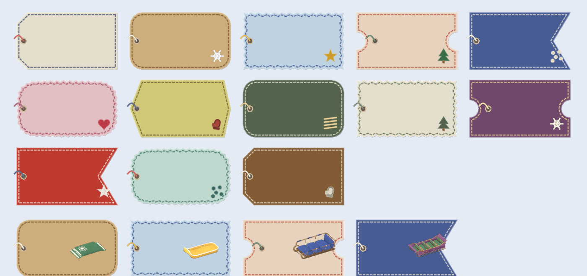
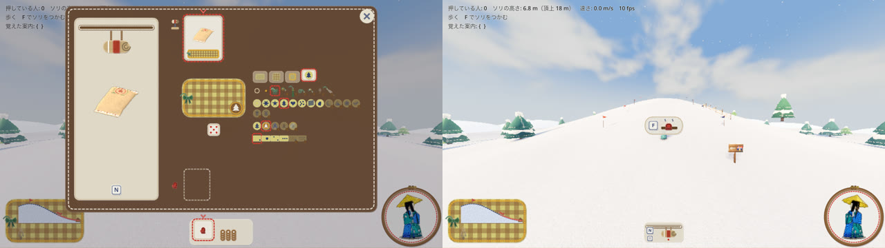
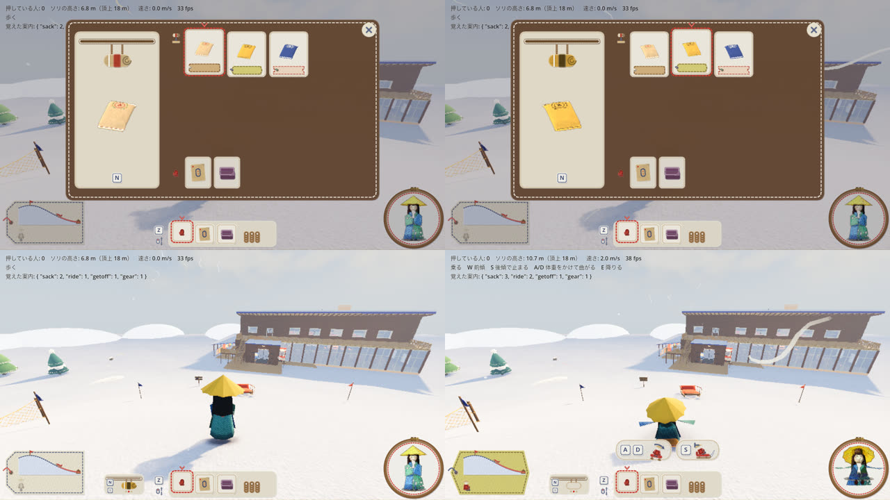
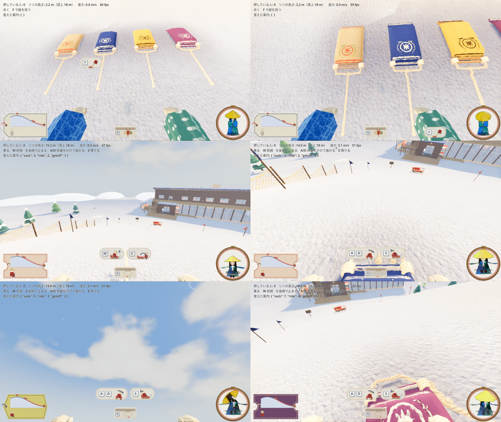
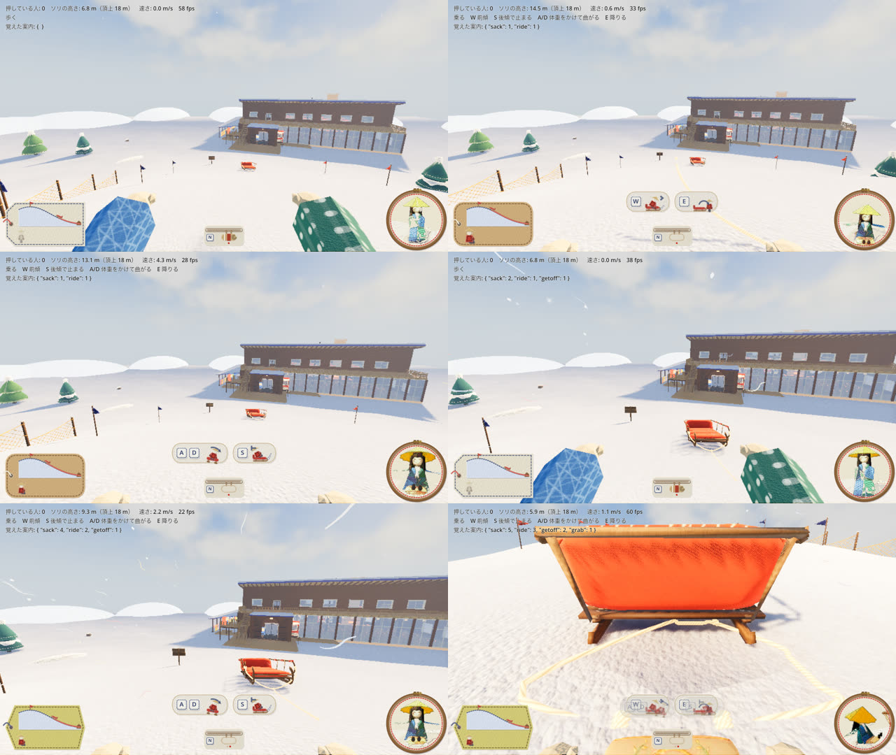
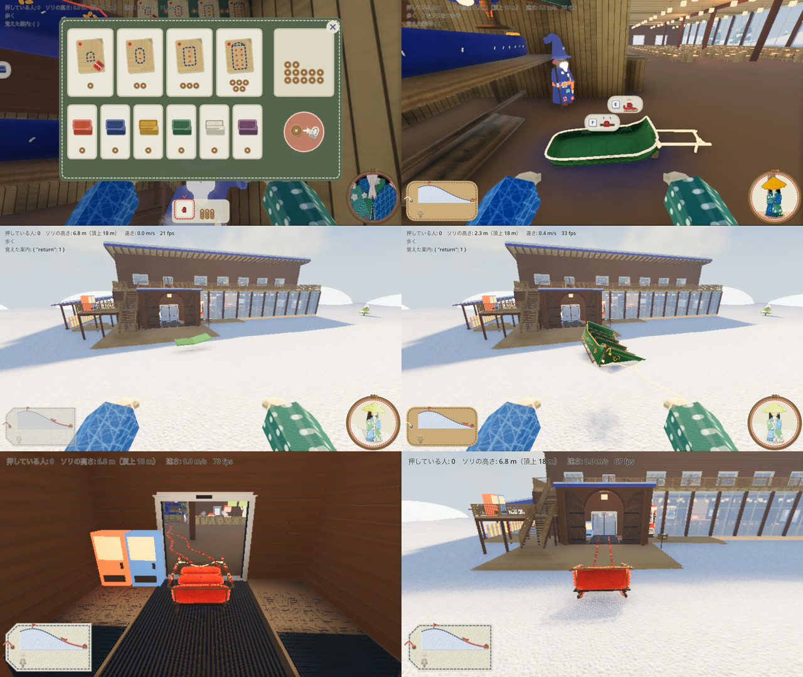

# ミシンで新しいソリを作る（2026-10-29）

ロッジの大きなミシンの前の塀（貸出のカウンター）を外し、横に型紙と布の売り子のおじさんを立たせた。おじさんから型紙と布を買い、ミシンにセットして縫うと、広げた実寸のソリが出てくる。出てきたソリは折り紙のように畳んで持ち物に入れ、外で広げて置ける。置いたソリは、ふつうのソリとして押したり乗ったりできる。



上の絵は、左上から順に「おじさんの前 → 売り台 → 布がないときのミシンの画面（空いた枠からおじさんへ矢印） → ミシンの画面（型紙と布、できるソリが回る、縫うボタン） → 縫う（ため） → ソリが出てくる → 手すりの前に吊るした名札 → 畳む → 持ち物に入った（左下の札に、広げた姿が回る窓） → 外で広げる → 広げたソリ → 乗って滑る」。どれも一人称の画面で、`game/tools/shop_shots.gd` が人の操作と同じ入口を呼んで撮った。1 枚ずつの絵は `01_…jpg`〜`32_…jpg`、そのときの記録は `log.txt` にある。

## ソリの名札（タグ）



- ソリ 1 台に 1 枚、柄の違う名札が付く（`game/sled_tags.gd`）。柄は形 7 種（角を切った紙・丸い角・ピンキングのぎざぎざ・切符・燕尾の旗・波の縁・六角）と、紙の色・縁の糸・吊るす糸・判子（雪の結晶・星・もみの木・ハート・水玉・しま・手袋）の組み合わせで、いまは 13 枚（上の 3 段）。最初からあるソリは 0 番（いままでの札と同じ紙のタグ）、縫ったソリは順に 1〜12 番
- 広げたソリ: 手すりの前の結び目から、小さな名札を糸で吊るす
- 畳んだソリ: 包みにも同じ名札が付き、名札の窓に、広げた姿が 12 コマで 15° ずつくるくる回る（上の絵のいちばん下の段。持ち物の列の絵と、手に持った包みにも出る）
- 畳んだソリを手に持っているとき（2026-10-29 直し）: 名札は吊るさず、包みの上の面に平らに貼る（左上と右下の角を紙テープで留め、面から少し浮かせる）。一人称では、その面を自分のカメラへ向けて手の少し上・内側に持つので、名札の柄と、窓の中で回る広げた姿がはっきり見える。人形の手（三人称・右下の小窓）では、名札の面を人形の前へ向ける（小窓やほかの人から見える。後ろからの三人称では包みの裏になる）。持ち物の列のアイコンも同じ並び。絵は [held-tag/](held-tag/)（名札の柄 1・4・10 番で、一人称・窓が回ったあと・三人称）、撮るのは `game/tools/held_tag_shots.gd`
- 画面の左下の札は、**最後に触ったソリ**（つかむ・紐を持つ・乗る・広げる）の名札の柄で描く。丘の断面の上の印がそのソリの場所、下にいまそのソリにいる人。そのソリを畳んで持っていれば、印は持っている人の所で、人の横に広げた姿が回る窓
- 柄を並べた絵は `game/tools/tag_sheet.gd` で描ける

## 遊び方

| 操作 | すること |
|---|---|
| おじさんの前で **F** | 売り台を開く。品物の札を押して選び、右の赤い買うボタンで買う。閉じるのは右上の ×、F、Esc |
| **ホイール**・トラックパッドの**二本指スクロール**・**Z**（Shift+Z で逆） | 手に持つ物を替える（素手 → 持ち物 1 → 2 → …）。持ち物がないときと **Alt** を押しているときは、ホイールはいままでどおり視野角（トラックパッドの視野角はピンチ） |
| ミシンの前で **F**（か **T**） | ミシンの画面を開く。下に並んだ自分の持ち物を押すと、型紙は型紙の枠、布は布の枠に入る（枠を押すと外す。開いたときは、手に持っている物か最初の型紙・布が入っている）。そろうと、できるソリが布の色でくるくる回る。縫うボタン（針）で、型紙と布をいっしょに使って 7 つの場面が始まる。足りない枠は破線で空き、おじさんを指す矢印が出る。閉じるのは ×、F、T、Esc |
| 縫ったソリのそばで **G** | 畳んで持ち物に入れる（誰も乗っていない・つかんでいないときだけ） |
| 畳んだソリを手に持って **左クリック** | 前の床に広げて置く。坂ではソリを坂に沿わせる。壁や物とぶつかる所には置けない |

起動引数 `--spawn=shop` で、おじさんの前から始まる。

```bash
/Applications/Godot.app/Contents/MacOS/Godot --path game -- --spawn=shop
```

流れを通して撮るには:

```bash
/Applications/Godot.app/Contents/MacOS/Godot --path game --resolution 1280x720 --fixed-fps 30 -s res://tools/shop_shots.gd -- --bots=0 --no-sound --no-pip --spawn=shop --dir=/tmp/shop --sled=mid --fabric=navy
```

`--sled` は `sack`・`small`・`mid`・`large`、`--fabric` は `red`・`navy`・`mustard`・`holly`・`cream`・`plum`。

## 自分の名札（2026-10-29）と、試したが没にした方位磁針



代表の言葉:「タグは個人で一つデザインして持っておいて、ソリの所有者としてのタグ付けがいい感じそうですね。じゃあ自タグを付けているソリは、タグ上にログポースのような球状の方位磁針のようなもので複数指せて、針の先で距離表示できると、ソリを見失わなくて良いなと思います」

- **自分の名札**: 名札はソリごとに配るのをやめ、一人一つ。装備の画面（I）のまんなかの段で、形 7・紙の色 12・縁の糸 8・吊るす糸 8・判子 8 の部品を組み合わせて決める（`sled_tags.gd` の SHAPES・PAPERS・THREADS・MOTIFS）。画面で変えると保存し（`user://my_tag.cfg`）、次に起動しても同じ。はじめは人の番号から決めた名札
- **持ち主の印**: 縫ったソリ・自分の米袋には、持ち主（縫った人）の名札が付く（`sled.gd` の owner_id と tag）。名札を変えると、自分のソリの名札も付け替わる。最初からあるソリは持ち主なしで、ロッジの名札（いままでの紙の名札）。名札のデザインは出来事 `tag_design {design}` で配る（通信では「誰が」の印）
- **名札の中身**（代表の言葉:「タグの中の情報は、前の丘の高さとインタラクトプレイヤー情報がいいや」）: 左下の自分の名札の中は、元の中身に戻した。丘の断面の上を、いま関わっているソリ（最後に触ったソリ）の印が進み、ふもとからの赤い糸が登った分だけ伸びる。下に、そのソリにいる人（押す・引く・乗る人）の形と、押している人の数だけの糸の矢印。そのソリから離れると、名札は消える（元のとおり）。名札の形・色は自分の名札のデザイン
- **方位磁針は、試したが没（2026-10-31 代表）**: 代表の言葉:「待ち針での場所表示は没だね」。左下の名札の上に、自分のソリの方へ待ち針が倒れる方位磁針を作ったが、外した（`hud.gd` の方位磁針と `pin_cushion_3d.gd`、名札の部品のクッションの色、確かめ用の `compass_shots.gd`・`pillow_shots.gd`）。左下の名札は、中身（丘の断面とソリの印、関わる人、押す人数の矢印）だけで、ソリから離れると消える。保存した名札にクッションの色の値が残っていても、読み込みで使わない。試したことの記録と絵（`my-tag/`）は残す:
  - **3D のピンクッションの方位磁針**（代表の言葉:「剣山！…ななめから見下ろすアングルのほうがわかりやすい」「僕の知ってる剣山は、半球の小さいクッション？に待ち針が刺さっている感じ」「剣山がいま 2D でペタンコなのも見づらいから、3D で作り直して」）: 名札の上に、3D で作ったピンクッションを載せる（`game/pin_cushion_3d.gd`。小さな自分だけの世界を 240 × 200 で描き、HUD の大きさに合わせて伸び縮み）。ふっくらした四角いフェルトの枕（`look.gd` の felt）に、白い玉縁のレース。左の奥の上から光を当て、ふくらみの陰と針の影が出る。明るさは本体の画面の露出に合わせる。自分のソリ（縫ったソリ・出している米袋）の数だけ、つやのある玉の待ち針がソリの側の斜面に刺さり、そのソリの方へ 3D で倒れる。水平の向きは自分の見ている向きが基準（奥が前、右が右）、立ち上がりはソリが上なら立ち、下なら寝る。後ろのソリの針は、見下ろすカメラの向きと重なって点にならないよう寝かせて、手前の縁から手前へ倒す。玉はソリのメインカラー、距離は玉の所に巻尺のテープ（m）。乗っているソリの針はクッションの上に寝かせる。名札がソリから離れて消えていても、ピンクッションは出る（自分のソリを探すため）。ソリが 1 台も無いときは出さない
  - **上下の読み取り**: この角度では、奥へ倒れるのと上へ立つのが画面ではどちらも上向きになるため、ソリが上か下かは針の立ち方のわずかな違いにしか出ない（[my-tag/compass_3d.jpg](my-tag/compass_3d.jpg) の下の段の 2・3 枚目）。前後左右ははっきり読める
  - **クッションの色**: 3D のクッションの色も、装備の画面（I）の名札の部品のいちばん下の段で選ぶ（`sled_tags.gd` の CUSHIONS）。左端は自分の名札の地の色（少し淡く。破線の印）、ほかは淡いピンク（はじめ）・水色・生成り・ミント・藤・レモン（[my-tag/pillow_color_row.jpg](my-tag/pillow_color_row.jpg)）
  - 途中で、生け花の剣山（木の縁に短い針がびっしり）も作ったが、代表の思う剣山（ピンクッション）と違ったのでやめた。2D で描いた形（四角いピンクッション `--compass=pillow`、トマトの針山 `cushion` など）は、起動の引数で見られる
  - 距離: 待ち針の玉の先に、巻尺のテープの切れはし（黄色い紙に目盛り）と小さな数（m）。結び目の数も試したが小さくて読みにくかった（[my-tag/compare_number_knots.jpg](my-tag/compare_number_knots.jpg)）
  - 形はほかに、針山（`--compass=cushion`）・毛糸玉と縫い針（`yarn`）・はじめのフィルムの玉（`glass`）を作って見比べた（[my-tag/compare_cushion_yarn.jpg](my-tag/compare_cushion_yarn.jpg)）。製図のコンパスは、何台も同時に指せないので作らなかった
  - 大きさは HUD の大きさの設定に合わせて変わる（`Icons.ui_scale`）。右側には、いまつかんでいる・乗っているソリにいる人と、押している人の数だけの糸の矢印
  - 絵: [my-tag/compass_3d.jpg](my-tag/compass_3d.jpg)（3D のピンクッション）、[my-tag/00-sheet.jpg](my-tag/00-sheet.jpg)

## 装備の画面（2026-10-29）



代表の言葉:「米袋の設定は、インベントリというか装備画面を作って、そこで設定するようにしましょう。呼び出しのときは、その設定してある米袋をすぐ取り出す感じ」

- **I** で装備の画面を開く（いまの割り当てと重ならず、多くのゲームで持ち物・装備を開くキー）。売り台・ミシンの画面と同じ作りの、文字のない画面（革の色のフェルト）
- 左: いま装備している米袋を帯に下げ、広げた姿がくるくる回る。下に N（これが出る）
- 右の上の段: 持っている米袋（標準のクラフト紙と、縫った色違い）。それぞれ広げた姿と名札の柄。装備しているものに赤い糸の印。押すと装備が入れ替わる
- 右の下の段: 持ち物（型紙・布）。見るだけ
- 閉じるのは ×、I、Esc。N は選び直しなしで、装備している米袋をすぐ足もとに出す。前の Shift+N（装備の枠で選ぶ）は、この画面に置き換えた
- HUD の装備の枠（帯に下げた袋）は、装備している米袋の色（色違いは袋が布の色、帯が読める色）。N と I のキー。Esc の札にも I
- 装備は種類ごとに「持っている物の配列」と「装備している番号」を持ち、出来事 equip {gear, index} で替える（`craft.gd` の GEARS）。いまは米袋だけ。服や名札の柄は、種類と段を足せば入る
- 確かめ: `game/tools/sack_gear_shots.gd` の 3（I で開く → からしの米袋を選ぶ → I で閉じる → N でからしの米袋が出る）。記録は [gear-screen/log.txt](gear-screen/log.txt)

## 米袋の色と紐（2026-10-29）



代表の言葉:「米袋は、米袋全体の色を変えてほしい。米袋の紐は、米袋の前方の端と端をつなぐような感じでお願いします。いまはだいぶ外側にはみ出ているので」

- **色**: 布の色で縫った米袋は、袋全体（クラフト紙の地）がその色になる。米袋の glb は地・印刷・テープ・縫い目を 1 枚の絵に焼いてあるので、絵の色で地（色相 0.1 のほどほどの鮮やかさ）・口のテープ（淡い）・印刷と縫い目（そのほか）に分け、地は布の色に（しわ・影の明るさのむらは残す）、印刷（赤い丸・「米」・稲穂・帯）と縫い目は地の上で読める 1 色にする。地が暗ければ生成りの白抜き、明るければ地の色の濃い色。標準の米袋（クラフト紙）はそのまま。`props.gd` の `recolor` に `whole` を足し、`sled.gd` の `KINDS` の米袋に `"whole": true`
- **紐**: 前の左右の耳（`rope_tie_l`・`rope_tie_r`）を結ぶ紐を、耳のあいだ + 0.1 m の短いたわみにし（ほかのソリは + 0.76 m のまま）、引っ張り紐をまんなかから 1.2 m だけ出す（ほかは 3.0 m）。`KINDS` の米袋の `rope_spare`・`rope_len`。紐が袋の外へはみ出ていたのは、`sled_rope.gd` が紐の点を「ソリの台の中に入ったら外へ出す」箱を中くらいのソリの大きさ（幅 ±0.8 m、前 1.42 m）で決めていて、小さな米袋では結び目と引っ張り紐が箱の中に入り、横へ押し出されていたため。米袋はその箱を袋の大きさにした
- 確かめ: `game/tools/sack_look_shots.gd`（標準・紺・からし・すももを、置いたとき・N で呼び出したとき・乗って滑るとき）。右下の小窓では、小さな米袋は人形にほとんど隠れる（[sack-look/11_selfcam_ride.jpg](sack-look/11_selfcam_ride.jpg)）

## 米袋は装備（2026-10-29）



代表の言葉:「米袋は常に所持している状態で、インベントリを圧迫しない装備扱いにしてください。なにかのキーで呼び出しできるのが理想です」「米袋もカスタムできるようにしたいから、売り台から外さないで」

- 米袋は全員が最初から 1 つ（標準）持つ装備。持ち物の列には入れず、列の左の**装備の枠**（帯に下げた丸めた米袋）で示す
- **N**: いま選んでいる米袋を足もとにぽんと広げて、そのまま乗る。坂の途中なら、すぐ滑り出す（中腹で 1.5 秒後に 4.2 m/s）。つかんでいる・紐を持っている・ほかのソリに乗っているときは、手を離して・降りてから乗る（大きいソリが滑っていったとき、すぐ追いかけられる）
- もう一度 **N**: 降りて、くるっと丸めて帯に戻す（畳む動きの速回し）。出したまま離れた所にいれば、N で足もとへ呼び戻して乗る
- 呼び出す米袋は、I で開く装備の画面で選ぶ（下の「装備の画面」。はじめは Shift+N だった）。米袋は一人に一つだけ出せる
- 片付け: 誰も乗っていない米袋から持ち主が 30 m 離れて 4 秒たつと、ひとりでに帯に戻る
- 米袋の型紙は売り台に残した。型紙と布で縫った米袋は、ミシンの前には出ず、装備の枠に入って、呼び出す米袋になる（名札は前の米袋の次の柄）
- キー N は、いまの割り当て（Space・F・E・R・C・V・P・G・T・Z・Q・X・B・Tab・1〜7・Y・H）と重ならない、左手を少し伸ばせば届くキーから選んだ
- これで畳む・広げるの操作（G・左クリック）は無くした。畳めるのは一人用（米袋）だけで、米袋は装備の呼び出し・しまうになったため。出来事の fold・unfold と折り紙の動き（`origami.gd`）は、帯に戻す動きと、大のソリがロッジの前に出る動きに使う
- 足で漕ぐ加速（滑走中の Space 連打）と、米袋で大きいソリに追いついて止める物理は、ソリの物理の作業に任せた
- 確かめ: `game/tools/sack_gear_shots.gd`（N・Shift+N は本物のキーのイベントで流す）。記録は [sack-gear/log.txt](sack-gear/log.txt)

## 畳めるのは一人用だけ（2026-10-29）



代表の言葉:「畳めるソリは一人用のみにしましょう」

- 畳めるのは一人用（席が 1 つ）のソリだけで、いまは米袋。小（2 人）・中（3 人）・大（8 人）は畳めない（`craft.gd` の `foldable`。ホストも断る）
- 畳めないソリのそばでは G のワッペンを出さない。それでも G を押すと、折ろうとして前の角が少し持ち上がり、ぱたんと戻るだけ（12 コマで 6 コマ）
- 売り台・看板・ミシンの画面の型紙は、畳める型紙（米袋）の右下の角に、折り目の入った赤い小さな包みの印を付けた
- 縫ったときの流れ:
  - **米袋**: ミシンの前に出る → G で畳んで持つ → 外で広げる（いままでどおり）
  - **小・中**: ミシンの前に広げた実寸で出る。持ち物には入らない。押したり紐で引いたりして、ロッジの西の通路 → 内の自動ドア（幅 3.0 m）→ 風除室 → アーチ戸（幅 3.6 m）→ 玄関前の広場 → 雪の上、と運び出せる
  - **大**: ロッジの中から運び出せない（下の確かめ）。縫うと、ミシンの上では 1 m の大きさで見せ、本物は**ロッジの前の雪の上**（玄関前の広場の先、頂上向き）に、空から包みが落ちて折り紙のように開いて出てくる（`main.gd` の `delivery_spot`）。縫った人の左下の札がそのソリになるので、場所は札の印でわかる
- 確かめ（`game/tools/carry_out_check.gd`。結果は [fold-single/carry_out.txt](fold-single/carry_out.txt)）:
  - ソリの大きさの箱を、ミシンの前から外の雪まで道に沿って動かした。米袋・小・中は通る。大（幅 2.2 m × 長さ 4.8 m）は、西の通路の家具とカウンター奥の壁に当たり、道を 3 通り変えても通らない
  - 本物のソリを後ろから押して運んだ（自動ドアは人にしか開かないので、当たりのない人がついて歩く）。小は 10 秒、中は 17 秒で外の雪まで出た
  - `shop_shots.gd --sled=sack|small|large`: 米袋は畳めて広げて滑れる。小・大は畳めず、G を押しても持ち物に入らない。大はロッジの前に出る

## 決めたこと

- **持ち替え**: ホイール・二本指スクロール・Z。ホイールは、持ち物があれば手に持つ物、なければ視野角（Alt を押しながらなら、持ち物があっても視野角）。Mac のトラックパッドの二本指スクロールはホイールでなく `InputEventPanGesture` で届くので、それも受ける（ためた量が 1.5 で 1 つ）。Z は空いていたキー。持ち物の列の左に Z とホイールの絵を出し、Esc の札にも足した
- **ミシンにセットする**: 手に持って T でセットするやり方は、ミシンの画面に置き換えた。型紙と布は 1 回の出来事（`sew`）でいっしょに使われ、片方だけ消えることはない
- **F が重なるとき**: ミシンとおじさんの両方に近いときは、向いている方の画面を開く
- **左クリック**: 雪玉を持っていれば投げる → 畳んだソリを手に持っていれば広げる → 高い両手のひらなら拍手、の順。雪玉は持ち物とは別で、雪玉を持っているあいだは右手が雪玉になる
- **お金**: 仮に木のボタン。最初に 12 個。型紙は米袋 1・小 2・中 3・大 5、布はどれも 1（`game/craft.gd` の `START_BUTTONS`・`PATTERN_PRICE`・`FABRIC_PRICE` で変える）。持ち物は 8 つまで
- **布の色**: 赤・紺・からし・ひいらぎ緑・生成り・すもも（`game/fabrics.gd`）
- **布の色の当て方**: ソリのメインカラーの受け口（PR #18 の `sled.gd` の `main_color`・`set_main_color` と `props.gd` の `recolor`）を使う。`sled.fabric` に布の名前を入れると、そのメインカラーになる
- **出てくる所**: ミシンのまんなかの前に、ソリの後ろの端が出口の目印の少し奥に来るように止まる。いちばん大きい 8 人乗り（長さ 4.8 m）もロッジの中に収まる
- **畳む・広げる**: 1 枚の布になって、前の半分・前の半分・左の半分と 3 回折る。12 コマで 30 コマ（2.5 秒）。広げるは逆回しで、最後に布がふくらんでソリになる

## 通信の備え

買う・持ち替え・セット・縫い上がり・畳む・広げるは、`game/craft.gd` の出来事 `{kind, who, frame, …}` にしてある（身ぶりの `emotes.gd` と同じ形。中身は数・文字・Vector3 だけ）。いまは一人の画面の中で `send()` がすぐ配る。通信を入れたら、`send()` はホストへ送るだけにし、ホストが値段・持ち物の空き・ソリの置き場を確かめてから全員に配る。財布と持ち物はホストが持つ。畳む・広げるの動きは出来事のコマから始まるので、全員の画面で同じコマに動く。

## できていないこと

- おじさんは形の部品（円錐・球・管）で組んだ仮の姿。人形のラフ（`person/ideas/characters` の旅のおじいさん、v2・v3）を Blender から骨と焼いた絵の glb に書き出すのは、まだ
- 「パッチワークテーマのおじさん」は、ラフの中で継ぎ当てのコートを着た旅のおじいさんだと読んだ。4 回目のラフの「継ぎはぎの巨人」のほうだったら、姿を差し替える
- 名札の柄は、いまは縫った順に配る。好きな柄を選ぶ・売る（おじさんの売り物に足す）のは、まだ
- 音: 縫ったソリの滑る音・きしむ音は、もとのソリにしか付いていない（`audio.gd` は 1 台だけを見ている）。売り台・畳む・広げるの音もまだない
- 仲間（ボット）は、縫ったソリを押さない
- 一人称の手に持った物は、小さな箱の仮の形
- 実際の手でまだ遊んで確かめていない（確かめたのは `shop_shots.gd` の通しと、画面の絵）
