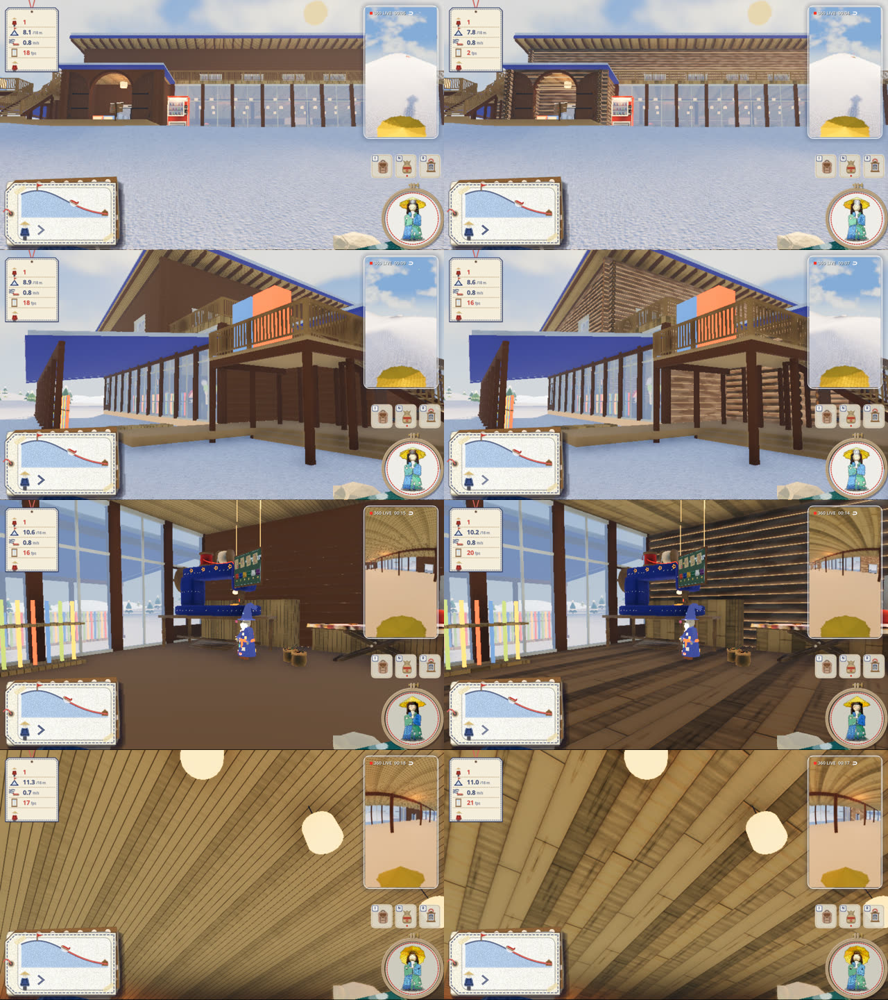
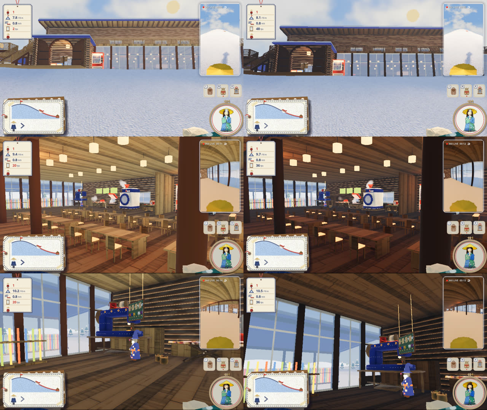

# ロッジの丸太と板（2026-10-31）

代表の言葉:「ロッジの壁・天井・床の木の板が全部細い。もっと大きくして荒っぽくしてほしい。あと壁は外側も内側も丸太の段々を見たいので、普通に丸太を組み上げた感じにしてほしい」

左が直す前、右が直した後。上から、正面・角（外）・ミシンの所・天井を見上げる。ほかに [03_dining.jpg](03_dining.jpg)（食堂）、[06_inner_wall.jpg](06_inner_wall.jpg)（中の壁）。

## したこと

- **床と天井の板**（`game/lodge/lodge.gd` の `_planks`）: 板の幅を 15 cm から 40 cm に（2.4 m に 6 枚）。板ごとの濃さ（0.70〜1.12 倍）とわずかな色合い、継ぎ目の溝、板ごとの高さの違い（段差）、角の丸み、長さの途中の突き合わせの継ぎ目、強めの木目と節を、凹凸の絵にも入れた。1 階の床は前は板の模様のない一色だったので、同じ板にした（卓・棚など「board」の板も同じ幅になる）
- **丸太の壁**: 壁はもとから丸太（直径 36 cm の円柱）を段に積み、角で交互に突き出して組む形だったが、フェルトの一色で平らに見えていた。
  - 丸太の素材（`LOG_SHADER`）: 胴は、剥いた木肌と残った樹皮のむら、丸太の向きに流れる木目、下向きの面（継ぎ目のくぼみ）を暗く。木口（角で突き出した丸太の端）は年輪とひび、外側に樹皮の輪。色は日なたで橙のれんがに見えないよう、落ち着いた茶にした
  - 継ぎ目の綿（`lodge/build_lodge.py` の `CHINK`）: 段と段の継ぎ目に、外と中の両面から見える細い帯（綿の詰め物）を足した。明るいと白い縞に見えるので、陰の色に寄せた
- 窓と扉の枠は、もとから丸太を抜いた所に収まっているので、そのまま

## こげ茶に（2026-10-31）

代表の言葉:「いいね、木の色もっと濃くてもいいよ。僕の記憶のロッジはもっともっとこげ茶色だった」

丸太（樹皮・木肌・木口）、柱、戸、床・天井・卓の板、外のデッキと手すりを、どれもこげ茶に寄せた（明るさはおよそ 6 割）。中は灯りで暖かいこげ茶に、外は日なたでも橙に転ばない暗い茶に見える。継ぎ目の綿も、丸太に合わせて少し暗くした。

## 重さ

- 三角形: ロッジの見た目の glb で 67,280 → 70,820（+3,540、+5%。継ぎ目の綿の帯）。丸太の形は増やしていない
- fps: この作業のあいだ、ほかの作業の Godot が 4〜5 本同時に動いていて（負荷 10〜40）、直す前と後を交互に測っても 6〜23 fps で大きくぶれ、差を読み取れなかった（[fps_before_after.txt](fps_before_after.txt)）。混んでいないときに直す前に測った値は、右上の 360° 映像ありで 30〜34 fps、なしで 37〜51 fps で、直す前から 45〜60 fps に届いていない。いちばん重いのは右上の 360° 映像（場面を 6 回描く）。手で遊ぶときに測り直したい
