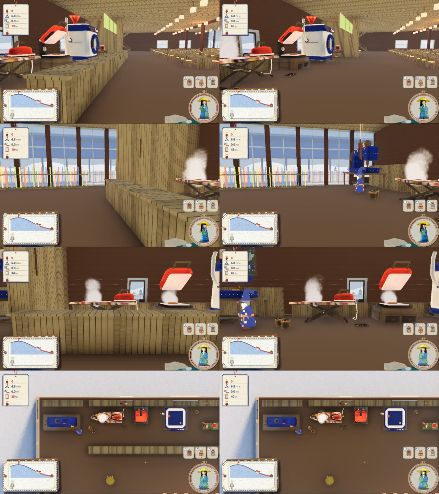

# ミシンとご飯の施設のあいだを、ひと続きに（2026-10-31）

代表の言葉:「ミシンとご飯の方の施設との間の仕切りを無くしたい。ご飯の前の塀も消してほしい」

左が直す前、右が直した後。上から、ミシンの前からご飯の機械の方・ご飯の機械の前からミシンの方・そのあいだ・真上から（天井を消して）。

- `lodge/build_lodge.py` で、厨房の西の間仕切り（ミシンとのあいだ）と、レジ・配膳のカウンター（ご飯の機械の前の塀）を、見た目と当たり判定の両方から外し、glb を書き出し直した（ミシンの前の貸出のカウンターを外したのと同じやり方）
- 厨房の東の間仕切り、壁ぎわの裏の台と貸出の棚、天井から吊るしたメニュー板はそのまま。間仕切りもカウンターも床・壁・天井から離れて立っていたので、外した跡に穴やつなぎ目は残らない。灯りの目印と、中の小物（`lodge_props_interior`）は、間仕切りとカウンターに載っていなかったので動かしていない
- 歩いて通れるか（`game/tools/lodge_open_shots.gd`、本物の W キー）: 直す前は、ミシンの前からご飯の機械へ向かうと、カウンターの西の端で止まった（3.3 秒、[walk_before.txt](walk_before.txt)）。直した後は、行き帰りとも 9.4 秒で着く（[walk_after.txt](walk_after.txt)）
- 型紙と布を買ってミシンで中のソリを縫う流れ（`tools/shop_shots.gd`）も、前と同じく通った
- 8 人乗りの大のソリは、いまもロッジの外へ運び出せない（`tools/carry_out_check.gd`。西の通路の卓や壁に当たる。外したカウンターとは別の所）。縫うとロッジの前に出る作りはそのまま
