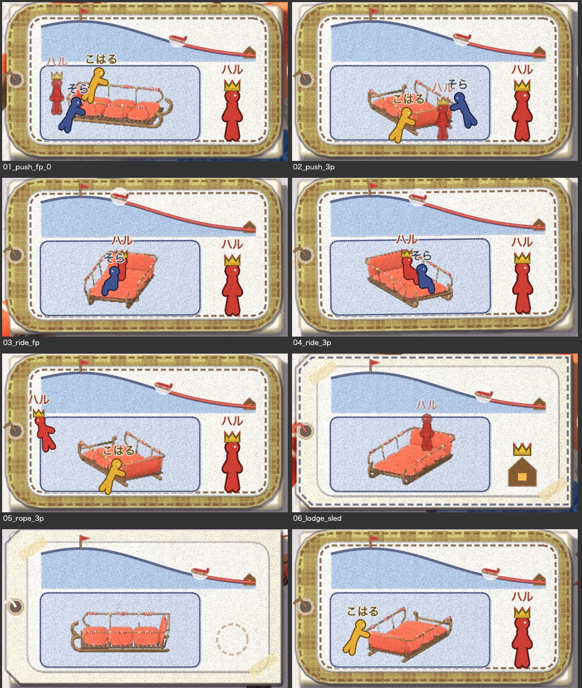
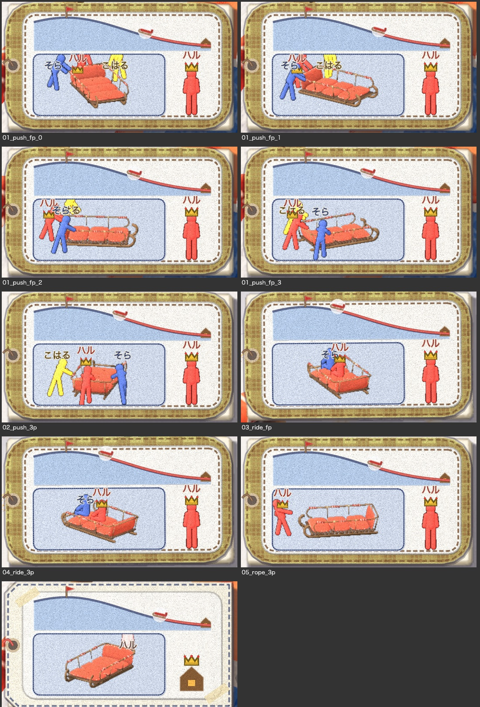

# ソリの名札の作り直し

2026-10-31。代表の言葉は次のとおり。

- 「タグは米袋には要らない」
- 「タグはソリごとにデザインできるべき」
- 「HUD のタグには、そのタグが付いたソリがくるくる 360° 回転するアニメーションと、誰がインタラクトしてるか、乗ってるか、だれがオーナーか（タグ持ってる人）を表示してほしい」
- 「ソリからタグを外して所有権を放棄できるようにしてほしい」

見本の絵で決めたことは次のとおり。

- [その 1](mock.jpg) を見た代表の言葉：「B が近い、丘は残す。その下はキャラのアイコンでなく、回っているソリに、乗っている位置・押している位置の実際に合わせて人を乗せたり押させたりして見せる」
- [その 2](mock2.jpg) を見た代表の言葉：「オーナーは王冠表示」「人形表示は傘とか服とか付けずに、シンプルな人型アイコンにキャラカラー、プレイヤー名を頭の上に」「プレイヤー名はインベントリで自分で決められるように」
- 返事のなかった 3 つは、見本で勧めた案にした（あとで変えられる）。
  - 札の大きさは 1.3 倍。
  - 柄は装備の画面で選ぶ。
  - 外した名札は手元に戻り、付け直せる。

## 決まり

- **米袋に名札は付けない**。
  - 米袋の 3D の名札、装備の画面の米袋の札の名札、HUD の名札の束の米袋の札をなくした。
  - `--sled=sack` で始めたときも付かない（`sled.gd` の `retag`）。
- **名札はソリごと**。
  - ソリの `tag` が、そのソリの柄。
  - 縫い上がったソリには「いつもの柄」（今までの自分の名札）が付く。
  - 畳むと包みに付いたまま持ち歩き、広げてもその柄のまま。
  - 柄は装備の画面（I）で替える。名札の下の札の列から、替える名札を選ぶ。
    - いつもの柄（針の印。これから縫うソリに付く）
    - 置いてある自分のソリ（回る姿）
    - 畳んだソリ
    - 名札入れの外した名札
  - いつもの柄を替えても、いまあるソリの名札は替わらない。
- **持ち主は名札を持っている人**（`owner_id`）。
  - **外す**：自分のソリの名札の結び目のそばで **G を長押し**（0.75 秒。結び目のまわりに赤い糸の輪が満ちる）。
    - 名札は帯の名札入れへ飛んで戻る（`craft.gd` の `loose_tags`）。
    - ソリは持ち主のいない、名札のないソリになる。だれでも乗れて、畳める。
  - **付ける**：名札入れに名札があれば、持ち主のいない名札なしのソリの結び目のそばで G を長押し。
    - 名札が飛んで結ばれ、そのソリの持ち主になる。
    - ロッジのソリ（ロッジの名札が付いている）には付けられない。
  - 名札のない包みを広げても、持ち主のいないソリのまま。
- **名前とキャラの色**。装備の画面の左の上で、名前を打ち（10 字まで）、色を 12 色から選ぶ。
  - いつもの柄といっしょに `user://my_tag.cfg` に保存する。
  - 仲間には、番号の順にはじめの名前（ゆき・そら・こはる…）と色（赤・藍・からし…）が付く。

## HUD の札（左下）

名札の形・柄は、その札のソリの名札で描く。名札を外したソリは無地の紙。窓の中は次のとおり。

- **上の段**：丘の断面とソリの印、登った分の赤い糸（今までどおり）。
- **下の段の左**：そのソリが 12 コマの刻みで 15° ずつ回る図（4 秒で 1 周。`sled_tags.gd` の `turntable_wide`）。
  - 押している人・紐で引いている人・つかんでいる人・乗っている人を、そのソリの上の実際の所に人の形で乗せて、いっしょに回す（`turn_project` で同じ向きに合わせる）。
    - 座る：席に座った姿
    - 押す：前のめりで両手を前へ
    - 引く：前のめりで片手を後ろへ
    - つかんでいるだけ：立った姿で薄く
  - 人の形は丸い頭と太い線だけの人型で、キャラの色で描く。頭の上に名前、持ち主には王冠を載せる（`person_icon.gd`）。
  - 窓からはみ出す人（紐の先で引く人）は、窓の縁の内に寄せる。
- **下の段の右**：持ち主。
  - 持ち主がいれば、王冠を載せた人の形と名前。
  - ロッジのソリは、王冠を載せた家。
  - 名札を外したソリは、点線の空の輪。

札の大きさは前の 1.3 倍（`hud.gd` の `TAG_K`）。左上の情報を整理したセッション（PR #71）が「押している人数はタグで」と外した分も、この札の人の形が引き受ける。

## 撮った絵

左下の札を切り抜いたもの：



画面全体：

- 押して登る：[一人称](shots/01_push_fp_0.jpg)（[少しあと、回った向き](shots/01_push_fp_3.jpg)）・[三人称](shots/02_push_3p.jpg)
- 乗って滑る：[一人称](shots/03_ride_fp.jpg)・[三人称](shots/04_ride_3p.jpg)
- [紐で引く](shots/05_rope_3p.jpg)・[ロッジのソリ](shots/06_lodge_sled.jpg)
- 名札：[G を長押しの途中](shots/07_untag_hold.jpg)・[外したあと](shots/08_untagged.jpg)・[付け直したあと](shots/09_tag_on.jpg)
- [装備の画面（名前・色・替える名札の列）](shots/10_gear.jpg)
- [米袋に名札がない](shots/11_sack_3p.jpg)

```bash
Godot --path game --resolution 1600x900 --fixed-fps 30 -s res://tools/sled_tag_shots.gd -- --bots=2 --no-sound --no-pip --dir=/path/shots
```

## 回り方をゆっくりに、人を 3D の人型に（2026-10-31 の続き）

代表の言葉：「タグでのソリの回転はもっとゆっくりにして人形もちゃんと全角度のイラストなりモデル形を用意してほしい」

- **回り方**：札の回る図は、12 コマの刻みで 2 コマに 1 回 5° ずつにした（12 秒で 1 周。前は 4 秒で 1 周）。
  - `sled_tags.gd` の `WIDE_STEP`・`WIDE_DEG`。
  - 包みや装備の画面の回る図は前のまま。
- **人の見せ方**：次の 3 つを比べて、**単純な 3D の人型**にした（`person_icon.gd` の `model`・`pose_model`）。
  - 全角度のイラスト：角度ごと・姿ごとに描く数が多い。刻んだ角度の間で見え方が飛ぶ。
  - `person/` の紙人形の模型：どの角度でも正しいが、笠と服が戻る。代表の前の言葉「傘とか服とか付けずに」に合わない。
  - 単純な 3D の人型（丸い頭と、太い円柱の胴・腕・脚。キャラの色のフェルト）：どの角度でも正しい。ソリの陰にも正しく隠れる。
- **人型の置き方**：回る図と同じ小さな世界の、ソリの上の実際の所に置き、ソリといっしょに回す。
  - 座る人はソリの前を向く。押す・つかむ人はソリを向く。紐で引く人はソリから離れる向きを向く。
  - 縁は、少しふくらませた裏面を濃い色で描く。赤い人型が赤いソリの上にいても、形が見える。
  - つかんでいるだけの人は淡い色。
  - 窓から出る遠くの人（紐の先で引く人）は、ソリの半分の長さ + 0.9 m まで寄せる。
- **名前と王冠**：今までどおり 2D で頭の上に描く。
- **右の持ち主**：同じ人型を正面から少し斜めに撮った図にした。



画面全体：

- 押して登る：[一人称](turn/01_push_fp_0.jpg)・[1 秒あと](turn/01_push_fp_1.jpg)・[2 秒あと](turn/01_push_fp_2.jpg)・[3 秒あと](turn/01_push_fp_3.jpg)・[三人称](turn/02_push_3p.jpg)
- 乗って滑る：[一人称](turn/03_ride_fp.jpg)・[三人称](turn/04_ride_3p.jpg)
- [紐で引く](turn/05_rope_3p.jpg)・[ロッジのソリ](turn/06_lodge_sled.jpg)

## まだのこと

- 通信はまだない。
  - 出来事（`sled_tag`・`untag`・`tag_on`・`profile`）は `craft.gd` の形にそろえてあるので、ホストが確かめて配ればそのまま乗る。
- 名前を打つ欄は Godot の LineEdit（日本語入力は OS の入力に任せる）。
- キャラの色は HUD の人の形と名前にだけ使う。人形の服の色には使っていない。
