# 雪に縫い留められたボタン（2026-10-30）

斜面の雪に、大きなボタンが糸で「×」にゆるく縫い付けてある。ソリの滑り木（米袋も）が上を通ると、糸がぷつんと切れ、ボタンがぽんと跳ね上がって取れる。歩いて近づき、裁ちばさみで糸を切っても取れる。取ったボタンは財布（お金）に入る。乗って滑った距離と速さでもボタンがもらえる。

- 本体: `game/snow_buttons.gd`（出る・切る・分ける・埋もれる・風の揺れ・糸を描く・裁ちばさみ・滑った距離と速さ）
- 形: `props/build_snow_button.py` → `game/props/snow_button/`（ボタン 4 段と、裁ちばさみの片刃 2 つ）。光る素材は `game/look.gd` の `shine`
- 音: `sound/gen/button.py`（ぷつん・ぽん・着地のぽふ・縫い付くするっ・段ごとの取った音・シャキン。コードで合成）
- 財布: `game/craft.gd`（`MONEY`・`split`・出来事 `earn`）、画面は `game/craft_ui.gd`、お金の絵は `game/craft_icons.gd` の `money`
- 速さの表示の縫い込みと巻き取り: `game/hud.gd`・`game/speedo.gd`
- 押して手伝った人: `game/sled.gd` の `helped`。歩いて切る F: `game/player.gd`
- `--no-buttons` で出さない

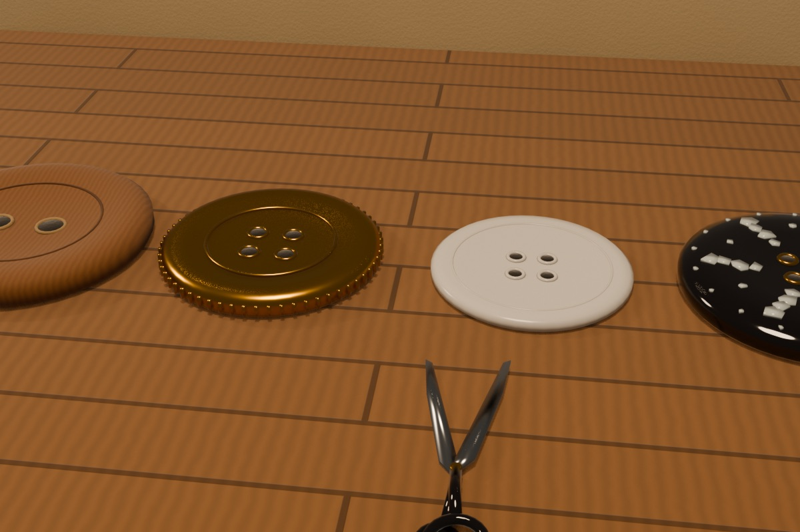

## お金のボタンの 4 段（2026-10-30 代表）

お金はボタン。4 段あり、文字を使わず、**色・光り方・穴の数・大きさ・音**で見分ける。

| 値打ち | 素材 | 見た目 | 穴 | 大きさ（直径・厚み） | 取ったときの音 | 斜面に降る割合 |
|---|---|---|---|---|---|---|
| 1 | 木 | 茶色、つやなし。縁が少し盛り上がり、まんなかは浅い皿 | 2 | 0.50 m・5.8 cm | コッ（乾いた短い木の音） | 90% |
| 10 | 真鍮 | 金色、ふちに刻み（ぎざぎざ）、金属のつやできらっと光る | 4 | 0.42 m・4.7 cm | チン（小さな鈴の澄んだ音） | 8.5% |
| 100 | 白蝶貝 | 白く、見る向きで虹色に変わる。薄く上品 | 4 | 0.38 m・2.6 cm | シャラン（薄い貝の板が触れ合う細かな音が下りていく） | 1.3% |
| 1000 | 螺鈿 | 漆黒のつやに、貝の小片が花の形にはめ込まれ、虹色にきらめく。穴を真鍮の輪で縁取る | 4 | 0.46 m・5.6 cm | 低くやわらかい鐘のポーンに、貝のきらめきが上っていき、最後に澄んだ二つの音 | 0.2% |

- **値打ちが上がるほど小さく薄くなり、光る**（螺鈿だけは別格に黒く大きめ）。木だけ穴 2 つ
- **遠くから**: 真鍮・白蝶貝・螺鈿は、ボタンの上で星がまたたく（画面での大きさが一定なので、遠くても見える）。いつもは小さく薄く光り、ときどき大きくきらっ（4 コマ）。値打ちが高いほどよくまたたく。真鍮は金、白蝶貝は白、螺鈿は虹色に色が移る
- **財布の中**は、いままでどおり「木のボタンの何個分」で持つ（`craft.gd` の `wallets`）。**見せるとき**に段ごとに分ける（`split`。いちばん少ない枚数になるように。両替はひとりでに）。財布の絵は段ごとの山（**左から価値の低い順に、木・真鍮・白蝶貝・螺鈿**。2026-10-30 代表）で、木が 10 枚になると真鍮 1 枚に替わる。財布へ飛んでいくボタンは、その素材の山の位置へ飛ぶ
- **売り台の値段**も、段ごとに分けたボタンで出す（`craft_icons.gd` の `price`。財布と同じ向きに、左から価値の低い順）。いまの値段は 1〜5 なので木だけ
- 取って財布に入るとき、飛んでいくボタンも段ごとの 1 枚ずつ（真鍮・白蝶貝・螺鈿は光る）
- **取得音**は、ボタンが**財布に入る瞬間**に、自分の耳元で鳴らす（`audio.gd` の `coin`。ソリで取っても、裁ちばさみで取っても、
  滑った分でも同じ）。1 枚ごとに、ボタンが財布の山に当たって重なる硬く軽い「チャリ」（8 つから選び、高さと間をばらつかせる）。
  続けて入るときは 50〜75 ms ごとに連なって「チャリチャリチャリ…」（2026-10-30 代表「連続でチャリチャリってなってほしい」）。
  真鍮（チン）・白蝶貝（シャラン）・螺鈿（特別な音）は、そのチャリに素材の音を重ねて、連打の中で光らせる。
  取った場所では、糸が切れる「ぷつん」と、ボタンが跳ねる「ぽん」だけ（まわりの人にも聞こえる）
- **滑り終わりのご褒美**（2026-10-30 代表「滑り終わったあとに手元に入ってくるお金の音がしないのが悲しい」）: 止まると、糸の上のボタンが
  一つずつ「ぷつ」と外れて財布へ飛び、入るたびにチャリチャリと連なる。全部入ったら、締めくくりの「ちゃりん」
  （`audio.gd` の `reward`。〜5 枚・〜12 枚・それより多いか真鍮入りで 3 つの大きさ）。どれも耳元の Self バス（設定の効果音の音量に合う）で、
  止まったあとは滑走の風が消えているので埋もれない
- 紙吹雪は値打ちが高いほど多い

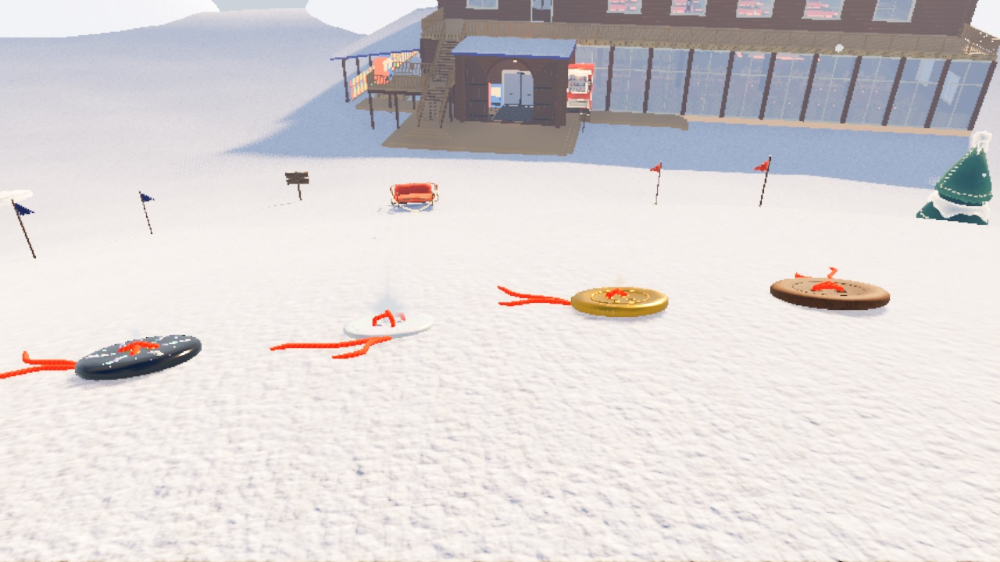

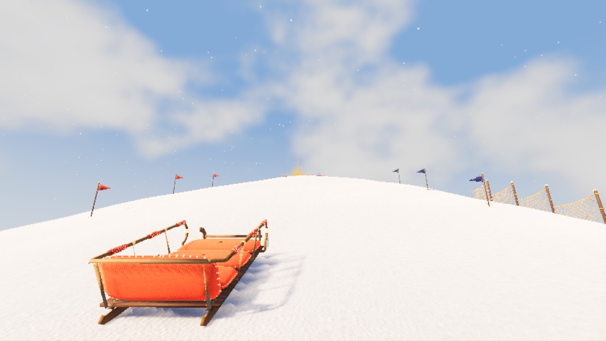

## 決まり

### 置き方: ばらばら

列は作らず、一つずつばらばらに置く（2026-10-30 代表「ボタンは列を作らずばらばらがいい」）。はじめは「縫い目のように一列に並べ、全部ほどくと大きなボタン」という案で作ったが、やめた（列・玉留め・大きなボタンは消した）。

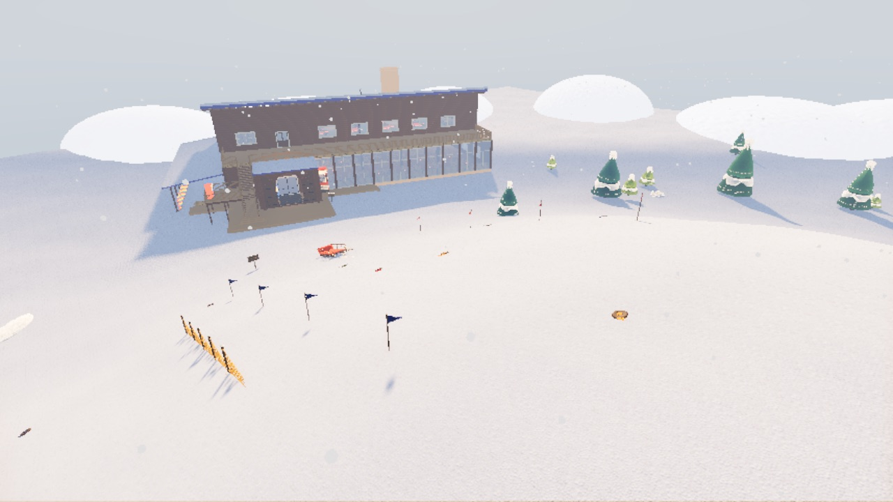

- 斜面に同時に 14 個まで（`MAX_BUTTONS`）。始まってすぐ 6 個続けて降り、そのあとは足りなければ 3〜7 秒ごとに 1 個
- ほかのボタンから 3 m 以上離す。ロッジ・木・小物には重ねない
- **出やすい所**: 高い所から長く滑るほど通れる所（`spot_weight`）。はじめは決めた形で、頂上からふもと（+z。登り道の側）へ下る向きほど、頂上に近いほど多い（そこより下まで滑る人はみんな通る）。頂上のすぐ下は遅くて切れないので、少し下りてから。実際に乗って滑った跡（4 m のます目）も覚えておき、その滑りで下った高さを重みとして足す。長く・高くから滑った道ほど重く、古い跡は 10 分で半分に薄れる

置き場所の数え方（`game/tools/button_spawn_check.gd`。置き場所を 200 回選んだ）:

| | ふもと（+z ±45°） | 西 | 東 | 裏（-z） | 7〜15 m | 15〜25 m | 25〜35 m | 35 m〜 |
|---|---|---|---|---|---|---|---|---|
| 決めた形だけ | 123 | 26 | 28 | 23 | 63 | 57 | 51 | 29 |
| 西へ長く滑った跡を 5 本入れたあと | 21 | 163 | 6 | 10 | 73 | 70 | 32 | 25 |

### 取る

- 乗っている人のいる、2 m/s より速いソリの**滑り木**（左右 2 本の、雪に触れる線）が、ボタンの縁から 12 cm 以内を通ると糸が切れる（`HIT`・`MIN_SPEED`）。乗っている人の重さで切れる。空のソリや、押して登っているソリでは切れない
- 小（滑り木の間 0.56 m）と米袋（0.4 m）は、滑り木だけで幅いっぱいが切れる
- 中と大は、胴の下（左右の滑り木のあいだ、1.2 m・1.9 m）を通っても切れる（`BELLY`。2026-10-30 代表「当たりを広げる」「中も同様が良い」）。
  滑り木だけでは、間が広く曲がりも遅いので拾いにくかった（中は平均 1.0〜2.3 個、大は 0.3〜0.7 個）
- ソリは体重移動でゆっくりしか曲がらない（[操作と物理の決まり](../controls-and-physics.md) の「乗って滑るときの手ざわり」）。いくつも拾うには、押し出すときに向きで狙い、乗っている人が息を合わせて同じ向きに体重をかける
- 切れると: 糸がぷつん（音）、ボタンがぽんと 1.5 m 跳ね上がって回り、ソリへ飛んでいって吸い込まれる。小さな紙吹雪（6 色の紙の切れはし）。切れた糸の端は 4 秒ほど雪に残る

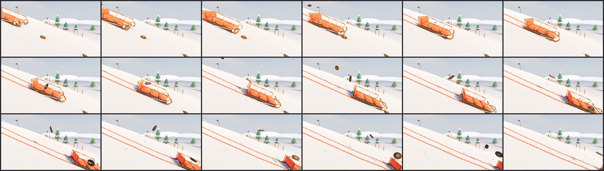

### 分け方

- 取ったボタンは、そのソリに**乗っていた全員に 1 つずつ**入る（分け合って減らない。奪い合いにしない）
- そのソリを**押した・紐で引いた**けれど乗らなかった人（滑る前の 2 分のうち）にも、1/3 ずつ届く。端数はためておき、1 つになったら財布に入る（`HELPER_SHARE`・`HELP_WINDOW`）

### 財布に入る（画面。文字なし）

取った所からボタンが画面を弧を描いて飛び、財布に入ると財布がぽんと跳ねる。持ち物の列が出ていなければ、画面の下のまんなかに財布だけの札を 3.5 秒出す。

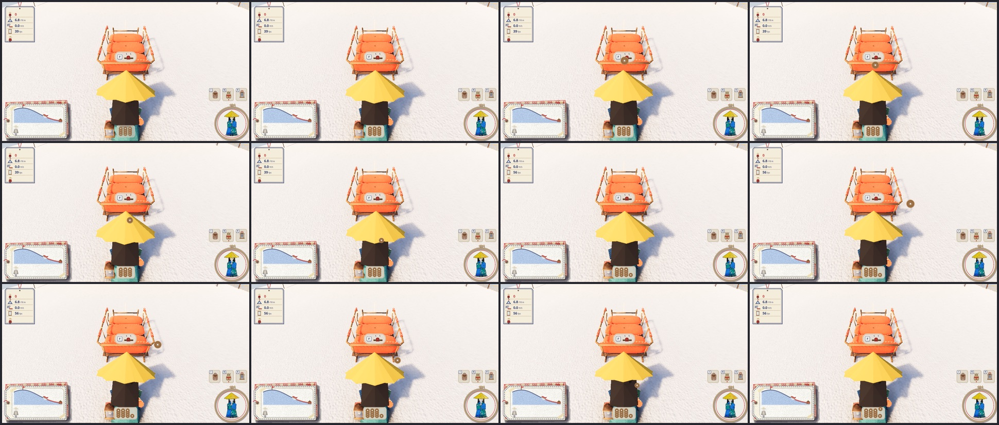

### 歩いて裁ちばさみで取る（2026-10-30 代表）

ソリで通らなくても、歩いて近づいて F を押すと、裁ちばさみで糸をちょきんと切って取れる。

- 1.8 m より近く、ボタンのほうを向いていると、ボタンの上に案内のワッペン（F のキーと、ボタンと裁ちばさみの絵）が出る（`hud.gd`。ほかの案内と同じく、何回か使うと出なくなる）
- F を押すと、はさみが手もとから出て、ボタンの糸へ伸び、開いて「ちょきん、ちょきん」（シャキンの音 2 回）、戻ってしまう。15 コマ（1.25 秒）、12 fps のコマ撮り。そのあいだはその場から動けない
- 切ったボタンは、ぽんと跳ねて**切った人へ**飛び、**切った人だけ**に入る（分けない）
- ソリで通るほうが、たくさん・速く取れる: 歩いて近づくのに時間がかかり、一つ切るごとに 1.25 秒止まる。ソリは走りながら次々に切れ、乗っている全員に入る

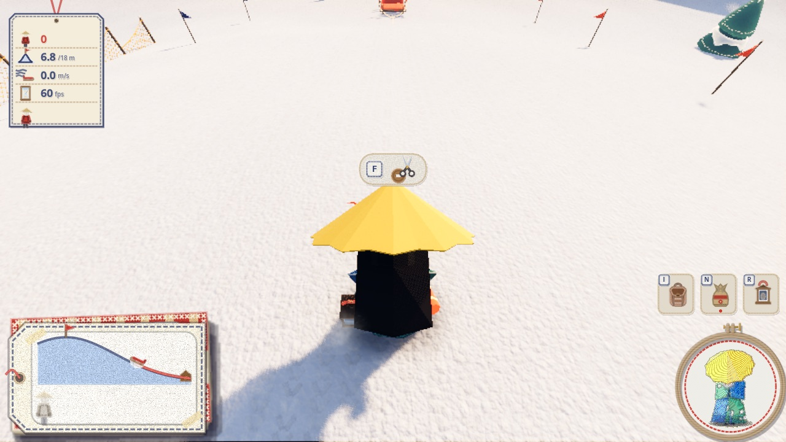

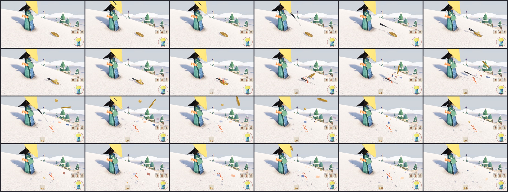

### 滑った距離と速さでももらえる（2026-10-30 代表「滑走距離と速度でもお金もらえてほしい」）

一回の滑り（乗って滑り出してから止まるまで）ごとに数える。

- **長さ**: 12 m 滑るごとに木のボタン 1 つ（`RIDE_M_PER_WOOD`）。一回の上限は木 18 個（`RIDE_MAX_WOOD`）
- **速さ**: 10 m/s と 13 m/s（`RIDE_BRASS`）を超えるたびに、真鍮のボタンが 1 つ（一回の滑りで一度ずつ）
- **見せ方**: 左の速さの表示（ボビンからほどけた糸が縫い目になって下へ流れる。PR #41・#44）とつなげた。12 m 滑るごとに木のボタンが、
  速さを超えた瞬間に真鍮のボタンが（ボビンもぽんと跳ねる）、**糸の上にぽんと縫い込まれ**、縫い目と一緒に下へ流れて、糸の下の端に数珠のように積もる
  （2026-10-30 代表「糸巻きアニメーションでの速度表現でもボタンが登場しないのがもったいない」）。止まると、縫い目の糸が下の端からくるくる巻き取られ
  （ボビンが逆に回る。ボタンが多いほど長く）、**糸の上のボタンが上から順に、ぽんと外れて財布へ**飛んでいく。財布に着くたびに素材の音。数字は出さない

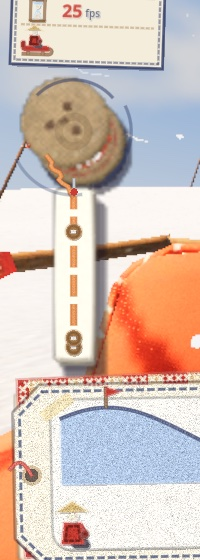
- **分け方**: 乗っていた一人ひとりに、**その人が乗ってから縫い込まれた分**。止まったときか、**途中で降りたとき**（E で降りる・米袋をしまう・
  落とされる）に、その人の財布へ入る（2026-10-30 代表「途中で降りても手元に入るようにしてほしい」）。降りたときも、止まったときと同じ
  「ぷつ → チャリチャリ → ちゃりん」。ほかの人の分は、それぞれ降りたときか止まったとき。押して手伝ったけれど乗らなかった人には、
  止まったときに滑り全体の分の 1/3
- **滑っている最中の音**: 糸の上にボタンが縫い付いて積もるたびに、耳元で「ぷつっ・ころん」（`button_stitch`）。真鍮は「きらっ」
  （`button_glint`）を重ねる（2026-10-30 代表「滑り降りている最中もスタックする報酬のコインの音はしてほしい」）
- 始まりは、乗っている人がいて（押されて登っているのでなく）1.5 m/s を超えたとき。終わりは、0.5 m/s より遅いのが 1 秒続くか、誰も乗らなくなったとき

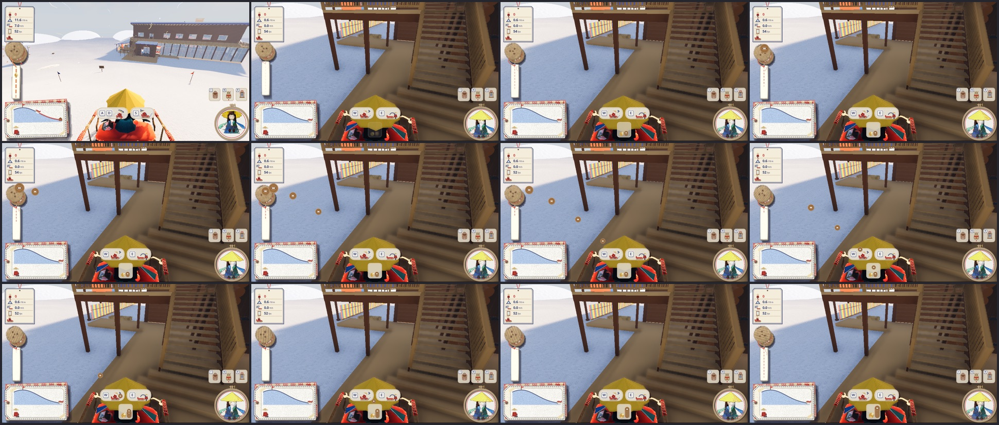

頂上から滑ったときにもらえる数（`game/tools/ride_pay_check.gd`。頂上の 3 m から +z へ 2 m/s で押し出し、あとは何もしない。米袋は Space の連打も。斜面のボタンは置かない）:

| ソリ | 乗る人 | 連打（回/秒） | 滑った長さ | いちばん速い所 | 木 | 真鍮 | 一人に入る数 |
|---|---|---|---|---|---|---|---|
| sack | 1 | 0 | 59 m | 4.7 m/s | 4 | 0 | 4 |
| sack | 1 | 6 | 64 m | 9.3 m/s | 5 | 0 | 5 |
| sack | 1 | 10 | 65 m | 10.4 m/s | 5 | 1 | 15 |
| small | 1 | 0 | 63 m | 6.5 m/s | 5 | 0 | 5 |
| small | 2 | 0 | 63 m | 8.0 m/s | 5 | 0 | 5 |
| mid | 1 | 0 | 59 m | 8.1 m/s | 4 | 0 | 4 |
| mid | 3 | 0 | 59 m | 9.7 m/s | 4 | 0 | 4 |
| large | 1 | 0 | 58 m | 9.6 m/s | 4 | 0 | 4 |
| large | 8 | 0 | 58 m | 11.1 m/s | 4 | 1 | 14 |

- 頂上からのふつうの一回で、木 4〜5 個。速く滑ると真鍮が混ざる: 米袋を 1 秒に 10 回漕いだとき（10.4 m/s）と、大に 8 人乗ったとき（11.1 m/s）
- **斜面のボタンとの釣り合い**: 斜面のボタン 1 つの値打ちの見込みは、1 × 0.9 + 10 × 0.085 + 100 × 0.013 + 1000 × 0.002 = 約 5。下の「拾える数」の 2 個前後で一回あたり約 10〜13 になり、滑っただけの 4〜5 より多い（ただし多くの回は木が 2 個ほどで、ときどき大きく当たる）

### 新しいボタンが降ってくる

空（13 m）から木の葉のように左右へ揺れ、揺れに合わせて傾きながら、約 3 秒でひらひら落ちる。穴に通った糸の端が 2 本、上へたなびく。雪に着くとぽふ（音と雪の粉）、そこから糸が雪の中から穴を通って × を渡り、また潜る（10 コマ）。最後にほどけた糸の端が出る。12 fps のコマ撮り。

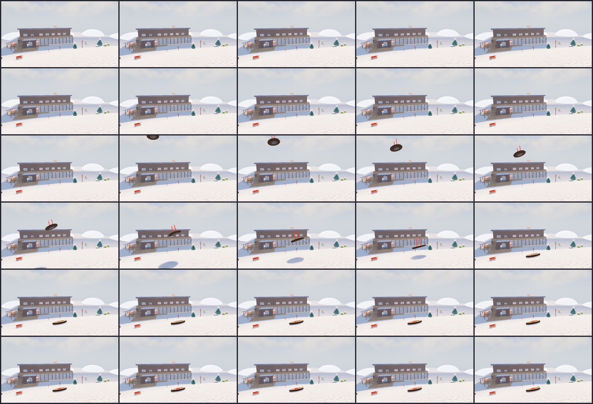

### 風にそよぐ・転がる

- ほどけた糸の端（46 cm と 34 cm）が、風下へなびいて波打つ。風が強いほど持ち上がる
- 突風で、風上の縁がふわっと持ち上がる（〜20°）。強い突風（ときどき）では、風下の縁を軸に 1〜2 回ころころ転がり、少し止まって糸がぴんと張り、引かれて戻る。糸が雪に潜る所から穴まで張る
- 風は見た目だけ（各自の画面。通信では配らない）。動きは 12 fps のコマ撮り

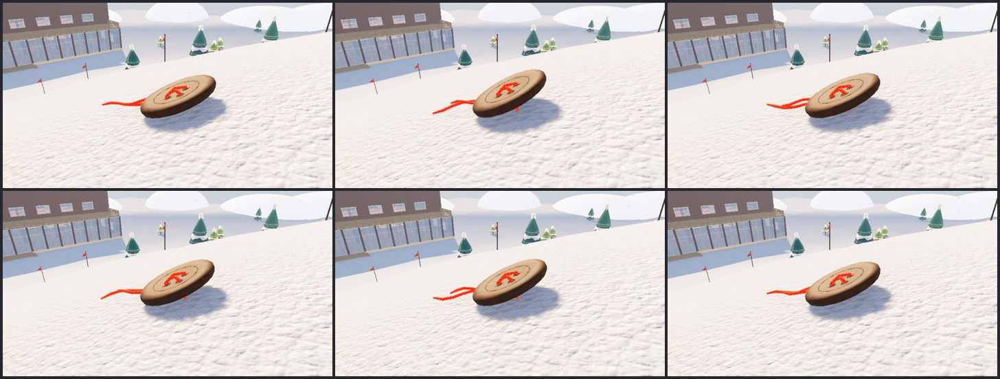

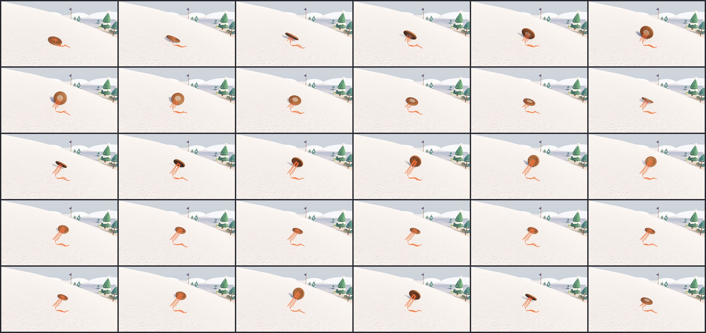

### 遠くから見つける

雪の上の茶色い丸と、6 色（赤・藍・からし・緑・桃・青緑）の糸の色の点。糸は遠いほど太く描く（1 m 離れるごとに半径 0.4 mm）。

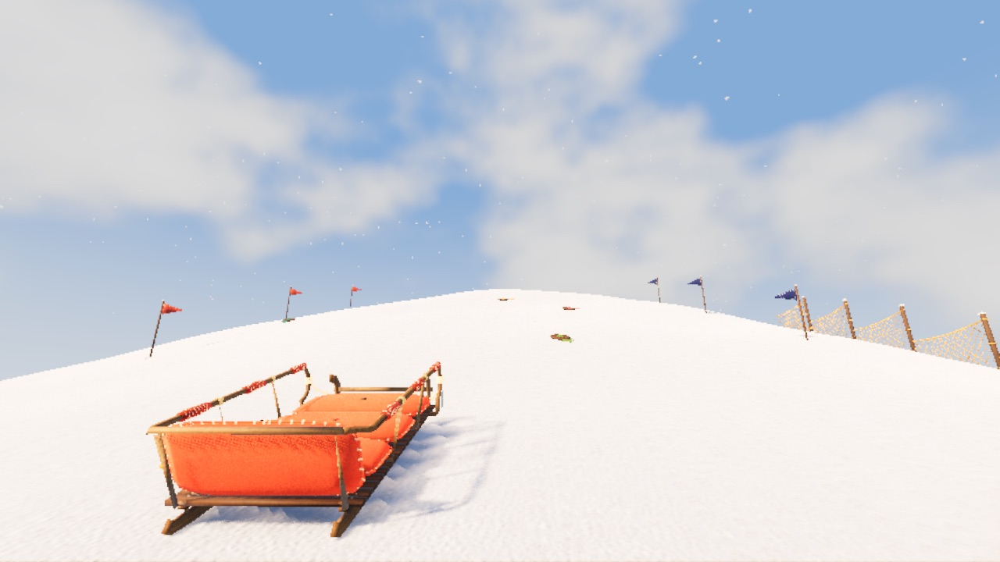

### 埋もれて消える

滑りあとと同じ考え方。消えるまでの時間のまんなかは 200 秒で、吹きだまりのまとまり（6 m）で ±40%、一つずつ ±35% ずれるので、まばらに消える。最後の 25%（6 秒以上）で、ボタンが沈み、上に雪がこんもりかぶっていき、糸の端も短く沈む。

### 取得音が鳴らなかった原因と、確かめ（2026-10-30）

代表「ソリで獲得したお金が手に入るときに取得音がしない」。`game/tools/button_sound_check.gd` で、中のソリに乗って頂上から滑り、
斜面のボタン 5 つ（木・真鍮・木・白蝶貝・木）を取り、止まるまでの音を書きとめて分かったこと（直す前）:

- **斜面のボタン**: 素材の音は、ボタンのあった**雪の上の場所**で、糸が切れて 0.2〜0.3 秒あとに鳴っていた。そのころソリは 2 m ほど先にいて、
  速いときの滑走の風（−5〜−14 dB）に埋もれた。しかも画面のボタンが財布に入るのはさらに 1 秒ほどあとで、そのときは何も鳴らなかった
- **滑った距離と速さ**: 財布に入っても、音を鳴らす作りがなかった

直したあと（滑り出してからの秒。音は「耳元」＝自分の画面で）:

| 時刻 | 鳴った音 | |
|---|---|---|
| 3.07 / 3.17 → 4.13 | ぷつん・ぽん（その場）→ コッ（耳元） | 木。財布に入る瞬間にコッ |
| 4.50 / 4.58 → 5.53 | ぷつん・ぽん → チン | 真鍮 |
| 5.48 / 5.58 → 6.57 | ぷつん・ぽん → コッ | 木 |
| 6.40 / 6.50 → 7.47 | ぷつん・ぽん → シャラン | 白蝶貝 |
| 7.25 / 7.33 → 8.27 | ぷつん・ぽん → コッ | 木 |
| 13.98 | （止まる） | 滑った分: 木 4（糸の上に積もった 4 つ） |
| 14.33・14.37・14.43・14.47 | ぷつ ×4（耳元） | 糸の上のボタンが、一つずつ外れて飛び出す |
| 15.07・15.13・15.17・15.23 | チャリ ×4（耳元） | チャリチャリと続けて財布に入る |
| 15.40 | ちゃりっ（耳元） | 締めくくり（4 枚なので小さいほう） |

（真鍮・白蝶貝のときは、チャリと同じ時刻にチン・シャランが重なる。時刻は 12 コマごとの記録なので、間は少し丸まって見える）

### 糸巻きの回る向き（2026-10-30 代表「糸巻きの回転方向、逆だね？」）

糸はボビンの左下から下へ出ていくので、左側が下へ動く向き（画面で反時計回り）に回ると、糸を送り出して見える。平らな絵（`speedo.gd`）は
その向きだったが、ふだんの立体の板のボビン（`hud.gd` → `hud_plates.gd` の `model`）は角度の符号が逆で、時計回り（糸を巻き取る向き）に
回っていた。板のカメラは +Z から −Z を向き、上が +Y なので、+Z まわりの正の角が画面で反時計回り。板にも同じ符号の角を渡すように直した。
速いほど速く回り、止まると止まる、はそのまま。滑り終わりの巻き取りでは逆に回る（糸を巻き取る）。

`game/tools/speedo_spin_shots.gd` で、乗って 3 m/s を超えた所から 0.1 秒ごとに撮ったボビン（左から順に、上の穴が左へ動く＝反時計回り）:

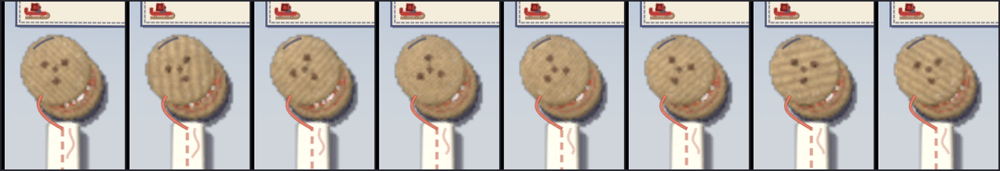

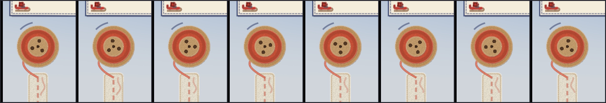

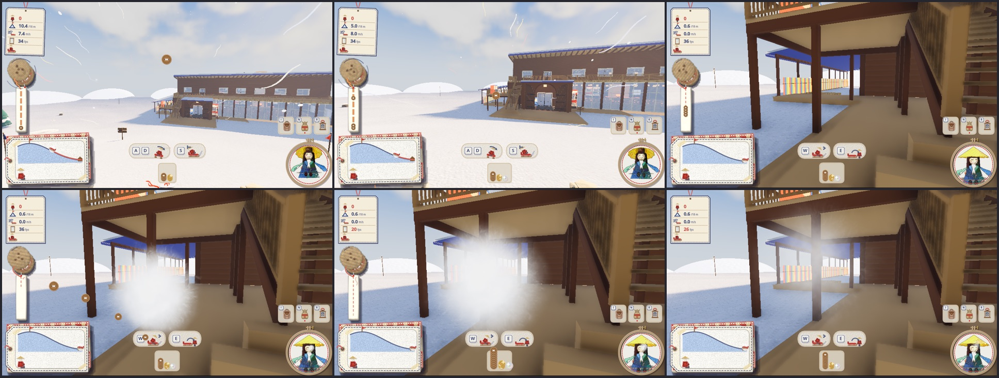

途中で降りたとき（`button_sound_check.gd -- --leave=off`・`--leave=sack`。z = 34 m を過ぎたら降りる）:

| | 中のソリから E で降りる | 米袋をしまう（N） |
|---|---|---|
| 滑っている最中の、糸に縫い付く音 | 4.13・6.15 秒（ぷつっ・ころん） | 4.95・8.07 秒 |
| 降りた時刻と速さ | 7.10 秒・8.1 m/s | 9.60 秒・4.7 m/s |
| 降りたときの糸の上のボタン | 木 2 | 木 2 |
| 自分の分（`ride_pay_one`） | 7.12 秒・木 2（途中で降りた） | 9.62 秒・木 2（途中で降りた） |
| 糸から外れる「ぷつ」 | 7.47・7.50 秒 | 9.97・10.00 秒 |
| 財布に入る「チャリ」 | 8.20・8.27 秒 | 10.70・10.77 秒 |
| 締めくくり「ちゃりっ」 | 8.40 秒 | 10.90 秒 |

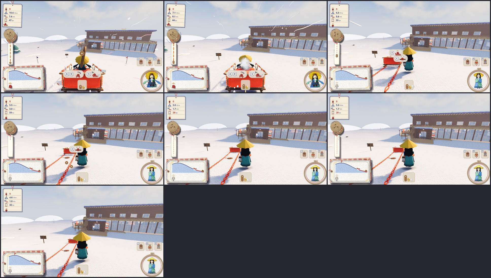

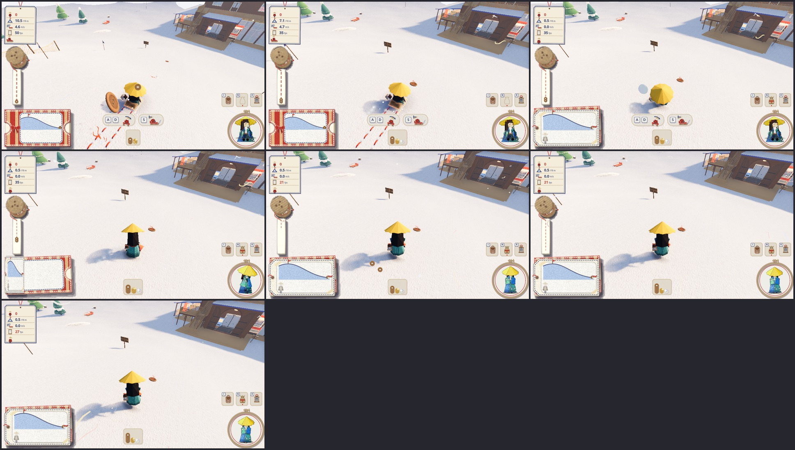

## 通信の備え

出来事は `craft.gd` と同じ形の短い辞書（中身は数・文字・Vector3）。ホストが決めて配る。

| 出来事 | 中身 | 決めるのは |
|---|---|---|
| `drop` | 番号・段・置き場・雪面の向き・回転・糸の色・埋もれきるコマ | ホスト（置き場所選び・段） |
| `snip` | 番号・ソリの名前・はさみで切った人・場所 | ホスト（滑り木の当たり・はさみの切れるコマ） |
| `shear` | 番号・人 | ホスト（近いか・向いているか。F を押した人が頼む） |
| `ride_mark` | ソリ・縫い込むボタン（木・真鍮）・速さ | ホスト（一回の滑りを数える。12 m ごとと、速さを超えたとき） |
| `ride_pay` | ソリ・滑った長さ・木と真鍮の数・縫い込んだ順・{手伝った人の番号: 数} | ホスト（止まったときのまとめ） |
| `ride_pay_one` | ソリ・人・その人の分のボタンの並び・値打ち・途中で降りたか | ホスト（降りたとき・止まったとき） |
| `share` | 番号・{人の番号: 数}・{人の番号: 端数}・場所 | ホスト（乗っていた人・手伝った人） |
| `earn`（`craft.gd`） | 人の番号・数・場所 | ホスト（財布はホストが持つ） |

動き（降る・縫い付く・跳ねる・埋もれる）は出来事のコマから数えるので、どの画面でも同じコマで動く。

## 拾える数（2026-10-30、`game/tools/button_check.gd`）

頂上の下から +z へ下る幅 12 m・長さ 36 m の帯に、ばらばらに 14 個（間は 3 m 以上。置き方は 3 通り、どのソリも同じ置き方）。頂上の少し下から +z へ 3 m/s で押し出し、席の数だけ乗せて滑る。体重のかけ方は、全員（前にあるボタンのうち、いちばん少し曲がれば届くものへ、全員が同じ向きに。滑り木の間が広いソリは片方の滑り木で踏むように狙う）・一人だけ・なし。

| ソリ | 乗る人 | 体重のかけ方 | 置き方 1 | 置き方 2 | 置き方 3 | 平均 |
|---|---|---|---|---|---|---|
| sack | 1 | 全員 | 2 | 4 | 2 | 2.7 |
| sack | 1 | なし | 2 | 1 | 1 | 1.3 |
| small | 2 | 全員 | 3 | 2 | 1 | 2.0 |
| small | 2 | 一人 | 2 | 1 | 1 | 1.3 |
| small | 2 | なし | 2 | 1 | 1 | 1.3 |
| mid | 3 | 全員 | 3 | 1 | 2 | 2.0 |
| mid | 3 | 一人 | 3 | 1 | 2 | 2.0 |
| mid | 3 | なし | 3 | 1 | 2 | 2.0 |
| large | 8 | 全員 | 3 | 1 | 3 | 2.3 |
| large | 8 | 一人 | 3 | 1 | 2 | 2.0 |
| large | 8 | なし | 3 | 1 | 2 | 2.0 |

（14 個中の拾えた数）

読み方:

- ばらばらなので、どのソリでも一回の滑りで拾えるのは 14 個のうち数個（平均 0.3〜2.7 個）
- 米袋と小は、全員で体重をかけると、かけないときの 1.5〜2 倍拾える（米袋 1.3 → 2.7、小 1.3 → 2.0）
- 中は胴の下でも切れるようにして、体重のかけ方によらず平均 2.0 個（滑り木だけのときは、なし 1.0・一人 1.7・全員 2.3 個だった）。
  何もしなくても拾えるようになった分、息を合わせる差はこの測り方では出なくなった（狙い方はまんなかで追うだけの単純なもの）
- 大は胴の下でも切れるようにして、平均 2.0〜2.3 個（滑り木だけのときは 0.3〜0.7 個だった）。ほかのソリと並び、一つ取れば乗っている 8 人全員に入る。
  曲がりが遅い（8 人そろえて半径 205 m）ので、体重をかけても増えるのは少し（2.0 → 2.3）
- 狙い方は、測るために決めた単純なもの（いちばん少し曲がれば届くボタンを追う）。人は押し出す向きで狙い、もっと先を見て選べるので、遊ぶ人はこれより多く拾えるはず

## 決めていないこと

- 値段の釣り合い: 型紙は 1〜5、布は 1。斜面のボタンと滑った分でボタンが増えるので、売り物の値段を見直すか（真鍮・白蝶貝・螺鈿で払う品物を作るか）
- 4 段の降る割合（90・8.5・1.3・0.2%）と、滑った分（12 m で木 1、10・13 m/s で真鍮）
- 歩いて切ったボタンを、近くにいる人と分けるか（いまは切った人だけ）
- 手伝った人の割合（1/3）と、手伝ったとみなす時間（2 分）
- 空のソリでも切れるようにするか（いまは乗っている人の重さで切れる）
- 置く数（14）と、降る間隔。人数が多い部屋では増やすか
- 雪玉や足で踏んでも取れるようにするか（いまはソリだけ）

## 確かめ方

```bash
/Applications/Godot.app/Contents/MacOS/Godot --headless --fixed-fps 60 --path game -s res://tools/button_check.gd -- --sled=mid --no-player --bots=0 --no-sound --no-lodge
```

```bash
/Applications/Godot.app/Contents/MacOS/Godot --headless --fixed-fps 60 --path game -s res://tools/button_spawn_check.gd -- --no-player --bots=0 --no-sound
```

音の記録（鳴った時刻と素材）と絵:

```bash
/Applications/Godot.app/Contents/MacOS/Godot --path game --resolution 1280x720 --fixed-fps 30 -s res://tools/button_sound_check.gd -- --bots=0 --no-pip --dir=/tmp/button_sound
```

```bash
/Applications/Godot.app/Contents/MacOS/Godot --headless --fixed-fps 60 --path game -s res://tools/ride_pay_check.gd -- --sled=sack --no-player --bots=0 --no-sound --no-lodge
```

絵を撮る（`--case=field|close|roll|fall|snip|hud|tiers|shears|ride`。`hud`・`shears`・`ride` は `--no-player` なし）:

```bash
/Applications/Godot.app/Contents/MacOS/Godot --path game --resolution 1280x720 --fixed-fps 30 -s res://tools/button_shots.gd -- --no-player --bots=0 --no-sound --no-pip --dir=/tmp/button_shots --case=snip
```
