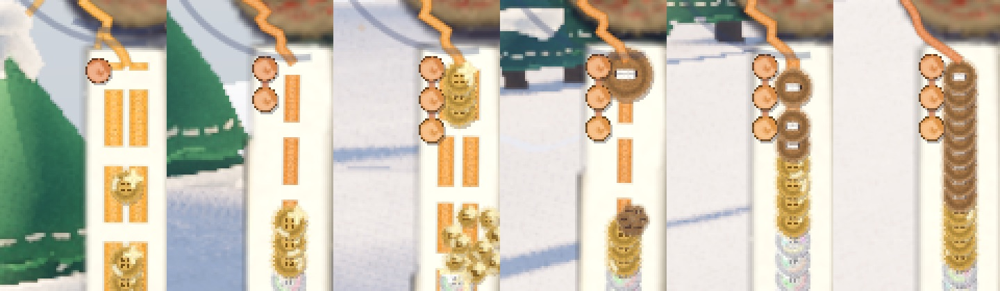
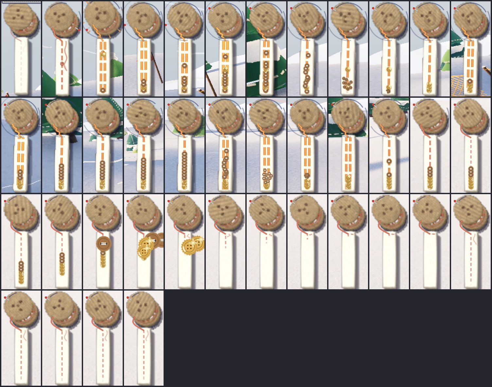
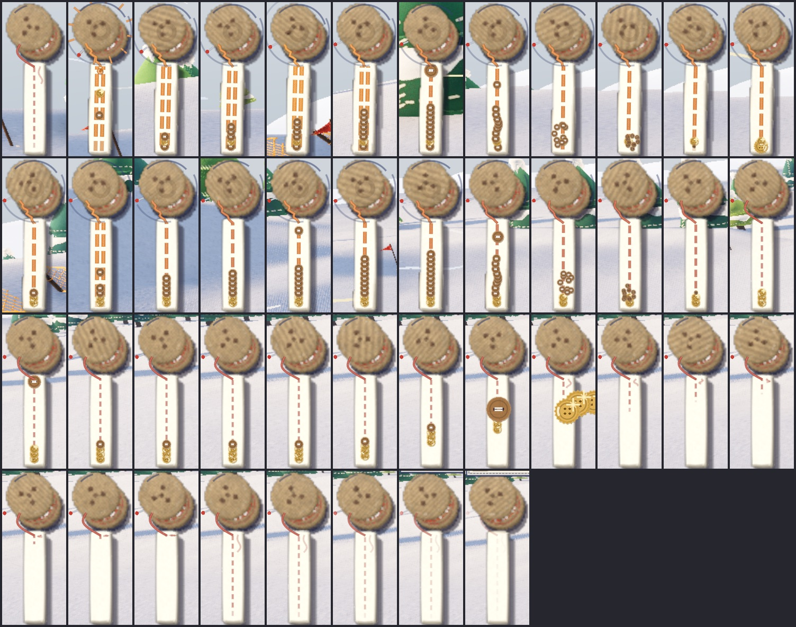
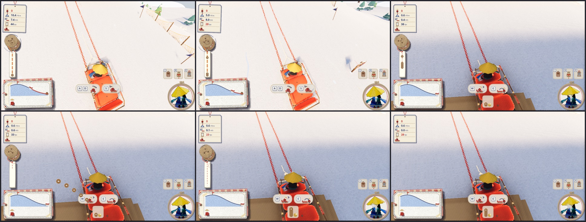

# 雪に縫い留められたボタン（2026-10-30）

斜面の雪に、大きなボタンが糸で「×」にゆるく縫い付けてある。ソリの滑り木（米袋も）が上を通ると、糸がぷつんと切れ、ボタンがぽんと跳ね上がって取れる。歩いて近づき、裁ちばさみで糸を切っても取れる。取ったボタンは財布（お金）に入る。乗って滑った距離と速さでもボタンがもらえる。

- 本体: `game/snow_buttons.gd`（出る・切る・分ける・埋もれる・風の揺れ・糸を描く・裁ちばさみ・滑った距離と速さ）
- 形: `props/build_snow_button.py` → `game/props/snow_button/`（ボタン 4 段と、裁ちばさみの片刃 2 つ）。光る素材は `game/look.gd` の `shine`
- 音: `sound/gen/button.py`（ぷつん・ぽん・着地のぽふ・縫い付くするっ・段ごとの取った音・シャキン。コードで合成）
- 財布: `game/craft.gd`（`MONEY`・`split`・出来事 `earn`）、画面は `game/craft_ui.gd`、お金の絵は `game/craft_icons.gd` の `money`
- 速さの表示の縫い込みと巻き取り: `game/hud.gd`・`game/speedo.gd`
- 押して手伝った人: `game/sled.gd` の `helped`。歩いて切る F: `game/player.gd`
- `--no-buttons` で出さない


## お金のボタンの 4 段（2026-10-30 代表）

お金はボタン。4 段あり、文字を使わず、**色・光り方・穴の数・大きさ・音**で見分ける。

| 値打ち | 素材 | 見た目 | 穴 | 大きさ（直径・厚み） | 取ったときの音 | 斜面に降る割合 |
|---|---|---|---|---|---|---|
| 1 | 木 | 茶色、つやなし。縁が少し盛り上がり、まんなかは浅い皿 | 2 | 0.50 m・5.8 cm | コッ（乾いた短い木の音） | 90% |
| 10 | 真鍮 | 金色、ふちに刻み（ぎざぎざ）、金属のつやできらっと光る | 4 | 0.42 m・4.7 cm | チン（小さな鈴の澄んだ音） | 8.5% |
| 100 | 白蝶貝 | 白く、見る向きで虹色に変わる。薄く上品 | 4 | 0.38 m・2.6 cm | シャラン（薄い貝の板が触れ合う細かな音が下りていく） | 1.3% |
| 1000 | 螺鈿 | 漆黒のつやに、貝の小片が花の形にはめ込まれ、虹色にきらめく。穴を真鍮の輪で縁取る | 4 | 0.46 m・5.6 cm | 低くやわらかい鐘のポーンに、貝のきらめきが上っていき、最後に澄んだ二つの音 | 0.2% |

- **値打ちが上がるほど小さく薄くなり、光る**（螺鈿だけは別格に黒く大きめ）。木だけ穴 2 つ
- **遠くから**: 真鍮・白蝶貝・螺鈿は、ボタンの上で星がまたたく（画面での大きさが一定なので、遠くても見える）。いつもは小さく薄く光り、ときどき大きくきらっ（4 コマ）。値打ちが高いほどよくまたたく。真鍮は金、白蝶貝は白、螺鈿は虹色に色が移る
- **財布の中**は、いままでどおり「木のボタンの何個分」で持つ（`craft.gd` の `wallets`）。**見せるとき**に段ごとに分ける（`split`。いちばん少ない枚数になるように。両替はひとりでに）。財布の絵は段ごとの山（**左から価値の低い順に、木・真鍮・白蝶貝・螺鈿**。2026-10-30 代表）で、木が 10 枚になると真鍮 1 枚に替わる。財布へ飛んでいくボタンは、その素材の山の位置へ飛ぶ
- **売り台の値段**も、段ごとに分けたボタンで出す（`craft_icons.gd` の `price`。財布と同じ向きに、左から価値の低い順）。値段は下の「お店の値段」
- 取って財布に入るとき、飛んでいくボタンも段ごとの 1 枚ずつ（真鍮・白蝶貝・螺鈿は光る）
- **取得音**は、ボタンが**財布に入る瞬間**に、自分の耳元で鳴らす（`audio.gd` の `coin`。ソリで取っても、裁ちばさみで取っても、
  滑った分でも同じ）。1 枚ごとに、ボタンが財布の山に当たって重なる硬く軽い「チャリ」（8 つから選び、高さと間をばらつかせる）。
  続けて入るときは 50〜75 ms ごとに連なって「チャリチャリチャリ…」（2026-10-30 代表「連続でチャリチャリってなってほしい」）。
  真鍮（チン）・白蝶貝（シャラン）・螺鈿（特別な音）は、そのチャリに素材の音を重ねて、連打の中で光らせる。
  取った場所では、糸が切れる「ぷつん」と、ボタンが跳ねる「ぽん」だけ（まわりの人にも聞こえる）
- **滑り終わりのご褒美**（2026-10-30 代表「滑り終わったあとに手元に入ってくるお金の音がしないのが悲しい」）: 止まると、糸の上のボタンが
  一つずつ「ぷつ」と外れて財布へ飛び、入るたびにチャリチャリと連なる。全部入ったら、締めくくりの「ちゃりん」
  （`audio.gd` の `reward`。〜5 枚・〜12 枚・それより多いか真鍮入りで 3 つの大きさ）。どれも耳元の Self バス（設定の効果音の音量に合う）で、
  止まったあとは滑走の風が消えているので埋もれない
- 紙吹雪は値打ちが高いほど多い


## 決まり

### 置き方: ばらばら

列は作らず、一つずつばらばらに置く（2026-10-30 代表「ボタンは列を作らずばらばらがいい」）。はじめは「縫い目のように一列に並べ、全部ほどくと大きなボタン」という案で作ったが、やめた（列・玉留め・大きなボタンは消した）。


- 斜面に同時に 14 個まで（`MAX_BUTTONS`）。始まってすぐ 6 個続けて降り、そのあとは足りなければ 12〜24 秒ごとに 1 個（大きな山は別。下の「降ってくるボタン」）
- ほかのボタンから 3 m 以上離す。ロッジ・木・小物には重ねない
- **出やすい所**: 高い所から長く滑るほど通れる所（`spot_weight`）。はじめは決めた形で、頂上からふもと（+z。登り道の側）へ下る向きほど、頂上に近いほど多い（そこより下まで滑る人はみんな通る）。頂上のすぐ下は遅くて切れないので、少し下りてから。実際に乗って滑った跡（4 m のます目）も覚えておき、その滑りで下った高さを重みとして足す。長く・高くから滑った道ほど重く、古い跡は 10 分で半分に薄れる

置き場所の数え方（`game/tools/button_spawn_check.gd`。置き場所を 200 回選んだ）:

| | ふもと（+z ±45°） | 西 | 東 | 裏（-z） | 7〜15 m | 15〜25 m | 25〜35 m | 35 m〜 |
|---|---|---|---|---|---|---|---|---|
| 決めた形だけ | 123 | 26 | 28 | 23 | 63 | 57 | 51 | 29 |
| 西へ長く滑った跡を 5 本入れたあと | 21 | 163 | 6 | 10 | 73 | 70 | 32 | 25 |

### 取る

- 乗っている人のいる、2 m/s より速いソリの**滑り木**（左右 2 本の、雪に触れる線）が、ボタンの縁から 12 cm 以内を通ると糸が切れる（`HIT`・`MIN_SPEED`）。乗っている人の重さで切れる。空のソリや、押して登っているソリでは切れない
- 小（滑り木の間 0.56 m）と米袋（0.4 m）は、滑り木だけで幅いっぱいが切れる
- 中と大は、胴の下（左右の滑り木のあいだ、1.2 m・1.9 m）を通っても切れる（`BELLY`。2026-10-30 代表「当たりを広げる」「中も同様が良い」）。
  滑り木だけでは、間が広く曲がりも遅いので拾いにくかった（中は平均 1.0〜2.3 個、大は 0.3〜0.7 個）
- ソリは体重移動でゆっくりしか曲がらない（[操作と物理の決まり](../controls-and-physics.md) の「乗って滑るときの手ざわり」）。いくつも拾うには、押し出すときに向きで狙い、乗っている人が息を合わせて同じ向きに体重をかける
- 切れると: 糸がぷつん（音）、ボタンがぽんと 1.5 m 跳ね上がって回り、ソリへ飛んでいって吸い込まれる。小さな紙吹雪（6 色の紙の切れはし）。切れた糸の端は 4 秒ほど雪に残る


### 分け方

- 取ったボタンは、そのソリに**乗っていた全員に 1 つずつ**入る（分け合って減らない。奪い合いにしない）
- そのソリを**押した・紐で引いた**けれど乗らなかった人（滑る前の 2 分のうち）にも、1/3 ずつ届く。端数はためておき、1 つになったら財布に入る（`HELPER_SHARE`・`HELP_WINDOW`）

### 財布に入る（画面。文字なし）

取った所からボタンが画面を弧を描いて飛び、財布に入ると財布がぽんと跳ねる。持ち物の列が出ていなければ、画面の下のまんなかに財布だけの札を 3.5 秒出す。


### 歩いて裁ちばさみで取る（2026-10-30 代表）

ソリで通らなくても、歩いて近づいて F を押すと、裁ちばさみで糸をちょきんと切って取れる。

- 1.8 m より近く、ボタンのほうを向いていると、ボタンの上に案内のワッペン（F のキーと、ボタンと裁ちばさみの絵）が出る（`hud.gd`。ほかの案内と同じく、何回か使うと出なくなる）
- F を押すと、はさみが手もとから出て、ボタンの糸へ伸び、開いて「ちょきん、ちょきん」（シャキンの音 2 回）、戻ってしまう。15 コマ（1.25 秒）、12 fps のコマ撮り。そのあいだはその場から動けない
- 切ったボタンは、ぽんと跳ねて**切った人へ**飛び、**切った人だけ**に入る（分けない）
- ソリで通るほうが、たくさん・速く取れる: 歩いて近づくのに時間がかかり、一つ切るごとに 1.25 秒止まる。ソリは走りながら次々に切れ、乗っている全員に入る


### 滑った距離と速さでももらえる（2026-10-30 代表「滑走距離と速度でもお金もらえてほしい」）

一回の滑り（乗って滑り出してから止まるまで）ごとに数える。

倍率は、ボタン 1 個の重さではなく、**もらえる間隔**に効く（2026-10-30 代表「1 ボタンの重さというよりか、滑走距離に対して出る報酬の
間隔が狭くなるのと、達成速度に対して出る報酬の間隔が狭くなるのが良い。あと滑走距離の節目に出る真鍮ボタンの間隔増やすとか、
コンボ性にするとかが良いと思う」、「乗り物・山・高さで」「コンボ（増えていく）」）。倍率は、乗り物 × 人数のおまけ × 山 × いまの高さ（下の「倍率」）。

基準の間隔は 2026-10-31 に広げた（代表「米袋で結構稼げてしまっている。滑走距離に応じてもらえるお金の間隔を大きくしたほうが良さそう」。
12 m・0.3 m/s・コンボ 50 m（倍率なし）→ 30 m・0.75 m/s・コンボ 80 m（乗り物の倍率つき）。米袋は ×1.2 → ×1.0）。

- **長さ**: 木 1 つが出るまでに滑る距離は、**30 m ÷ 倍率**（`RIDE_M_PER_WOOD`）。米袋で丘なら 27 m ほどごと、大に 8 人で大きな山の頂上なら
  0.7 m ほどごと。上限はない
- **速さ**: その滑りでいちばん速い所が 8 m/s（`RIDE_V_FROM`）を超えてから、**0.75 m/s ÷ 倍率**（`RIDE_V_PER_WOOD`）上がるごとに木 1 つ
- **詰まりすぎたら上の素材で**: 木の間が 2 m（`RIDE_MIN_GAP`）より詰まる倍率（15 より上）では、10 個分ずつ**真鍮**でまとめて縫い込む
  （間は 10 倍。それでも詰まれば白蝶貝）。縫い込む音と動きが速くなりすぎないように
- **距離の節目のコンボ**（`RIDE_COMBO_M`・`RIDE_COMBO_KEEP`）: 止まらずに **80 m** 滑るたびに、**真鍮が 1 つ・2 つ・3 つ…と増えていく**。
  1.5 m/s より遅くなるとコンボが切れ、次の節目は 1 つから（節目までの距離も数え直す）。
  - コンボの真鍮 1 つの値打ちには、**乗り物の倍率**（米袋 ×1.0・小 ×2.3・中 ×3.3・大 ×5.3）を掛ける。人数・山・高さは掛けない
  - 前は倍率なしで、漕いで止まらずに滑れる米袋が得をしていた
  - 糸の上には真鍮をその数だけ縫い込み、倍率で増えた分は、ふつうの滑った分と同じく木の間を詰めて足す
  - 丘の一回（60〜90 m）では 0〜1 回。大きな山を頂上から止まらずに（260〜290 m）滑ると 3 回で、1 + 2 + 3 = 真鍮 6
  - 切れる速さは 3 m/s から 1.5 m/s に下げた。一人で乗る小が、大きな山の中腹の平らで切れないように
- **コンボの見せ方**（2026-10-31 代表「コンボしていることを、なにかで表示＋気持ちがいい音を追加で出してほしい」）: 数字は出さない。
  - 左の速さの表示のリボンの左の縁に、段の数だけ**玉結び（結び目）**が上から縦に並び、縦の糸でつながる（`speedo.gd` の `draw_combo`）
  - 結んだばかりはぽんとふくらんできらっと光り、段が上がるほど結び目が明るい山吹へ寄る。糸の色も、一段ごとに少しずつ明るくなる（`hud.gd` の `COMBO_TINT`）
  - **切れたら**（滑り終わりも）、結び目が下から一つずつゆるんで輪になり、広がりながら下へふわっと落ちて消える（0.7 秒）
- **コンボの音**（`audio.gd` の `combo`。`sound/gen/button.py`）: 耳元で鳴らす
  - 一段上がるたびに、木琴のやわらかい「ポン」に小さな鈴の「りん」を重ねた 1 音。**五音音階で一段ずつ高くなる**（ド・レ・ミ・ソ・ラ・ド・レ・ミ）
  - 3 段目からは、5 度上・オクターブ上の小さなきらめきが後ろに続き、段が上がるほど増えて少し華やかになる
  - **切れたとき**は、木琴の 2 音が短くやさしく下がる（ミ → ド。小さく）




- 一つ分に届かない端数は、糸の上に糸くずとして積もり、止まったら次の滑りへ持ち越す（下の「倍率」の端数）

- **見せ方**: 左の速さの表示（ボビンからほどけた糸が縫い目になって下へ流れる。PR #41・#44）とつなげた。ボタン（真鍮はボビンもぽんと跳ねる）が
  **糸の上にぽんと縫い込まれ**、縫い目と一緒に下へ流れて、糸の下の端に数珠のように積もる
  （2026-10-30 代表「糸巻きアニメーションでの速度表現でもボタンが登場しないのがもったいない」）。止まると、縫い目の糸が下の端からくるくる巻き取られ
  （ボビンが逆に回る。ボタンが多いほど長く）、**糸の上のボタンが上から順に、ぽんと外れて財布へ**飛んでいく。財布に着くたびに素材の音。数字は出さない


- **分け方**: 乗っていた一人ひとりに、**その人が乗ってから縫い込まれた分**。止まったときか、**途中で降りたとき**（E で降りる・米袋をしまう・
  落とされる）に、その人の財布へ入る（2026-10-30 代表「途中で降りても手元に入るようにしてほしい」）。降りたときも、止まったときと同じ
  「ぷつ → チャリチャリ → ちゃりん」。ほかの人の分は、それぞれ降りたときか止まったとき。押して手伝ったけれど乗らなかった人には、
  止まったときに滑り全体の分の 1/3
- **滑っている最中の音**: 糸の上にボタンが縫い付いて積もるたびに、耳元で「ぷつっ・ころん」（`button_stitch`）。真鍮は「きらっ」
  （`button_glint`）を重ねる（2026-10-30 代表「滑り降りている最中もスタックする報酬のコインの音はしてほしい」）
- 始まりは、乗っている人がいて（押されて登っているのでなく）1.5 m/s を超えたとき。終わりは、0.5 m/s より遅いのが 1 秒続くか、誰も乗らなくなったとき


一回でもらえる数は、下の「一回の取り分と、1 分あたり」（`game/tools/ride_pay_check.gd` は、丘で斜面のボタンを置かずに滑った分だけを出す）。

### 新しいボタンが降ってくる

空（13 m）から木の葉のように左右へ揺れ、揺れに合わせて傾きながら、約 3 秒でひらひら落ちる。穴に通った糸の端が 2 本、上へたなびく。雪に着くとぽふ（音と雪の粉）、そこから糸が雪の中から穴を通って × を渡り、また潜る（10 コマ）。最後にほどけた糸の端が出る。12 fps のコマ撮り。


### 風にそよぐ・転がる

- ほどけた糸の端（46 cm と 34 cm）が、風下へなびいて波打つ。風が強いほど持ち上がる
- 突風で、風上の縁がふわっと持ち上がる（〜20°）。強い突風（ときどき）では、風下の縁を軸に 1〜2 回ころころ転がり、少し止まって糸がぴんと張り、引かれて戻る。糸が雪に潜る所から穴まで張る
- 風は見た目だけ（各自の画面。通信では配らない）。動きは 12 fps のコマ撮り


### 遠くから見つける

雪の上の茶色い丸と、6 色（赤・藍・からし・緑・桃・青緑）の糸の色の点。糸は遠いほど太く描く（1 m 離れるごとに半径 0.4 mm）。


### 埋もれて消える

滑りあとと同じ考え方。消えるまでの時間のまんなかは 200 秒で、吹きだまりのまとまり（6 m）で ±40%、一つずつ ±35% ずれるので、まばらに消える。最後の 25%（6 秒以上）で、ボタンが沈み、上に雪がこんもりかぶっていき、糸の端も短く沈む。

### 取得音が鳴らなかった原因と、確かめ（2026-10-30）

代表「ソリで獲得したお金が手に入るときに取得音がしない」。`game/tools/button_sound_check.gd` で、中のソリに乗って頂上から滑り、
斜面のボタン 5 つ（木・真鍮・木・白蝶貝・木）を取り、止まるまでの音を書きとめて分かったこと（直す前）:

- **斜面のボタン**: 素材の音は、ボタンのあった**雪の上の場所**で、糸が切れて 0.2〜0.3 秒あとに鳴っていた。そのころソリは 2 m ほど先にいて、
  速いときの滑走の風（−5〜−14 dB）に埋もれた。しかも画面のボタンが財布に入るのはさらに 1 秒ほどあとで、そのときは何も鳴らなかった
- **滑った距離と速さ**: 財布に入っても、音を鳴らす作りがなかった

直したあと（滑り出してからの秒。音は「耳元」＝自分の画面で）:

| 時刻 | 鳴った音 | |
|---|---|---|
| 3.07 / 3.17 → 4.13 | ぷつん・ぽん（その場）→ コッ（耳元） | 木。財布に入る瞬間にコッ |
| 4.50 / 4.58 → 5.53 | ぷつん・ぽん → チン | 真鍮 |
| 5.48 / 5.58 → 6.57 | ぷつん・ぽん → コッ | 木 |
| 6.40 / 6.50 → 7.47 | ぷつん・ぽん → シャラン | 白蝶貝 |
| 7.25 / 7.33 → 8.27 | ぷつん・ぽん → コッ | 木 |
| 13.98 | （止まる） | 滑った分: 木 4（糸の上に積もった 4 つ） |
| 14.33・14.37・14.43・14.47 | ぷつ ×4（耳元） | 糸の上のボタンが、一つずつ外れて飛び出す |
| 15.07・15.13・15.17・15.23 | チャリ ×4（耳元） | チャリチャリと続けて財布に入る |
| 15.40 | ちゃりっ（耳元） | 締めくくり（4 枚なので小さいほう） |

（真鍮・白蝶貝のときは、チャリと同じ時刻にチン・シャランが重なる。時刻は 12 コマごとの記録なので、間は少し丸まって見える）

### 糸巻きの回る向き（2026-10-30 代表「糸巻きの回転方向、逆だね？」）

糸はボビンの左下から下へ出ていくので、左側が下へ動く向き（画面で反時計回り）に回ると、糸を送り出して見える。平らな絵（`speedo.gd`）は
その向きだったが、ふだんの立体の板のボビン（`hud.gd` → `hud_plates.gd` の `model`）は角度の符号が逆で、時計回り（糸を巻き取る向き）に
回っていた。板のカメラは +Z から −Z を向き、上が +Y なので、+Z まわりの正の角が画面で反時計回り。板にも同じ符号の角を渡すように直した。
速いほど速く回り、止まると止まる、はそのまま。滑り終わりの巻き取りでは逆に回る（糸を巻き取る）。

`game/tools/speedo_spin_shots.gd` で、乗って 3 m/s を超えた所から 0.1 秒ごとに撮ったボビン（左から順に、上の穴が左へ動く＝反時計回り）:


途中で降りたとき（`button_sound_check.gd -- --leave=off`・`--leave=sack`。z = 34 m を過ぎたら降りる）:

| | 中のソリから E で降りる | 米袋をしまう（N） |
|---|---|---|
| 滑っている最中の、糸に縫い付く音 | 4.13・6.15 秒（ぷつっ・ころん） | 4.95・8.07 秒 |
| 降りた時刻と速さ | 7.10 秒・8.1 m/s | 9.60 秒・4.7 m/s |
| 降りたときの糸の上のボタン | 木 2 | 木 2 |
| 自分の分（`ride_pay_one`） | 7.12 秒・木 2（途中で降りた） | 9.62 秒・木 2（途中で降りた） |
| 糸から外れる「ぷつ」 | 7.47・7.50 秒 | 9.97・10.00 秒 |
| 財布に入る「チャリ」 | 8.20・8.27 秒 | 10.70・10.77 秒 |
| 締めくくり「ちゃりっ」 | 8.40 秒 | 10.90 秒 |

### 倍率（2026-10-30 代表）

はじめは乗り物の倍率を 1 以下（米袋 ×0.3・小 ×0.7・中 ×1.0・大 ×1.6）にし、歩いて取るのも下げる案を出したが、代表「歩いて取る倍率を
下げると、1 が 0.3 になってしまうのでは？ ソリの倍率を上げるほうが良いでしょう。あとお店の値段。あと山ごと＆標高ごとに倍率と降ってくる
ボタンを変えましょう」「×1.0 のまま」で、次のようにした。滑った分は、そのあと代表「1 ボタンの重さというよりか…間隔が狭くなるのが良い」で、
倍率をボタンの重さではなく間隔に効かせるようにした（上の「滑った距離と速さでももらえる」）。

- **歩いて裁ちばさみで取る: ×1.0 のまま**。どこで取っても、木 1 個は 1（乗り物の倍率も場所の倍率も掛けない）
- **乗り物の倍率**（`snow_buttons.gd` の `RIDE_RATE`）: 米袋 ×1.0・小 ×2.3・中 ×3.3・大 ×5.3（米袋は 2026-10-31 に ×1.2 から下げ、歩きと同じ。速く回れる分だけ歩きより上）。大きいソリは重く、人を集めないと押して登れない
  （[ゲームデザイン](../game-design.md) の柱 5）。その頑張りがお金でも報われるように（代表「乗り物によって収入倍率を変えたほうが良いな〜。
  米袋でもそこそこ稼げてしまうし、大きなソリで頑張る理由がなくなってしまう」）
- **人数のおまけ**（`CREW_BONUS`）: 一緒に乗っている人が 2 人目から 1 人ごとに、一人ひとりの取り分が +10%（大に 8 人で +70%）。
  人数は、その分を足したときに乗っていた人数で数える。**滑った分だけ**に掛ける（斜面のボタンには掛けない）
- **山ごとの倍率**（`MAP_RATE`）: 丘 ×1.0・大きな山 ×1.5
- **標高ごとの倍率**（`ALT_RATE`）: 高さ 1 m ごとに +3%（丘の頂上 18 m で ×1.54、大きな山の中腹 45 m で ×2.35、頂上 75 m で ×3.25）。
  滑った分は、いま滑っている所の高さ。斜面のボタンは拾った所の高さ
- 掛け方のまとめ（ソリ）:
  - 滑った分: 木 1 つが出るまでの距離 = 12 m ÷（乗り物 × 人数のおまけ × 山 × 標高）、速さは 0.3 m/s ÷ 同じ倍率。
    コンボの真鍮（80 m ごとに 1・2・3…）は、乗り物の倍率だけを掛ける
  - 斜面のボタン = ボタンの値打ち × 乗り物 × 山 × 標高（乗っていた全員に、その値打ちが入る）
- **端数**: たまった分が一つ分（木 1、詰まりすぎたら真鍮 10）に届くたびに、糸の上にボタンを縫い込む。一つ分に満たない端数は、
  積もったボタンのいちばん上に**糸くず**（ほつれた糸の玉）として見せ、たまるほど大きくなる。滑り終わり（か降りたとき）に残った端数は、
  その人の**次の滑りへ持ち越す**（`ride_carry`）。持ち越しが木 1 個分になったら、次に入るときに木を 1 つ足して入れる（糸巻きから飛ぶ）。
  斜面のボタンの端数も同じ持ち越しにたまる。取りこぼしはしない
- 押して手伝った人には、倍率を掛けたあとの 1/3

### 降ってくるボタン（山ごと・標高ごと。2026-10-30 代表）

- **大きな山にも降る**。コースの上（頂上から流しの終わりまで、コースのまんなか ±6 m）。丘はいままでどおり斜面に（`_pick_spot`）
- **同時に出ている数**（`MAP_MAX`）: 丘 14・大きな山 20
- **降る間**（`MAP_DROP_EVERY`）: 丘 12〜24 秒・大きな山 20〜40 秒ごとに 1 個（始まってすぐ、それぞれ 6 個続けて降る）。
  **残る時間**（`MAP_LIFE`）: 丘 ×1.5（5 分）・大きな山 ×3（10 分）。歩いて切って回ると、降る数をほとんど取れてしまうので、降る数を絞り、
  そのぶん長く残して、ソリで滑るときに拾えるボタンは減らさない（降る数が多かった 3〜7 秒ごとのときは、歩きが小や米袋より稼げた）
- **上の素材の出やすさ**: 真鍮・白蝶貝・螺鈿の割合（`TIERS` の chance）に、山ごと（`MAP_RARE`。丘 ×1.0・大きな山 ×1.3）と、
  高さ 1 m ごとに +1.2%（`RARE_ALT`）を掛ける。大きな山の頂上では ×2.5
- **高い所ほど少し多く降る**: 大きな山では、高さ 1 m ごとに置かれやすさ +2%（`MT_SPOT_ALT`。頂上はふもとの 2.5 倍ほど）


置き場所 2000 か所ごとの、1 個の値打ちの見込み（`pay_rate_check.gd -- --case=spots`。段の見込みは、段の出やすさ × 値打ち。
ソリで拾うと、これに場所の倍率と乗り物の倍率が掛かる。歩いて切ると段の見込みのまま）:

| 山 | 高さ | 置かれた割合 | 上の素材の割合 | 段の見込み（歩き） | 場所の倍率 | 段 × 場所 |
|---|---|---|---|---|---|---|
| 丘 | 0〜15 m | 65% | 11.2% | 5.6 | ×1.31 | 7.3 |
| 丘 | 15〜30 m | 35% | 11.9% | 5.8 | ×1.49 | 8.7 |
| 大きな山 | 0〜15 m | 14% | 14.5% | 6.9 | ×1.92 | 13.2 |
| 大きな山 | 15〜30 m | 19% | 16.3% | 7.6 | ×2.45 | 18.7 |
| 大きな山 | 30〜45 m | 25% | 19.0% | 8.7 | ×3.22 | 28.0 |
| 大きな山 | 45〜60 m | 22% | 21.4% | 9.7 | ×3.93 | 38.0 |
| 大きな山 | 60〜75 m | 20% | 23.7% | 10.6 | ×4.58 | 48.5 |

### 一回の取り分と、1 分あたり

**一回の滑りの一人の取り分**（2026-10-31 の値で測り直した。`game/tools/pay_rate_check.gd -- --buttons --reps=4`（丘は 6）。頂上（か大きな山の
中腹の上の端）から 2 m/s で押し出し、あとは何もしない。米袋は 1 秒に 10 回漕ぐのも。斜面のボタンは、滑る前にその山の数（丘 14・大きな山 20）まで
ふつうの置き方で置き、まっすぐ滑って通り道のものを拾う（狙わない）。斜面のボタンの値打ちは、拾った所の段の見込みで均した値（螺鈿のくじ運をならす）。
拾える数は回ごとのばらつきが大きいので、米袋と、中腹からの小に 1 人は、2 回分の測り（12 回・8 回）を合わせた。はじめから乗っていた一人の分で、
端数こみ。滑った分の内わけは、距離の分・速さの分・コンボの真鍮の数）:

| 場所 | ソリ | 乗る人 | 漕ぐ | 滑った長さ | 滑った時間 | 滑った分（距離・速さ・コンボ） | 斜面のボタン | 一回の合計 |
|---|---|---|---|---|---|---|---|---|
| 丘 | 米袋 | 1 | — | 59 m | 21 秒 | 2.5（2.5・0・0） | 0.8 個 → 6.4 | 8.9 |
| 丘 | 米袋 | 1 | 1 秒に 10 回 | 63 m | 12 秒 | 7.2（2.6・4.6・0） | 1.0 個 → 7.5 | 14.7 |
| 丘 | 小 | 1 | — | 59 m | 17 秒 | 5.7（5.7・0・0） | 1.2 個 → 22.8 | 28.5 |
| 丘 | 小 | 2 | — | 73 m | 18 秒 | 7.4（7.4・0・0） | 1.2 個 → 22.1 | 29.5 |
| 丘 | 中 | 1 | — | 72 m | 18 秒 | 10.2（9.5・0.6・0） | 1.7 個 → 41.2 | 51.4 |
| 丘 | 中 | 3 | — | 86 m | 22 秒 | 25.0（13.3・11.7・0） | 1.2 個 → 30.3 | 55.3 |
| 丘 | 大 | 1 | — | 76 m | 19 秒 | 30.0（16.1・13.9・0） | 1.0 個 → 40.6 | 70.6 |
| 丘 | 大 | 8 | — | 74 m | 13 秒 | 78.9（26.8・52.1・0） | 3.0 個 → 124.5 | 203.4 |
| 大きな山 | 米袋 | 1 | — | 99 m | 35 秒 | 23.2（13.2・0・1） | 1.2 個 → 48.2 | 71.4 |
| 大きな山 | 米袋 | 1 | 1 秒に 10 回 | 277 m | 47 秒 | 104.0（27.3・16.6・6） | 1.3 個 → 38.8 | 142.8 |
| 大きな山 | 小 | 1 | — | 278 m | 77 秒 | 200.8（62.8・0・6） | 2.0 個 → 160.2 | 361.0 |
| 大きな山 | 小 | 2 | — | 288 m | 70 秒 | 152.2（70.7・12.5・3） | 2.5 個 → 143.8 | 296.0 |
| 大きな山 | 中 | 1 | — | 278 m | 62 秒 | 177.5（90.1・21.4・2） | 3.2 個 → 310.7 | 488.2 |
| 大きな山 | 中 | 3 | — | 276 m | 49 秒 | 314.4（107.7・74.8・4） | 2.5 個 → 232.8 | 547.2 |
| 大きな山 | 大 | 1 | — | 280 m | 47 秒 | 545.9（145.6・82.3・6） | 2.5 個 → 383.9 | 929.8 |
| 大きな山 | 大 | 8 | — | 260 m | 38 秒 | 840.7（237.4・285.3・6） | 5.2 個 → 896.8 | 1737.5 |
| 大きな山の中腹から | 米袋 | 1 | 1 秒に 10 回 | 172 m | 33 秒 | 54.7（14.4・10.3・3） | 0.8 個 → 18.2 | 72.9 |
| 大きな山の中腹から | 小 | 1 | — | 191 m | 64 秒 | 104.5（35.5・0・3） | 0.3 個 → 13.4 | 117.9 |
| 大きな山の中腹から | 小 | 2 | — | 192 m | 53 秒 | 108.2（39.2・0・3） | 1.5 個 → 76.5 | 184.7 |
| 大きな山の中腹から | 中 | 3 | — | 189 m | 40 秒 | 181.3（60.6・21.7・3） | 2.0 個 → 149.7 | 331.0 |
| 大きな山の中腹から | 大 | 8 | — | 198 m | 40 秒 | 389.4（142.3・88.2・3） | 2.5 個 → 250.1 | 639.5 |

（中腹から、漕がない米袋・中に 1 人・大に 1 人は、中腹の平らで止まってしまう。コンボの真鍮の数は、乗り物の倍率を掛ける前の数）

**1 分あたりの一人の取り分**（一回の合計 ÷（押して登る時間 + 滑った時間）。登る時間は、丘は溝の底（頂上から 58 m）から
`pay_rate_check.gd -- --case=climb`、大きな山は登り道の下の端から `mountain_check.gd -- --case=climb`（押す力は人と同じ `sled.push`。
人が歩いて戻る時間は数えない）。歩きは `pay_rate_check.gd -- --case=walk`: ボタンを自然に降らせて 15〜20 分、いちばん近い休んでいる
ボタンへ走り（3.4 m/s。坂で遅くならない、多めの見積もり）、着いたら 1.25 秒止まって切る。値打ちは段の見込みで均した値）:

| 遊び方 | 乗る人・押す人 | 丘 | 大きな山（中腹から） | 大きな山（頂上から） |
|---|---|---|---|---|
| **歩いて裁ちばさみで取る** | 1 | **18.7** | 中腹より下だけ 5.5 | 中腹より上だけ 12.3（山ぜんぶ 16.6） |
| 米袋（漕がない） | 1 | 14.1 | 止まる | 37.9 |
| 米袋（1 秒に 10 回漕ぐ） | 1 | 30.3 | 57.6 | 68.5 |
| 小 | 1 | 48.9 | 66.1 | 138.8 |
| 小 | 2 | 52.1 | 117.9 | 124.2 |
| 中 | 1 | 31.8 | 止まる | 73.8（登るのに 5 分 35 秒） |
| 中 | 3 | 73.7 | 220.7 | 228.0 |
| 大 | 1 | 13.5（登るのに 4 分 55 秒） | 止まる | 30 分で登り切れない |
| **大** | **8** | **244.1** | 330.8 | **569.7** |

登る時間: 丘 米袋 17 秒・小 1 人 18 秒・小 2 人 16 秒・中 1 人 79 秒・中 3 人 23 秒・大 1 人 295 秒・大 8 人 37 秒。
大きな山の中腹まで 米袋 43 秒・小 1 人 43 秒・小 2 人 41 秒・中 3 人 50 秒・大 8 人 1 分 16 秒、頂上まで 米袋 1 分 18 秒・小 1 人 1 分 19 秒・
小 2 人 1 分 13 秒・中 1 人 5 分 35 秒・中 3 人 1 分 35 秒・大 8 人 2 分 25 秒。

- **米袋（漕ぐ）は、一人で乗る小を超えない**: 丘 30.3 と 48.9、中腹から 57.6 と 66.1、頂上から 68.5 と 138.8。
  歩きと比べると、丘で 1.6 倍（歩きと同じ ×1.0 で、速く回れる分だけ上）。漕がない米袋は、丘では歩きより少し下（14.1）
- **歩きがいちばん少ない**: 丘 18.7・大きな山 16.6 / 分。下回るのは、丘で漕がない米袋（14.1）と、丘で大を一人で押し上げる（13.5。登るのに 5 分）だけ。
  歩きは ×1.0 のままで、降る数で頭打ちになる（丘で 1 分に 3.3 個ほど・大きな山で 2 個ほど）
- **大に大勢がいちばん多い**: 丘 244・大きな山 570 / 分
- **大きな山の上のほうがいちばん稼げる**: どのソリでも、大きな山の頂上から ＞ 中腹から ＞ 丘。歩きも、大きな山では中腹より上（12.3）が下（5.5）の倍ほど
  （ただし歩きは倍率を掛けないので、山ぜんぶでは丘（18.7）とほぼ同じ）
- 小に 2 人（頂上から 124.2）が小に 1 人（138.8）より少ないのは、この測りで 2 人のほうのコンボが途中で切れた（真鍮 3 と 6）のと、
  斜面のボタンのばらつき。どちらも滑った分は 1 人より多くなる作り（人数のおまけ）
- 一人で大・一人で中は、登るのに時間がかかりすぎて割に合わない（人を集める理由になる）

### お店の値段と、最初の財布（2026-10-30 代表「あとお店の値段」）

稼ぎが増えたので、`craft.gd` の値段を上げた（いままでは型紙 1〜5・布 1・最初 12）:

| | いまの値段 | 前 |
|---|---|---|
| 型紙: 米袋 | 20 | 1 |
| 型紙: 小 | 100 | 2 |
| 型紙: 中 | 400 | 3 |
| 型紙: 大 | 1500 | 5 |
| 布（1 色） | 10 | 1 |
| 最初の財布（`START_BUTTONS`） | 30 | 12 |

- 最初の財布で、米袋の型紙と布（色違いの米袋）はすぐ縫える。小（110）は、少し滑って稼いでから
- 売り台と看板の値段は、段ごとに分けたボタンで出る（小 = 白蝶貝 1・真鍮 1、大 = 螺鈿 1・白蝶貝 5）

**縫うまでの時間**（上の 1 分あたりで割った見込み。最初の財布 30 から、ほかに何も買わずに。値段は変えていない）:

| 遊び方 | 最初の小（型紙と布 110。あと 80） | 大（型紙と布 1510。あと 1480） |
|---|---|---|
| 歩いて裁ちばさみで取るだけ（丘・18.7 / 分） | 4 分 20 秒 | 1 時間 19 分 |
| 米袋で漕ぐ（丘・30.3 / 分） | 2 分 40 秒 | 48 分 50 秒 |
| 米袋で漕ぐ（大きな山の頂上から・68.5 / 分） | 一回滑れば（一回 143） | 21 分 40 秒 |
| 米袋で小を縫い、小で一人（大きな山・138.8 / 分） | 同上 | 12 分（小を縫ってから 10 分 50 秒） |
| 二人で小（大きな山・124.2 / 分） | — | 11 分 50 秒 |
| 三人で中（大きな山・228.0 / 分） | — | 6 分 30 秒 |
| 大に 8 人で乗せてもらう（大きな山・569.7 / 分） | — | 2 分 40 秒 |

- 中（410）は、小で一人なら大きな山で 3 分ほど
- 歩くだけでは、大は 1 時間をこえる。仲間とソリに乗るほど早い

### 糸の上で両替する（2026-10-30 代表「ゲージが木のコインで埋まって獲得できないお金なんかは、真鍮にして場所を空ければいいのに」）

**調べたこと**（大きな山の頂上から、`game/tools/mountain_check.gd -- --case=run --pay`）: 長い滑りでは、本当に取りこぼしていた。

- 滑った分の木は、一回 18 個まで（`RIDE_MAX_WOOD`）だった。大きな山を米袋で 1 秒に 10 回漕ぐと 758 m（木なら 63 個）、大に 8 人で 280〜285 m（23 個）滑るが、
  どれも木 18 個で止まっていた
- 速さの表示では、糸の上のボタンの数に上限がなく、糸の上の端まで積もると、それより上は同じ所に重なって見えなくなっていた（数は財布に入っていた）

**直したこと**

- 木の上限をやめた（滑った長さの分だけ入る）
- 糸の上で、同じ素材が 10 個たまると、くるくる縫い縮まって上の素材 1 個に変わり、場所が空く（木 10 → 真鍮、真鍮 10 → 白蝶貝、白蝶貝 10 → 螺鈿。`hud.gd` の `_exchange`）。
  0.5 秒かけて 10 個が渦を巻きながら小さくなって、いちばん古いボタンの所に寄り、上の素材がぽんとふくらんで、きらっと光る。音は上の素材の音（真鍮ならチン）ときらっ（`audio.gd` の `exchange`）
- 財布へ入る値打ちは変えない（両替だけ）。止まったときは、両替したあとの糸の上のボタンが飛び、真鍮・白蝶貝・螺鈿はチャリに素材の音が重なる
- それでも糸の長さに収まらないとき（画面が低いとき）は、積もる間を詰めて、いつでも糸の上に収める（`speedo.gd` の `sewn_positions`）

**確かめ**（`game/tools/spool_exchange_shots.gd`。あなたが大きな山の頂上から滑る）:

| | 大に 8 人（あなた＋人形 7） | 米袋で 1 秒に 10 回漕ぐ（受け皿の手前まで） |
|---|---|---|
| 縫い込まれた数 | 25（木 23・真鍮 2） | 22（木 21・真鍮 1） |
| 両替（チン・きらっ） | 13.5・27.3 秒（木 10 → 真鍮、2 回） | 13.8・28.8 秒（2 回） |
| 糸の上にいちばん多く並んだ数 | 13 | 12 |
| 止まって財布へ | 木 3・真鍮 4（チャリ ×7、うち真鍮のチン 4）→ ちゃりん（大きい） | 木 1・真鍮 3 → ちゃりん（大きい） |
| 財布に入った値打ち | 43（= 23 + 20） | 31（= 21 + 10） |





### 後ろ向きに滑ったとき（2026-10-30 代表「後ろ向きで滑ってもお金もらえないのか！」）

滑った分は、ソリの向きによらず数えている。一回の滑りの長さは、ソリの速度の水平の大きさを足した道のり
（`Vector2(v.x, v.z).length() × 時間`）、速さは速度の大きさ（`linear_velocity.length()`）で、ソリの前の向きは見ていない。
後ろ向き（ソリの前を頂上へ向けたまま、ふもとへ滑る）で確かめた結果:

| ソリ | 乗る人 | 前向き | 後ろ向き |
|---|---|---|---|
| 米袋（`ride_pay_check`） | 1 | 60 m・木 5 | 60 m・木 5 |
| 小 | 1・2 | 63 m・木 5 | 63〜64 m・木 5 |
| 中 | 1・3 | 59 m・木 4 | 59 m・木 4 |
| 大 | 1・8 | 58 m・木 4（8 人は真鍮 1） | 58 m・木 4（8 人は真鍮 1） |
| 中に、あなたが乗る（`button_sound_check -- --backward --no-slope`） | 1 | — | 縫い付く音 5 回 → 止まって木 5、ぷつ ×5 → チャリ ×5 → ちゃりっ |
| 帯の米袋に、あなたが乗る（`-- --backward --sack --no-slope`） | 1 | — | 縫い付く音 4 回 → 止まって木 4、ぷつ ×4 → チャリ ×4 → ちゃりっ |

向きで違うのは、滑りの数え方ではなく、乗ったままの動かし方:

- 乗ったまま W で雪をかく（`sled.gd` の SCOOP）のは、ソリの前の向きにだけ効き、登る向きの分は消す。頂上でソリの前が頂上を
  向いていると（仲間はソリを前向きに押して登るので、頂上ではたいていそう）、乗ったままでは後ろ向きに滑り出せない。押し出すか、坂の途中から
- 米袋を Space で漕ぐ（`sled.gd` の `kick`）のも前の向きにだけ効き、前が登りだと漕げない。後ろ向きの米袋は、漕いで 10 m/s（真鍮）に届かない




## 通信の備え

出来事は `craft.gd` と同じ形の短い辞書（中身は数・文字・Vector3）。ホストが決めて配る。

| 出来事 | 中身 | 決めるのは |
|---|---|---|
| `drop` | 番号・段・置き場・雪面の向き・回転・糸の色・埋もれきるコマ | ホスト（置き場所選び・段） |
| `snip` | 番号・ソリの名前・はさみで切った人・場所 | ホスト（滑り木の当たり・はさみの切れるコマ） |
| `shear` | 番号・人 | ホスト（近いか・向いているか。F を押した人が頼む） |
| `ride_mark` | ソリ・縫い込むボタン（木・真鍮・白蝶貝）・速さ | ホスト（一回の滑りを数える。倍率に応じた距離・速さの一つ分と、コンボの節目） |
| `ride_combo` | ソリ・コンボの段（0 は切れた） | ホスト（距離の節目・1.5 m/s より遅くなった）。乗っている人の画面で結び目と音 |
| `ride_pay` | ソリ・滑った長さ・木と真鍮の数・縫い込んだ順・{手伝った人の番号: 数} | ホスト（止まったときのまとめ） |
| `ride_pay_one` | ソリ・人・その人の分のボタンの並び・値打ち・途中で降りたか | ホスト（降りたとき・止まったとき） |
| `share` | 番号・{人の番号: 数}・{人の番号: 端数}・場所 | ホスト（乗っていた人・手伝った人） |
| `earn`（`craft.gd`） | 人の番号・数・場所 | ホスト（財布はホストが持つ） |

動き（降る・縫い付く・跳ねる・埋もれる）は出来事のコマから数えるので、どの画面でも同じコマで動く。

## 拾える数（2026-10-30、`game/tools/button_check.gd`）

頂上の下から +z へ下る幅 12 m・長さ 36 m の帯に、ばらばらに 14 個（間は 3 m 以上。置き方は 3 通り、どのソリも同じ置き方）。頂上の少し下から +z へ 3 m/s で押し出し、席の数だけ乗せて滑る。体重のかけ方は、全員（前にあるボタンのうち、いちばん少し曲がれば届くものへ、全員が同じ向きに。滑り木の間が広いソリは片方の滑り木で踏むように狙う）・一人だけ・なし。

| ソリ | 乗る人 | 体重のかけ方 | 置き方 1 | 置き方 2 | 置き方 3 | 平均 |
|---|---|---|---|---|---|---|
| sack | 1 | 全員 | 2 | 4 | 2 | 2.7 |
| sack | 1 | なし | 2 | 1 | 1 | 1.3 |
| small | 2 | 全員 | 3 | 2 | 1 | 2.0 |
| small | 2 | 一人 | 2 | 1 | 1 | 1.3 |
| small | 2 | なし | 2 | 1 | 1 | 1.3 |
| mid | 3 | 全員 | 3 | 1 | 2 | 2.0 |
| mid | 3 | 一人 | 3 | 1 | 2 | 2.0 |
| mid | 3 | なし | 3 | 1 | 2 | 2.0 |
| large | 8 | 全員 | 3 | 1 | 3 | 2.3 |
| large | 8 | 一人 | 3 | 1 | 2 | 2.0 |
| large | 8 | なし | 3 | 1 | 2 | 2.0 |

（14 個中の拾えた数）

読み方:

- ばらばらなので、どのソリでも一回の滑りで拾えるのは 14 個のうち数個（平均 0.3〜2.7 個）
- 米袋と小は、全員で体重をかけると、かけないときの 1.5〜2 倍拾える（米袋 1.3 → 2.7、小 1.3 → 2.0）
- 中は胴の下でも切れるようにして、体重のかけ方によらず平均 2.0 個（滑り木だけのときは、なし 1.0・一人 1.7・全員 2.3 個だった）。
  何もしなくても拾えるようになった分、息を合わせる差はこの測り方では出なくなった（狙い方はまんなかで追うだけの単純なもの）
- 大は胴の下でも切れるようにして、平均 2.0〜2.3 個（滑り木だけのときは 0.3〜0.7 個だった）。ほかのソリと並び、一つ取れば乗っている 8 人全員に入る。
  曲がりが遅い（8 人そろえて半径 205 m）ので、体重をかけても増えるのは少し（2.0 → 2.3）
- 狙い方は、測るために決めた単純なもの（いちばん少し曲がれば届くボタンを追う）。人は押し出す向きで狙い、もっと先を見て選べるので、遊ぶ人はこれより多く拾えるはず

## 決めていないこと

- 値段の釣り合い: 型紙 20〜1500・布 10・最初 30 にした。滑りあとの柄など、ほかの売り物の値段
- 歩いて切るときの坂の遅さ（1 分あたりの歩きは、坂で遅くならない多めの見積もり）。大勢の部屋で、降る数（丘 1 分に 3.3 個ほど・大きな山 2 個ほど）を増やすか
- 4 段の降る割合（90・8.5・1.3・0.2%）と、滑った分（倍率 ×1 で 30 m・0.75 m/s で木 1、80 m ごとのコンボの真鍮）。コンボの節目の長さと、切れる速さ（1.5 m/s）
- 歩いて切ったボタンを、近くにいる人と分けるか（いまは切った人だけ）
- 手伝った人の割合（1/3）と、手伝ったとみなす時間（2 分）
- 空のソリでも切れるようにするか（いまは乗っている人の重さで切れる）
- 雪玉や足で踏んでも取れるようにするか（いまはソリだけ）

## 確かめ方

```bash
/Applications/Godot.app/Contents/MacOS/Godot --headless --fixed-fps 60 --path game -s res://tools/button_check.gd -- --sled=mid --no-player --bots=0 --no-sound --no-lodge
```

```bash
/Applications/Godot.app/Contents/MacOS/Godot --headless --fixed-fps 60 --path game -s res://tools/button_spawn_check.gd -- --no-player --bots=0 --no-sound
```

音の記録（鳴った時刻と素材）と絵:

```bash
/Applications/Godot.app/Contents/MacOS/Godot --path game --resolution 1280x720 --fixed-fps 30 -s res://tools/button_sound_check.gd -- --bots=0 --no-pip --dir=/tmp/button_sound
```

```bash
/Applications/Godot.app/Contents/MacOS/Godot --headless --fixed-fps 60 --path game -s res://tools/ride_pay_check.gd -- --sled=sack --no-player --bots=0 --no-sound --no-lodge
```

倍率と 1 分あたり（`--case=ride|climb|walk|spots`。`ride` は `--sled=KIND --map=hill|mountain [--from=mid] --buttons --reps=4`、
`walk` は `--map=… [--band=top|low] --secs=900`）:

```bash
/Applications/Godot.app/Contents/MacOS/Godot --headless --fixed-fps 60 --path game -s res://tools/pay_rate_check.gd -- --sled=large --map=mountain --buttons --reps=4 --no-player --bots=0 --no-sound
```

絵を撮る（`--case=field|close|roll|fall|snip|hud|tiers|shears|ride`。`hud`・`shears`・`ride` は `--no-player` なし）:

```bash
/Applications/Godot.app/Contents/MacOS/Godot --path game --resolution 1280x720 --fixed-fps 30 -s res://tools/button_shots.gd -- --no-player --bots=0 --no-sound --no-pip --dir=/tmp/button_shots --case=snip
```
