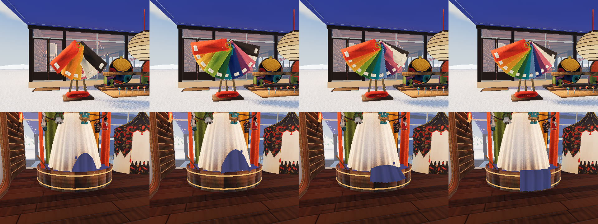
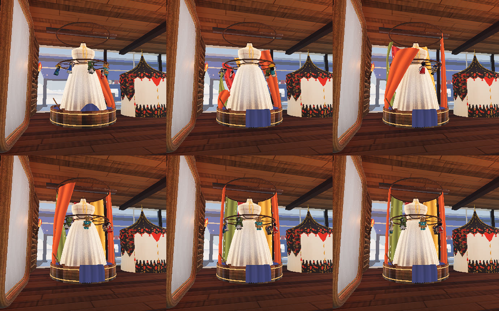
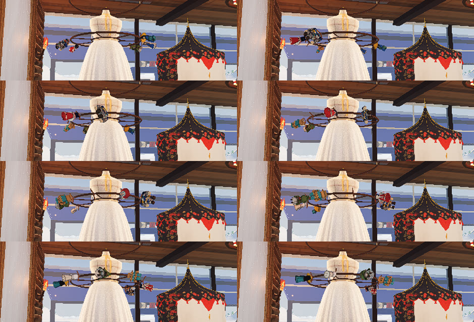
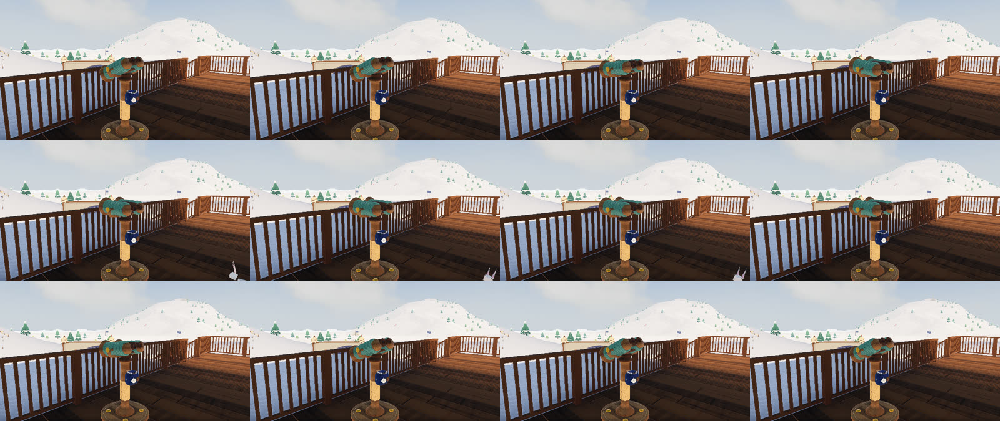
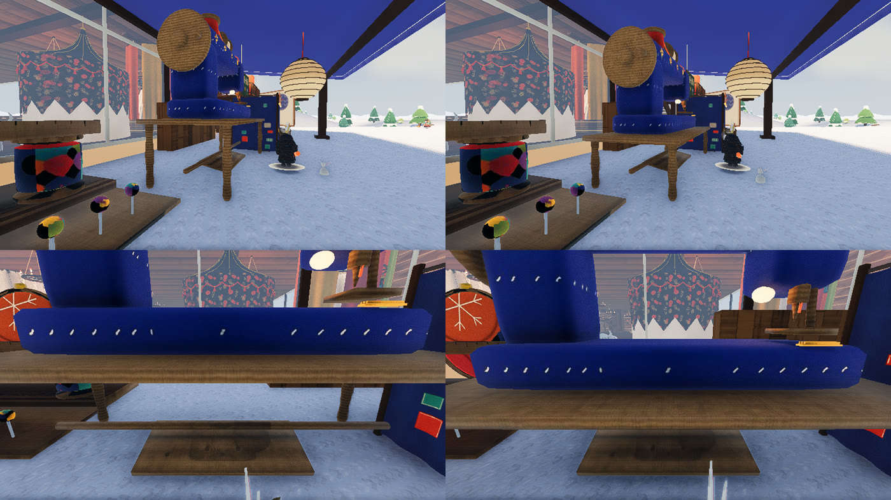

# お金を払う施設の、近づくと動く作り（2026-11-07）

代表「見本帳は近づくと展開される方が良いかも。お金を払う施設はすべて近づくと動きのあるインタラクションをすることで注意を引いてほしいので。それでいったら染台もそうか、染台もなにかモーションを付けてほしい。ミシン台の高さが高いかも、机もう少し下げてほしい。」

## 決まり

- 人（自分・ボット・つないでいるほかの人）が近づくと動き、動ききったら止まって形も更新しない。人を見るのは 0.25 秒ごと（`game/stall_sense.gd`）
- 動きは人形と同じ 12 コマ／秒。布や紙らしく、ばねで少し行き過ぎて戻る
- 字は使わない

## 施設ごとの動き

| 施設 | 払うもの（`craft.gd` の出来事） | 近づいたときの動き | 作り |
|---|---|---|---|
| 見本帳 | ソリの染め代（`sled_dye`）・滑りあとの柄（`stitch_buy`） | 布が外から順に扇に開く。離れると閉じる | `game/sled_book.gd`。今回足した |
| 染台と人台 | 服の染め代（`dye`） | 沈めた布が持ち上がり、前の縁を越えて外へ垂れる。人形が腰の輪を 4 周して足が遠心力で持ち上がり、落ち着くと長い布が液から渦を描いて天井の輪まで昇る。離れると布は沈む | `game/dye_vat.gd`・`game/dress_form_cloth.gd`・`game/wardrobe.gd` |
| 双眼鏡台 | ボタン 1 枚か雪玉（`scope_on`） | 深くうつむいて休み、近づくと顔を上げて、のぞく側を人へ向ける。離れるとまたうつむく | `game/binocular_stand.gd`。今回足した |
| おじいさんの番台 | 型紙・布（`buy`） | カーテンが開き、手を振る | `bandai_curtain.gd`・`shopkeeper.gd`。もとのまま |
| 雪だるまの店 | ペレット（`food_buy`） | 冷蔵庫の扉が開き、番台が組み立つ | `fridge_door.gd`・`snowman_shop.gd`。もとのまま |
| 紙細工屋さん | 提灯・小物（`lantern_buy`・`pal_buy`） | テントの幕が開き、おじぎする | `paper_tent.gd`・`paper_lady.gd`。もとのまま |
| 山男の棚 | 焚き火セット・ペグ（`buy`）、ミニオン（`pal_buy`） | 手を振り、顔を向ける。棚は動かない | `mountain_man.gd`。もとのまま |

対象にしなかった所: ミシン（型紙と布を使うだけ。近づくと針が上がる動きはもとからある）、料理の台（払わない）、自販機（置いてあるだけ）、雪合戦の掛金（人と人のやり取り）。

## 見本帳

布を 1 枚ずつ動かすので、`design/sled-custom/build_book.py` で台（`sled_book.glb`）と布（`sled_book_leaf.glb`・`sled_book_leaf_trim.glb`）に分けた。布は白く焼いた 1 枚を MultiMesh で 12 枚に増やし、色は 1 枚ごとの色で付ける。描くのは布と札の 2 回で、絵も 1 枚ぶんで済む。閉じたときの前は赤の布。

## 染台

布の断面を 12 コマ書いた `POSES`（`game/dye_vat.gd`）で形が決まる。コマの形は一度作ったら使い回す。縁に掛けてあった小さな布は、この布に替えた。だれかが染めると、布も液も染めた色になる（もとのまま）。

### 長い布と人形（2026-11-07 代表「染台とトルソーのモーション地味だな...いまトルソー周りの布が染台から昇って来てもいいのに。トルソーにかかってる人形たちをぐるんとまわしてもいいのに。」）

- 長い布は `dress_form.glb` に焼くのをやめ、`game/dress_form_cloth.gd` が作る。ふだんは液の中で描かない。人が 4.5 m まで来ると 1 枚ずつ昇る（`game/wardrobe.gd` の `SENSE_R`。人形・長い布・染台の布の 3 つがこの値で動き出す。代表「もっと近くで」で 8 m から狭めた）
- 形の計算は起動したときに裏のスレッドで全コマぶん済ませる。動かすときの組み立ては重いコマでも約 4 ms（画面なしで測った）
- 人形は腰の輪に掛かっているので、腰の輪に沿って回す。回り続ける案（1 周 10 秒）と比べて、代表が止まる案を選んだ
- 代表「もっと勢いよく4週回って、回ってる最中は遠心力で足のほうが外側に引っ張られて持ち上がる感じに」: 来るたびに 4 周（`SPIN_TURNS`）、速さは 1 周約 1 秒（`SPIN_TOP`）。足の持ち上がりは輪の速さから遠心力の角で決め、75° まで（`FLING_MAX`）。回りが落ちると足が落ちて少し揺れる
- 持ち上がった足は長い布より外へ出るので、回っているあいだ長い布は液の中で待ち、落ち着いてから昇る（`CLOTH_WAIT`）。布がまだ上にあるときに人が戻っても、回さない

## 双眼鏡台

## ミシン台

ミシンは書き出すときに 1.5 倍される（`props/build_machines.py`）ので、台本の天板 0.85 m がゲームでは 1.28 m あった。台本の `TZ` を 0.65 にして、ゲームで 0.98 m（30 cm 下げた）。胴・針・足踏みの目印も一緒に下がる。背の低い人形（武者 0.99 m）で、天板がちょうど頭の高さ。左がもと、右が下げたあと。

## 確かめ

`game/tools/stall_motion_shots.gd`。`--what=book|vat|stand|man|lady|curtain|fridge|machine` で、人を歩かせて 12 コマごとに撮る。`--sew=1` はミシンで縫う流れ。終わりに、動きが止まっているかを書き出す。
