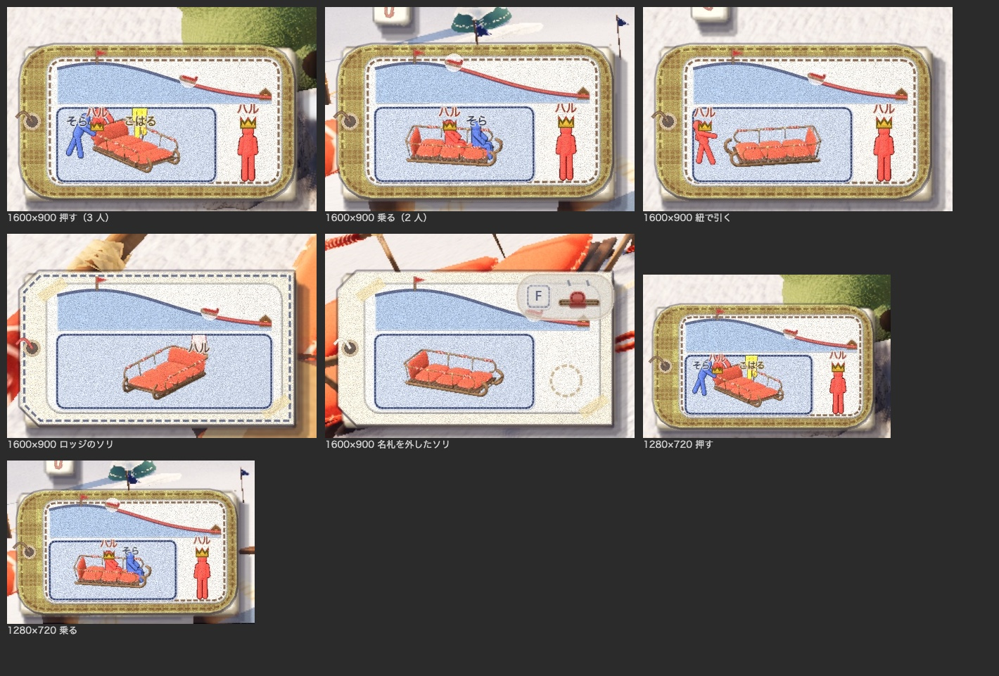

# 左下の札を小さく

2026-11-01。代表の言葉：「タグ表示でかすぎるかも、もっと小さくできる？」

左下の名札の札（丘の断面・回るソリと人・持ち主）を小さくする。

## 見比べ

いまの大きさ（100%）と、75%・60%・50% を、1600×900 と 1280×720 の画面で撮って並べた。
60% と 50% は、札の中の名前と王冠だけを 75% の大きさのまま描く案も並べた。

- [1600×900](compare_1600x900.jpg)
- [1280×720](compare_1280x720.jpg)

左は画面全体（赤い点線の枠が札）。右の 2 つは札を画面の画素のまま切り抜いたもの（3 人で押す所・2 人で乗る所）。

代表は **75%** を選んだ。札も、名前と王冠も、そろって 75% にする。

## 決まり

- `hud.gd` の `TAG_K` を 1.82 から 1.365 にした（前の大きさの 75%）。
  - 札の中のもの（丘の断面・回る図・人型・名前・王冠・持ち主）は、みな `TAG_K` で大きさが決まるので、そろって小さくなる。
  - HUD の大きさの設定にも、今までどおり合わせて変わる。
- 札の上に積む物（`tag_rect` の上の縁から位置を決める物）は、札に合わせて下がる。

## 確かめたこと

`tools/tag_size_shots.gd`（3 人で押す所と、2 人で乗る所を撮る）と `tools/sled_tag_shots.gd` で撮った。新しいエラーは出ていない。

- 1600×900 で、名前（ハル・そら・こはる）と王冠は読める。人型もつぶれない。
- 1280×720 では名前の字が 9 画素ほどになるが、読める。



画面全体は `shots/` に置いた。

```bash
Godot --path game --resolution 1600x900 --fixed-fps 30 -s res://tools/tag_size_shots.gd -- --bots=2 --no-sound --no-pip --dir=/path/shots
```
