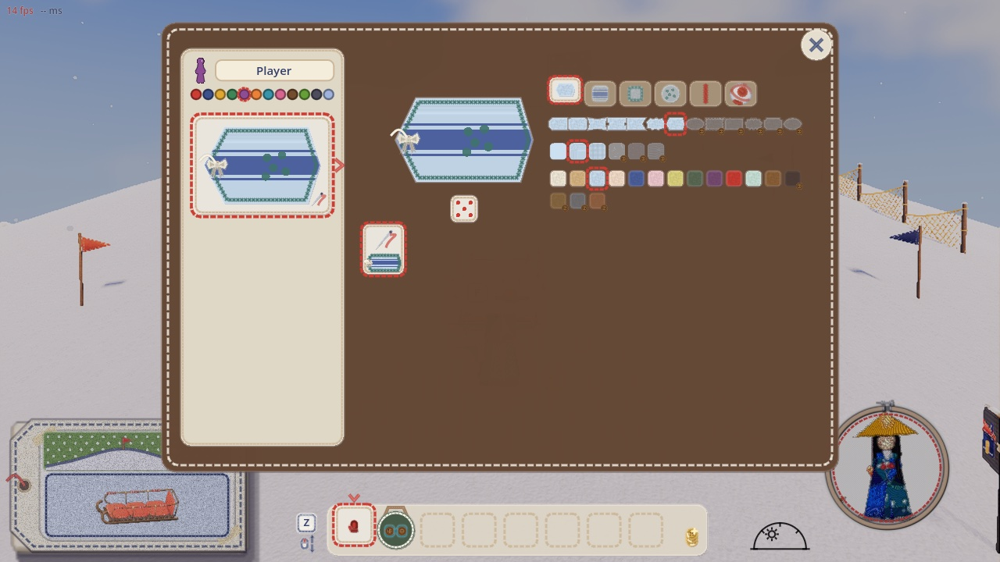
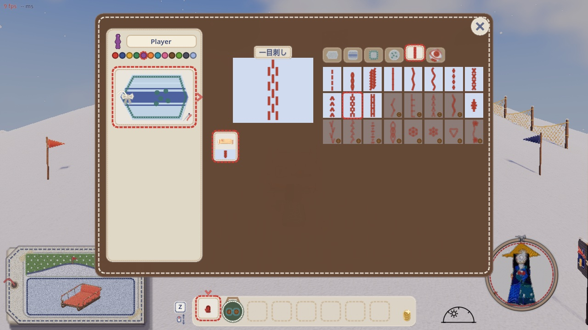
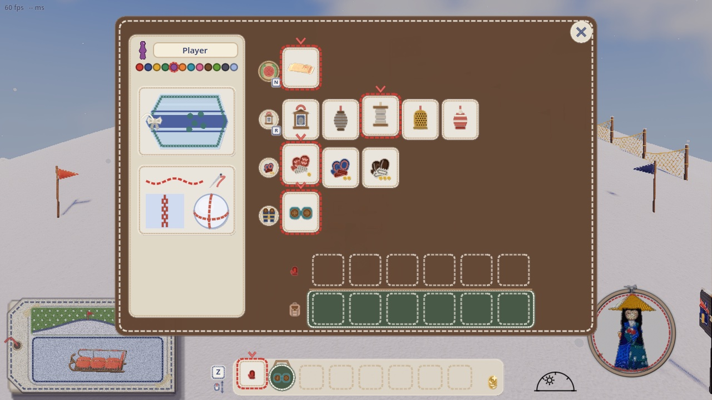
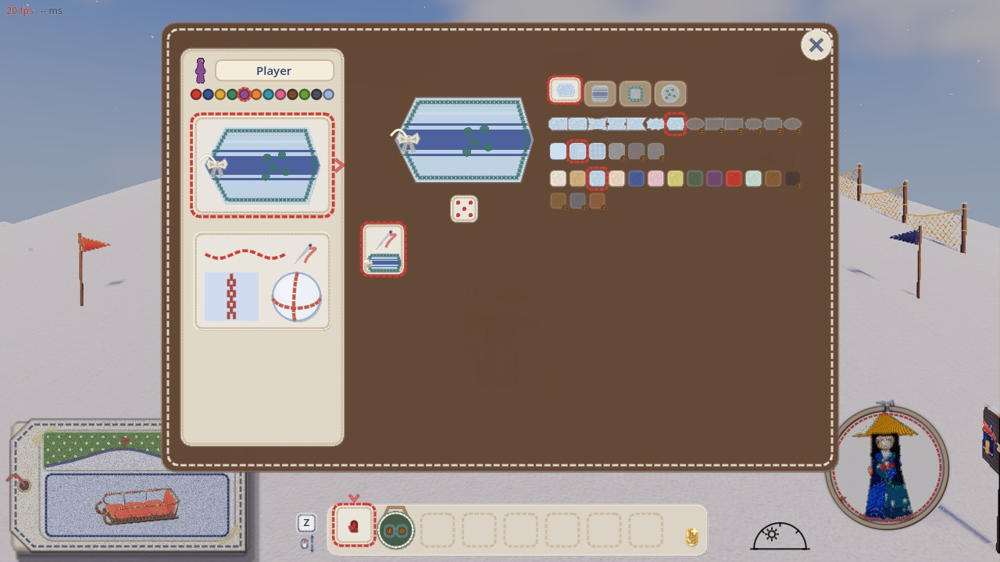
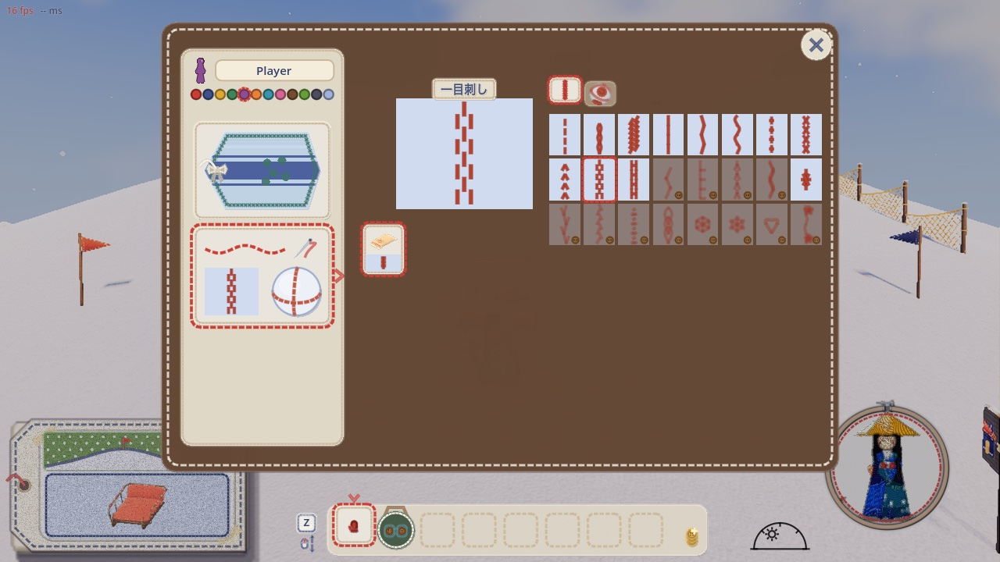
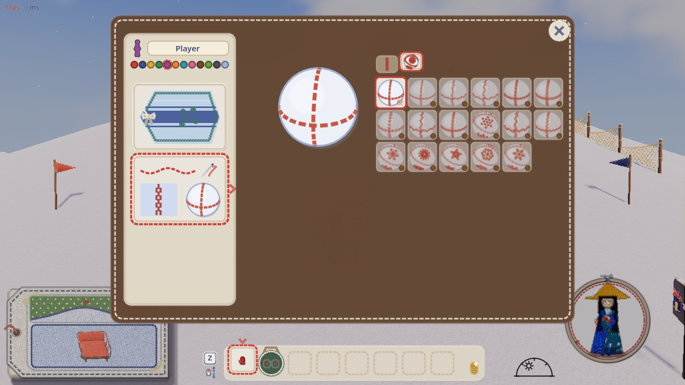

# 持ち物の画面（I）の、名札の柄のタブとステッチのタブを分ける（2026-11-10）

代表「インベントリでタグの柄設定用のタブとステッチ選択のタブは分けてほしい」

## 分ける前

左の名札の札を押すと、右に名札と柄の画面が出た。上のページの札 6 枚が 1 列に並んでいた。

| ページの札 | 中身 |
|---|---|
| 1〜4 | 名札の部品（形と素材・模様・縁の糸と吊るす糸・飾りと判子） |
| 5 | 滑りあとの柄 |
| 6 | 大玉の縫い目の柄 |

| 絵 | 写っているもの |
|---|---|
|  | 1 枚目（名札の形）。札の列に名札の部品と縫い目の柄が混ざる |
|  | 5 枚目（滑りあとの柄） |

## 分けたあと

- 左の紙に、札を 2 枚並べた。
  - 上は自分の名札の札。押すと、右が名札の柄の画面になる。ページの札は名札の部品の 4 枚だけ。
  - 下はステッチの札。押すと、右がステッチの画面になる。ページの札は、滑りあとの柄と大玉の柄の 2 枚だけ。
  - ステッチの札の絵は、上に針と赤い糸のランニングステッチ、下にいまの滑りあとの柄と、自分の大玉の柄。字は使わない。
- 開いている札には、赤い糸の縁と右への山形が付く。
- 開いている札をもう一度押すか Esc で、装備に戻る。
- どちらの札も、前に開いていたページで開く。
- 名札の部品の「縁の糸」（名札のふちのステッチ）は、名札の一部なので名札の柄のほうに残した。
- 滑りあとの柄と大玉の柄は、どちらも縫い目の柄を選ぶものなので、ステッチのほうに 2 枚のページとしてまとめた。

| 絵 | 写っているもの |
|---|---|
|  | 装備の画面。左に名札の札と、その下にステッチの札 |
|  | 名札の札を押した。ページの札は 4 枚 |
|  | ステッチの札を押した。ページの札は 2 枚（滑りあと・雪玉）。滑りあとの柄 |
|  | ステッチの、雪玉の柄のページ |

確かめ: `game/tools/tag_stitch_tabs_check.gd`
- 分けたあとの数字はだめ 0。
- `--before` を付けると、分ける前の絵だけ撮る。
