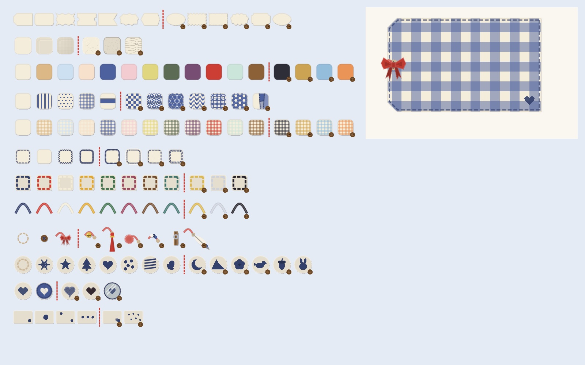
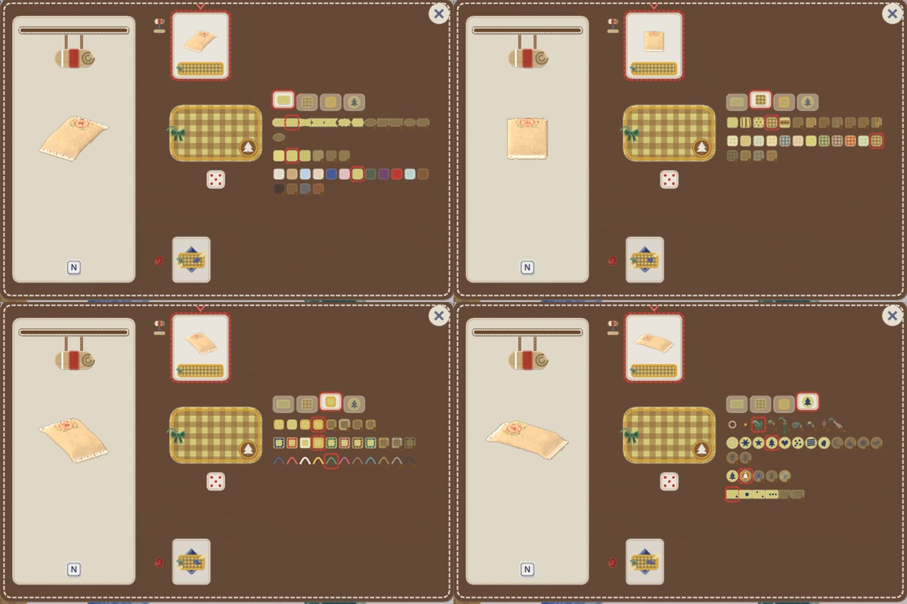
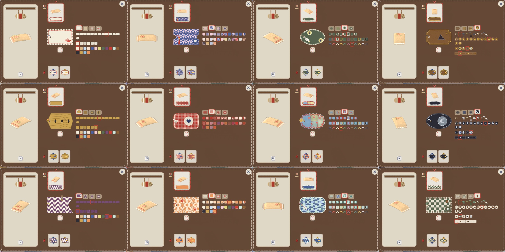
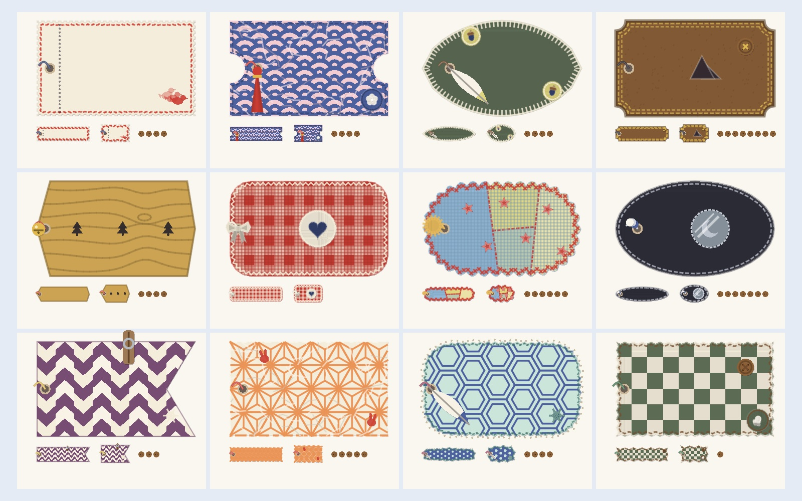
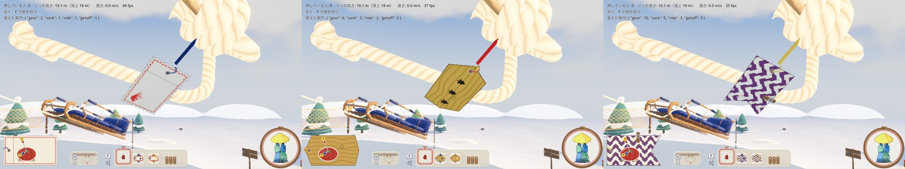

# 自分の名札の幅を広げる

2026-10-29。代表の言葉は「名札がバリエーションなくて、というか無難すぎてもったいない感じ」。自分の名札（PR #32）は、形 7 種・紙の色・縁の糸・吊るす糸・判子の 5 つの部品しかなかった。これを、手芸の名札・タグ・ワッペンで実際にある作りを汲んだ 12 の部品にし、組み合わせで「その人らしさ」が出るようにした。文字は使わない。

実装は `game/sled_tags.gd`（部品・描き方）、`game/craft_ui.gd`（装備の画面 I）、`game/craft.gd`（手に入れた部品・使えるかの判定）、`game/player.gd`（保存）。

## 調べた幅（手芸の名札・タグ・ワッペン）

| 作り | 実物で見る形 | 名札に入れたもの |
|---|---|---|
| 刺繍のワッペン | 楕円や丸の土台に、輪郭を縫い、中をサテンで埋める | 形「楕円」、判子の作り「刺繍」 |
| フェルトのアップリケ | 丸く切ったフェルトを縫い付け、その上に形を重ねる | 素材「フェルト」、判子の作り「アップリケ」 |
| 和紙・千代紙・型染め | ちぎった縁、繊維の筋、青海波・麻の葉・矢絣・七宝・亀甲・市松などの和柄 | 形「ちぎり」、素材「和紙」、模様の和柄 6 種 |
| 布のタグ | ギンガムの格子、縞、水玉、織り目 | 素材「布」、模様「格子・縞・水玉・帯」 |
| 革・木の札 | 磨いた縁（コバ）、太い糸、焼き印、木目 | 素材「革・木」、判子の作り「切り抜き」 |
| 飾り | ボタン、リボン、鈴、房（タッセル）、ぼんぼん、ビーズ、木のクリップ、羽根 | 飾り 8 種 |
| 縁 | 並縫い、ミシンのジグザグ、クロスステッチ、ブランケットステッチ、レースの縁 | 縁の作り 7 種 |
| 切手・切符 | ミシン目の歯、切り取り線 | 形「切手」、縁の作り「ミシン目」 |
| パッチワーク | 継ぎはぎの布と縫い目 | 模様「継ぎはぎ」 |
| スタンプ | 位置・向き・重ね押し・散らし | 押し方 6 種 |
| 透けるフィルム | 窓の向こうが透ける | 判子の作り「フィルムの窓」 |

参考: [Polka Dot Chair の刺繍フェルトのタグ](https://www.polkadotchair.com/hand-embroidered-felt-gift-tag-tutorial/)、[Catholic Sprouts のボタンとリボンのフェルトのタグ](https://catholicsprouts.com/simple-felt-gift-tag/)、[Brother の In the Hoop のタグ](https://www.brother-usa.com/blogs/stitching-sewcial/in-the-hoop-embroidered-gift-tag)、[OLFA の刺繍した紙のタグ](https://olfa.com/blogs/craft/create-festive-embroidered-paper-tags-for-your-gifts)、[FUN! JAPAN の和柄の意味](https://fun-japan.jp/jp/articles/14279)。形と描き方は自作（外の素材は使っていない）。

## 部品（12）と、最初から使える／あとで手に入る



各段の左が最初から使える部品。赤い縦の破線より右の、木のボタンの印の付いた部品があとで手に入る部品。

| 部品 | 最初から | あとで手に入る |
|---|---|---|
| 形 | 角を切った紙・丸い角・ぎざぎざ・切符・燕尾の旗・波の縁・六角 | 楕円・切手・ちぎり・雲・額・葉 |
| 素材 | 紙・フェルト・布 | 和紙・革・木 |
| 地の色 | 12 色 | 墨・金茶・空・柿 |
| 模様 | なし・縞・水玉・格子・帯 | 市松・青海波・麻の葉・矢絣・七宝・亀甲・継ぎはぎ |
| 模様の色 | 12 色 | 4 色（地の色と同じ並び） |
| 縁の作り | 並縫い・なし・ジグザグ・クロス | ブランケット・レース・ミシン目・二本の並縫い |
| 縁の糸・吊るす糸 | 8 色 | 金糸・銀糸・黒 |
| 飾り | なし・ボタン・リボン | 鈴・房・ぼんぼん・ビーズ・木のクリップ・羽根 |
| 判子 | なし・雪の結晶・星・もみの木・ハート・水玉・しま・手袋 | 三日月・山・梅・鳥・どんぐり・うさぎ |
| 判子の作り | 判子（平らなインク）・アップリケ | 刺繍・切り抜き・フィルムの窓 |
| 押し方 | 隅・まんなか・対角・三つ並べ | ずらし重ね・散らし |

- 標準（最初から）だけで、形 7 × 素材 3 × 地 12 × 模様 5 × … と組める。凝った物は、あとで手に入る側に置いた
- 部品の並びは「最初から」を前に、`STARTER` の数で分ける。`COST` に木のボタンの数の目安を置いた（例: 素材・判子の作り 6、模様・飾り 5、形・縁 4）。**手に入れる仕組み（報酬・店）はまだない**
- 手に入れた部品は `craft.gd` の `tag_owned`。`tag_unlock` の出来事で足す（通信でも同じ道）。`tag_design` は、まだ手に入れていない部品を前のままにする
- 保存（`user://my_tag.cfg`）に、手に入れた部品も書く。前の版の保存（5 部品だけ）は、書いていない部品をはじめの名札のままにして読む
- ロッジの名札（`DESIGNS` の 13 枚）は、素材を紙・模様なし・押し方を隅として、いままでと同じ見え方

## 装備の画面（I）



部品は 4 ページ（形と素材・模様・縁と糸・飾りと判子）。上の札でページを替える。札の絵はそのページの部品の見本。まだ手に入れていない部品は暗く、木のボタンの印が付いていて、押しても替わらない。名札の下のさいころは「おまかせ」で、使える部品から選び直す（地と模様の色は見分けられるほど離す）。



## 組み合わせの例（12）



大きい名札の下に、米袋の札の大きさ（104 × 28）と見本の大きさ（56 × 34）。右の木のボタンは、あとで手に入る部品の数。

| # | 組み合わせ |
|---|---|
| 1 | 切手・紙・ミシン目・鳥をずらし重ね（郵便好き） |
| 2 | 切符・和紙・桜に青海波・房・梅のアップリケ |
| 3 | 葉・フェルト・ブランケットステッチ・羽根・どんぐりのアップリケを対角に |
| 4 | 額・革・二本の並縫いに金糸・ボタン・山の切り抜き |
| 5 | 六角・木・鈴・もみの木を三つ並べ |
| 6 | 丸い角・布の赤いギンガム・ジグザグ・リボン・ハートのアップリケ（最初から使える部品だけ） |
| 7 | 雲・布の継ぎはぎ・クロスステッチ・ぼんぼん・星の刺繍を散らし |
| 8 | 楕円・墨のフェルト・銀糸・ビーズ・三日月のフィルムの窓 |
| 9 | 燕尾の旗・紫に矢絣・木のクリップ・雪の結晶 |
| 10 | ちぎり・和紙に柿の麻の葉・うさぎを対角に |
| 11 | 波の縁・薄緑に亀甲・レースの縁・羽根・雪の結晶の刺繍 |
| 12 | ぎざぎざ・フェルトの市松・ボタン・手袋のアップリケ |

ゲームの中で、縫ったソリに吊るした名札（左下の札と持ち物の列も写る）: [examples/](examples/)（01〜12 が上の表の番号）。米袋に吊るした名札（例 1・5・9）:



## 小さく描いても崩れない

- 形はどれも、内側へだけ削る・ふくらませる作りで、自分と交わらない。`game/tools/tag_outline_check.gd` で、形 13 種を見本の大きさ（28 × 18）から左下の札（262 × 146）まで、HUD の大きさ 0.4〜2.0 倍の 100 通りで確かめる（三角形に分けられるか・辺どうしが交わらないか・枠からはみ出さないか）。崩れ 0 / 1300
- 同じ道具で、形 × 模様 × 素材 × 縁の作りの 14976 通りを計算し、塗れない欠片が出ないことを見る
- 模様は名札の形で切り抜き、模様の目の大きさに下限を置く（小さい名札でも縞や水玉が潰れない）。素材の筋（織り目・木目・繊維）は小さい名札では描かない
- 判子は、楕円・葉・雲・旗の切れ込みからはみ出さないよう、形の内へ寄せる
- 計算した模様と縁は、形・模様・素材・縁・大きさごとに覚えておき、毎回の計算を省く（左下の札は毎コマ描くため）

## 確かめの道具

```bash
Godot --headless --path game -s res://tools/tag_outline_check.gd
```

```bash
Godot --path game --resolution 1600x1000 -s res://tools/tag_sheet.gd -- --mode=parts --out=/path/parts.png
```

```bash
Godot --path game --resolution 1600x1000 -s res://tools/tag_sheet.gd -- --mode=combos --out=/path/combos.png
```

```bash
Godot --path game --resolution 1280x720 --fixed-fps 30 -s res://tools/tag_variety_shots.gd -- --bots=0 --no-sound --no-pip --dir=/path/shots
```

`tag_sheet.gd` は `--mode=lodge`（ロッジの名札 13 枚と畳んだソリの名札）と `--mode=combo --i=3`（1 枚を大きく、いろいろな大きさで）も描く。

## まだのこと

- あとで手に入る部品を、報酬や店（木のボタン）で手に入れる仕組み。値の目安は `COST` にあるだけ
- 装備の画面の飾りの見本は小さい（25 px）。見本を大きくするか、指したときに大きく見せるかは、遊んで決める
