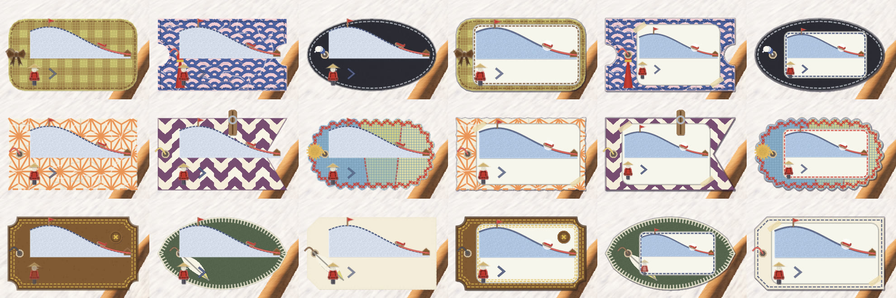
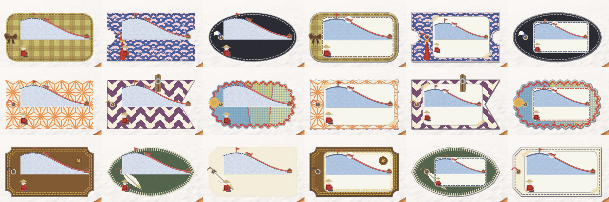
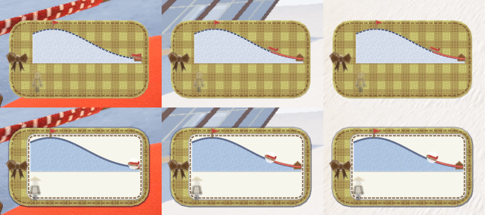

# 左下の札に無地の窓を敷く

2026-10-29。代表の言葉は「タグの中のお山表示、背景によってはすごく見づらいですね」。代表が見せた画面では、黄と茶のギンガムの名札の上に丘の断面・ソリの印・人の形が描かれていて、柄に埋もれて読めなかった。

## 直したこと

- **窓**: 名札の中に無地の窓を一枚敷き、丘の断面・ソリの印・人の形・糸の矢印はその上に描く（`game/hud.gd` の `_draw_tag` と `_draw_tag_info`）。名札の柄は、窓のまわりの縁として見える
- **窓の形は素材に合わせた手芸の形**（`game/sled_tags.gd` の `_draw_window`）:
  - 紙・和紙・木は、角を紙テープで留めた紙のラベル
  - フェルト・布は、並縫いで縫い付けた白い布の当て布
  - 革は、二本の並縫いで縫い付けた窓
  - 縫い目の糸は名札の縁の糸で描く。窓の上で読めない明るい糸のときは、藍にする
- **窓の地は、いつも同じ明るさの生成り**（`WINDOW`）。名札の地が墨や紺でも、見え方は変わらない
- **線と印を濃くした**:
  - 丘は、雪を前より濃い水色にし、輪郭を藍の糸の実線にした（前は薄い水色に点線）
  - ソリの印には白い縁を付けた
  - 赤い糸を少し太くした
  - 糸の矢印の、薄く揺れる時のいちばん薄い濃さを上げた
- **窓の位置と大きさ**（`window_rect`）:
  - 置く範囲は、穴と糸の輪より右で、名札の縁の内側
  - 楕円・葉・雲・旗の切れ込み・切符の切り欠きなどで縁からはみ出す辺だけを、少しずつ縮める
  - 窓の中の絵は 210 × 120 の枠で組み、窓に合わせて縮めて真ん中に置く
  - 形と大きさごとに計算を覚えておく
- **面に垂れる飾り**（房・羽根）は、窓の下に差し込む（窓の中の絵を隠さない）
- **名札の外に影と細い縁**を付けた。雪の白・空の青・ロッジの茶色のどれの上でも、名札の形が浮いて見える

## 比べた絵

押して登る（左が直す前、右が直した後。名札は 9 枚: 代表が見せた黄と茶の格子・青海波の切符・墨の楕円・麻の葉のちぎり・矢絣の旗・継ぎはぎの雲・革の額・フェルトの葉・はじめの紙の名札）:



乗って滑る:



背景を変えて（上が直す前、下が直した後。左からロッジの前・空・雪）:



画面全体: [直す前](push_full_before.jpg)・[直した後](push_full_after.jpg)

## 小さく描いても崩れない

`game/tools/tag_outline_check.gd` で、形 13 種を左下の札の大きさ（262 × 146）の 0.4〜2.0 倍で確かめる。

- 窓が名札の縁からはみ出さない
- 窓が穴より右にある
- 窓が 210 × 120 の枠の 55% 以上の広さを持つ

結果は崩れ 0 / 130。窓がいちばん狭くなるのは、雲・切符・葉・楕円（枠の 64〜81%）。

```bash
Godot --headless --path game -s res://tools/tag_outline_check.gd
```

```bash
Godot --path game --resolution 1600x900 --fixed-fps 30 -s res://tools/tag_window_shots.gd -- --bots=0 --no-sound --no-pip --dir=/path/shots
```
