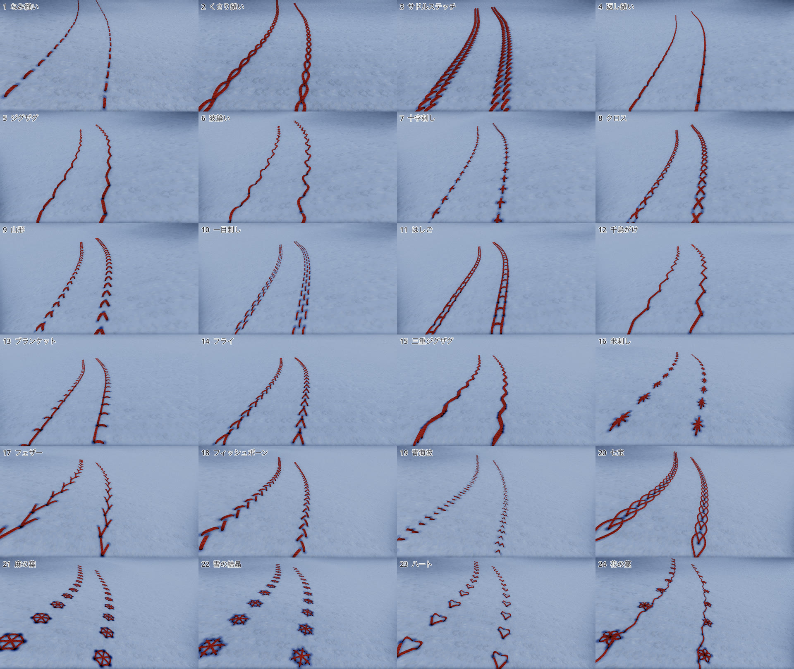
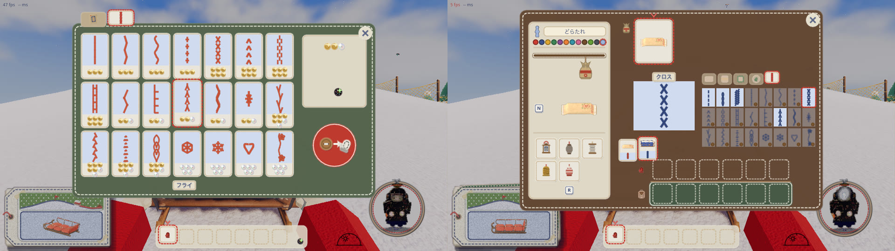
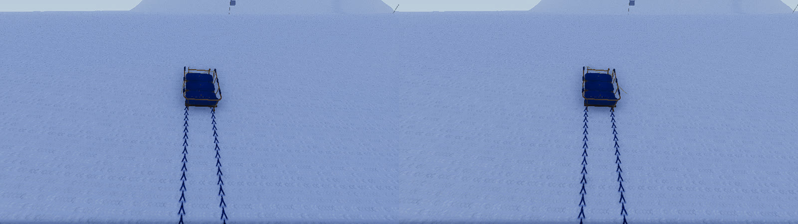

# 滑りあとのステッチ（2026-11-06）

代表「滑りあとのステッチ表示が不安定」「滑り後のステッチをソリ屋で買ってインベントリでソリごとに設定できるようにして欲しい。さまざまなステッチ案をimozuruやweb検索から作ってほしい」。

## 不安定さ

`stable-before-after.jpg` は同じ滑りの 8・16・28 秒（上が直す前、下が直したあと）。原因と決まりは `design/controls-and-physics.md` の「滑りあとの決まり」。

## 案

**2026-11-06 代表が 24 案を全部残すと決めた。**

`game/tools/stitch_board.gd` で、ソリの縫う処理（`sled.gd`）に道すじを渡して本物の雪の上に引いた絵。形は `game/stitches.gd`。糸は今の 2 本撚りの糸のまま、色はソリのメインカラー。

### 見たものと汲み取ったもの

| 見たもの | 汲み取ったもの |
|---|---|
| [Embroidery stitch（Wikipedia）](https://en.wikipedia.org/wiki/Embroidery_stitch): 刺繍の系統（直刺し・返し・鎖・ブランケット・フェザー・クロス・結び目・カウチング） | 系統ごとに 1 つ以上を棚に並べる。結び目（粒）は糸の目で描けないので今回は入れない。カウチングは太さの違う糸が要るので今回は入れない |
| [Sarah's Hand Embroidery: Stitch Index](https://www.embroidery.rocksea.org/reference/for-hand-embroidery-beginners/stitch-dictionary/)、[Fly Stitch](https://www.embroidery.rocksea.org/stitch/fly-stitch/fly-stitch/)、[Fishbone Stitch](https://www.embroidery.rocksea.org/stitch/fishbone-stitch/fishbone-stitch/) | フライは Y の字が並ぶ。フィッシュボーンは左右から中心へ交互に入り、中心に筋ができる |
| [Sashiko（Wikipedia）](https://en.wikipedia.org/wiki/Sashiko): 刺し子は布を補強する実用の縫いで、北国の冬の手仕事でもあった。一目刺しは格子の点に一針ずつ刺す | 雪山に合う棚として刺し子の系統を入れる（十字刺し・一目刺し・米刺し・青海波・七宝・麻の葉） |
| [Japanese Patterns（Japanese Taste）](https://japanesetaste.com/blogs/japanese-taste-blog/japanese-patterns-wagara-history-meanings-traditional-designs): 青海波は重なる半円、七宝は重なる円、麻の葉は六角形を三角に割った形 | 青海波は 2 段の弧、七宝は半分ずつ重なる輪、麻の葉は六角形とまんなかを渡る線 |
| `props/stitches.md`（2026-10-27 代表の決め） | 標準は重いソリほど太く丈夫。凝った柄は報酬や通貨で。たくさんためる。候補の一覧もここから |

クレタンはフィッシュボーンと雪の上で見分けにくいので、今回は棚に入れない。

### 値段の段（ボタン）

| 段 | 柄 |
|---|---|
| 標準（0） | なみ縫い・くさり縫い・サドルステッチ |
| 30 | 返し縫い・ジグザグ・波縫い・十字刺し |
| 60 | クロス・山形・一目刺し・はしご |
| 120 | 千鳥がけ・ブランケット・フライ・三重ジグザグ・米刺し |
| 250 | フェザー・フィッシュボーン・青海波・七宝 |
| 500 | 麻の葉・雪の結晶・ハート・花の蔓 |

## 買う・設定する決まり

- **買う**: 売り子のおじさんの売り台に、左上の札で「糸の柄」の棚を足した。安い順に 21 種類。持ち物の場所は使わない。一度買えば、その人のどのソリにも使える。同じ柄は二度買えない
- **設定する**: 持ち物の画面（I）の名札の段に、5 つ目の札を足した。下の札で替えるソリ（持っている米袋・置いてある自分のソリ・畳んだ自分のソリ）を選び、右の棚で柄を押す。持っていない柄は薄く、木のボタンの印が付く
- **替えられる人**: ソリの持ち主だけ。名札と同じ決まりにした。ロッジのソリと名札を外したソリは、誰も替えられない。ほかの人の出来事はホストが断る
- **色**: 糸の色は今までどおりソリのメインカラー
- **保存**: 買った柄と標準の米袋の柄は、名札の部品やランタンと同じく `my_tag.cfg` に残す。縫ったソリは今でも次の起動に持ち越さないので、その柄も持ち越さない。畳んだ包みと立てかけ台のソリは、柄を持ったままでいる
- **替えたとき**: もう残っている跡は前の柄のまま、消えるまで残る
- **通信**: 名札と同じ `craft.gd` の出来事で全員に配る。あとから入った人には、置いてあるソリの柄も届く

左がホストの画面、右がつなぐ側の画面。同じフライの跡が出ている。

## 確かめの道具

- `game/tools/stitch_board.gd`: 柄を雪の上に並べて撮る
- `game/tools/stitch_shop_check.gd`: 買う・設定する・畳む・滑る・保存と、2 つ起動の確かめ（終わると保存ファイルを元に戻す）
- `game/tools/trail_stable_check.gd`: 跡が途切れない・描かれない目がないことを測る
