# 解放の品の札を、よくあるゲームの店の見せ方にする（2026-11-10）

代表「いやーーなんかアンロックUIが直感的に理解しづらいな。一般的なゲームのやりかたにしてほしい」

## よくあるゲームの店の見せ方

よくあるやり方を、広く知られた作りからまとめた。

| ようす | よくある見せ方 |
|---|---|
| 買える | 品物の絵をそのまま見せ、下に値段（お金の印と数）。押せる |
| お金が足りない | 品物の絵は見せたまま。値段を赤くするか、札ごと暗く・グレーにする。押せない（押すと震える・断りの音） |
| 持っている | 値段を消し、チェックの印（緑のチェックの丸）や「持っている」の帯。押すと身につける |
| 身につけている | 札に色の太い枠、または角の印・下の帯（チェックと一緒のことが多い） |
| まだ解放できない（ロック） | 品物は暗い影（シルエット）か、薄いグレー。南京錠の印。値段は出さない（解ける条件を出すこともある） |

共通しているのは、次の 3 つ。

- 品物の絵は、ロックのほかは隠さない。
- 「持っている」は値段と入れ替わる。
- ロックは南京錠ひとつで伝える。

今の Lodge（#235）は、まだ買っていない品を包みで隠している。そのため、ロックの包みとの差が値段と荷札しかなく、「買える」に見えにくい。

## 案（`proposal_cards.jpg`）

上から 3 段: 今（#235）・案 A・案 B。どの段も左から 5 枚: 買える・お金が足りない・持っている・身につけている・ロック。
品は山師の棚の品: フェルトの手袋（500）・夜目の双眼鏡（1000）・毛糸の手袋・ふつうの双眼鏡・遠見の双眼鏡。

- **案 A（値札とチェック）**
  - 札はいつも品物の絵を見せる。値段は、絵の下の紙の値札にボタンで出す。
  - 足りない: 札はそのまま。値札の縁とボタンが赤くなり、選べない。
  - 持っている: 値札の代わりに、緑のフェルトの丸に白い糸のチェック。
  - 身につけている: チェックに加えて、札のまわりに赤い糸の太い縁。
  - ロック: 札がくすみ、品物は薄い影だけになる。まんなかに真鍮の南京錠。値札は出さない。
- **案 B（暗くして角の印）**
  - 買える: 品物の絵の下に値段のボタン（今の札と同じ）。
  - 足りない: 札ごと暗いグレーにかぶせる（品物は見える）。値段のボタンは上に残し、下に赤い糸の線を引く。
  - 持っている: 値段の所は空け、札の右上の角に緑のチェック。
  - 身につけている: 角のチェックに加えて、札の下に赤いフェルトの帯とあなたの印の結び目。
  - ロック: 札が藍に沈み、品物は薄い影になる。値段の所に南京錠。

作るときの予定:
- `craft_icons.gd` の札の部品（`card_state` に「身につけている」を足し、値札・チェック・縁・南京錠を描く関数）を直す。
- 山師・紙細工屋さん・連れ・見本帳・持ち物の画面が、それを使うようにする。
- 包み（`parcel`・`unwrapped`・`wrap_card`）は使わなくなる。

道具: `game/tools/unlock_card_mock.gd`（`Godot --path game --resolution 1400x900 -s res://tools/unlock_card_mock.gd -- --out=...png`）

## 代表の決め

- 「Aかなー」
- 「いや、やっぱその値札みたいなのやめよう。お金が足りなくて変えないものはグレーにするだけでいいよ」
- 「インベントリパンパンのときはそのイラストじゃなくて（現状全然伝わらないイラストのため）インベントリスロットを表示したほうが良いんじゃないでしょうか」
- 「山師は双眼鏡と手袋はそれぞれ別タブ作ったほうが良いかも」

## 作ったもの

`craft_icons.gd` の札の部品（`card_state`・`foot`・`over`）を、どの店も呼ぶ。包み（`parcel`・`unwrapped`・`wrap_card`）と、いっぱいの巾着の絵（`bag_full`）は外した。

| ようす | 見え方 |
|---|---|
| 買える | 品物の絵の下に値段のボタン |
| お金が足りない | 札ごとグレーにかぶせる（絵と値段は透けて見える）。選べない |
| 持っている | 値段の代わりに緑のフェルトの丸に白い糸のチェック |
| 身につけている | チェックと、札のまわりに赤い糸の太い縁（二重の縫い目） |
| ロック | 札がくすみ、品物は薄い影、まんなかに真鍮の南京錠。値段なし |
| 持ち物がいっぱい（場所を使う品） | 札が薄くくすみ、右上に埋まった枠の小さな印。店の板の下に、手持ちとかばんの枠を全部並べ、赤い糸の縁で囲む |

各店で「身につけている」になるもの:
- 山師: はめている手袋、首から下げている双眼鏡、使っている雪玉の柄
- 紙細工屋さん: 提げている提灯の形、いまの色（色替えの段）
- 連れ: 付けている小物とミニオン
- 見本帳: いま替えているソリの柄

持ち物の画面:
- 装備の段の選んでいる札は、店と同じ赤い糸の縁と緑のチェック。
- ステッチの画面では、使っている柄が縁とチェック。まだ持っていない柄は、木のボタンの代わりに小さな南京錠。

山師の段の札は、5 枚にした。
- 並び: 道具（焚き火セット・ペグ）・連れ・雪玉の柄・双眼鏡・手袋。
- 連れの画面の段の札も同じ並びにし、板に収まるように小さくした。

枠を使う品（ソリ屋の型紙・布、雪だるまの店の食べ物、山師の焚き火セット・ペグ）も、同じ見え方にそろえた。
- どの店でも「買える・足りない・ロック・いっぱい」が同じ決まりで読めるように。
- ちがうのは「持っている」がないことだけ（買うたびに持ち物に入る品なので）。

ランタンの色替えとソリの染めは、今のまま（値段のボタン、足りなければ選べない）。
- 色替えの段の札も、値段・グレー・いまの色の縁とチェックは同じ部品で描く。

| 絵 | 写っているもの |
|---|---|
| 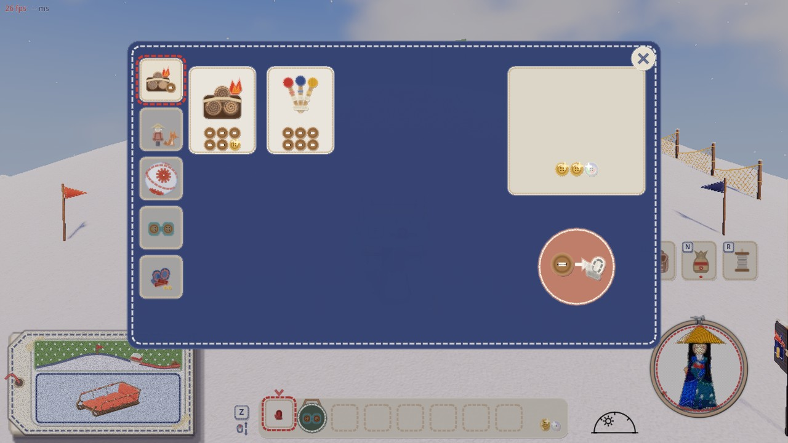 | 山師の道具の棚 |
| 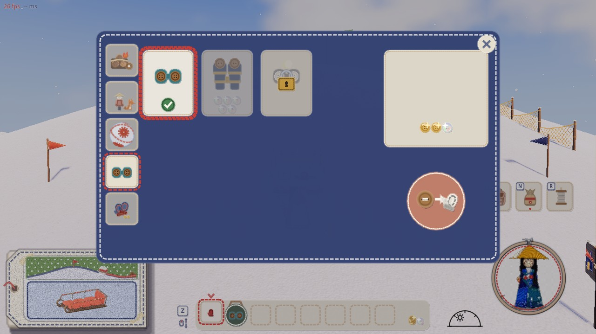 | 山師の双眼鏡の棚 |
| 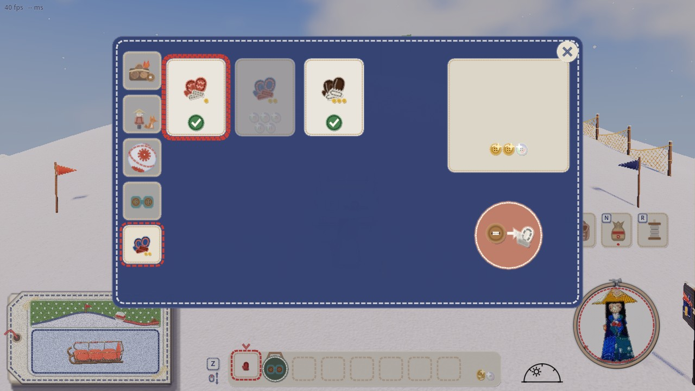 | 山師の手袋の棚 |
| 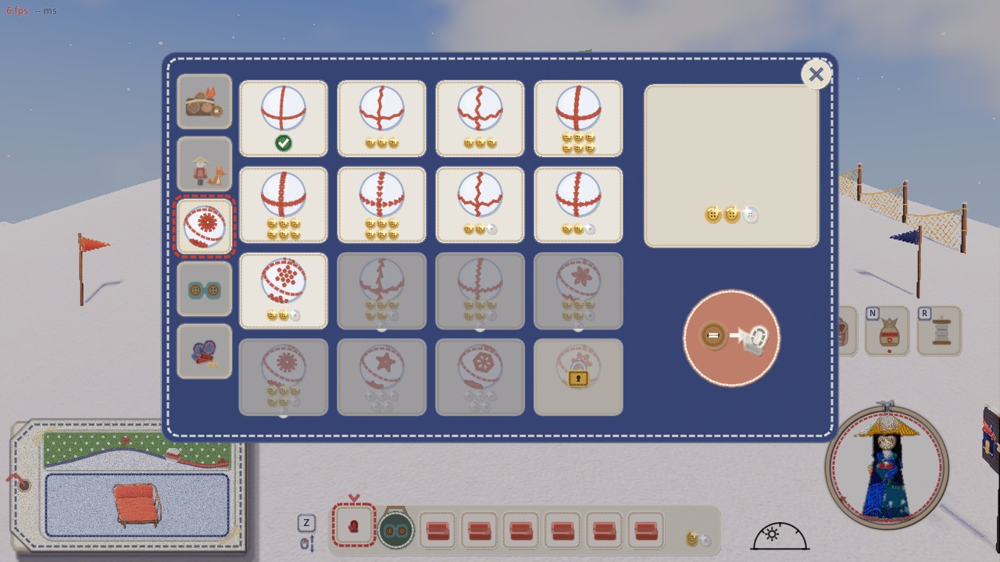 | 山師の雪玉の柄の棚 |
| 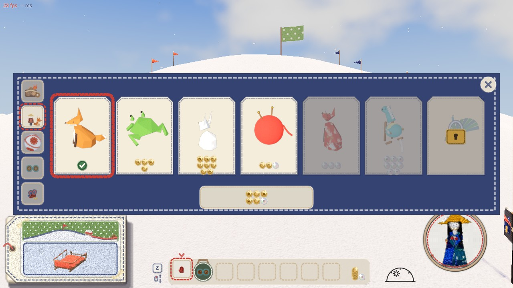 | 山師の連れ |
| 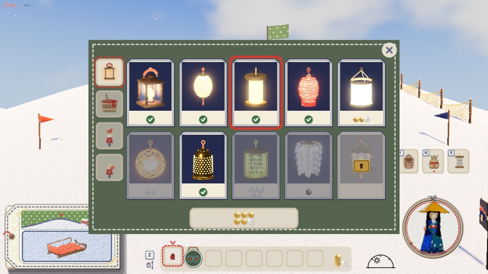 | 紙細工屋さんの提灯の形 |
| 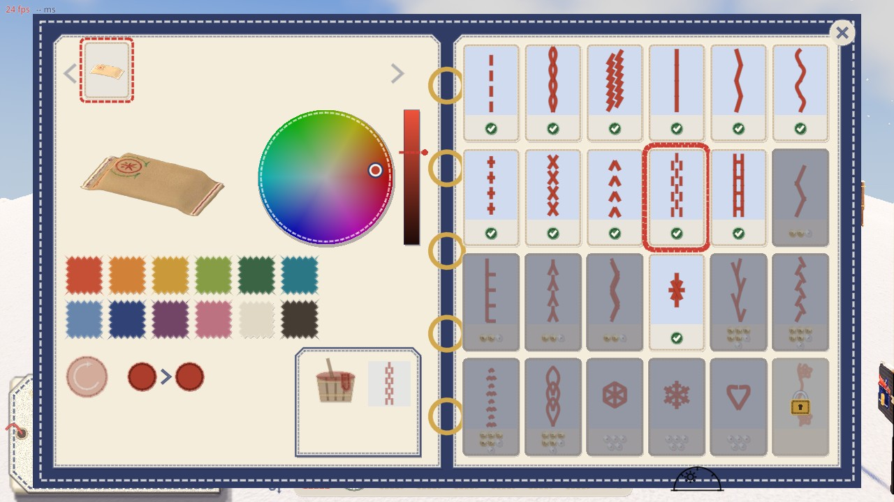 | 見本帳の滑りあとの柄 |
| 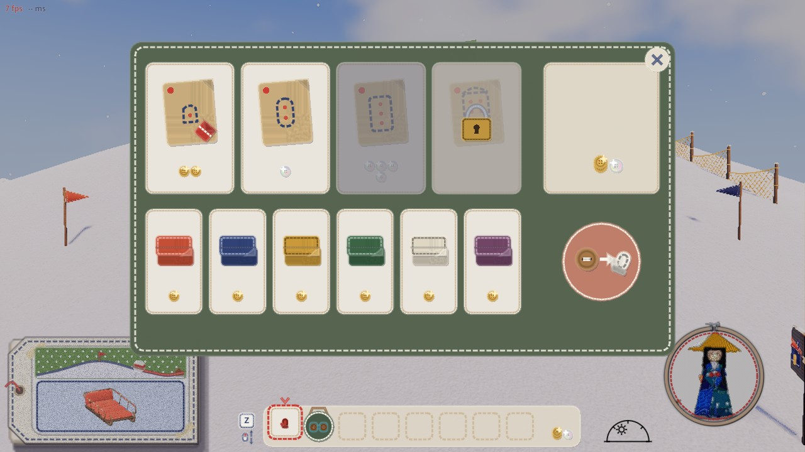 | ソリ屋（枠を使う品） |
| 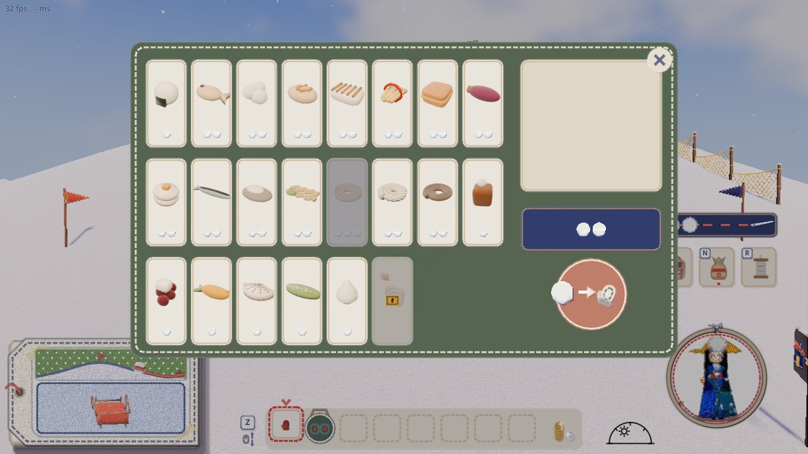 | 雪だるまの店（枠を使う品） |
| 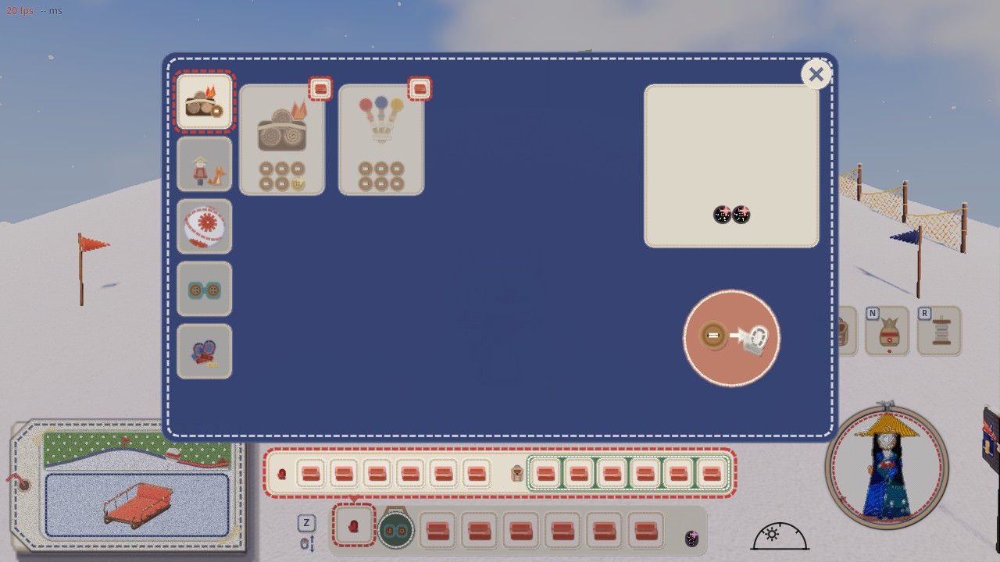 | 持ち物がいっぱいの山師の道具の棚。下に手持ちとかばんの枠 |
| 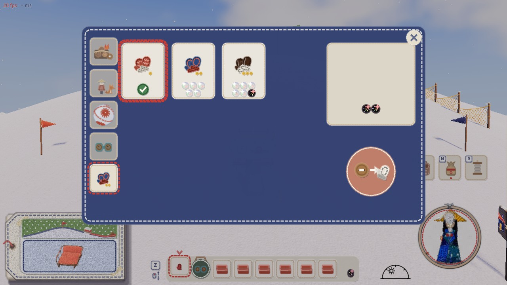 | いっぱいでも、手袋の棚はふつうに買える |
| 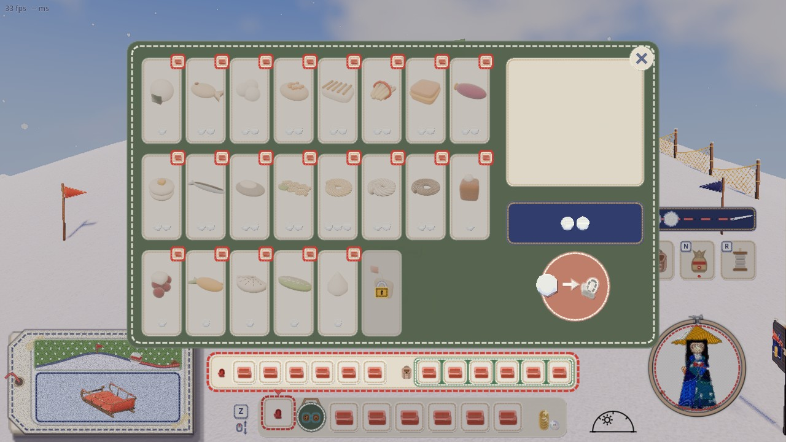 | 持ち物がいっぱいの雪だるまの店 |
| 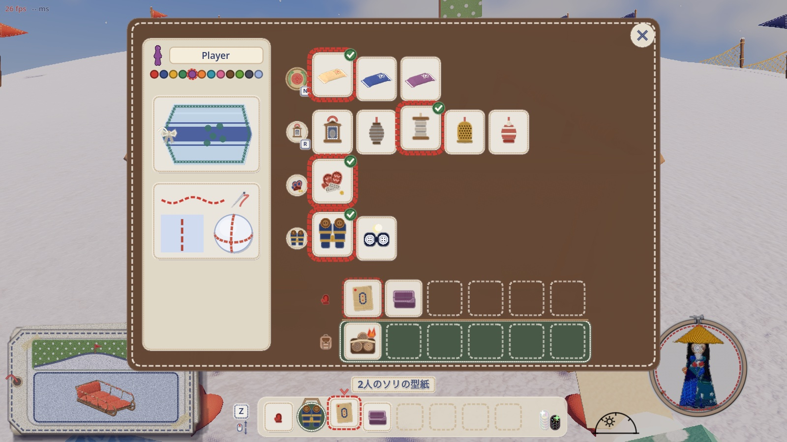 | 持ち物の画面（装備の段の選んでいる札に縁とチェック） |

確かめ（だめはどれも 0。遊ぶ人の保存ファイルは確かめの前後で同じ）:
- `shop_state_shots.gd`: 上の店の絵と数字。
- `inventory_unlock_check.gd`: 遊ぶ人の保存に双眼鏡があっても、持っていないところから始めるようにした。
- `inventory_check.gd`: 持ち物の数字。
