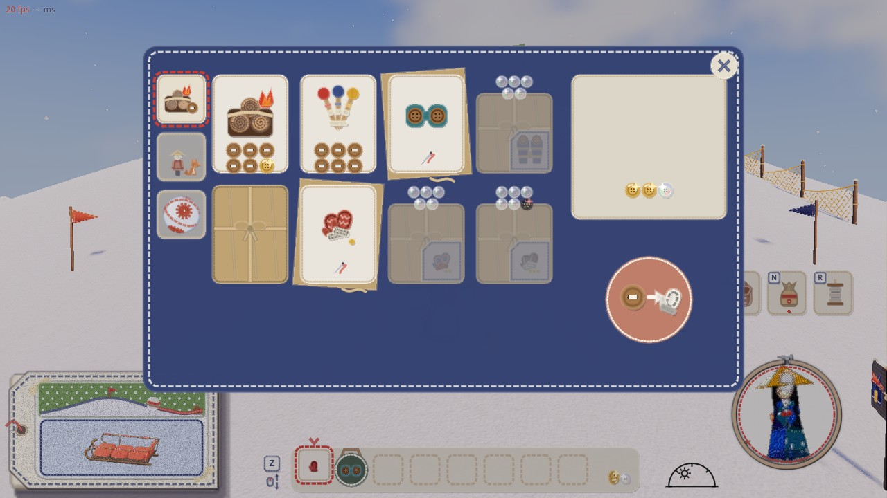
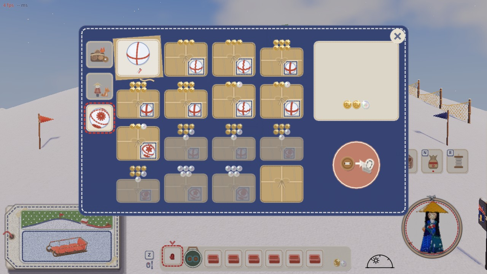
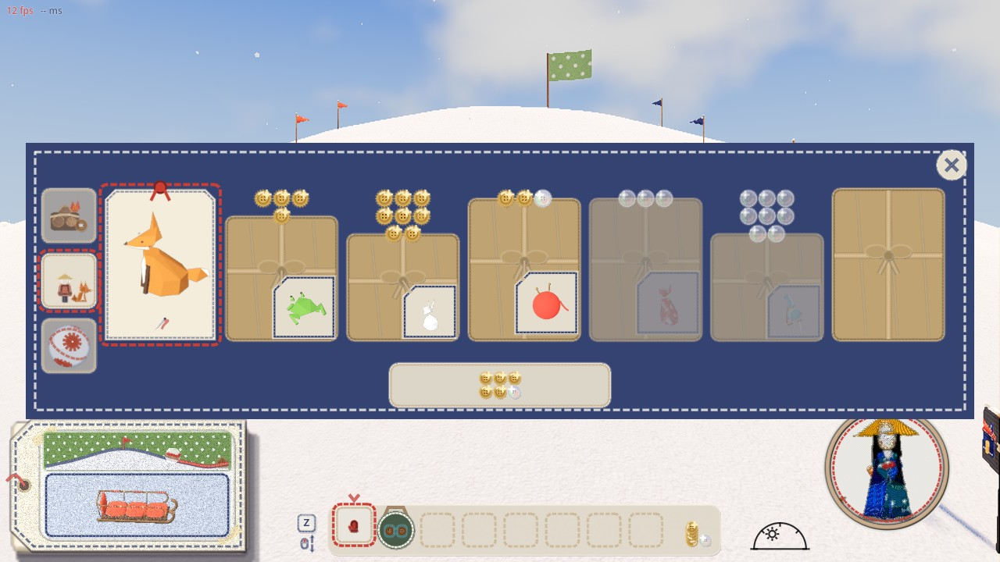
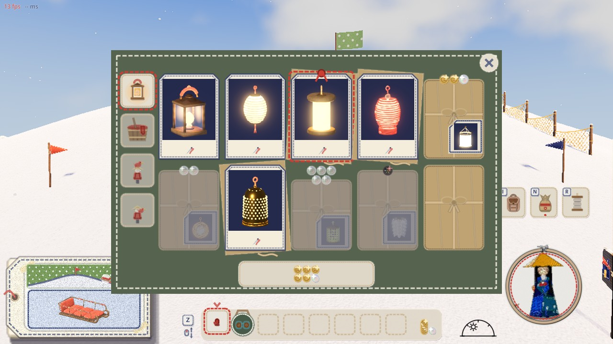
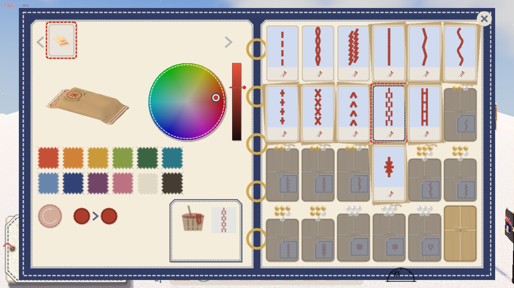

# 解放の品を、店で小包の見え方にする（2026-11-10）

代表「UNLOCK系のやつが小包になってなくない？小包の上に金額を乗せてほしい。お金が足りなくて変えないときはグレーの小包で、買えるときは色のある小包にするのは？」

## どの店のどの品が当てはまるか

**解放の品（一度買えばずっと持つ。持ち物の場所を使わない）→ 小包にする**

| 店 | 品 | 数 |
|---|---|---|
| 山師・道具の棚 | 手袋（毛糸 100・フェルト 500・革 1500） | 3 |
| 山師・道具の棚 | 双眼鏡（ふつう 30・遠見 500・夜目 1000） | 3 |
| 山師・雪玉の柄の棚 | 大玉の縫い目の柄（ball_stitches.gd） | 16 |
| 山師・連れ | ミニオン（pals.gd の pet。値段 0 の 1 匹を除く） | 6 |
| 紙細工屋さん・提灯 | ランタンの形（lantern.gd。標準の 1 つはただで最初から持っている） | 9 |
| 紙細工屋さん・頭／肩 | 頭・肩の小物（pals.gd。値段 0 を除く） | 6 ＋ 4 |
| 見本帳（右の面） | 滑りあとの縫い目の、売っている柄（stitches.gd。標準の 3 柄はただ） | 21 |

**相談したい品（持つ品ではなく、その場で払う染め代）**

- 紙細工屋さんの色替え（提げているランタンを染める。色を替えるたびに払う）
- 見本帳のソリの染め（ソリごとに払う。札は「染める」の 1 枚）

この 2 つは「一度買えばずっと」ではないので、今のまま（札に値段・足りなければグレー）にしたいと考えています。小包にするなら言ってください。

**枠を使う品 → 今のまま**: ソリ屋の型紙・布、雪だるまの店の食べ物、山師の焚き火セット・ペグ

## 案（`proposal_parcels.jpg`）

上から 4 段: 今（#233）・案 1・案 2・案 3。どの段も左から 1 買える・2 お金が足りない・3 買ったあと・4 まだ売っていない（ロック）。
品は山師の棚で、1 フェルトの手袋・2 夜目の双眼鏡・3 毛糸の手袋・4 遠見の双眼鏡。

3 つの案で同じ所:

- 1 買える: 赤い水玉の包み紙に紅白のひもをかけた小包。上の面に値段のボタンが乗る
- 2 お金が足りない: 同じ小包がグレーの紙とひもに沈み、ボタンも薄い。選べない
- 3 買ったあと: 札の上に包み紙が 4 方へ開き、ひもがほどけて、中身が出ている。下に今の針の印

案ごとに違う所（中身の手がかりと、ロックの見分け）:

| 案 | 中身の手がかり | ロック（4） |
|---|---|---|
| 1 | 蝶結びから下がる紙の荷札に、中身の小さな絵 | 今のクラフト紙と麻ひもの包みに、赤い封蝋（雪の結晶の型押し）。値段なし |
| 2 | 小包の前に薄紙の丸い窓。中身が透けて見える | 板を打ちつけた木箱。値段なし |
| 3 | なし（色と値段だけ。開けるまで中身はわからない） | 今の包みに雪が積もる。値段なし |

手がかりとロックは別々に選べます（例: 手がかりは案 1 の荷札、ロックは案 2 の木箱）。

案の絵の道具: `game/tools/unlock_parcel_mock.gd`（`Godot --path game --resolution 1240x1000 -s res://tools/unlock_parcel_mock.gd -- --out=...png`）

## 代表の決め

「いまのに中身のイラストのタグつけてあげてほしい」「あ、え、そうじゃなくて 茶色いふうにリボンかけてあるやつ。立体じゃなくていいよ」
「全部茶色の封してあるやつにしてほしい」「ball_states.jpgの右下のやつに全部して。でもそれだと中身とUNLOCK料金わかんないから値段と中身見せてあげてほしい」

上の案（色のある立体の小包）はやめて、ロックの包み（クラフト紙に麻ひもの十字と蝶結び）と同じ見え方に、値段と中身を足した。

## 作ったもの

`craft_icons.gd` に 2 つの関数を置き、各店（山師の道具・雪玉の柄・連れ、紙細工屋さんの提灯の形・頭・肩、見本帳の滑りあとの柄）は呼ぶだけ。

- `parcel`（まだ買っていない解放の品）: クラフト紙に麻ひもの包み。包みの上の縁に値段のボタンが乗り、麻ひもの結び目から角を切った生成りの荷札が下がり、
  荷札に中身の絵（手袋・双眼鏡の絵、雪玉の柄の玉、滑りあとの柄、紙細工屋さん・連れは札の 3D の絵をそのまま小さく）。
  お金が足りなければ、包みと荷札がグレーに沈み、ボタンも薄い（選べない。今までどおり）
- `unwrapped`（買ったあと）: 札のうしろに、開いたクラフト紙が少し斜めに敷いてあり、ほどいた麻ひもが下に垂れる。札は今の「もう持っている」で、下に針の印。
  紙細工屋さんと連れの持っている札にも、値段の代わりに針の印を出した（前は何も出していなかった）
- ロック（まだ売っていない）: 今までどおり包みだけ（値段も荷札もない）
- 値段 0 の品（標準の提灯・標準の滑りあとの柄など、最初から持っている物）は、開いた紙を敷かない

| 絵 | 写っているもの |
|---|---|
|  | 山師の道具の棚（双眼鏡・手袋。焚き火とペグは場所を使う品なので今のまま） |
|  | 山師の雪玉の柄の棚 |
|  | 山師の連れ |
|  | 紙細工屋さんの提灯の形 |
|  | 見本帳の滑りあとの柄 |

確かめ: `game/tools/shop_state_shots.gd`（上の絵と、グレー・包みの札は選べない・ロックの品はホストが断る などの数字。だめ 0）。
