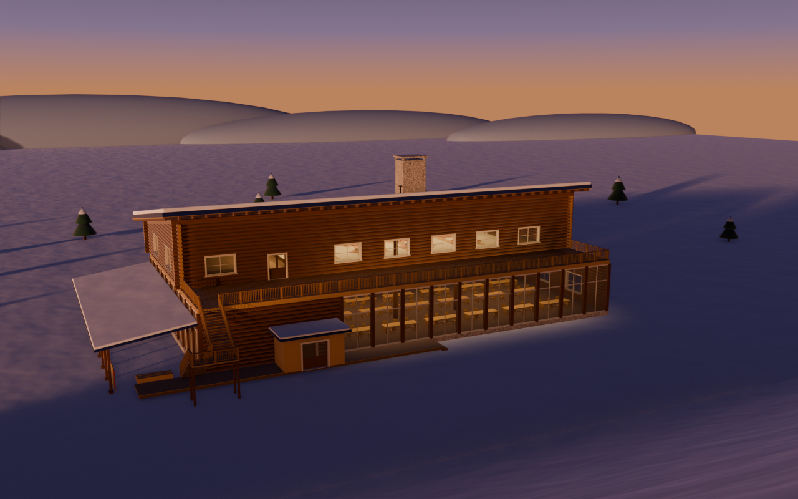

# ロッジ

ゲームの丘のふもとに建つロッジ。ゲーム本体（`game/`）には混ぜず、ここで単体の建築として作る。

元は代表の図面（[drawings/daihyo.svg](drawings/daihyo.svg)）。設計の理由・寸法・比率・素材・光は [design.md](design.md) にある。



## ファイル

| ファイル | 中身 |
|---|---|
| [dims.py](dims.py) | すべての寸法。1 間 = 1.818 m の格子 |
| [build_lodge.py](build_lodge.py) | Blender の台本。組む・描く・書き出す |
| [materials.py](materials.py) | 素材（フェルト・毛糸の雪・木・石・紙）と空。すべてノードとコードで作る |
| [design.md](design.md) | 設計の記録 |
| `drawings/daihyo.svg` | 代表の図面 |
| `renders/` | 描いた画像（下の表） |
| `../game/lodge/lodge.glb` | ゲームで使う見た目と、機械の置き場・灯りの目印。Godot が読めるよう `game/` の中に書き出す |
| `../game/lodge/lodge_collision.glb` | 当たり判定（箱と坂だけ） |

## 動かし方

Blender 5.2 を画面なしで動かす。外の素材は使わない。

```bash
/Applications/Blender.app/Contents/MacOS/Blender -b -P lodge/build_lodge.py -- --phase 4 --look day --views hill,in1 --prefix lodge/renders/05-day
```

```bash
/Applications/Blender.app/Contents/MacOS/Blender -b -P lodge/build_lodge.py -- --phase 4 --look flat --export game/lodge
```

引数:

- `--phase 1..4`: どこまで組むか。1 塊、2 開口、3 冠（軒・雪・手すり・階段）、4 設え（中の家具）
- `--look clay|day|dusk|flat`: `clay` は粘土の濃淡（形を見る）、`day` と `dusk` は素材と光、`flat` は書き出し用
- `--views`: カメラの名前をカンマで区切る。`hill` `west` `east` `north` `aerial` `close` `in1` `in2` `kotatsu` `terrace`
- `--prefix`: 画像の名前の頭。`<prefix>-<カメラ>.png` に書く
- `--export <フォルダ>`: 描かずに 2 つの glb を書き出す
- `--blend <ファイル>`: 組んだ場面を .blend に保存する

素材と光のある描画は、中の光を焼くので 1 回に 2〜3 分かかる。

## Godot で使う

ゲームでは `game/main.gd` の `_make_lodge()` が置く。場所はスタートの先の少し西の麓（x = -27, z = 76）で、正面（ガラスの食堂とテラス）を頂上へ向ける。足もとの地面は `lodge_weight()` で平らにならし、木を重ねない。

- `lodge.glb` の素材は役割の名前（`log` `roof` `snow` `stone` `post` `board` `floor` `glass` `paper` …）と色だけ。手芸の質感はゲームの `game/look.gd`（`felt()` `snow()` `paper()` `wood()`）に名前で差し替える
- 丸太の木口の渦は UV の u が 2〜3 の面にある（胴は 0.1）。Godot で渦を描くなら、この UV で切り分ける
- `lodge_collision.glb` は名前の末尾が `-colonly` なので、Godot は読み込みで StaticBody3D と当たり判定だけを作る（見た目なし）。Godot 4.6 で、StaticBody3D が 5 つできることを確かめた
- 当たり判定では、戸の開口（風除室のアーチ戸・1 階の内の自動ドア・勝手口・西の戸・テラスへの戸）を抜き、窓は塞いだ。開け放したアーチ戸は壁にし、風除室の格子の溝は床として歩けるようにした。階段と玄関前の広場の外まわりの段は坂にした。椅子・灯り・小物は入れていない
- 2 階の小上がりは 0.4 m の段。プレイヤーが上がれる高さかは、ゲームの側で確かめる
- 原点は 1 階の外形の中心の真下、雪の地面の高さ。正面（南）が -Y（Blender）＝ +Z（Godot）を向く
- 機械の置き場の目印（空の節点）: `slot_food_kitchen`、`slot_craft_rental`、`slot_vending_1`〜`3`。場所と向きは `dims.py` の `SLOTS`（並びは [design/lodge-layout/](../design/lodge-layout/)）。機械は `game/main.gd` が置く
- 灯りの場所の目印（空の節点）: `light_lamp_0`〜`2`（食堂の天井）、`light_lantern_0`〜`1`（座敷）、`light_fire`（炉）、`light_vestibule`（風除室）。食堂は炉を入れて 4 つまで。ゲームはここに暖色の OmniLight3D を影なしで灯し、炉の火だけ揺らす
- 書き出しでは面取りを外し、形を 2 つの物体にまとめる。建物は `lodge_body`、中の家具と小物（卓・椅子・灯り・自販機など）は `lodge_props_interior`（名前の prop で 360° 映像から外せる）。動かす自動ドアだけ別。三角形はロッジ全体で 10 万以下が目安（いま約 6.7 万）
- 自動ドアの戸は `autodoor_l` / `autodoor_r`（ガラスは `autodoor_glass_l` / `_r`）。`lodge.gd` が、人（CharacterBody3D）が戸の前後 3 m に入ると左右へ 1.4 m 引き分ける

## 画像

| 画像 | 中身 |
|---|---|
| `01-massing-hill.png` `01-massing-west.png` | 段階 1: 塊 |
| `02-openings-hill.png` `02-openings-west.png` | 段階 2: 丸太の壁と窓・戸 |
| `03-crown-hill.png` `03-crown-west.png` `03-crown-close.png` | 段階 3: 軒・雪・手すり・外階段 |
| `04-setsue-*.png` | 段階 4: 中の家具（粘土） |
| `05-day-hill.png` | カット 1: 外観・昼 |
| `05-dusk-hill.png` | カット 2: 外観・夕方 |
| `05-day-in1.png` `05-dusk-in1.png` | カット 3: 1 階の食堂（昼・夕方） |
| `05-day-kotatsu.png` | カット 4: 2 階の掘りごたつ |
| `05-day-terrace.png` | カット 5: テラスから丘 |
