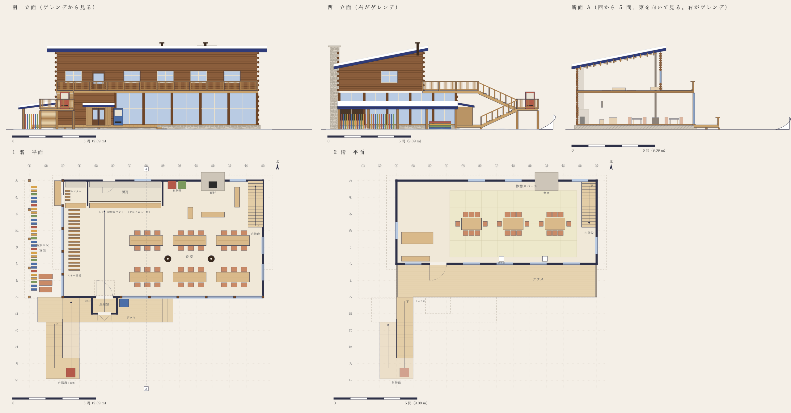
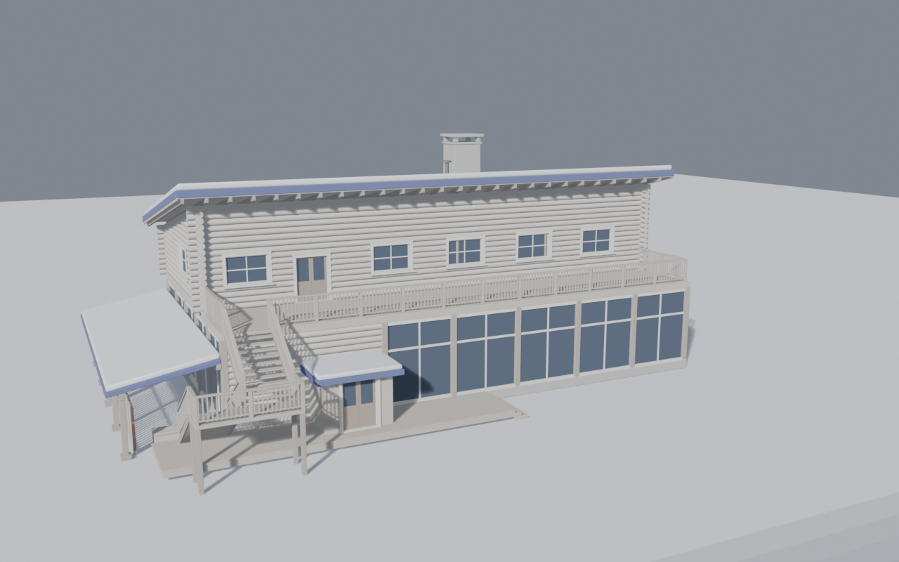
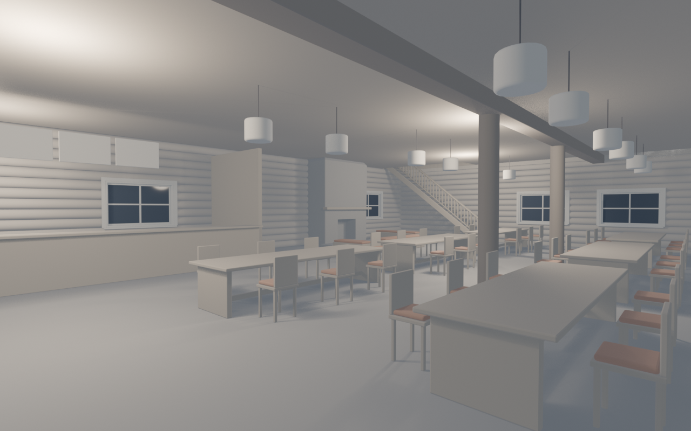
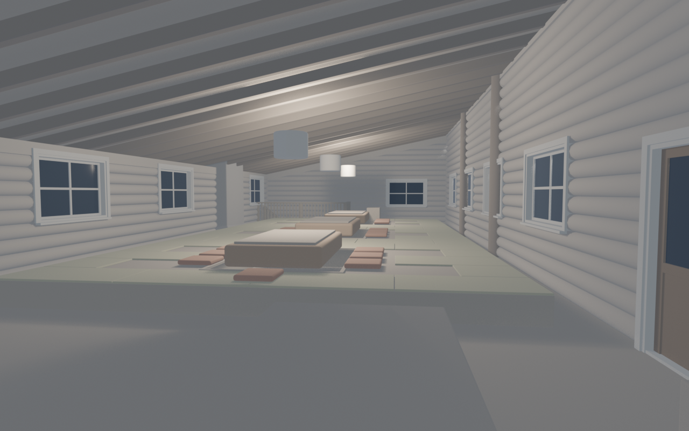

# ロッジの設計

2026-10-27。ゲーム本体には混ぜず、ロッジ単体で作る。

最初は腰折れ屋根の案を作ったが、代表が自分で図面を描いた（[drawings/daihyo.svg](drawings/daihyo.svg)）。食堂が一番大きく見え、片流れの屋根で雪が裏へ落ちるので、こちらに乗り換えた。そこから読み取った寸法に、直した 3 点を入れたものが [dims.py](dims.py) にある。Blender の台本 [build_lodge.py](build_lodge.py) はこの数字だけを使う。

## 大きさ（2026-10-27 に 2 倍へ）

実寸（間口 21.8 m）で組んだら、ゲームの丘（高さ 18 m）とソリの中で小さく見えた。代表の指示で **間取りを 2 倍**にした。代表の図面の 1 間を、2 間（G = 3.636 m）の格子に読み替える。**高さは 1.5 倍**にとどめた。2 倍にすると、2 階建てが丘と同じ高さになるため。

戸・窓台・手すり・階段の 1 段・椅子・畳など、人が触れる物は人の大きさのまま（人は身長 1.7 m）。広がった食堂には卓を 18、座敷にはこたつを 8 卓置いた。窓は 1.5 間 × 1.95 m にして、1.5 格子ごとに並べ直した。

下の表と文の寸法は 2 倍にしたあとの値。

## 3 行で

1. **2 階建ての丸太組み。** 石の基壇に載せる。1 階の南と西はガラスの壁で、2 階は丸太で囲み、藍のフェルトの片流れ屋根を架ける。屋根は丘の側が高く、雪は北の裏へ落ちる。
2. **入口と 1 階の席。** 丘から滑り降りた人はデッキに上がり、風除室から食堂に入る。座るのはガラス際の 6 人掛けの卓 18 か、北の暖炉をコの字に囲む長椅子。レジ・配膳のカウンターは北、貸出は西の端と、屋根だけの下屋。
3. **2 階。** 東の隅の内階段か、西の外階段でテラスから上がる。小上がりの畳に掘りごたつが 3 卓ある。南の 2 間はテラスで、丘を見下ろす。

## 直した 3 点

| 点 | 代表の図面 | 直したあと | 理由 |
|---|---|---|---|
| 煙突 | 頂部が屋根の一番高いところとほぼ同じ | 南の屋根の上端より 1.8 m 上（15.1 m） | 煙突は北の低い側にあるので、丘から見ると屋根に隠れていた。縦に貫くものが丘から 1 本見えると、建物が 1 つにまとまる |
| 南の軒 | 0.6 m（実寸のとき） | 2.0 m。垂木の木口を 1.2 m ごとに見せる | 丘から見ると上が平らな 2 段の箱になりやすい。軒を深くすると 2 階の壁に影の帯が落ち、屋根に厚みが出る |
| 外階段 | 踊り場が丘へ大きく出る | デッキの先から 3 m | 蹴上げ 0.18 m・踏面 0.27 m のふつうの階段にして縮めた。デッキの上から上り始め、折り返してテラスに着く。西の端に寄せたので、正面に滑り込むソリの道をふさがない |

## 寸法（代表の図面の 1 間 = 54px から読み、2 倍の格子に読み替えた）

| 決めたこと | 値 |
|---|---|
| 1 階 | 12 × 7 格子（43.6 × 25.5 m）。床は地面から 0.45 m（石の基壇）、天井 5.7 m |
| 2 階 | 12 × 5 格子。南を 2 格子（7.3 m）さげ、さげた分がテラス。床 6.1 m |
| 屋根 | 片流れ約 1.5 寸。2 階の壁は南 6.45 m、北 3.7 m。軒の出は南 2.0 m、北 1.0 m、東西 1.6 m |
| 丸太 | 径 0.26 m を 0.25 m ごとに積む。角で交差して 0.3 m 突き出す |
| 1 階のガラスの壁 | 南は東の 8.5 格子で柱は 3.1 m ごと、西は全面で柱は 2.5 m ごと。欄間の横桟は床から 3.45 m |
| 窓 | 1.5 間 × 1.95 m、窓台は床から 0.9〜1.0 m。十字の桟で 4 枚。すべて同じ形 |
| 風除室 | 8 × 5 m、高さ 5.7 m（1 階の屋根まで）。外は木のアーチの両開き戸（幅 3.6 m、頂は床から 4.95 m）で、ふだんは外へ開け放す。両脇は板の壁。中に自販機 2 台と、靴の雪を落とす溝つきのマット。マットの両横の床は鉄の格子（溝蓋）を敷いた浅い溝で、落とした雪が下へ抜けてたまらない。内の戸は引き分けの自動ドア（幅 3 m）で、ゲームでは人が近づくと開く（代表の記憶から） |
| 下屋（貸出） | 西に 2.3 間。屋根だけで、柱は 1.75 間ごと。壁際 3.15 m から外へ 2.4 m に下がる |
| デッキ | 地面から 0.45 m。7.5 間 × 1.5 間。東の端に 2 段 |
| 外階段 | 32 段（蹴上げ 0.177 m、踏面 0.27 m）。16 段ごとに踊り場。幅は 1 間 |
| 内階段 | 東の隅。東の壁際を北へ 15 段上り、北の壁際の踊り場で折り返して、南へ 16 段上って 2 階に出る。幅 1.6 m の 2 本 |

## 比率の確かめ

| 項目 | 目安 | このロッジ |
|---|---|---|
| 基壇の高さ | 全高の 8〜12% | 0.45 / 13.3 m = **3%**。目安より低い。デッキと同じ高さにして、ソリを降りてそのまま上がれるようにした。基壇の代わりに、デッキと風除室が地面との接点になる |
| 冠（軒先から雪の上まで） | 勾配屋根 20〜30% | 片流れなので丘から見える冠は軒の帯だけ（約 0.8 m）。軒の出を倍にし、垂木の木口で厚みを出した |
| 軒の出 | 階高の 15〜25% | 南 2.0 m（2 階の南の壁 6.45 m の 31%） |
| 開口率 | 20〜35%。50% を超えるとガラスの箱 | 1 階の南は約 67%、2 階の南は約 15%。1 階は代表の図面どおり食堂をガラスにした。丸太の 2 階が上に載り、柱が 3.1 m ごとに入るので、ガラスの箱には見えない（サムネイルで確かめた） |
| 窓の形 | 1 つの建物で混ぜない | 1.5 間 × 1.95 m の 1 種類 |
| 上の層の幅 | 下の 55〜85% | 奥行きで 71%（7 → 5 格子）。桁行きは同じ 12 格子 |
| 重心 | 全高の 40% 以下 | 1 階が一番広く、2 階は北へ寄る。丘から見て低く長い |
| 手すり | — | 1.1 m（建築基準法）。縦材は 0.15 m ごと |

## 何が何を支えるか

- **基壇**（石）が 1 階の丸太の壁とガラスの壁の柱を受ける
- **2 階の南の壁**は 1 階の中にある。下に梁を通し、2 本の丸柱で受ける。丸柱は 2 階を抜けて屋根の垂木まで届く
- **屋根**は垂木（半間ごと）を南北の壁に架け、その上に野地板と藍のフェルトの板を載せる
- **テラス**は 1 階の屋上。床の縁の帯（3.95〜4.25 m）が南の面に横線を引く
- **外階段**の踊り場は 4 本の柱で地面に降りる。側桁が段を受ける
- **下屋**は柱の上の桁と、壁に付けた受け材に屋根を渡す
- **煙突**は自分の基礎に立つ石の塔。1 階は炉で幅 2.55 m、2 階より上で 1.64 m にすぼまる。屋根の北の軒を切り欠いて抜ける

## 素材が切り替わる線（段階 3 で素材を入れる）

| 高さ | 下 | 上 |
|---|---|---|
| 0.45 m（基壇の上端） | フェルトの小石を積んだ石 | 1 階: 丸太（巻いたフェルトのロール。木口に渦が見える）と、濃い木の柱とガラス |
| 3.95〜4.25 m（2 階の床の縁） | 1 階 | 2 階: 丸太。縁の帯は明るい木 |
| 軒 | 丸太の壁 | 藍のフェルトの屋根。垂木と野地板は木 |
| 屋根の上 | 藍 | 毛糸の雪の毛布。北の軒先で雪庇が垂れる |

煙突は下から上まで石。笠は藍のフェルトにして、上に雪を載せる。

## 設え（1 層に 1〜2 つ）

| 層 | 設え |
|---|---|
| 地面とデッキ | 風除室。下屋の貸出スキーの立て（色とりどりのフェルトのスキー） |
| 1 階の外 | 窓の凹みと窓台。それ以上は足さない |
| テラス | 手すりだけ。床を空けて丘を見る |
| 屋根 | 煙突と、厨房の排気の筒 1 本 |

中:

- **1 階**: 正面（南）のガラス面いっぱいに、窓に接した一続きのカウンター（奥行き 0.5 m、高さ 1.05 m）と、一人用の高い椅子（0.8 m ごと、37 脚）。一人で外の丘を眺めて休む場所（代表の指示）。その内側に卓 18（3 列 × 6、6 人掛け、座面にクッション）。2 階の南の壁を受ける丸柱 5 本は、2 列目と 3 列目の間の通路に立つ。北の暖炉をコの字の長椅子で囲む。北にレジ・配膳のカウンターと裏の台、上に 3 枚のメニュー板。西の北に貸出のカウンターと棚。西のガラス際に内のスキー置場。卓の上に吊り灯り
- **2 階**: 高さ 0.4 m の小上がりに畳を敷く。掘りごたつ 8 卓（2 列 × 4、天板 2.2 × 1.27 m、掘り込み 0.4 m）。卓ごとに掛け布団と座布団 8 枚、上に紙の灯り。西の端に長椅子と卓、内階段の脇に下足箱

### 機械の置き場

食べ物を買って料理する機械と、服・スキー・ソリを買って作る機械は代表があとで置く。ロッジには入れず、床を空けて、glb に空の目印（`slot_*`）だけを入れる。

| 目印 | 場所 |
|---|---|
| `slot_food_kitchen` | 厨房（カウンターの奥） |
| `slot_craft_rental` | 貸出のカウンターの奥 |
| `slot_vending_1`, `slot_vending_2` | 北の壁際（代表の図面の自販機 2 台の場所）。風除室の自販機 2 台は形として組んである |
| `slot_vending_3` | デッキの上、風除室の東（図面の青い自販機） |

## 組んだ順（段階 2）

`build_lodge.py --phase N` で、N までを積み上げて組む。段階 3 までは粘土の濃淡だけで、形を見る。

| 段階 | 入れたもの | 画像 |
|---|---|---|
| 1 塊 | 外形の長方形、屋根の板、下屋、デッキ、階段の塊、煙突 | `renders/01-massing-*.png` |
| 2 開口 | 丸太を段に積み、窓と戸の位置で抜く。窓は額縁・見込みの板・十字の桟・窓台・水切り。ガラスの壁は柱・欄間・縦桟 | `renders/02-openings-*.png` |
| 3 冠 | 垂木と野地板、面取りした屋根、雪の毛布と雪庇、煙突の肩と笠、テラスの手すり、外階段（段鼻・側桁・踊り場）、デッキの板、下屋の桁 | `renders/03-crown-*.png` |
| 4 設え | 上に書いた中の物と、置き場の目印 | `renders/04-setsue-*.png` |

## 素材と光（段階 3）

素材は [materials.py](materials.py) にあり、すべてノードとコードで作る（外の画像は使わない）。`build_lodge.py --look day|dusk` で使い、`--look clay` のときは粘土のまま。

| 役割 | 素材 | 作り方 |
|---|---|---|
| 丸太 | 巻いたフェルトのロール | 胴はフェルト（細胞状のノイズで繊維の凹凸、シーンで縁の毛羽）。木口は UV を別に振り、渦巻きの層を描く |
| 雪（屋根・地面・丘・木の帽子） | 毛糸のメリヤス編み | V 字の編み目を Python で画像に描き、箱投影で貼る。繊維の凹凸、数 m の毛布のたるみ、強いシーン |
| 石（基壇・煙突・炉） | フェルトの小石 | ボロノイで石ごとの色むら。目地は暗く凹む |
| 屋根 | 藍のフェルト | 繊維の凹凸。シーンは控えめ（明るい青に飛ばないように） |
| 柱・戸・板・手すり | 木 | 縞を雑音でゆがめた木目 |
| 床（1 階・2 階・デッキ・テラス）・天井 | 木の床板 | 木目に、幅 0.15 m・長さ 1.8 m の板を千鳥に張った継ぎ目（代表の指示: 床も木の板） |
| 畳 | い草 | 細かい縞 |
| こたつ布団 | パッチワーク | 揃った四角の端切れ。褪せた赤・山吹・藍・生成り |
| 灯り | 紙 | 生成りの紙が光る |
| 炉の火 | 光る板と薪 | 橙。揺らぎはゲームの中で付ける（静止画では一定） |

光:

- **昼**: 太陽は南西から高度 28 度、暖色。空は地平線の白から上の青へ。雪の影は空の青になる
- **夕方**: 太陽は高度 6 度の橙。空は地平線の橙から藍へ。中の灯りを強め、窓が橙に光る
- **中**: 卓の上の紙の灯り 12、2 階の行灯 3 と天井の柔らかい面の灯り、炉の火。中に光の箱（照度ボリューム）を置いて焼く。焼かないと空の青が丸太の壁を抜けて中に回り込み、2 階の畳が青くなった
- まわりにフェルトの木（2 段の円錐と雪の帽子）と遠くの山なみを置く。これは景色で、glb には入れない

### 5 カット

| | カット | 画像 |
|---|---|---|
| 1 | 外観・昼。丘の中腹から見下ろす | `renders/05-day-hill.png` |
| 2 | 外観・夕方。同じ場所から、窓の灯り | `renders/05-dusk-hill.png` |
| 3 | 1 階の中。風除室から北東の炉と卓を見る | `renders/05-day-in1.png`（夕方は `05-dusk-in1.png`） |
| 4 | 2 階。掘りごたつの座敷から、戸と窓越しにテラスを見る | `renders/05-day-kotatsu.png` |
| 5 | テラスから丘を見る | `renders/05-day-terrace.png` |

## 確かめたこと

- 幅 320px に縮めても、軒の帯・テラス・外階段・煙突が読め、箱ではなく建物に見える
- 煙突は丘から屋根の上に出て見える（直す前は屋根に隠れていた）
- 屋根の雪は煙突の切り欠きで消えていた（ブール演算が雪庇の円柱との重なりで失敗）。重なりを許す設定にして直した
