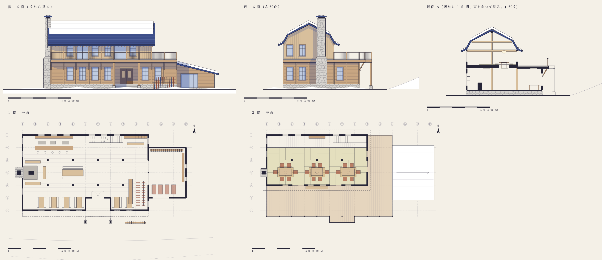
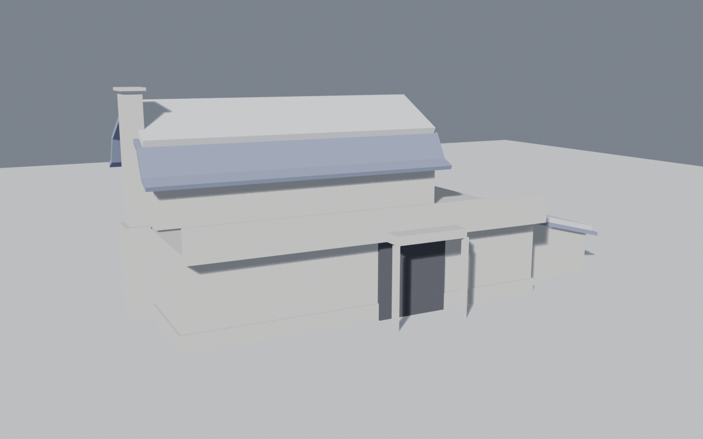
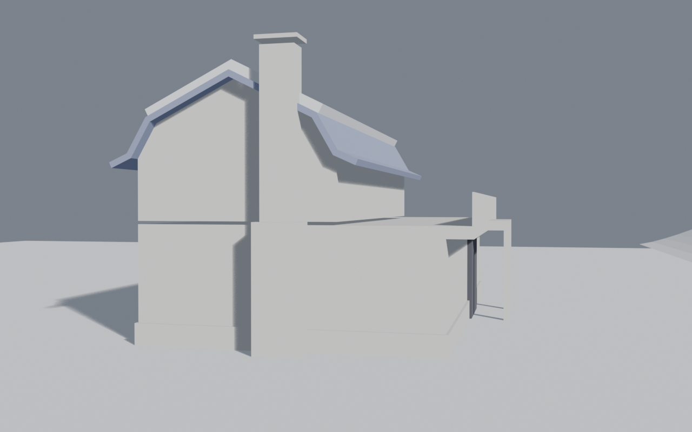

# ロッジの設計

2026-10-27。ゲーム本体には混ぜず、ロッジ単体で作る。最初に下書きを作ったが、箱を積んだだけで退けられた。そこで形の決まりを先に決めてから組む（社内スキル `miniature-architecture` の手順 1〜7）。数字はすべて [dims.py](dims.py) にあり、図面（[drawings.py](drawings.py)）と Blender の台本が同じ数字を使う。

## 3 行で

1. **2 階建て。** 石の基壇の上に木の 1 階を置く。2 階は藍のフェルトの腰折れ屋根の中にあり、屋根の上の流れに毛糸の雪が載る。
2. **入口と 1 階の席。** 丘から滑り降りた人は、テラスが 1 間張り出した下をくぐり、4 段上がって 1 階の土間に入る。座るのは窓際の卓か、西の石の煙突の前のストーブのまわり。厨房のカウンターは奥（北）、貸し出しは東の端と下屋。
3. **2 階。** 土間の奥の階段を上がると、板の間で靴を脱ぐ。畳の座敷に掘りごたつが 3 卓ある。ガラス戸から南のテラスに出て、丘を見下ろす。

## 形の決め方

| 決めたこと | 値 | 理由 |
|---|---|---|
| 単位 | 1 間 = 1.818 m。柱は 1 間ごと | 和の建物の寸法。畳は 1 間 × 半間（1:2） |
| 1 階 | 10 間 × 6 間（18.2 × 10.9 m）、階高 2 間 | 広い土間。長い辺を丘に向ける |
| 2 階 | 8 間 × 4 間。西の端にそろえ、南へ 2 間さげる | さげた分がテラスになる（理由のあるずらし）。幅は 1 階の 80%、奥行きは 67% |
| 下屋 | 東に 3 間 × 4 間の片流れ。南は 1 間さげる | 貸し出しのソリ置き。高さが西から東へ 3 段で下がる（2 階 → テラス → 下屋） |
| 屋根 | 腰折れ。下の流れは 60 度、上の流れは 5 寸、軒先は 4 寸 5 分ではね出す | 切妻にすると、西から見たとき「三角屋根に煙突の家」という記号になる（図面の初稿で確かめた）。腰折れは北海道の牧舎の形。急な下の流れには雪が載らず藍が見え、上の流れに雪が積もる |
| 玄関 | 6〜7 間目。壁を 1 間引っ込め、その前でテラスを 1 間張り出す | 入口に印を付けるため、テラスを 1 か所だけ大きく張り出す。丘から入口が分かる |
| 煙突 | 西の妻に、棟から 1 間南へずらして立つ石の塔。肩で一度すぼまり、上に笠 | 縦に貫く 1 本。妻の真ん中に置くと記号の家に見えるので、ずらす |

## 比率の確かめ

| 項目 | 目安 | このロッジ |
|---|---|---|
| 基壇の高さ | 全高の 8〜12% | 0.8 m / 9.9 m = **8.1%** |
| 冠（軒先から雪の上まで） | 勾配屋根は 20〜30% | **36%**。目安を超える。2 階の上半分が屋根の中にあるので、冠が胴の役も兼ねる。雪国のロッジは屋根が主役（大きさ＝優先度） |
| 軒の出 | 階高の 15〜25% | 2 階の軒 0.75 m（1 階の階高の 21%）。テラスの張り出し 0.9 m（25%） |
| 窓の縦横比 | 住居は縦長 1:1.6〜1:2 | 1 階 0.9 × 1.8（1:2）、2 階 0.86 × 1.55（1:1.8）、戸 0.9 × 2.2（1:2.4）。横長は混ぜない |
| 開口率 | 20〜35% | 南面の 1 階 25%、2 階 37%、南面全体 **29.5%**。上ほど透ける |
| 窓の間隔 | 窓幅の 1〜1.5 倍 | 1 間に窓 1 つで、間隔 0.92 m（1.0 倍）。両端の 1 間は窓を開けず壁で閉じる。角を固めるため。中はストーブと貸し出し |
| 上の層の幅 | 下の 55〜85% | 80%（桁行）、67%（梁間） |
| 重心 | 全高の 40% 以下 | 体積で **34%** |
| 手すり | 階高の 0.30〜0.35 | 1.1 m（1 階の階高の 0.30。建築基準法でも 1.1 m） |
| 階段 | — | 蹴上げ 0.182 m × 20 段、踏面 0.26 m。一人称で歩くので実寸にした。スキルの 1/12〜1/16 は絵の中の縮尺の目安 |

## 何が何を支えるか

- **基壇**（石）が 1 階の木の骨組みを受ける。外周の柱は 1 間ごと
- 1 階の中に**柱が 2 列**ある。南の列（い通りから 2 間）は 2 階の南の壁の真下、北の列は棟の真下。2 階をさげても、さげた壁の下に柱がある。棟木は 2 階の座敷の 3 本の束で受け、束はそのまま 1 階の北の列の柱に降りる
- **テラス**は 1 階の屋根でもある。南北に渡した梁（1 間ごと）が南の壁から 0.9 m 片持ちで出る。各柱から斜めの**持ち送り**が梁の先を支える
- **玄関の上の張り出し**は 2.7 m 出るので、持ち送りでは受けない。石の束に立つ 2 本の柱で受ける
- **煙突**は自分の基礎に立つ石の塔。自分の重さだけを持つ。屋根のけらばは煙突のところで切り欠く
- **下屋**の高い側は、テラスの縁の梁より下で母屋の壁に取り付く

## 素材が切り替わる線

| 高さ | 下 | 上 |
|---|---|---|
| 0.8 m（基壇の上端） | フェルトの小石を積んだ石 | 1 階: 横の下見板（濃い木）に 1 間ごとの柱が出る |
| 3.9〜4.3 m（テラスの縁の梁） | 下見板 | 2 階: 縦の羽目板（明るい木）。階の境の帯で切り替える |
| 6.6 m（桁＝軒） | 木の壁 | 藍のフェルトの屋根（縁はかがり縫い） |
| 7.9 m（屋根の折れ点） | 藍が見える急な流れ | 毛糸の雪の毛布（裾はゴム編みの丸み） |

煙突は下から上まで石（フェルトの小石）。笠だけ藍のフェルトにして、上に雪を載せる。

## 設え（1 層に 1〜2 つ）

| 層 | 設え |
|---|---|
| 地面と基壇 | 玄関の脇のスキー立て（スキーが並ぶ）。玄関の張り出しの 2 本の柱 |
| 1 階の外 | 窓の凹みと窓台。それ以上は足さない |
| テラス | 2 階の壁に沿った長い腰掛け 1 つ。張り出しの先は丘を見下ろす場所 |
| 屋根 | 煙突（縦に貫く 1 本）と、そこから上がる煙 |

中身（ゲームの中で触れる物）:

- **1 階**: 窓際の 4 人掛けの卓 6 つ（窓に直交して置く）。中央に長卓 1 つ。床の 3 割は空ける。西のストーブは石の炉台に置き、東に開いたコの字の長椅子で囲む。脇に上着と手袋を乾かす物干しを置く（休むと乾く）。北には厨房のカウンター。奥に布を熱で扱う道具の形の調理機を 3 台（アイロン台・スチーマー・乾燥機）置き、裏の棚も付ける。北東に荷物棚と着替えの腰掛け、東に貸し出しのカウンターと上着の掛け棒。下屋にはソリとスキーの架台がある
- **2 階**: 階段を上がった板の間に下足箱がある。畳 48 枚の座敷に掘りごたつが 3 卓（天板 1.8 × 0.9 m、掘り込み 0.42 m）。卓ごとにパッチワークのこたつ布団と、フェルトの座布団 6 枚。上に紙の吊り灯り

## 光（段階 3 で使う）

- 太陽は南西から、高度 28 度の午後の光。丘に面した南の面が光を受け、軒とテラスの影の帯が南の壁に落ちる
- 夕方は高度 8 度の橙の光にする。雪の影は青、窓の明かりは橙
- 中は蛍光灯（1 階）と紙の灯り（2 階）とストーブの火。色は褪せた温かい色

## カット（段階 3 の 5 枚）

1. 外観・昼: 丘の中腹から見下ろす（テラスと屋根の雪が主役）
2. 外観・夕方: 同じ場所から、窓の灯り
3. 1 階の中: 入口から西を見る（ストーブと窓際の卓）
4. 2 階: 掘りごたつの座敷から、ガラス戸越しにテラスを見る
5. テラスから丘を見る

## 確かめたこと

- 図面の初稿は切妻だった。西の立面が「三角屋根に煙突の家」に見えたので、腰折れに変え、煙突を中心からずらした
- 長方形だけの塊（`renders/00-massing-*.png`）で重心とシルエットを見た。丘から見ると「低く長い 1 階 → さがった 2 階 → 屋根の雪 → 煙突」の段になる。下屋で東へ下がる。開口のない塊は、まだ長い 1 階の面が平らに見える。柱・窓の凹み・テラスの影の帯（段階 2）で崩す前提

