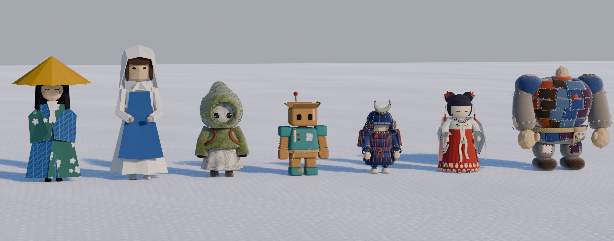

# 新しい人形のラフ（4 回目、2026-10-28）

代表の Pinterest のボード「[&wind：Lodge キャラ](https://jp.pinterest.com/k_hhh_h/windlodge-%E3%82%AD%E3%83%A3%E3%83%A9/)」の意匠を取り、Lodge のアートコンセプト（紙の体、フェルト・毛糸・麻ひも・絹の服、毛糸の雪）で描き直したものです。素材と縫い目はソリと同じ部品（`props/common.py` → `lodge/materials.py`）を使い、雪の上で同じ光で描いています。

骨はまだ入れていません。ゲームの中でも確かめていません。



| 絵 | 中身 |
|---|---|
| [00-lineup.jpg](renders/00-lineup.jpg) | いまの 3 体（左）と新しい 4 体（右）を、同じ縮尺で雪の上に並べた絵 |
| [00-lineup-turn70.jpg](renders/00-lineup-turn70.jpg) | 全員を右へ 70° 向けた絵。遠くから顔の向きが読めるかを見る |
| [00-four.jpg](renders/00-four.jpg) | 新しい 4 体の正面（上の段）と斜めうしろ（下の段） |
| [ningyo-close.jpg](renders/ningyo-close.jpg) | 絹の人形の胸から腰の寄り。絹の光り方を見る |

1 体ずつの絵は `renders/<名前>-quarter.jpg`（斜め前）・`-front.jpg`（正面）・`-backq.jpg`（斜めうしろ）です。

## 3 回目からの直し

| 人形 | 言われたこと | 4 回目でしたこと |
|---|---|---|
| 紙のロボット | 首を詰めてもよい。段ボールのコンセプトは良い。ふんどしは変わっている。体全体をもっと角ばらせてよい | 首の蛇腹を 2 段に縮め、頭を下げた。赤い前垂れを外した。足・脚・腰・胴・肩・こぶしを角の立った箱にし、腕と首の蛇腹も四角い断面にした。腰と膝と手首の縄も、箱に沿う角の丸い四角に巻く |
| 武者 | 良い | そのまま |
| 絹の人形 | 光の反射が、絹の控えめで上品な輝きではない。質感を調べ直す。（そのあと）広袖とリボンを垂れたやわらかい布の形に | 絹の素材を作り直した（下の「絹の光り方」）。広袖を、腕に掛かって真下へ垂れるしずくの断面とたるみのひだに。リボンを平たい布の蝶結びと、ねじれて垂れる燕尾の垂れに |
| おじいさん → **継ぎはぎの巨人** | 肩を張りすぎ（のあと）おじいさんは微妙なので、頭の小さなゴーレムのような巨漢に | 継ぎはぎの布をふくらませた大きな体に、太い十字縫いで手足を縫いつけた。頭とこぶしはもんだ紙で、頭は肩のあいだに低く小さく、太い首巻きで据える |

1 回目と 2 回目の台本は `v1/`・`v2/` に残しています（絵はリポジトリに入れていません。台本から描き直せます）。

## 絹の光り方

3 回目の絹は、プラスチックのようなつやになっていました。原因と、直し方です。

- **原因**: Principled BSDF の異方性（Anisotropic）は Cycles だけで効き、Eevee では効かない（[Blender マニュアル](https://docs.blender.org/manual/ja/4.1/render/shader_nodes/shader/principled.html)）。3 回目は、異方性で光が伸びるつもりで粗さを 0.32 と低くし、光の強さ（Specular IOR Level）も 0.6 と高くしていた。Eevee では、ただの丸くて強い光の点になっていた
- **絹の光り方**: 布の見た目は、拡散光・鏡のような光・糸どうしの影・浅い角度での縁の明るさでできている。絹の糸は光を中で散らすので、光の点は白くならず、糸の色をおびる（Sadeghi ら「[A Practical Microcylinder Appearance Model for Cloth Rendering](https://datarepo.eng.ucsd.edu/visiondata/obisker/public_html/cloth/microcylinder-sg13.pdf)」、2013。絹のクレープデシンを測っている）。布用の描き方でも、鏡の光をやわらかくし、縁に色の違う光（sheen）を足して 2 色に見せる（[Filament の布の描き方](https://www.mintlify.com/google/filament/materials/shading-models)）
- **4 回目の作り**:
  - 光の色は糸の色（Specular Tint を糸の色と白の間に）。強さは控えめ（Specular IOR Level 0.32）
  - 光は広くやわらかく（粗さ 0.46〜0.58。糸の節のむらで場所ごとに変える）
  - 浅い角度で、色が少しずれる（玉虫の色。茜は橙へ、月白は温かい白へ）。縁に同じ色の sheen
  - 異方性のかわりに、細かな平織りの凹凸と、横に長い糸の節（スラブ）のむらで光をばらす
  - 刺繍の所は糸が盛り上がる（繻子縫いの筋）

## 4 体と、参考から取ったもの

### 紙のロボット（`robo`）
- **参考**: 箱の頭のロボット（四角い窓の目、大きな肩当て、太い腕と大きなこぶし、腰に巻いた縄）
- **取る**: 段ボールの箱の頭と、ふた 4 枚。四角い窓の目（段ボールの縁どり）。どこも角の立った箱の体（はげた青緑の絵の具を塗った胴・肩当て・足、段ボールのままの腰・脚・こぶし）。四角い蛇腹の腕と短い首。腰に麻縄を 2 巻きして前で結ぶ。胸に新聞紙の張り紙と木のボタン、角をまたぐマスキングテープ、肩に真鍮の割りピン、アンテナに赤いフェルトの玉
- **取らない**: 頭の葉っぱ。手のちょうちん（指さしの手をふさぐ）。赤い布の前垂れ
- **体つき**: 背 0.92 m（アンテナの玉まで）、箱の頭の上まで 0.78 m。脚は短く太く、足は大きい。胴は下ほど太く、重心は低い
- **共在**: 箱の正面の窓の目と、ふたの開き方（前のふたが大きく開く）で向きがわかる。こぶしが大きく、腕を上げると遠くからも見える
- **骨**: やさしい。部品はほぼ硬い箱で、肩・肘・腰・膝で回すだけ。蛇腹の腕は伸び縮みで見せられる
- **気になる所**: 指がないので、指さしはこぶしごと向ける形になる

### 折り紙の武者（`musha`）
- **参考**: 苔の上の小さな武者 2 体（糸で縫った細い目、紺の布の鎧、吹返しの大きなボタン、三日月の前立、赤い紐の結び目）、折り紙の多面体（どんぐり、かぼちゃ）
- **取る**: 折り紙の多面体の顔とこぶし。黒い糸で縫った細い目。紺のフェルトの兜（12 本の筋に星の十字縫い、縁になみ縫い）、錣 3 段、吹返し（縁に十字縫い、大きな木のボタン）。錫色の厚い三日月（縁を黒い糸でなみ縫い）。忍緒をあごの下に回して右の頬の下で結ぶ。胴は札板 4 段を赤い毛糸で縅し、胸板に十字縫い。肩上と大袖（4 段、縅）、草摺（4 枚 × 3 段、縅）。太い籠手に斜めの刺し子、手甲。脛当てに縦のなみ縫いと赤い紐。赤い毛糸の帯
- **取らない**: 刀、苔
- **体つき**: 2.5 頭身、背 0.9 m（三日月の先まで）。7 体でいちばん小さい
- **共在**: 三日月・つば・忍緒の結び目が前にあるので、向きが遠くから読める
- **骨**: ふつう。大袖と草摺は硬い板なので、肩と腰に付けて少し揺らす。腕を上げると大袖がじゃまになりやすい（上げたら外へ逃がす）
- **気になる所**: 縫い目が多く、遠くでは赤い縦の線の模様に見える。顔は兜の下で小さく、目のあたりしか見えない

### 絹の人形（`ningyo`）
- **参考**: 布の人形（白い顔に閉じた目、紺の糸のお団子に布の玉、赤い房）。服の組み立ては漢服の襦裙（齐胸襦裙）
- **取る**: 和紙の顔に刺繍の閉じた目。紺の毛糸を巻いた髪と 2 つのお団子（双丫髻）。お団子ごとに絹の花 2 輪と、赤い絹糸に真珠 3 粒と房を垂らした歩揺（左右に 1 本ずつ）。月白の絹の襦（交領右衽: 左の身頃を上に重ねる y の字の襟、藍に梅の刺繍）、広袖（袖口に藍の刺繍の縁）。茜の絹の裙を胸の高さで結び、ひだを付け、すそに梅の刺繍の帯。クリームの絹のリボンを前で蝶結びにして長く垂らす。真ん中に翡翠の玉と赤い房の禁步。背中から両腕に掛けて前へ垂らす、透ける桃色の披帛。刺繍の絹の靴の先
- **取らない**: 口紅（口は描かない決まり）。袖で手を隠すこと（手は袖口から出す）
- **体つき**: 3 頭身、背 0.95 m（お団子の上まで）
- **共在**: 閉じた目、胸のリボンと禁步、お団子の花で向きが読める
- **骨**: ふつう。広袖と披帛は腕に付けて揺らす。裙が広く、脚は見えない（歩く動きはすその揺れで見せる）
- **広袖の形**: 腕の上は布が腕に掛かり、下は前と後ろの 2 枚が重さで真下へ垂れて、底で丸く合わさる（しずくの断面）。垂れた所に下へ走るたるみのひだを入れ（下ほど深い）、袖口は少し広げて開き、中の裏地が見える。腕の道筋は肩・肘・手首をなめらかな曲線でつなぐ
- **リボンの形**: 胸の蝶結びは、平たい布の輪 2 つ（前の布が外へ出て先で折り返し、後ろの布で戻る）と、布を巻いた結び目。垂れ 2 本は長さを変え、裙に沿ってゆるく揺れてねじれ、端を燕尾に切る。布は幅の向きにも割って少し反らせる（なめらかに描いても筒に見えない）。披帛も同じ作りでねじる
- **気になる所**: 披帛は透けるぶん、遠くでは見えにくい。右の袖（絵の左）は前に披帛が重なり、寄りで見ると袖の底の縁だけが浮いて見える。袖とリボンは止まった形なので、ゲームでは揺れものにして重さを見せたい。Lodge のゲームは Godot なので、ゲームに入れるときは同じ考え（光の色を糸の色に、やわらかい光、縁の sheen）で Godot の素材に移す

### 継ぎはぎの巨人（`golem`）
- **参考**: フェルトの魔法使いの人形の継ぎはぎのコート、紙の王子。代表の注文で、頭の小さなゴーレムのような巨漢にした
- **取る**: 体は灰色のフェルトを綿でふくらませた大きな塊（上ほど太い胴、大きく丸い肩、幅の広い腰、短く太い脚と大きな足）。胴と腰は継ぎ当て約 60 枚で埋める（フェルト 6 色、格子、縦じま、青海波。なみ縫いと十字縫い）。肩・腕・脚にも継ぎ当て。手足はクリームの毛糸の太い十字縫いで胴に縫いつける。頭とこぶしはもんだ紙。頭は肩のあいだに低く小さく、さび色のフェルトの太い首巻きで据え、端を前に垂らす。黒い糸の細い目。腰に太い麻縄。肩と頭に綿の雪
- **取らない**: とんがり帽、眼鏡、ひげ、杖（おじいさんの意匠はやめた）
- **体つき**: 背 1.25 m、腕を入れた幅 1.1 m。7 体でいちばん大きい。頭は体のおよそ 1/7
- **共在**: 頭が小さいので、顔の向きは遠くから読みにくい。首巻きの垂れた端と、前へかがむ胴と、前に出た大きなこぶしで向きを見せる
- **骨**: ふつう。手足は縫いつけた輪のところで回す。体が大きいので、歩きはゆっくり左右に揺らす
- **気になる所**: 胴は丸い樽で、ゴーレムの「岩を積んだ」感じはまだ弱い。継ぎ当ては部品が多いので、ゲームに入れるときは 1 枚の絵に焼く

## 横から見た向きの読みやすさ（00-lineup-turn70.jpg）

| 人形 | 横から見て向きがわかるか |
|---|---|
| 紙のロボット | 弱い。真横からは箱の横の面で、窓の目は縁が少し見えるだけ。前のふたが大きく開いているのが手がかり |
| 武者 | わかる。吹返しのボタンと三日月が前に出ている。三日月は横からは細い |
| 絹の人形 | よくわかる。横顔の閉じた目、胸のリボン、前に垂れる披帛 |
| 継ぎはぎの巨人 | 体の向きはわかる（前へかがむ胴、前に出たこぶし、首巻きの端）。小さな頭の向きは読みにくい |

## まだしていないこと

- 骨・動き・ゲームの中での見え方は確かめていない
- 色違いは作っていない
- 部品の数が多い（とくに武者の縫い目と、巨人の継ぎ当て）。ゲームに入れるときは縫い目と継ぎ当てを質感に焼いて、三角形の数を減らす

## ファイル

| ファイル | 中身 |
|---|---|
| [roughs.py](roughs.py) | 4 体を組んで描く台本 |
| `renders/` | 描いた絵 |
| `v2/` | 2 回目（新聞紙の箱頭の子・フェルトの武者・布の人形・旅のおじいさん）の台本 |
| `v1/` | 退けた 1 回目（紙風船の頭・武者・刺し子・箱の頭）の台本 |

```bash
/Applications/Blender.app/Contents/MacOS/Blender -b -P person/ideas/characters/roughs.py -- --doll musha --views quarter,front,backq
```

```bash
/Applications/Blender.app/Contents/MacOS/Blender -b -P person/ideas/characters/roughs.py -- --lineup --size 2800x1100
```

- `--doll` は `robo`・`musha`・`ningyo`・`golem`。`--views` に `close` を入れると胸から腰の寄りも描く。`--blend <ファイル>` を付けると、回して見られる .blend も書き出す。`--turn 70` で並べた全員を右へ向ける
- 素材・縫い目・雪・光は `props/common.py`（その中で `lodge/materials.py`）を読むだけで使う。紙の素材は `person/build_dolls.py` から写した。絹・段ボール・絵の具・格子と縦じまの綿は、この台本の中で作る（柄は numpy で描く）
- `--lineup` は、いまの 3 体を `person/build_dolls.py` から借りて組む。ファイルは書き換えず、読んで「描く」の見出しより前だけを実行する。そのため、並べた 3 体はその時点の姿になる。あちらの見出しの名前が変わると `--lineup` は動かない
- 描くのは Eevee。1 体 3 枚で 1〜3 分、並べた絵は 3〜5 分
- ボードの画像はリポジトリに入れていない（見るときはボードを開く）
