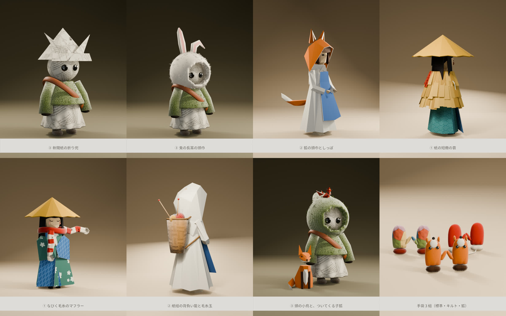
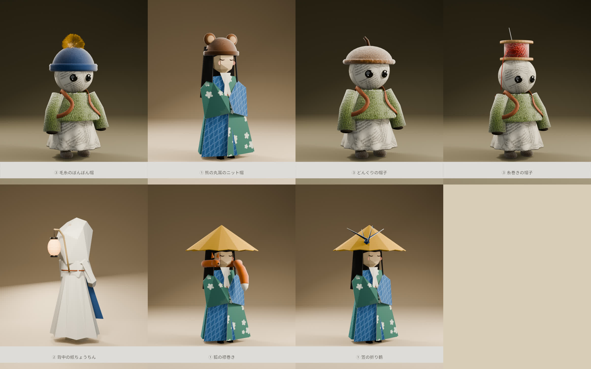
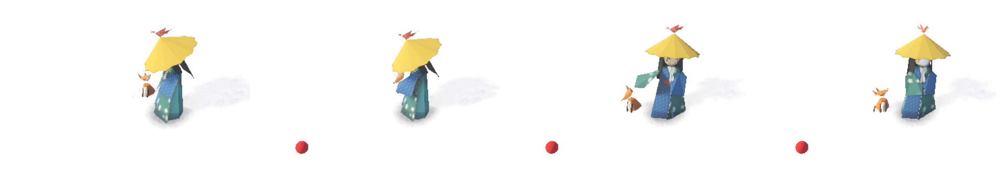

# 服・帽子・小物の案（2026-10-28）

人形（プレイヤーの体）に着せるもののアイデアと、Blender の軽いラフ。決まりは「肌は紙、身につけるのは布・フェルト・毛糸・紙」と、裁縫の道具の形を借りること（[アートコンセプト](../../../design/art-concept.md)の「人」）。まだ案で、ゲームには入れていない。



## おすすめの 3 つ

1. **頭の小鳥と、ついてくる子狐**（[07](renders/07-nakama.png)）: 動物の要望に応えつつ、共在感覚にいちばん直接効く。小鳥はあなたの頭の上で同じ方を向き、子狐はあなたが指した所へ顔を向ける。目線と共同注意を、動物がそのまま大きく見せてくれる
2. **風になびく長い毛糸のマフラー**（[05](renders/05-muffler.png)）: 端が風と速さで流れるので、滑る向きと速さが遠くからでも読める。標準を短い無地にして、長いものや縞のものをミシンで作れば、集める楽しみの入口になる
3. **手袋 3 組**（[08](renders/08-tebukuro.png)）: 一人称で自分の体として見えるのは手袋だけ。替えたときにいちばん目に入る。狐の指人形の手袋は、指さすと狐の鼻先が指す

はじめから配る標準には **新聞紙の折り兜**（[01](renders/01-kabuto.png)）も向いている。ロッジの古新聞で誰でも折れるという設定にでき、こどもの日の兜は海外の人には珍しい。

## ラフ

| | ラフ | 人形 | 選んだ理由 |
|---|---|---|---|
| [01](renders/01-kabuto.png) | 新聞紙の折り兜 | ③ news | ③ の新聞紙の体と同じ素材で、ひと続きに見える。正面の三角と鍬形が頭の向きをはっきり示す。目は兜のつばの下に出る |
| [02](renders/02-usagi.png) | 兎の長耳の頭巾と綿のしっぽ | ③ news | 動物の案。長い耳が頭の向きの矢印になる。片耳を途中で折って、その人らしさを出す |
| [03](renders/03-kitsune.png) | 狐の耳の頭巾と折り紙のしっぽ | ② origami | ボードの多面体の狐と、② の大きな面と稜線の作りが同じ。顔の窓は今の頭巾と同じ大きさに保つ |
| [04](renders/04-mino.png) | 紙の短冊の蓑 | ① kasa | ① の笠と組になる、雪国の装い。肩と背中だけを覆い、前と腕は空けて、指さしと手を振る動きを見せる。背中に千代紙の短冊を 1 枚だけまぜたのは、凝った版の見本 |
| [05](renders/05-muffler.png) | 風になびく長い毛糸のマフラー | ① kasa（全員） | 上の「おすすめ」を参照。差し色の赤（あなた）と生成りの縞 |
| [06](renders/06-kago.png) | 紙紐の背負い籠と毛糸玉 | ② origami | 背中の色と形で、うしろ姿からでも誰かわかる。拾った毛糸玉が籠からのぞき、集めた物が外から見える。頭より高くしない |
| [07](renders/07-nakama.png) | 頭の千代紙の小鳥と、ついてくる折り紙の子狐 | ③ news（全員） | 上の「おすすめ」を参照 |
| [08](renders/08-tebukuro.png) | 手袋 3 組（標準の赤いミトン、キルトの鍋つかみ、狐の指人形） | 全員 | 上の「おすすめ」を参照 |

## ラフ（2 回目）



| | ラフ | 人形 | 一覧の番号 |
|---|---|---|---|
| [09](renders/09-bonbon.png) | 毛糸のぼんぼん帽（藍に山吹のぼんぼん） | ③ news | 1 |
| [10](renders/10-kuma.png) | 熊の丸耳のニット帽（笠を脱いだ姿） | ① kasa | 33 |
| [11](renders/11-donguri.png) | どんぐりの帽子 | ③ news | 34 |
| [12](renders/12-itomaki.png) | 糸巻きの帽子（針と糸の端つき） | ③ news | 7 |
| [13](renders/13-chochin.png) | 背中の紙ちょうちん（腰の紐に挿した竿から下げる） | ② origami | 26 |
| [14](renders/14-erimaki.png) | 狐の襟巻き（顔は閉じた目の弧） | ① kasa | 20 |
| [15](renders/15-tsuru.png) | 笠の折り鶴 | ① kasa | 29 |

## ゲームでの確かめ: 頭の小鳥と、ついてくる子狐

小鳥と子狐をゲームに入れて、あなたが指した所を本当に一緒に見るかを確かめた（2026-10-28）。



左から、1 指す前、2 右前の雪を指す、3 指したまま顔をそむける、4 指さしを切る。赤い玉は、確かめ用に指した所に置いた目印。動画は [16-pets-game.mp4](renders/16-pets-game.mp4)。

- **小鳥**: あなたの笠の先に止まる（頭の骨に付けたので、頭と一緒に動く）。指していれば指した所を、指していなければあなたの見ている先を向く。指さしが入ると、ぴょんと跳ねて向き直る。指していないときは、ときどき首をかしげる
- **子狐**: あなたの右の少しうしろを歩いてついてくる。止まっているときは、指していれば指した所を、指していなければあなたの顔を見上げる。首で届かない向きは体ごと向く。ソリに乗ると膝の上に乗る（ここは録っていない）
- **数値**（0.5 秒ごとに、頭の向きと見る所の水平のずれを出した）: 指しているあいだは、小鳥 0〜3°、子狐 0°。あなたが顔を 32° そむけても、2 匹は指した所を見続けた。指さしを入れた・切った直後の 0.5 秒ほどは、向き直る途中なので大きくずれる（12 コマ／秒で姿勢を刻むため）。歩いているあいだ、子狐は前を見る
- 姿勢（向き・跳ねる・しっぽ）は人形と同じ 12 コマ／秒の時計で刻み、子狐の居場所だけ毎フレームなめらかに動かす

### ゲームのファイル

| ファイル | 中身 |
|---|---|
| `game/companions.gd` | 小鳥と子狐の動き。色は `look.gd` の紙と青海波の和柄に置き換える |
| `game/companions/bird.glb`・`kit.glb` | 形。この台本の `--look export` で書き出した（小鳥は体と頭、子狐は体・頭・しっぽに分けた） |
| `game/main.gd` | あなたを作った直後に連れを足す数行（`--no-pets` で出さない） |
| `game/tools/pets_record.gd` | 上の確かめの録画。あなたをソリから離して立たせ、指す・見回す・切る・歩くを決まった時刻に行う |

```bash
/Applications/Godot.app/Contents/MacOS/Godot --path game --resolution 960x540 -s res://tools/pets_record.gd -- --no-pip --no-sound --bots=0 --dir=/tmp/pets
```

- 連れはまだ案。いまは誰でも最初から連れている。集める・懐かせる手順と、仲間（bot）の連れは入れていない
- 小鳥はあなたの体と同じ層なので、一人称の画面には映らない。右上の映像と三人称（C）で見える。子狐は一人称でも見える

## アイデアの一覧

手に入れ方は 3 つに分けた。**はじめから**（丈夫で素朴な標準）、**遊んで集める**（登る・滑る・拾う・季節）、**ミシン**（ロッジの大きなミシンの形の機械で、集めた布や糸から作る。凝ったものは通貨も使う）。★ はラフを描いたもの。

共在の欄は、目線・顔の向き・指さし・手を振る・白い息が見えにくくならないかを書いた。

### 帽子・頭巾

| # | もの | 説明 | 人形 | 手に入れ方 | 共在への効き方 |
|---|---|---|---|---|---|
| 1 | 毛糸のぼんぼん帽 | 太い毛糸のメリヤス編み。てっぺんにぼんぼん | 全員 | はじめから | ぼんぼんが頭のてっぺんの印になり、揺れて頭の動きが読める。眉より下へかぶせない |
| 2 | フェルトの耳あて | 丸いフェルトを毛糸のバンドでつなぐ | 全員（③ は頭巾の上） | 遊んで集める | 顔の横だけなので目線は隠れない |
| 3 ★ | 新聞紙の折り兜 | こどもの日の兜。正面の三角、鍬形、前立て | ③（② も） | はじめから（ロッジの古新聞で折る） | 三角の向きで頭の向きが強く読める。つばを目の上で止める |
| 4 | 千代紙の替え笠 | 笠に千代紙を貼る。青海波・麻の葉・七宝と柄を多く | ① | 遊んで集める | つばの向きが目線になるのは今と同じ。柄で遠くからでも誰かわかる |
| 5 | 綿帽子の笠 | 笠の上に綿を雪のように積む | ① | 季節の報酬（大雪の日） | 笠の形は変えないので目線は同じ |
| 6 | 革の指ぬき帽 | 裁縫の指ぬきの形の小さな帽子。頭にちょこんと載せる | ③ | ミシン | 小さいので何も隠さない |
| 7 | 糸巻きのシルクハット | 木の糸巻きを帽子にし、糸の色を替えられる | ② | ミシン（通貨） | 背が高いので遠くからの目印になる。つばは狭くして顔に影を落とさない |
| 8 | 針山の帽子 | トマト形の針山。待ち針の頭は丸い玉 | 全員 | 遊んで集める（珍しい） | 頭の上だけなので邪魔しない。針の先は見せない |

### 上着・羽織

| # | もの | 説明 | 人形 | 手に入れ方 | 共在への効き方 |
|---|---|---|---|---|---|
| 9 | 綿入れ半纏 | 藍のフェルトに白い刺し子の縫い目 | 全員 | はじめから | 腕の形がそのまま出るので動きを邪魔しない |
| 10 ★ | 紙の短冊の蓑 | 藁色の紙の短冊を 3 段に重ね、首もとで麻ひもを結ぶ | ① | 遊んで集める（雪の日） | 前と腕は空けるので、指さしと手を振る動きは見える。歩くと短冊が揺れる |
| 11 | 端切れのパッチワーク半纏 | 拾った端切れを縫い合わせる。一着ごとに柄が違う | 全員 | ミシン（端切れを集める） | 柄が一人ずつ違うので、遠くからでも誰かわかる |
| 12 | 編み込みのセーター | 北欧の雪の結晶とトナカイの柄 | ③（全員） | ミシン | 腕の線が出るので動きが読める |
| 13 | フェルトのポンチョ | 丸いフェルトをかぶる | 全員 | 遊んで集める | **注意**: 腕が中に隠れると指さしが読めない。腕を出す切れ込みを必ず入れる |

### 手袋

| # | もの | 説明 | 人形 | 手に入れ方 | 共在への効き方 |
|---|---|---|---|---|---|
| 14 ★ | 赤いフェルトのミトン | 2 つを毛糸の紐でつなぐ。手首は生成りの編み地 | 全員 | はじめから | 一人称で自分の体として見えるのは手袋だけ。親指が分かれているので、手を振る形が出る |
| 15 ★ | キルトの鍋つかみ手袋 | 端切れのパッチをひし形に縫う。手首に掛けひもの輪 | 全員 | ミシン（ロッジの台所の手伝いで） | ふくらんで大きいが、手の位置ははっきり見える |
| 16 ★ | 狐の指人形の手袋 | 先が鼻先。ボタンの目、三角の耳、白い口もと | 全員 | 遊んで集める | 指さすと狐の鼻先が指す。一人称の画面で自分の手が狐になる |
| 17 | 五本指の毛糸の手袋 | 指先だけ色違い | 全員 | 遊んで集める | 指が分かれるので指さしの形がはっきりする。今は指を分けず腕で指す決まりなので、入れるなら手の形を足す |

### 首まわり

| # | もの | 説明 | 人形 | 手に入れ方 | 共在への効き方 |
|---|---|---|---|---|---|
| 18 ★ | 風になびく長いマフラー | 赤と生成りの縞の編み地。両端にぼんぼん | 全員（① に似合う） | はじめから短い無地、長いものと縞はミシン | 端が風と速さで流れ、滑る向きと速さが読める。**注意**: 口もとより上へ巻くと白い息が隠れる |
| 19 | 巻尺のマフラー | 目盛りの付いた布テープを首に掛ける | ②③ | 遊んで集める | 細いので何も隠さない |
| 20 | 狐の襟巻き | フェルトの狐が首に巻きつく | 全員 | ミシン（通貨） | **注意**: 顔の横にもう一つ顔ができる。相手が顔の向きと取り違えないよう、狐の目は閉じた弧にする |

### 靴

| # | もの | 説明 | 人形 | 手に入れ方 | 共在への効き方 |
|---|---|---|---|---|---|
| 21 | フェルトの長靴 | 底は縫い目でつないだ厚いフェルト | 全員 | はじめから | 足もとだけなので影響なし |
| 22 | 毛糸のかんじき | 輪にした太い毛糸の雪靴 | 全員 | 遊んで集める | 雪に丸い輪の足あとが残り、誰が通ったかわかる |
| 23 | 草履に重ねる毛糸の靴下 | 指の分かれた足袋形の靴下 | ① | 遊んで集める | 影響なし |

### 背負うもの

| # | もの | 説明 | 人形 | 手に入れ方 | 共在への効き方 |
|---|---|---|---|---|---|
| 24 ★ | 紙紐の背負い籠 | 編んだ紙紐の籠。拾った毛糸玉と編み針がのぞく | ②（①） | 遊んで集める（中身が増える） | うしろ姿で誰かわかる。頭より高くしない |
| 25 | 裁縫箱のリュック | ふたが針山で、横に糸巻き | ③ | ミシン | 小さいので邪魔しない |
| 26 | 背中の紙ちょうちん | 夕方にぽっと灯る | 全員 | 季節の報酬（夕方に戻った回数） | 夕方、遠くの仲間の居場所がわかる。ロッジの橙の明かりとつながる |

### 飾り

| # | もの | 説明 | 人形 | 手に入れ方 | 共在への効き方 |
|---|---|---|---|---|---|
| 27 | 胸の大きなボタン | 色と形を集めて付け替える | 全員 | 遊んで集める（遠くまで滑ると拾える） | 小さいので影響なし |
| 28 | 刺しゅうのワッペン | 山・ロッジ・ソリ・登った回数の図柄 | 全員 | 遊んで集める（登った記念） | 言葉なしで、どれだけ一緒に登ったかが見える |
| 29 | 千代紙の折り鶴の笠飾り | 笠の縁に鶴を一羽 | ① | 遊んで集める | つばの向きと同じ方を鶴の頭が向き、目線の矢印になる |
| 30 | 安全ピンの勲章 | 大きな安全ピンに布のリボン | 全員 | 遊んで集める | 影響なし |

### 動物を身につける・連れる

代表の参考ボード（[&wind：Lodge キャラ](https://jp.pinterest.com/k_hhh_h/windlodge-%E3%82%AD%E3%83%A3%E3%83%A9/)）にある、多面体の折り紙の狐・うさぎ・鳳凰、ペーパークラフトのどんぐり・きのこ、跳ねるカエルの折り紙から。動物そのものを遊べる人形にする案は、同じ夜に動いている別のセッション（3 体以外の人形の案）の範囲として、ここでは扱わない。

| # | もの | 説明 | 人形 | 手に入れ方 | 共在への効き方 |
|---|---|---|---|---|---|
| 31 ★ | 兎の長耳の頭巾 | 生成りのフェルト。片耳を途中で折る。背中に綿のしっぽ | ③ | 遊んで集める | 耳が頭の動きに少し遅れて揺れ、頭の向きの矢印になる |
| 32 ★ | 狐の耳の頭巾としっぽ | 橙の紙の頭巾に三角の耳、先の白いしっぽ | ②（③ も） | ミシン（通貨） | 三角の耳が頭の向きを指す。しっぽは歩く・滑るで揺れる。顔の窓は今と同じ大きさに |
| 33 | 熊の丸耳のニット帽 | 茶の毛糸に丸い耳 | 全員 | はじめから（色違い） | 耳が小さいので目線は隠れない |
| 34 | どんぐりの帽子 | 栗色のフェルトの、どんぐりのかさの形。てっぺんに小さな柄 | ③ | 季節の報酬（秋） | 浅いので目にかからない |
| 35 ★ | 頭の千代紙の小鳥 | 青海波の千代紙で折った小鳥 | 全員 | 遊んで集める（糸くずを分けると懐く） | あなたの頭の上で同じ方を向き、目線の矢印が一本増える。指さすと小鳥もそちらを向く |
| 36 ★ | ついてくる折り紙の子狐 | 多面体の折り紙の子狐 | 全員 | 遊んで集める | あなたのうしろを歩き、あなたが指した所へ顔を向ける（共同注意を動物がまねる）。ソリでは膝の上に乗る |
| 37 | カエルの折り紙のポシェット | 跳ねるカエルの折り紙を腰に下げる | 全員 | 遊んで集める | 小さいので影響なし |
| 38 | 毛糸のしっぽ | 兎の綿、狐、猫の縞から選ぶ | 全員 | 遊んで集める | 歩く・止まるでしっぽの揺れが変わり、動きが遠くから読める |

### 避けるもの

- 目を隠すもの: 深いフード、目出し帽、ゴーグル、仮面。① の閉じた目、② のアーモンドの目、③ のボタンの目は、どれも目線の手がかりになっている
- 口もとより上まで覆うもの: 白い息が見えなくなる
- 頭より高く大きい背負いもの、全身を覆う着ぐるみ: 体の向きと腕の動きが読めない
- 腕を中に閉じ込める服: 指さしと手を振る動きが消える
- 顔の横にもう一つの顔（動物の襟巻き・肩の人形）: 目を開いた顔にすると、相手が顔の向きを取り違える。目は閉じた弧か小さな点にする

## 作り方

`person/blend/` の人形を開き、身につけるものの形を足して描く台本 [costume_rough.py](costume_rough.py)。人形の .blend は読むだけで保存しない。素材（紙・麻布）と形の小道具は `person/build_dolls.py` から写し、フェルト・編み地・毛糸玉・キルトの素材を足した。外の素材は使わない。名札の書体は Blender に入っている Noto Sans CJK。

```bash
/Applications/Blender.app/Contents/MacOS/Blender -b -P person/ideas/costume/costume_rough.py -- --look kabuto --out person/ideas/costume/renders/01-kabuto.png
```

- `--look`: `kabuto` `usagi` `kitsune` `mino` `muffler` `kago` `nakama` `tebukuro`（1 回目）、`bonbon` `kuma` `donguri` `itomaki` `chochin` `erimaki` `tsuru`（2 回目）
- `--look export --out game/companions`: 小鳥と子狐をゲーム用の glb に書き出す（`--out` は今いるフォルダからの道）
- Eevee で 1 枚 1 分ほど（800×1000、64 サンプル）
- 並べた 1 枚は ffmpeg でつないだ（`sheet.jpg`・`sheet-2.jpg`）

## 気づいたこと

- `build_dolls.py` の `tube()` は、半径を (u, v) の組で渡したときの楕円の式が誤っている（`sqrt(a·cos² + b·sin²)` で、半径が平方根の大きさになる）。今は数だけを渡しているので形に影響はない。この台本では `sqrt((a·cos)² + (b·sin)²)` に直した
