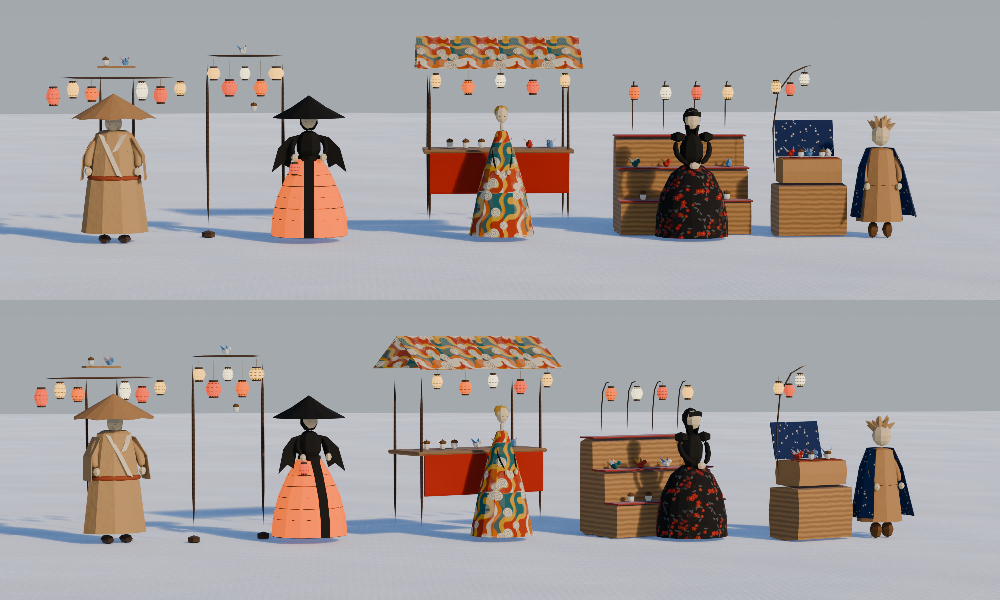
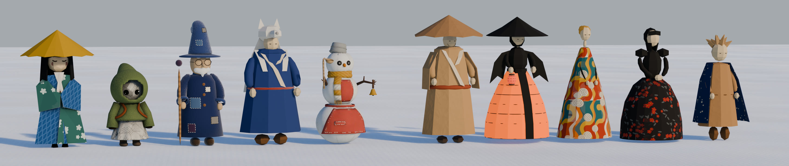
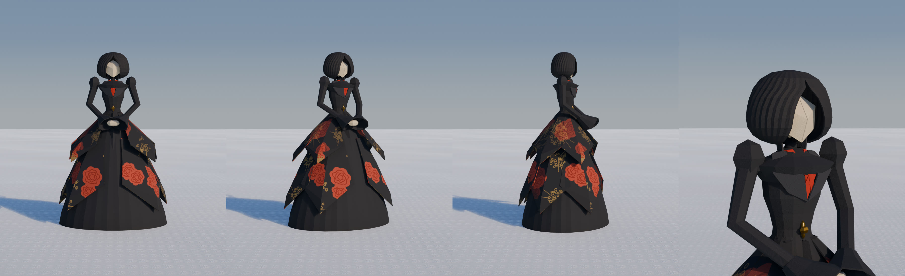
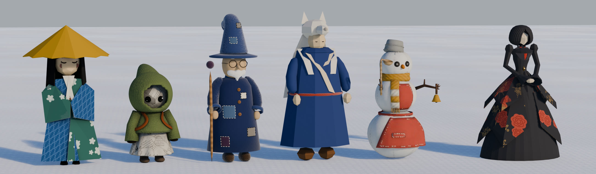

# 紙細工屋さんのラフ（2026-11-02）

代表の依頼「新キャラの紙細工屋さん作りたい。提灯とアクセサリ（鳥とかどんぐりとか）売ってくれる人。5案出して。」から。
売る物は、腰に提げる提灯と、頭・肩に載せる小物（鳥・どんぐりなど）。ミニオンは山師（山男）が育てて売る。

代表の Pinterest のボード「[&wind：Lodge キャラ](https://jp.pinterest.com/k_hhh_h/windlodge-%E3%82%AD%E3%83%A3%E3%83%A9/)」のうち、
まだ人形・売り子に使っていない人の作品から 5 つを取り、Lodge の紙の素材で描いた。代表は D（右から 2 つ目）の **黒い折り紙の婦人** を選んだ。
ゲームに入れた姿と売り場は [design/kamizaiku](../../../design/kamizaiku/README.md)。



上が正面、下が斜め前。絵の左から A〜E。

| 案 | 参考 | 取る | 取らない | 売り場 |
|---|---|---|---|---|
| A 笠の紙衣の行商 | 笠をかぶった折り紙の男 | 山谷に折ったクラフト紙の大きな笠、しわの残るクラフト紙の着物と幅広の袖、生成りの衿、朱の帯 | 刀 | 吊るし（背負子） |
| B 灯る裾の人 | 灯る紙の裾の踊り手 | 墨のとんがり笠、表が墨で裏が朱の紙の袖、裾を提灯の骨と和紙にして中から灯す | 踊りの姿勢、なびく髪 | 吊るし（柱 2 本に竿） |
| C 絵付けの円錐の人 | 絵付けした紙の円錐の人たち | 渦と色の帯を描いた紙の高い円錐、細い首と小さな頭、黄土の紙の髪の結い | 細すぎる体つき | 屋台 |
| D 黒い折り紙の婦人（選ばれた） | 着物とドレスを混ぜた黒い紙の婦人 | 下の「婦人の作り直し」 | — | 大きなアフタヌーンティーのスタンド |
| E 星のマントの子 | 新聞紙の王子 | もんだクラフト紙の尖った髪、クラフト紙の長い上着、紺に星のマント | 星の背景、狐 | 台（開いた紙の行李） |

ほかのキャラとの並び（左から 人形の笠・人形の新聞紙・おじいさん・山男・雪だるま、あけて A〜E。ゲームの大きさ）:



## 婦人の作り直し（代表の声）

1. 「おかっぱ頭は表現できてない」→ 参考の写真から寸法を測り、クレープ紙のおかっぱ（まんなかで分け、あごで最大、首へすっと締まる）と、まんなかを山に折った盾の顔に
2. 「シルエットが四角い…ウェストの締まりやシルエットのボリュームの分配が全然なっていない」→ 頭は小さく、袖山の立った細い袖とベルの袖口、胸から細い腰へ締まる上衣、墨地に金と朱の花の上がけを二段に、前は無地の尖った垂れ、裾は床で大きく広がる
3. 「少し頭身小さくできる？頭のサイズ縮小と、胴と腕を短く」→ 頭 0.8 倍、腰から上を縦に 0.8 倍（`shrink_upper`）
4. 「胸の襟の上になにか覆うようにあります…中の赤い着物が見えてほしい」→ 上衣の前を V にあけ、中に朱の着物と左前の打ち合わせ




## 売り場の案

- [05-counter.jpg](renders/05-counter.jpg): 左「座ってティーテーブル」、右「立ってティーワゴン」。代表「立ってるのも良いね」
- [06-tiers.jpg](renders/06-tiers.jpg): 代表「アフタヌーンティーみたいに何段にもなってるディスプレイ…バカでかくして」「ランタンの段とアクセサリの段で分けて」。
  下 2 段に提灯 10 種、上 3 段に小物 11 点を一つずつ（ゲームの glb をそのまま読んで並べた）

```bash
/Applications/Blender.app/Contents/MacOS/Blender -b -P person/ideas/kamizaiku/roughs.py -- --size 3000x1100 --views front,quarter
/Applications/Blender.app/Contents/MacOS/Blender -b -P person/ideas/kamizaiku/roughs.py -- --lineup --size 3400x950
/Applications/Blender.app/Contents/MacOS/Blender -b -P person/ideas/kamizaiku/roughs.py -- --close --size 900x1100
/Applications/Blender.app/Contents/MacOS/Blender -b -P person/ideas/kamizaiku/roughs.py -- --tiers --size 1300x1300
/Applications/Blender.app/Contents/MacOS/Blender -b -P person/ideas/kamizaiku/roughs.py -- --export game/props/paper_lady --what lady
/Applications/Blender.app/Contents/MacOS/Blender -b -P person/ideas/kamizaiku/roughs.py -- --export game/props/paper_lady --what stand
```

- 部品と紙の素材は `person/ideas/characters/roughs.py` の「形の道具」までを読んで使う（ファイルは書き換えない）。絵付け・花柄・星の紙はこの台本の中でコードで描く
- 並びの絵は、人形と雪だるまはゲームの glb を、おじいさんは `characters/v2/roughs_v2.py` の `build_tabi`、山男は `yamaotoko/roughs.py` の `build_wolf` を借りて組む
- ボードの画像はリポジトリに入れていない
