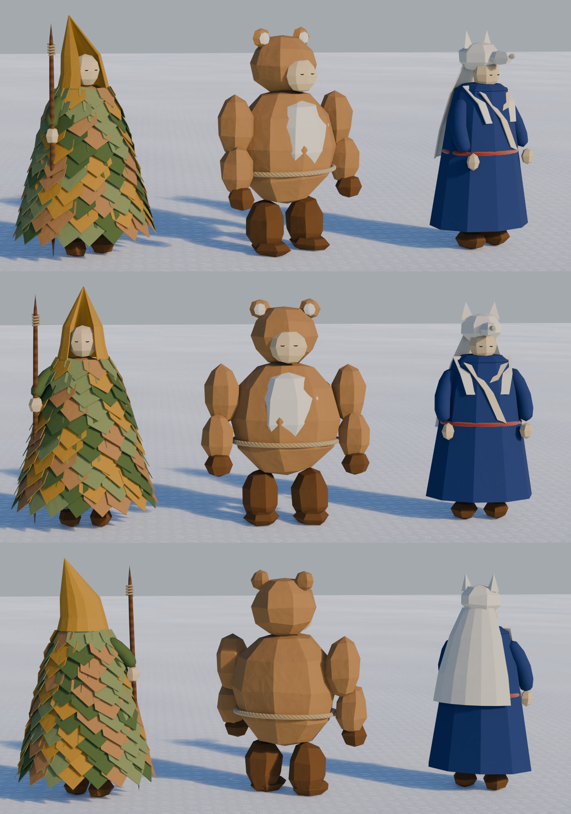

# 山の道具の売り子（山男・山師）のラフ（2026-11-01）

代表の Pinterest のボード「[&wind：Lodge キャラ](https://jp.pinterest.com/k_hhh_h/windlodge-%E3%82%AD%E3%83%A3%E3%83%A9/)」（いまは折り紙が中心）の意匠を取り、Lodge の素材で描いた 3 案。代表は右の **C 狼の毛皮の山男** を選んだ。ゲームに入れた姿と売り場は `design/mountain-man/`。



上から斜め前・正面・斜めうしろ。1 枚ずつは `renders/00-three-<向き>.jpg`。

| 案 | 参考 | 取る | 取らない |
|---|---|---|---|
| A 蓑の山師 | 紙の葉を重ねた剣士 | ちぎった紙の葉を 11 段重ねた蓑（色 4 つ）、折った紙のとんがり頭巾、木の杖、小さな多面体の顔 | 刀、舞う紙片 |
| B 熊の山男 | クラフト紙の熊、クラフト紙の兎 | 面の少ないクラフト紙の体と四肢、熊の頭を折った頭巾（丸い耳）の口元から人の顔、胸の白い紙、麻縄 | 四つ足の姿勢、熊の目と鼻 |
| C 狼の毛皮の山男 | 白い和紙の狼、折り紙の着物の人 | 藍の和紙の長い上着、クリームの紙の衿を左前に、赤い毛糸の帯、白い和紙の狼の頭巾と背中の毛皮、前足の毛皮 | 毛皮の狼の目、細い体つき |

```bash
/Applications/Blender.app/Contents/MacOS/Blender -b -P person/ideas/yamaotoko/roughs.py -- --size 2000x950 --samples 32 --views front,quarter,backq
```

- 部品と紙の素材は `person/ideas/characters/roughs.py` の「形の道具」までを読んで使う（ファイルは書き換えない）。和紙の色（藍・白・セージ・苔・黄土・灰）とクラフト紙の濃い色は、この台本で足す
- 描くのは Eevee。3 つの向きで 1 分ほど
- ボードの画像はリポジトリに入れていない
