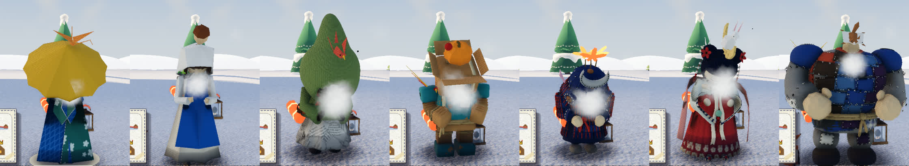
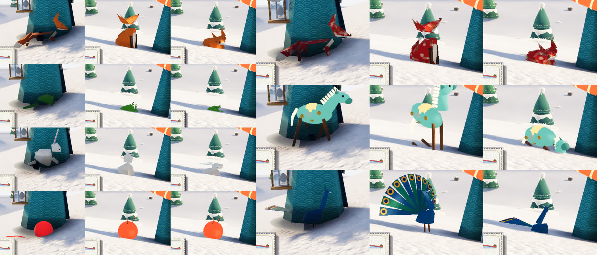
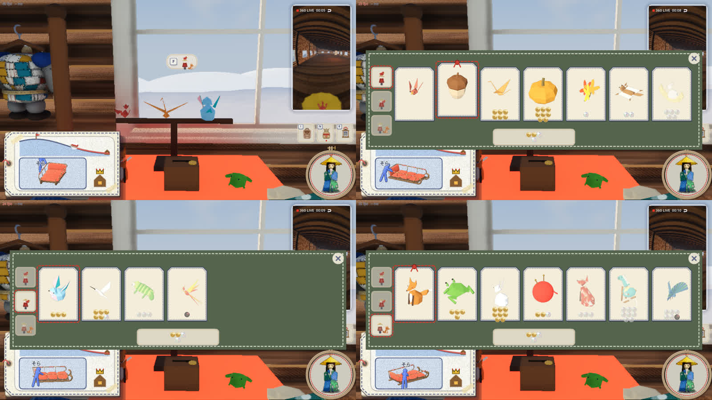
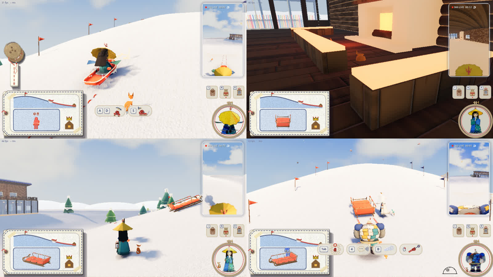

# 頭・肩の小物とミニオン（2026-11-01）

人形の頭や肩に載せる小物（perch）と、うしろをついて歩くミニオン（pet）。[アートコンセプト](../../design/art-concept.md)の「付属品は少なく。笠のような身につけるものは、集めて着替える側に回す」の、集める側の最初の品。

形はどれも、代表の参考ボード（&wind：Lodge キャラ）の折り紙・ペーパークラフト・フェルトの作品から取った。ボードにないのは毛糸玉だけで、Lodge の手芸の素材から足した。外の素材（質感の画像）は使っていない。素材は紙（`look.gd` の paper）・フェルト・毛糸で、千代紙の柄（青海波・七宝・桜・墨の筆の線）は `game/pals.gd` が描く。

## 代表が決めたこと

ラフ（[01](renders/01-perch.jpg)・[02](renders/02-pet.jpg)・[03](renders/03-dolls.jpg)・[04](renders/04-places.jpg)）を見て決めた。

| | 決めたこと |
|---|---|
| 一覧と値段 | ラフのまま（下の表） |
| ソリに乗ったとき | ミニオンはソリの横を走ってついて滑る。速いソリには遅れ、離れすぎると持ち主のうしろへ跳んで追いつく |
| ロッジの中 | ミニオンは暖炉の前（炉の長椅子の前の床）へ行って寝て待つ。持ち主が外へ出ると起きて、うしろから駆けてくる |
| 売る所・替える所 | 2 階の衣装掛けの横の、無人の売り台。そこで買ってすぐ付ける。おじいさんの番台はソリと布だけのまま |

## 一覧

値段は木のボタンの何個分。0 ははじめから持っている（いまの小鳥と子狐）。

### 頭・肩の小物

| | 名前（`pals.gd`） | 載せる所 | 値段 | 動き | ボードの絵 |
|---|---|---|---|---|---|
| A1 | 千代紙の小鳥 `chiyo_bird` | 頭 | 0 | 指した所・見ている先を向く、首をかしげる、羽をつくろう | 千代紙の鶴と狐 |
| A2 | 青い折り紙の小鳥 `blue_bird` | 肩 | 30 | 同じ | 青い小鳥 |
| A3 | 紙のどんぐり `acorn` | 頭 | 40 | 持ち主の動きに遅れて揺れる | どんぐり |
| A4 | 千代紙の折り鶴 `crane` | 頭 | 60 | 羽をゆっくり上下 | 千代紙の鶴 |
| A5 | 紙のかぼちゃ `pumpkin` | 頭 | 80 | 揺れる | かぼちゃ |
| A6 | 紅葉の葉 `maple` | 頭 | 100 | 揺れる | 紅葉の頭 |
| A7 | 白いハチドリ `hummingbird` | 肩 | 150 | 肩の上に浮いて、いつも羽ばたく | 白い鳥 |
| A8 | モモンガ `squirrel` | 頭 | 200 | しっぽを振る | モモンガ |
| A9 | カメレオン `chameleon` | 肩 | 300 | ゆっくり見回し、しっぽを巻き直す | カメレオン |
| A10 | 月と兎 `moon_rabbit` | 頭 | 500 | 月の上の兎が見回す | 月の兎 |
| A11 | 鳳凰 `phoenix` | 肩 | 1000 | 鳥と同じ | 鳳凰 |

### ミニオン

| | 名前 | 値段 | 歩き方 | ボードの絵 |
|---|---|---|---|---|
| B1 | 折り紙の子狐 `kit` | 0 | 四つ足 | 橙の折り紙の狐 |
| B2 | 跳ねるカエル `frog` | 40 | 跳ねる | 動く折り紙のカエル |
| B3 | 白い兎 `rabbit` | 80 | 跳ねる | 月の兎 |
| B4 | 毛糸玉 `yarn` | 120 | 転がる（ほどけた糸を引く） | （ボードにはない） |
| B5 | 千代紙の狐 `chiyo_fox` | 300 | 四つ足 | 千代紙の狐 |
| B6 | フェルトのポニー `pony` | 800 | 四つ足 | フェルトの馬 |
| B7 | 孔雀 `peacock` | 1500 | 二本足で首を振る（座ると羽を広げる） | 孔雀 |

## ゲームでの見え方



左から kasa・origami・news・robo・musha・ningyo・golem。載せる所は人形ごと（`pals.gd` の `HEAD`・`SHOULDER`）。頭は頭のいちばん上、肩は右の肩。kasa だけは肩が笠のつばの下に隠れるので、右のつばの上に止まる（頭の骨に付ける）。大きさはどの人形でも同じ。







- 一人称の画面には頭・肩の小物は映らない（あなたの体と同じ層）。三人称・HUD の自分の顔（刺繍の枠）・右上の 360° の映像には映る
- ミニオンは誰の画面にも映り、HUD の自分の顔にも映る
- 仲間（bot）も同じ仕組みで小物とミニオンを付ける。何を付けるかは工房の出来事なので、通信を入れたらほかの人の画面にも同じ物が出る

## 作りと動き

| ファイル | 中身 |
|---|---|
| `person/pets/build_pets.py` | Blender の台本。ラフを描く（`--sheet perch|pet|dolls`）か、glb に書き出す（`--export game/pals`） |
| `person/pets/lib.py` | 紙・フェルト・毛糸の素材と形の小道具（`person/ideas/costume/costume_rough.py` から写した） |
| `game/pals/` | `perch_<名前>.glb`・`pet_<名前>.glb`・素材の表 `mats.json` |
| `game/pals.gd` | 品書き（値段・載せる所・動き）、人形ごとの載せる所、素材の置き換え |
| `game/companions.gd` | 持ち主ごとの、頭・肩の小物とミニオンの動き |
| `game/pal_stall.gd`・`game/pals_ui.gd` | 衣装掛けの横の売り台と、買って付け替える画面 |
| `game/craft.gd` | 出来事 `pal_buy`・`pal_own`・`pal_wear`、持っている物 `pals_owned`・付けている物 `pals_wear` |
| `game/tools/pals_shots.gd` | 確かめの撮影（`--part=stall|dolls|pets|ride|hearth`） |

- ミニオンの glb は、姿ごとの節点（`walk`・`sit`・`sleep`）の下に部品（`body`・`head`・`tail`・`leg_*`）を持つ。節点の原点が回す支点。姿は 12 コマ／秒で置き換え、脚・首・しっぽもそのコマで刻む。居場所だけ毎フレームなめらか
- 止まってから 0.45 秒で座り、25 秒で寝る（暖炉の前では着いて 2 秒で寝る）
- 確かめの撮影は、始めに保存（`user://my_tag.cfg`）の写しを取り、終わりに戻す

```bash
/Applications/Godot.app/Contents/MacOS/Godot --path game --resolution 1280x720 -s res://tools/pals_shots.gd -- --part=dolls --doll=kasa --no-sound --dir=/tmp/pals
```

## まだのこと

- ミニオンはロッジの中をまっすぐ歩くので、家具を通り抜けたり、机の上を越えたりする（道を探す仕組みはない）
- 肩の小物は右の肩だけ。左の肩や、両方に載せる選び方はない
- 毛糸玉の毛糸の質感は、ゲームでは無地に近い
